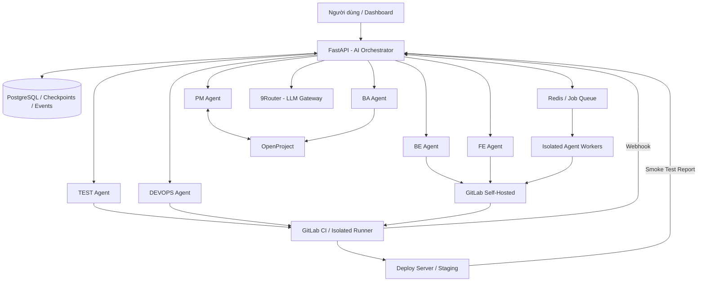
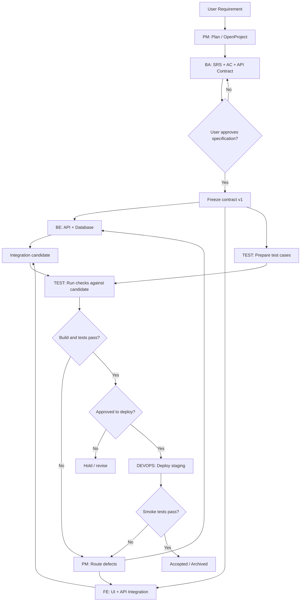
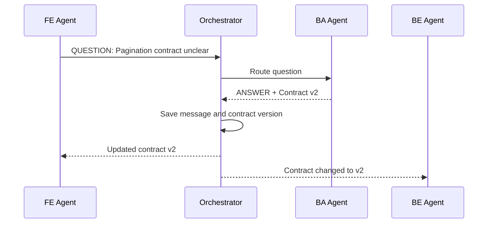
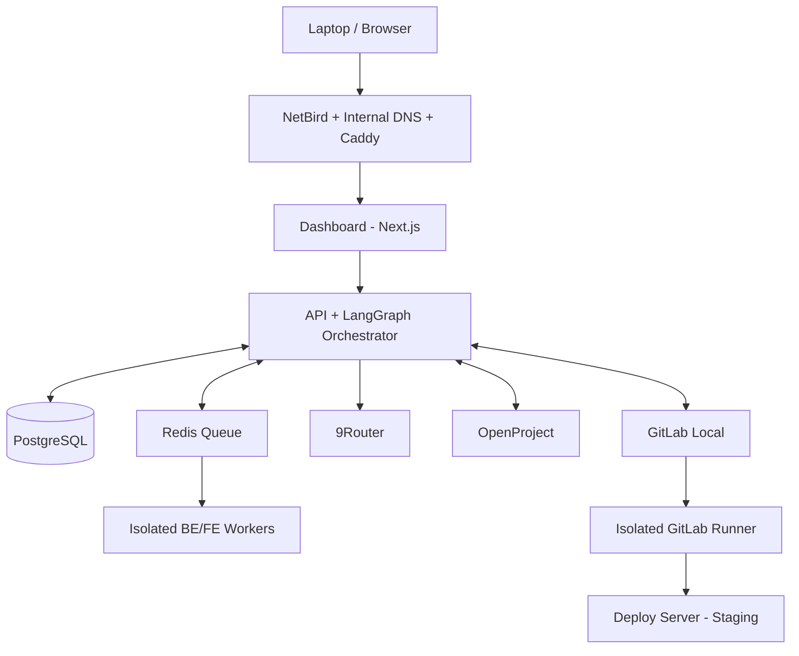

# THIẾT KẾ HỆ THỐNG AI SOFTWARE FACTORY – 6 AI AGENT

> **Đề tài:** Nghiên cứu và xây dựng hệ thống điều phối đa tác tử AI trong quy trình phát triển phần mềm  
> **Tên hệ thống:** AI Software Factory – Self-Hosted Multi-Agent Development Platform  
> **Phiên bản tài liệu:** 1.0 (đề xuất kiến trúc)  
> **Các vai trò:** PM · BA · BE · FE · TEST · DEVOPS  
> **Môi trường mục tiêu:** 9Router, OpenProject, GitLab Self-Hosted, Deploy Server, NetBird, Caddy, DNS nội bộ

---

## 1. Tổng quan và mục tiêu

### 1.1. Mục tiêu

Xây dựng nền tảng **Multi-Agent** mô phỏng nhóm phát triển phần mềm với sáu AI Agent độc lập về vai trò, quyền và đầu ra. Hệ thống phải có khả năng:

1. Tiếp nhận yêu cầu bằng ngôn ngữ tự nhiên.
2. Lập kế hoạch và tạo nhiệm vụ trong OpenProject.
3. Phân tích nghiệp vụ, tạo user stories, acceptance criteria và API contract.
4. Tự động phát triển backend và frontend, cho phép thực hiện song song.
5. Quản lý source code, branch, commit và merge request trong GitLab nội bộ.
6. Tạo/chạy kiểm thử, ghi nhận lỗi và điều phối vòng lặp sửa lỗi.
7. Triển khai ứng dụng lên **staging** sau khi được phê duyệt.
8. Giám sát Agent, lịch sử giao tiếp, sự kiện, chi phí và kết quả trên dashboard.

**Đầu ra của bài tập lớn gồm hai sản phẩm:**
- **AI Software Factory:** nền tảng điều phối và giám sát sáu Agent.
- **Module phần mềm thực tế:** một tính năng/module do các Agent cùng phát triển, kiểm thử và deploy (gợi ý: Mini Helpdesk hoặc module biệt lập của dự án hiện có).

### 1.2. Nguyên tắc thiết kế

- **Orchestrator-centric:** Agent trao đổi qua bộ điều phối và kho trạng thái chung; không trò chuyện tùy ý không kiểm soát.
- **Traceable:** mỗi hành động gắn `run_id`, `task_id`, phiên bản tài liệu và mã commit.
- **Human-in-the-loop:** người dùng duyệt đặc tả, thay đổi rủi ro cao, merge và deployment quan trọng.
- **Least privilege:** Agent chỉ sử dụng công cụ và tài nguyên đúng nhiệm vụ.
- **Reproducible:** kết quả build/test gắn commit SHA và lưu artifact.
- **Infrastructure reuse:** tận dụng 9Router, GitLab, OpenProject, server deploy; không dựng lại các chức năng sẵn có.
- **MVP first:** không triển khai sáu microservice Agent độc lập ngay từ đầu.

---

## 2. Kiến trúc tổng thể



### 2.1. Ba lớp kiến trúc

| Lớp | Thành phần | Chức năng |
|---|---|---|
| **Control Plane** | Dashboard, FastAPI, LangGraph, PostgreSQL, Queue | Điều phối, ghi sự kiện, quyền và phê duyệt |
| **Development Plane** | PM/BA/BE/FE/TEST, OpenProject, GitLab, isolated workers, CI runners | Quản lý nhiệm vụ, phát triển, review và kiểm thử |
| **Runtime Plane** | Deploy server, Docker staging, Caddy, NetBird, DNS | Vận hành và kiểm tra sản phẩm đã tạo |

**Lưu ý:** Sơ đồ là thiết kế đề xuất, chưa xác nhận các version, API endpoint, quyền truy cập hay tài nguyên thực tế trên hạ tầng.

### 2.2. Stack công nghệ

| Thành phần | Đề xuất | Ghi chú |
|---|---|---|
| Frontend điều phối | Next.js, TypeScript, Tailwind CSS | Dashboard và approval |
| Backend | Python + FastAPI | API, webhook, SSE |
| Multi-Agent framework | LangGraph | State graph, branching, checkpoint, human approval |
| Model gateway | 9Router | Model theo role; xác minh API/model/auth trước khi dùng |
| Task management | OpenProject API v3 | Work Package, trạng thái, phân công |
| Source control / CI | GitLab Self-Hosted | Repo, branch, MR, CI, artifact |
| Coding tool | Codex CLI hoặc coding worker tương đương | Chạy trong workspace cô lập |
| Job processing | Redis + RQ (MVP) | Worker xử lý công việc dài |
| Database | PostgreSQL | Dữ liệu ứng dụng và checkpoint |
| Testing | Pytest, Playwright, lint, static analysis | Bổ sung phù hợp tech stack module thực tế |
| Deployment | Docker / Docker Compose qua GitLab CI | Staging trước, production tùy chọn |
| Network & TLS | NetBird, Caddy, DNS nội bộ | Hạn chế phơi bày API ra Internet |

---

## 3. Thiết kế sáu AI Agent

| Agent | Nhiệm vụ | Đầu vào | Đầu ra |
|---|---|---|---|
| **PM** | Chia task, lập kế hoạch, xác định phụ thuộc, theo dõi blocker | Yêu cầu, trạng thái dự án | Sprint plan, Work Packages, phân công |
| **BA** | Phân tích nghiệp vụ, user story, luồng xử lý, tiêu chí nghiệm thu, API contract | Yêu cầu, kế hoạch PM | SRS rút gọn, AC, API/data contract |
| **BE** | Thiết kế database, API, logic nghiệp vụ, migration, backend tests | Task BE, BA contract, repo | Commit/MR backend, logs và kết quả build |
| **FE** | Thiết kế/triển khai UI, tích hợp API, trạng thái giao diện, responsive | Task FE, contract, repo | Commit/MR frontend, UI tests |
| **TEST** | Lập test case, chạy kiểm thử, ghi bug, xác nhận AC | AC, build/commit, deployment | Test report, bug report, pass/fail |
| **DEVOPS** | Tạo/sửa pipeline, đóng gói, cấu hình staging, deploy, smoke-test, rollback | CI result, artifact, phê duyệt | Deployment record, môi trường staging, logs |

### 3.1. Phân biệt trách nhiệm

- **PM** sở hữu kế hoạch, thứ tự ưu tiên và điều phối; **BA** sở hữu định nghĩa yêu cầu và tiêu chí nghiệm thu.
- **BE** và **FE** chỉ triển khai trên phạm vi file được phân quyền, có branch/worktree riêng.
- **TEST** đánh giá độc lập dựa trên AC và bằng chứng thực thi, không tự tuyên bố pass chỉ bằng lời của LLM.
- **DEVOPS** không được tự deploy production; deployment phải đáp ứng policy và approval.
- **Development Coordinator** là logic scheduler/phân công trong Orchestrator, **không phải Agent thứ bảy**.

### 3.2. Cấu trúc cấu hình mỗi Agent

```text
agents/
  pm/
    prompt.md
    agent.py
    schemas.py
    tools.py
    policies.yaml
  ba/
  be/
  fe/
  test/
  devops/
```

Mỗi Agent có `system_prompt`, danh sách tools được phép dùng, schema đầu vào/đầu ra, model profile, timeout, retry policy và các giới hạn quyền.

---

## 4. Quy trình phát triển và quan hệ phụ thuộc



### 4.1. Những phần chạy song song

- BA có thể chuẩn bị AC và API contract trong lúc PM tạo Work Packages.
- Sau khi contract được duyệt, BE và FE làm song song trên **hai workspace / branch riêng**.
- TEST soạn test cases và dữ liệu test ngay từ khi AC hoàn thành.
- DEVOPS chuẩn bị staging, pipeline và image build sớm; bước **deploy** phải chờ gate.

### 4.2. Quy tắc tích hợp mã nguồn

1. BE làm trên `feature/OP-123-be` và FE trên `feature/OP-123-fe`.
2. Mỗi Agent chỉ chỉnh sửa phần repo được cho phép; trường hợp cross-boundary phải yêu cầu điều phối.
3. Mỗi MR có task ID, AC, file thay đổi, kết quả lint/build/test và commit SHA.
4. Các MR được tích hợp vào nhánh đích theo policy (merge tuần tự hoặc integration branch), không cho hai Agent ghi trực tiếp cùng working tree.
5. TEST chạy trên **commit của ứng viên tích hợp**, không sử dụng kết quả CI của commit cũ.
6. Nếu BA sửa contract v1 → v2, Orchestrator đánh dấu các task phụ thuộc v1 là cần rà soát và cập nhật.

---

## 5. Giao tiếp Agent – giao thức và Shared State

### 5.1. Cách giao tiếp

**Hybrid Communication:** Các Agent có thể gửi yêu cầu đến nhau, nhưng mọi tin nhắn đi qua Orchestrator, được xác thực theo quyền, ghi vào PostgreSQL và chuyển tới đúng task.



### 5.2. Loại thông điệp

| Type | Ý nghĩa |
|---|---|
| `TASK_ASSIGNED` | Giao nhiệm vụ |
| `QUESTION` / `ANSWER` | Làm rõ yêu cầu hoặc vấn đề kỹ thuật |
| `CONTRACT_UPDATED` | Thay đổi đặc tả nghiệp vụ/API |
| `CODE_READY` | Branch/commit/MR đã sẵn sàng |
| `REVIEW_REQUESTED` | Yêu cầu kiểm tra code/candidate |
| `TEST_FAILED` | Kiểm thử thất bại |
| `FIX_REQUESTED` | Giao lỗi cần sửa |
| `TASK_COMPLETED` | Nhiệm vụ hoàn tất |
| `BLOCKED` | Cần con người can thiệp |
| `APPROVAL_REQUESTED` | Chờ người dùng chấp thuận |
| `DEPLOY_COMPLETED` / `DEPLOY_FAILED` | Kết quả triển khai |

### 5.3. Message schema mẫu

```json
{
  "message_id": "msg-00031",
  "run_id": "run-001",
  "task_id": "OP-123",
  "sender": "fe",
  "recipient": "ba",
  "type": "QUESTION",
  "priority": "normal",
  "payload": {
    "subject": "Ticket pagination",
    "question": "Use page/limit or cursor-based pagination?",
    "contract_version": 1
  },
  "requires_response": true,
  "correlation_id": "thread-015"
}
```

### 5.4. Shared State mẫu

```python
from typing import TypedDict, Any

class DevelopmentState(TypedDict, total=False):
    run_id: str
    project_id: str
    requirement: str
    plan_ref: str
    specification_ref: str
    spec_version: int
    contract_ref: str
    contract_version: int
    task_ids: list[str]
    branch_refs: dict[str, str]
    integration_commit_sha: str
    merge_request_ids: list[int]
    test_result_ref: str
    deployment_ref: str
    retry_count: int
    status: str
```

**Quy tắc:** state lưu tham chiếu tới code/spec/artifact; không nhúng toàn bộ repository, binary hoặc lịch sử chat vào prompt. Agent chỉ nhận ngữ cảnh đúng nhiệm vụ để giảm token và hạn chế nhiễu.

### 5.5. Event / webhook

- GitLab gửi webhook khi MR/pipeline thay đổi trạng thái.
- Backend xác thực webhook, ghi event và đưa công việc tiếp theo vào queue.
- Dùng `event_id`/`delivery_id` hoặc khóa idempotency để chống xử lý trùng.
- Kiểm tra `run_id`, `task_id`, `project_id`, branch và **commit SHA** trước khi tiếp tục workflow.
- Workflow dài được checkpoint; không giữ HTTP request mở trong toàn bộ quá trình coding/build/test.

---

## 6. Phân quyền và an toàn

### 6.1. Ma trận quyền (chính sách trong ứng dụng)

| Hành động | PM | BA | BE | FE | TEST | DEVOPS |
|---|:---:|:---:|:---:|:---:|:---:|:---:|
| Đọc OpenProject | ✓ | ✓ | ✓ | ✓ | ✓ | ✓ |
| Tạo/điều phối Work Package | ✓ | Giới hạn | – | – | Bug | Deploy status |
| Đọc GitLab repo | ✓ | ✓ | ✓ | ✓ | ✓ | ✓ |
| Sửa đặc tả | – | ✓ | Góp ý | Góp ý | Góp ý | – |
| Sửa backend | – | – | ✓ | – | – | – |
| Sửa frontend | – | – | – | ✓ | – | – |
| Sửa kiểm thử | – | – | Tests BE | Tests FE | ✓ | – |
| Sửa CI/deploy manifest | – | – | – | – | – | ✓ |
| Yêu cầu pipeline | Theo policy | – | ✓ | ✓ | ✓ | ✓ |
| Deploy staging | – | – | – | – | – | Có gate |
| Deploy production | – | – | – | – | – | **Cần duyệt thủ công** |

**Không** đưa token quản trị GitLab, OpenProject, SSH key production hoặc credentials của 9Router trực tiếp vào prompt của LLM.

### 6.2. Sandbox và triển khai

- Coding Agent thực thi trong **container/VM cô lập**, không mount Docker socket host và không chạy privileged nếu không thực sự cần.
- Giới hạn CPU/RAM, timeout, filesystem, network egress và thư mục được ghi.
- GitLab Runner cho CI chạy tách khỏi máy chứa dịch vụ quan trọng.
- Dùng service account với quyền tối thiểu; credential lưu ở secret manager hoặc biến môi trường có kiểm soát.
- Protected branch, MR review, pipeline gate và manual approval cho hành động quan trọng.
- Deployment mặc định **staging**; production là bước mở rộng tùy chọn.
- Có kế hoạch rollback dựa vào image/tag hoặc commit đã được xác nhận ổn định.

---

## 7. Tích hợp hạ tầng nội bộ

| Hệ thống | Vai trò | Kiểu kết nối | Lưu ý triển khai |
|---|---|---|---|
| 9Router | Cổng gọi model AI | API tương thích model được gateway hỗ trợ | Kiểm tra endpoint, model, authentication và rate limit |
| OpenProject | Quản lý task/sprint | API v3; MCP có thể bổ sung sau | Xác nhận quyền service account, trạng thái và loại Work Package |
| GitLab Local | Git, MR, CI, artifacts | GitLab API, Git SSH/HTTPS, webhook | Xác thực webhook, protected branches, runner |
| Server deploy | Chạy dashboard, orchestration hoặc staging | Docker, GitLab CI, SSH/deploy agent hạn chế | Không cho Agent dùng SSH toàn quyền |
| NetBird | Kết nối các host | Overlay network | Phân đoạn/ACL theo dịch vụ |
| Caddy | Reverse proxy / TLS | HTTPS nội bộ | Kiểm tra trust CA, webhook, hostname |
| DNS nội bộ | Phân giải hostname | AdGuard DNS | Hostname phải truy cập được từ worker và CI |

### 7.1. Phân bố thành phần đề xuất



Có thể chạy Orchestrator và Dashboard cùng server deploy nếu tài nguyên đủ. **Không chạy mã do Agent tạo trực tiếp trên host đang chứa GitLab, OpenProject hoặc các dịch vụ HomeLab quan trọng.**

---

## 8. Thiết kế dữ liệu

### 8.1. Bảng chính

| Bảng | Dữ liệu chính |
|---|---|
| `projects` | Tên, GitLab project ID, OpenProject project ID, repo/môi trường |
| `runs` | Yêu cầu, người tạo, trạng thái, thời điểm bắt đầu/kết thúc |
| `agent_tasks` | Task, owner, dependencies, AC ref, trạng thái |
| `agent_executions` | Agent, model, attempt, thời gian, token/chi phí nếu có, kết quả |
| `agent_messages` | Sender, recipient, type, payload, correlation, timestamps |
| `artifacts` | SRS, contract, test report, URI/path, checksum/version |
| `approvals` | Loại phê duyệt, người duyệt, quyết định, timestamp |
| `integration_events` | Event nguồn GitLab/OpenProject, idempotency key, xử lý |
| `deployments` | Môi trường, image tag, SHA, trạng thái, rollback reference |

**Nguồn dữ liệu chính:** OpenProject quản lý công việc, GitLab quản lý code/CI, Orchestrator quản lý trạng thái và quyết định của Agent. Tránh đồng bộ trùng lặp toàn bộ task board ở ba nơi.

### 8.2. State machine

**Run:** `CREATED → PLANNING → ANALYZING → WAITING_APPROVAL → DEVELOPMENT → TESTING → WAITING_DEPLOY_APPROVAL → DEPLOYING → COMPLETED`.

Trạng thái ngoại lệ: `BLOCKED`, `FAILED`, `CANCELLED`.

**Task:** `BACKLOG → READY → IN_PROGRESS → IN_REVIEW → TESTING → DONE`.

Nếu có lỗi: `TESTING → CHANGES_REQUESTED → IN_PROGRESS`. Nếu retry tối đa vẫn thất bại: `BLOCKED`.

### 8.3. Các gate bắt buộc

1. **Specification Gate:** người dùng duyệt SRS/AC/API contract trước khi phát triển.
2. **Integration Gate:** MR, lint, build, unit/integration tests đạt yêu cầu.
3. **Deployment Gate:** có artifact gắn SHA đã qua kiểm thử và approval.
4. **Acceptance Gate:** smoke tests trên staging đạt; người dùng nghiệm thu.

---

## 9. API nội bộ của Orchestrator (đề xuất)

| Method | Endpoint | Mục đích |
|---|---|---|
| `POST` | `/api/projects` | Đăng ký project/repository |
| `POST` | `/api/runs` | Tạo phiên từ yêu cầu |
| `GET` | `/api/runs/{run_id}` | Lấy trạng thái phiên |
| `GET` | `/api/runs/{run_id}/tasks` | Lấy task và dependencies |
| `GET` | `/api/runs/{run_id}/messages` | Xem giao tiếp Agent |
| `GET` | `/api/runs/{run_id}/events` | Stream SSE tiến độ |
| `POST` | `/api/runs/{run_id}/approve` | Duyệt hoặc từ chối gate |
| `POST` | `/api/runs/{run_id}/retry` | Thử lại task/bước lỗi |
| `POST` | `/api/runs/{run_id}/cancel` | Hủy workflow |
| `GET` | `/api/runs/{run_id}/report` | Báo cáo thực thi |
| `POST` | `/api/integrations/gitlab/webhook` | Nhận webhook GitLab |

Yêu cầu API: authentication, RBAC, audit log, rate limit phù hợp và xác thực nguồn webhook.

---

## 10. Dashboard đề xuất

1. **Project Overview:** danh sách dự án, trạng thái run, task đang chạy.
2. **Agent Activity:** sáu card role, trạng thái, thời gian, model, số attempt.
3. **Task Board:** tiến độ nhiệm vụ lấy từ OpenProject kèm dependency.
4. **Communication Monitor:** timeline câu hỏi/trả lời, contract change, lỗi và phản hồi.
5. **GitLab / CI:** branch, MR, commit SHA, pipeline/job logs và test artifacts.
6. **Approvals:** duyệt đặc tả, tích hợp, staging/production theo policy.
7. **Run Report:** số task, thời gian, số lượt sửa, test pass rate, chi phí/usage nếu gateway cung cấp.

Gợi ý giao diện dùng **SSE** cho event feed; trạng thái lịch sử tải từ PostgreSQL để vẫn hiển thị sau refresh.

---

## 11. Cấu trúc repository hệ thống

```text
ai-software-factory/
├── apps/
│   ├── dashboard/             # Next.js
│   └── api/                   # FastAPI
├── orchestrator/
│   ├── graph.py
│   ├── state.py
│   ├── scheduler.py
│   ├── policies.py
│   └── checkpoints.py
├── agents/
│   ├── pm/
│   ├── ba/
│   ├── be/
│   ├── fe/
│   ├── test/
│   └── devops/
├── integrations/
│   ├── router9/
│   ├── openproject/
│   ├── gitlab/
│   └── deployment/
├── workers/
│   ├── coding/
│   ├── testing/
│   └── execution/
├── shared/
│   ├── schemas/
│   ├── messages/
│   ├── contracts/
│   └── permissions/
├── infrastructure/
│   ├── docker/
│   ├── gitlab-ci/
│   └── migrations/
├── tests/
└── README.md
```

---

## 12. Kế hoạch triển khai

| Giai đoạn | Hạng mục | Kết quả nghiệm thu |
|---|---|---|
| **1. Nền tảng** | API, LangGraph, PostgreSQL, Redis, tích hợp 9Router, schema message | Chạy workflow và ghi lịch sử sáu role qua task mẫu |
| **2. PM + BA** | Kết nối OpenProject, lập plan, tạo SRS/AC/contract, approval | Yêu cầu tự nhiên chuyển thành Work Packages và đặc tả duyệt được |
| **3. BE + FE** | Coding workers cô lập, GitLab branch/MR, phát triển song song | BE và FE tạo source code thật và MR độc lập |
| **4. TEST + DEVOPS** | GitLab CI, test reports, routing lỗi, deploy staging, smoke test | Vòng lặp phát triển → test → sửa → staging chạy thông suốt |
| **5. Dashboard + báo cáo** | Event feed, approvals, thống kê, thực nghiệm, video | Có chứng cứ về giao tiếp Agent và module hoạt động thật |

**MVP bắt buộc:** một project demo, sáu Agent, một quy trình có approval, một vòng lặp sửa lỗi, một môi trường staging và một dashboard theo dõi trạng thái. Không cần đa tenant, production auto-deploy hay đa project song song ở bản đầu.

---

## 13. Kịch bản demo bài tập lớn (8–10 phút)

| Phần | Thời lượng gợi ý | Nội dung |
|---|---:|---|
| 1. Tổng quan | 1 phút | Mở dashboard, giới thiệu hạ tầng và kiến trúc sáu Agent |
| 2. PM + BA | 1,5 phút | Nhập yêu cầu; OpenProject tạo Work Packages; BA tạo AC/contract và duyệt |
| 3. BE + FE | 2 phút | Hai Agent chạy song song; GitLab xuất branch/commit/MR |
| 4. TEST | 1,5 phút | Test fail thực tế, gửi bug về BE/FE; Agent sửa và CI chạy lại |
| 5. DEVOPS | 1 phút | Approval; deploy staging; smoke test |
| 6. Nghiệm thu | 1–3 phút | Chạy module, xem lịch sử Agent, số liệu, báo cáo, minh chứng |

Nên chuẩn bị **một run đã hoàn thành và lưu đủ bằng chứng** cùng **một thay đổi nhỏ demo trực tiếp** để hạn chế rủi ro thời gian chờ model trong buổi bảo vệ.

### Các kịch bản thực nghiệm

1. **New feature:** Thêm bộ lọc ticket theo trạng thái, độ ưu tiên.
2. **Bug fix:** Phát hiện và xử lý lỗi null/validation có thể tái hiện.
3. **Deployment:** Triển khai staging, smoke test và kiểm chứng chức năng.

Thu thập: tổng thời gian, số lượt gọi model, số token/chi phí (nếu có), task completion, tỷ lệ build/test pass, số lần retry, commit SHA, pipeline ID và deployment version. **Không tự đặt trước số liệu kết quả thực nghiệm.**

---

## 14. Rủi ro và biện pháp kiểm soát

| Rủi ro | Biện pháp |
|---|---|
| Agent làm sai yêu cầu | BA contract/AC có version; human approval |
| BE/FE xung đột file hoặc contract | Workspace riêng, quyền theo path, contract version và integration gate |
| Agent lặp vô hạn | `max_retries`, timeout, token/cost budget, BLOCKED |
| Kết quả CI không còn đúng | Bắt buộc commit SHA khớp candidate đang kiểm tra |
| Webhook trùng hoặc bị giả mạo | Xác thực webhook, idempotency, kiểm tra trạng thái qua GitLab API |
| Lộ credential | Secret riêng, service account tối thiểu, không đưa secret vào prompt/log |
| Code sinh ra nguy hiểm | Isolated sandbox, network restrictions, container không privileged |
| Deploy ảnh hưởng hệ thống nội bộ | Staging tách biệt, manual approval, rollback |
| 9Router/model gặp lỗi hoặc quota | Timeout, model fallback có kiểm soát và thông báo rõ lỗi |
| OpenProject/GitLab mất kết nối | Retry có backoff, lưu hàng đợi, đánh dấu DEGRADED/BLOCKED |

---

## 15. Những thông tin cần xác minh trước khi triển khai

- Phiên bản GitLab và GitLab Runner; executor đang dùng; quyền tạo MR và cấu hình pipeline.
- Phiên bản OpenProject, API v3, plugin/tính năng GitLab integration, role của service account.
- 9Router: URL nội bộ, endpoint tương thích, danh sách model, authentication và quota.
- Deploy server: CPU, RAM, OS, Docker/Compose, dung lượng, topology mạng.
- NetBird ACL, Caddy route/TLS, chứng chỉ CA được các worker tin cậy.
- Stack của module mẫu (Next.js/FastAPI hay mã nguồn khác), quy trình deploy staging.
- Phạm vi cần duyệt thủ công và yêu cầu lưu log/chi phí trong báo cáo.

---

## 16. Kết luận kiến trúc

**Thiết kế chốt:** Một **LangGraph Orchestrator** điều phối **sáu role PM, BA, BE, FE, TEST, DEVOPS** qua Shared State, Structured Messages và Event/Queue; **9Router** xử lý truy cập model; **OpenProject** quản lý task; **GitLab** quản lý code, MR và CI; **server deploy** chạy staging; **NetBird, Caddy, DNS** cung cấp kết nối nội bộ.

Giá trị chính của bài tập không phải số lượng AI, mà là **chứng minh được toàn bộ chuỗi yêu cầu → phân tích → phân công → phát triển song song → kiểm thử → sửa lỗi → triển khai → nghiệm thu**, với dữ liệu và bằng chứng có thể kiểm tra trong các dịch vụ thật.
