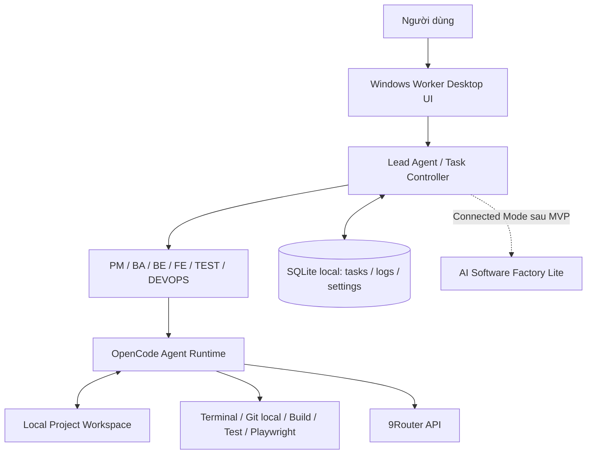
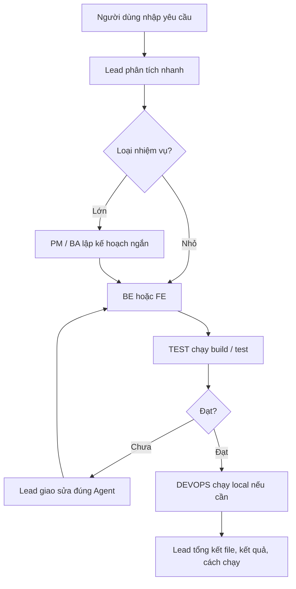

# AI Software Factory Lite + Windows AI Worker — Đặc tả MVP

**Phiên bản tài liệu:** 1.0  
**Mục tiêu:** triển khai phiên bản **đơn giản, dùng được ngay**, chạy trên máy Windows và tận dụng 9Router.  
**Phạm vi:** 1 Lead Agent + 6 Sub-Agent (PM, BA, BE, FE, TEST, DEVOPS); phát triển phần mềm trên **source code local**.  
**Định hướng:** giữ khả năng kết nối AI Software Factory Lite sau này nhưng **không xây hạ tầng phức tạp ngay từ đầu**.

---

## 1. Mục tiêu và nguyên tắc

Xây dựng một **Windows AI Worker** có giao diện để người dùng:

1. Chọn thư mục dự án trên máy cá nhân.
2. Kết nối tới **9Router** để sử dụng các model AI.
3. Chọn model cho Lead và từng Sub-Agent; bật/tắt Agent theo nhu cầu.
4. Gửi một yêu cầu phát triển phần mềm bằng tiếng Việt.
5. Để **Lead Agent** tự phân công công việc cho PM, BA, BE, FE, TEST, DEVOPS; chỉ gọi các Agent thực sự cần thiết.
6. Theo dõi nhiệm vụ, log, file thay đổi, kết quả chạy build/test.
7. Giữ toàn bộ mã nguồn và kết quả làm việc trên máy local.

**Nguyên tắc MVP:** ưu tiên hoàn thiện tính năng và tốc độ thực thi, không cố mô phỏng một doanh nghiệp với nhiều tầng quản lý.

### Không triển khai trong MVP

- Jira, OpenProject, GitLab Server, CI/CD remote, máy chủ deploy.
- LangGraph hoặc hệ thống orchestration riêng nếu OpenCode đã đủ đáp ứng việc giao việc cho subagent.
- Redis, RabbitMQ, PostgreSQL server, Kubernetes, microservice.
- Văn phòng 3D, nhân vật 3D/animation, voice, nhiều Worker phân tán.
- Dynamic Agent Registry, marketplace/plugin system, tự sinh Agent, tự cập nhật Skill phức tạp.
- Deploy production hoặc tự thực thi lệnh có tác động ngoài workspace mà không xin phép.

---

## 2. Kiến trúc tổng thể



**Quyết định chính:**

- **Worker** là nơi chạy Agent và thực thi code thật.
- **Lead** điều phối các Sub-Agent bên trong Worker.
- **OpenCode** là công cụ thực thi tác vụ AI/coding; không tự viết lại toàn bộ cơ chế đọc/ghi file và chạy terminal nếu không cần.
- **9Router** chỉ là AI Gateway, không phải hệ thống điều phối Agent.
- **Factory Lite** (nếu còn dùng) làm bảng quản lý và gửi nhiệm vụ, không chỉ đạo từng lượt gọi model. MVP phải chạy được **không cần Factory**.

> Các Agent là vai trò logic (prompt + model + tool policy + nhiệm vụ), **không phải 7 server hay 7 mô hình chạy liên tục**. Model cloud được gọi qua 9Router; mã nguồn và công cụ phát triển chạy local.

---

## 3. Thành phần phần mềm MVP

| Thành phần | Đề xuất | Trách nhiệm |
|---|---|---|
| Windows Desktop App | Electron + React + TypeScript | Chọn project, nhập task, cấu hình Agent/model, xem kết quả |
| Local Controller | Node.js/TypeScript (trong backend của Electron) | Quản lý phiên, giao việc, trạng thái, log và OpenCode process |
| Agent Runtime | OpenCode CLI hoặc headless adapter | Chạy Lead/subagent và các tool trên source code |
| AI Gateway | 9Router hiện có | Cấp model qua endpoint API tương thích mà runtime hỗ trợ |
| Local Database | SQLite (1 file) | Lưu projects, runs, agent settings, task history |
| Source Control | Git local | Checkpoint và xem diff; **không cần Git server** |
| Development Tools | Node/Python/toolchain của dự án; Playwright nếu cần | Build, test, chạy dev server |

Nếu giao diện desktop đang làm dở bằng framework khác, **ưu tiên tái sử dụng** thay vì viết lại chỉ vì bảng trên.

### Bố trí trên máy Windows

```text
Windows PC
├─ AI Worker Desktop App
│  ├─ Local Controller
│  ├─ Lead + 6 role definitions
│  ├─ Agent/Model settings
│  └─ SQLite + task/event log
├─ OpenCode Runtime
├─ Project Workspace (ví dụ D:\Projects\my-app)
└─ Git, Node/Python, browser test tools
          │
          └── HTTPS/LAN/NetBird → 9Router → LLM providers
```

**Không cần GPU** để chạy các model cloud qua 9Router. RAM/CPU vẫn cần đủ cho build, trình duyệt và test local.

---

## 4. Vai trò và trách nhiệm

| Agent | Khi nào kích hoạt | Đầu ra mong đợi |
|---|---|---|
| **Lead** | Mọi yêu cầu | Chọn Agent, giao task, nghiệm thu, tóm tắt kết quả |
| **PM** | Yêu cầu lớn, nhiều bước | Danh sách công việc + thứ tự phụ thuộc ngắn gọn |
| **BA** | Nghiệp vụ chưa rõ, có API/luồng dữ liệu | Acceptance criteria, mô tả chức năng và API contract tối thiểu |
| **BE** | Có backend / database / API | Code backend, migration nếu cần, test liên quan |
| **FE** | Có giao diện / tương tác người dùng | Code UI, kết nối API, responsive |
| **TEST** | Có thay đổi đáng kiểm thử | Chạy test/build, ghi lỗi tái hiện được, xác minh sửa lỗi |
| **DEVOPS** | Cần môi trường local, package, Docker, dev server | Lệnh chạy, sửa cấu hình, xác nhận ứng dụng khởi động |

### Quy tắc Lead

1. **Không gọi đủ 6 Agent cho mọi task.** Ví dụ sửa CSS nhỏ: FE → TEST.
2. Mỗi nhiệm vụ phải có **mục tiêu, phạm vi file, điều kiện hoàn thành**.
3. Chỉ chạy song song các phần **không xung đột file**. Bắt đầu MVP theo kiểu tuần tự; sau ổn định mới bật 2 task song song.
4. Ưu tiên chạy code/build/test thực tế thay vì chỉ tin vào câu trả lời của Agent.
5. Khi lỗi, gửi log và task trở về đúng Agent; giới hạn **2 vòng tự sửa** trước khi báo người dùng.
6. Không công bố hoàn thành khi chưa có bằng chứng về kết quả (lệnh build/test, kiểm tra UI hoặc xác minh thủ công).
7. Giữ log **tóm tắt hành động và kết quả**, không yêu cầu lưu/suy diễn chain-of-thought nội bộ của model.

---

## 5. Workflow cơ bản



### Ví dụ sử dụng

**Yêu cầu:** “Thêm đăng nhập cơ bản cho ứng dụng Next.js hiện có.”

1. Lead xem nhanh cấu trúc repo và giao BA xác định tiêu chí nghiệm thu nếu cần.
2. BE xây API/xử lý phiên đăng nhập nếu ứng dụng cần backend.
3. FE xây form và trạng thái đăng nhập.
4. TEST chạy lint, test, build và kiểm tra luồng chính.
5. DEVOPS chỉ tham gia nếu cần sửa môi trường hoặc chạy app.
6. Lead tóm tắt: file thay đổi, kết quả kiểm thử, chức năng chạy được, phần còn thiếu.

**Fast Mode:** nhiệm vụ đơn giản có thể bỏ qua PM, BA, DEVOPS; nhiệm vụ lớn dùng đủ vai trò khi cần.

---

## 6. Giao tiếp và dữ liệu giữa các Agent

MVP **không cần message broker**. Controller quản lý nhiệm vụ, kết quả và trạng thái qua dữ liệu có cấu trúc.

Ví dụ một task nội bộ:

```json
{
  "task_id": "task-001",
  "run_id": "run-001",
  "agent": "fe",
  "title": "Tạo form đăng nhập",
  "instructions": "Theo acceptance criteria đã duyệt",
  "allowed_paths": ["frontend/"],
  "acceptance": ["Có validate", "Hiển thị lỗi", "Build pass"],
  "status": "queued"
}
```

Các trạng thái cơ bản: `queued`, `running`, `blocked`, `failed`, `completed`, `cancelled`.

Mỗi lượt chạy tạo event tối thiểu:

- `TASK_STARTED`
- `AGENT_SELECTED`
- `TOOL_EXECUTED`
- `FILES_CHANGED`
- `TEST_PASSED` / `TEST_FAILED`
- `TASK_COMPLETED` / `TASK_FAILED`

**Chú ý:** chỉ lưu tóm tắt đủ quan sát; che API key, token, thông tin đăng nhập và giá trị nhạy cảm trong log.

---

## 7. Cấu hình model qua 9Router

Giao diện cấu hình cần có:

1. **Gateway URL** (ví dụ `http://<ip-lan>:<port>/v1` hoặc HTTPS qua NetBird/Caddy).
2. **API key**: lưu bằng Windows Credential Manager hoặc cơ chế lưu bí mật của hệ điều hành; không đưa vào SQLite/log/source code.
3. **Test Connection**: kiểm tra endpoint và xác thực.
4. **Fetch Models**: lấy danh sách model nếu 9Router cung cấp endpoint tương thích.
5. **Model selector từng Agent** và cài đặt mặc định.

Ví dụ **cấu hình logic của ứng dụng** (không phải cú pháp cấu hình bắt buộc của OpenCode):

```yaml
provider:
  type: openai-compatible
  base_url: ${ROUTER9_BASE_URL}
  api_key_env: ROUTER9_API_KEY

agents:
  lead:   { model: lead-model, enabled: true }
  pm:     { model: fast-model, enabled: true }
  ba:     { model: reasoning-model, enabled: true }
  be:     { model: coding-model, enabled: true }
  fe:     { model: coding-model, enabled: true }
  test:   { model: fast-model, enabled: true }
  devops: { model: fast-model, enabled: true }

execution:
  max_parallel_tasks: 1
  max_fix_rounds: 2
```

`lead-model`, `coding-model`, `fast-model` là **alias minh họa**; người dùng phải ánh xạ sang model ID có thật từ 9Router. Kiểm tra phiên bản và schema OpenCode đang cài trước khi sinh file config runtime; không sao chép cú pháp của bản khác một cách máy móc.

### Gợi ý preset

- **Fast:** model nhanh cho hầu hết nhiệm vụ; model coding mạnh chỉ cho BE/FE.
- **Balanced:** Lead dùng reasoning tốt hơn, BE/FE dùng coding model mạnh.
- **Quality:** Lead/BA/TEST nâng chất lượng, chấp nhận nhiều lượt gọi và chi phí hơn.

Preset chỉ là cách chọn model, **không đảm bảo tăng tốc nếu gateway bị giới hạn request**.

---

## 8. Agent prompt, Rules và Skills

Trong MVP, giữ **7 role cố định**, mỗi role dùng một file Markdown và một số skill cần thiết. Không xây Agent Marketplace/Registry.

Cấu trúc gợi ý:

```text
ai-worker/
├── apps/desktop/             # Electron + React
├── src/controller/           # Task controller, OpenCode adapter, events
├── src/storage/              # SQLite and repositories
├── src/integrations/9router/ # Gateway check / models
├── agent-profiles/
│   ├── lead.md
│   ├── pm.md
│   ├── ba.md
│   ├── be.md
│   ├── fe.md
│   ├── test.md
│   └── devops.md
├── skills/
│   ├── implement-feature/SKILL.md
│   ├── fix-bug/SKILL.md
│   ├── testing/SKILL.md
│   └── local-dev/SKILL.md
├── tests/
└── README.md
```

### Quy tắc chung

- Đọc cấu trúc dự án trước khi sửa code.
- Không làm thay đổi ngoài yêu cầu; không chỉnh file ngoài workspace được chọn.
- Không ghi credential vào repo, prompt hay log.
- Không xóa hàng loạt file, không sửa cấu hình hệ thống Windows, không chạy lệnh phá hủy nếu chưa có xác nhận.
- Ưu tiên tiêu chuẩn có sẵn trong repo; tránh tự thêm framework/dependency không cần thiết.
- Khi thay đổi code: ghi rõ file, lý do, cách test và kết quả.

**Nguồn skill tham khảo (tùy chọn):** [ECC](https://github.com/affaan-m/ECC), [Anthropic Skills](https://github.com/anthropics/skills), [Vercel Skills CLI](https://github.com/vercel-labs/skills). Chỉ nhập những skill đã kiểm tra nội dung và quyền công cụ.

---

## 9. Giao diện Windows MVP (2D)

Chỉ cần **5 khu vực** trên một màn hình hoặc một số tab:

1. **Project:** chọn thư mục, xem tên project và Git status.
2. **Task:** ô nhập yêu cầu, nút Run / Stop.
3. **Team:** Lead + 6 Agent, bật/tắt, chọn model từng Agent.
4. **Activity:** trạng thái Agent, task hiện tại, sự kiện và log.
5. **Result:** file đã sửa, Git diff, kết quả test/build và hướng dẫn chạy app.

Các thao tác tối thiểu: chạy task, dừng task, xem lỗi, thử lại task, mở thư mục dự án, xem diff. Chưa cần chat giữa các nhân vật hoặc hoạt hình văn phòng 3D.

---

## 10. Chế độ chạy: Standalone trước, Connected sau

### 10.1 Standalone Mode — bắt buộc trong MVP

- Worker chạy độc lập khi AI Software Factory Lite không mở.
- Người dùng chọn project local và nhập task trực tiếp trên Worker.
- Agent, log, trạng thái và cấu hình được lưu local.
- Không cần Jira, OpenProject, GitLab, backend tập trung hay kết nối ngoài 9Router.

### 10.2 Connected Mode — giai đoạn kế tiếp, không chặn MVP

Khi cần tích hợp lại AI Software Factory Lite:

- Factory gửi **yêu cầu cấp cao** cho Worker.
- Worker thực hiện phân công Agent và xử lý toàn bộ công việc.
- Worker gửi sự kiện tóm tắt và kết quả về Factory.
- Factory **không** quản lý trực tiếp từng lần gọi LLM hoặc điều khiển terminal của Worker.

Có thể dự trù adapter với bốn hành động: `register`, `next-task`, `report-event`, `complete-task`. **Chưa cần triển khai API này trong bản Standalone.**

---

## 11. Triển khai từng bước

### Bước 1 — Worker chạy được 1 Agent

- Dựng Electron + React và Local Controller.
- Chọn project folder (có whitelist phạm vi truy cập).
- Kết nối 9Router, thử model thật.
- Gọi OpenCode runtime để chỉnh một file trong repo test.
- Thu log/exit status; hiển thị file thay đổi.

**Đạt:** có thể nhập lệnh và tạo thay đổi mã nguồn thật trên máy cá nhân.

### Bước 2 — Lead + 6 Agent

- Tạo file profile cho từng Agent.
- Cho phép chọn model, bật/tắt Agent.
- Lead phân công theo loại công việc; tuần tự trước.
- Bổ sung chạy lint/test và vòng lặp sửa lỗi tối đa hai lần.

**Đạt:** một yêu cầu có thể đi qua nhiều role và tạo kết quả chạy được.

### Bước 3 — Hoàn thiện app local

- Lưu lịch sử task/session trong SQLite.
- Giao diện xem Agent, activity, diff và kết quả.
- Quản lý hủy tiến trình, timeout và lỗi khi mất 9Router.
- Đóng gói Windows `.exe`; cấu hình có thể giữ khi cập nhật.

**Đạt:** app dùng hằng ngày ở Standalone Mode không cần Terminal thủ công.

### Bước 4 — Kết nối Factory Lite (tùy chọn)

- Thêm Connector nhận task và gửi sự kiện.
- Đồng bộ trạng thái có `task_id`, tránh xử lý trùng nhiệm vụ.
- Mất kết nối Factory không làm hỏng task đang chạy local.

**Đạt:** dùng độc lập hoặc nhận việc từ Factory qua một adapter đơn giản.

---

## 12. An toàn vận hành tối thiểu

Do AI có thể tự viết code và chạy lệnh, **chế độ dev không đồng nghĩa được phép thao tác vô hạn trên Windows**.

- Chỉ cho sửa file trong **thư mục dự án đã chọn**; bảo vệ đường dẫn ngoài workspace.
- Ưu tiên chạy shell/build/test bằng tài khoản không có quyền Administrator; hạn chế truy cập thư mục nhạy cảm.
- Với repo không tin cậy, chạy test/lệnh trong môi trường cô lập (Docker hoặc WSL/sandbox phù hợp), không tin rằng prompt đủ để giới hạn lệnh.
- Không cho Agent tự chạy lệnh xóa dữ liệu, cài software toàn hệ thống hoặc truy cập credential mà không xác nhận.
- Có nút Stop/Cancel để dừng tiến trình con; ghi log thao tác.
- Git checkpoint trước thay đổi lớn; có thể xem và hoàn nguyên diff.
- API key 9Router lưu bằng Windows secure storage; không đưa vào source hoặc SQLite plaintext.

---

## 13. Tiêu chí nghiệm thu MVP

- [ ] App Windows mở được và cho chọn project local.
- [ ] Kết nối 9Router thành công với model thật.
- [ ] Chọn được model riêng cho Lead và 6 Agent; bật/tắt được từng Agent.
- [ ] Lead tự giao một task đơn giản cho BE hoặc FE.
- [ ] BE/FE thực sự tạo hoặc sửa file trong project.
- [ ] TEST chạy ít nhất một lệnh lint/test/build và lưu kết quả.
- [ ] Lead xử lý phản hồi lỗi (ít nhất một vòng sửa nếu lỗi xảy ra).
- [ ] Xem được Agent nào chạy, trạng thái, log và file đã thay đổi.
- [ ] Có Stop và có thể mở lại lịch sử phiên đã chạy.
- [ ] Standalone Mode hoạt động dù không có Factory Lite.
- [ ] Một dự án mẫu được chạy local và chứng minh chức năng hoạt động.

### Kịch bản demo ngắn

1. Mở Worker, chọn repo mẫu, chọn model BE/FE/TEST.
2. Nhập “Thêm chức năng lọc danh sách theo trạng thái”.
3. Lead giao FE/BE tùy phạm vi, Agent sửa file.
4. TEST chạy build hoặc test và trả kết quả.
5. Mở ứng dụng local, sử dụng bộ lọc mới.
6. Mở tab Result để xem Git diff và log Agent.

---

## 14. Chỉ sau MVP mới xem xét

- Giao diện **văn phòng 3D** với các nhân vật Agent và animation.
- Dynamic Agent Registry, thêm phòng ban Research/Marketing/Data.
- Chạy song song nhiều Agent với Git worktree và cơ chế hợp nhất code.
- Nhiều Worker Windows, scheduling phân tán.
- Kết nối đầy đủ Factory Lite, nhiều dự án, đồng bộ sự kiện nâng cao.
- Skills marketplace, tự sinh skill, memory dài hạn, voice.

**Các mục này không phải điều kiện nghiệm thu của bản đầu.** Thiết kế module tách biệt vừa đủ để có thể bổ sung, nhưng không triển khai trước khi core ổn định.

---

## 15. Prompt giao cho Coding Agent bắt đầu triển khai

> Hãy xây dựng MVP **AI Software Factory Lite – Windows AI Worker** đúng tài liệu này. Chỉ làm **Standalone Mode** trước, ưu tiên app chạy được trên Windows. Dùng Electron + React + TypeScript cho UI/controller, OpenCode làm agent runtime, 9Router làm model gateway. Tạo 1 Lead và 6 role cố định PM/BA/BE/FE/TEST/DEVOPS; có chọn model và bật/tắt Agent; cho phép chọn thư mục project local, nhập task, chạy Agent, hiển thị log, Git diff và kết quả test. Không thêm Jira/OpenProject/GitLab Server, Redis, microservice, 3D, dynamic registry hoặc distributed workers. Trước khi code hãy kiểm tra phiên bản OpenCode và cách gọi CLI/SDK chính xác trên môi trường hiện tại; không tự giả định schema. Luôn giữ quyền thực thi trong phạm vi workspace đã chọn, yêu cầu xác nhận với hành động nguy hiểm. Triển khai theo bước nhỏ, chạy kiểm thử sau mỗi bước, và báo cáo những gì đã chạy được/thực sự xác minh.

---

**Chốt phương án:** *1 Windows app + 1 Lead + 6 Sub-Agent + 9Router + OpenCode + local source + local Git/test*. Có thể nối Factory Lite sau; chưa xây 3D hoặc nền tảng Agent đa mục đích ở MVP.
