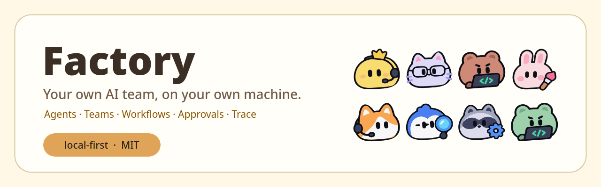
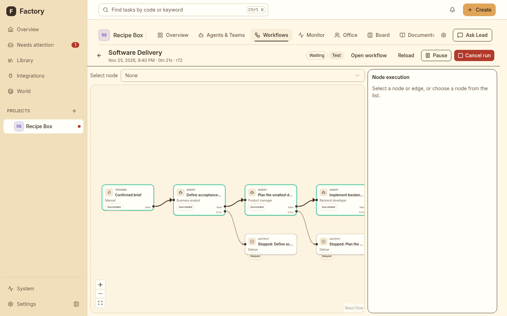
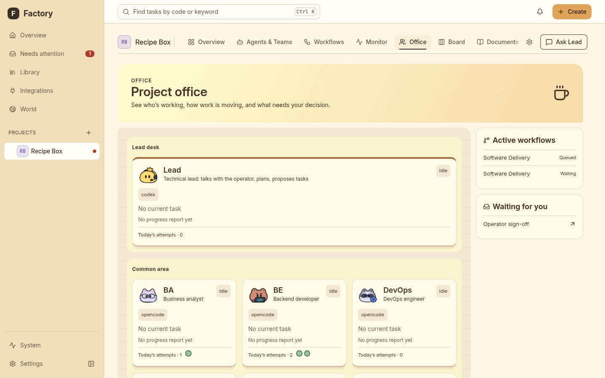
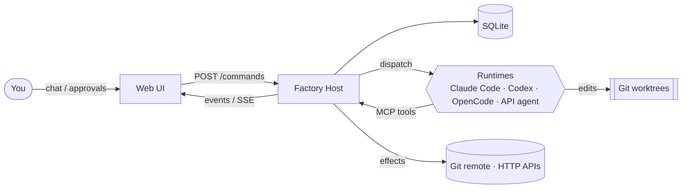

<p align="center">
  
</p>

<p align="center">
  <b>English</b> · <a href="README.vi.md">Tiếng Việt</a>
</p>

**Factory** is a local-first platform for running a team of AI agents on your own computer. You describe the work in a chat
with a **Lead** agent. When you agree on a plan, the Lead writes a short brief and starts a **workflow**. Agents work in
their own Git worktrees, review each other, and stop for **your approval** wherever a human should decide. Everything they
do is traceable, from your first message to the last file they changed.

Agents, teams, skills, tools, integrations and workflows are all data: you create and change them in the web UI, per
project. Nothing about your team is hard-coded.

<p align="center">
  
  
</p>

## What you get

- **Agents and teams as data.** Each project has its own agents (role, instructions, model, runtime, skills, tools, budget),
  teams and an org graph (`manages`, `reviews`, `collaborates`, `approves`). Start empty, from a team template, or let the
  Lead propose a setup from a plain-language description.
- **A real workflow engine.** A visual canvas (Trigger, Agent, Condition, Loop, Approval, Orchestrate, Sub-workflow, Wait,
  Action, Output) backed by a stateful engine: drafts and versions, pause / resume / retry / cancel, timeouts, recovery after
  a crash without duplicate work, and zero-token test runs with mock agents.
- **Talk first, then act.** Discuss freely with the Lead. When you confirm in your own words ("ok, go with option 2"), the
  Lead summarises the whole conversation into a versioned **brief** and starts the right workflow. A deterministic guard
  checks that you really said it. Prefer buttons? Switch the project to *classic* mode.
- **Bring your own runtimes.** Agents run on Claude Code, Codex CLI, OpenCode (in a bubblewrap sandbox) or directly on any
  OpenAI-compatible model API. Agents reach the Host through MCP and never see your API keys.
- **Approvals and policies.** Tool permissions per agent (`allow` / `ask` / `deny`), budgets, autonomy levels and circuit
  breakers. External side effects (pushing a branch, calling an HTTP API, publishing a bundle) go through one effect executor
  and are never retried blindly: an unclear outcome waits for you to reconcile it.
- **See everything.** Live monitor, end-to-end trace (request → run → node → task → attempt → tool call → artifact), cost
  per node and agent (unknown cost is shown as unknown, never as 0), and run insights that suggest improvements as a new
  **draft** — never published without you.
- **Organise like GitLab.** Nested groups (up to 5 levels) with inherited defaults, shared library and shared budgets.
- **Extensions.** Optional packs of teams, skills and workflows. `extensions/portal` turns Factory into a small web-game
  studio that builds turn-based browser games and publishes them to a game portal.

## How it works



- One process, one SQLite database, loopback only (`127.0.0.1`) unless you open it to your LAN on purpose.
- Every change goes through `POST /commands`: idempotent, revision-checked, one transaction per command with its events.
- **The model proposes; deterministic code checks and writes.** Plans, setups and improvements from an LLM are validated
  against schemas and policies before anything is stored.

More in [docs/architecture.md](docs/architecture.md).

## Quick start

Requirements: Linux x64 (or WSL2), `git`, and optionally an OpenAI-compatible model provider (OpenAI, OpenRouter, Ollama,
LM Studio, a local gateway…) and/or the Claude Code or Codex CLI.

```bash
git clone https://github.com/daubong240705-art/AI-SOFTWARE-FACTORY-6-AI-AGENT.git factory
cd factory
bash scripts/install.sh --yes        # installs a pinned Node 22, builds, installs the `factory` command
export PATH="$HOME/.local/bin:$PATH"

factory setup                        # model provider, API key, models, port, agent CLIs
factory doctor                       # checks every prerequisite and tells you how to fix it
factory start                        # then open http://127.0.0.1:8787/
```

Then: create a project (empty or from a team template) → open **Agent & Team** → chat with the Lead → confirm the plan.
The full guide, including providers, LAN access and troubleshooting by `doctor` code, is in
[docs/setup/README.md](docs/setup/README.md).

## Concepts

| Term | Meaning |
|---|---|
| **Project** | A Git repository plus its agents, teams, workflows, tasks and knowledge. Projects live in **groups**. |
| **Agent** | A configured worker: role, instructions, runtime + model, skills, tools, budget. Versioned; can be paused or archived. |
| **Team / relations** | Groups of agents and the org graph used to pick reviewers, approvers and managers. |
| **Library** | Versioned skills and agent templates, global or per group. Team templates come from **packs**. |
| **Workflow** | A versioned node graph. Edit the **draft**, **publish** a version, **run** it (or test-run it with mock agents). |
| **Task / attempt** | A unit of agent work and one try at it, in its own worktree. |
| **Approval** | A decision only a human can make. Shows up in *Needs attention*. |
| **Brief** | The agreed plan the Lead writes from your conversation; the input of the workflow it starts. |
| **Integration** | An MCP server or HTTP API, with credentials encrypted at rest and per-agent tool permissions. |

## Repository layout

| Path | What |
|---|---|
| `apps/factory-host` | The Host: Fastify API, command pipeline, workflow engine, dispatch, runtimes, MCP endpoint (Node 22, TypeScript, SQLite) |
| `apps/factory-ui` | The web UI (React 19, Vite, Tailwind 4, shadcn/ui, React Flow) |
| `packages/factory-contracts` | Shared zod contracts: commands, events, entities |
| `packs/` | Team templates: software, research, architecture, design (+ `_template` to write your own) |
| `extensions/` | Optional packs, e.g. `portal` (web-game studio) |
| `scripts/` | Installer, `factory` CLI wrapper, service files |
| `docs/` | Architecture, setup guide, UI glossary |

## Development

```bash
# Node >= 22.20 (the installer's pinned Node works: ~/.factory/node/bin)
(cd packages/factory-contracts && npm ci && npm run build && npm test)
(cd apps/factory-host && npm ci && npm run check && npm run build && npm test)
(cd apps/factory-ui && npm ci && npm run check && npm run build)
(cd apps/factory-ui && npm run dev)              # Vite on 127.0.0.1:5173, API proxied to the Host
node apps/factory-ui/e2e/audit/run.mjs           # UI audit: every screen, both themes, CRUD flows (needs Chrome)
```

There is no root workspace: build the contracts first, then the Host and the UI. See [CLAUDE.md](CLAUDE.md) for the
rules contributors (human or AI) follow.

## Security model

- Listens on loopback by default; LAN access needs an explicit setting and a login token.
- Session cookie + exact `Origin` + CSRF token on every write; one-time bootstrap token at first start.
- Model API keys stay in the Host process. Agents get a short-lived proxy token, never the key.
- Credentials are encrypted with AES-256-GCM; secret values never appear in the UI, logs, events or the database in clear.
- OpenCode agents run inside a bubblewrap sandbox; local CLI agents run with the permissions you grant them.

## Status

Factory is young and moving fast. It runs daily on a small home server (4 GB RAM) with two agents. Known gaps are listed in
[docs/setup/README.md](docs/setup/README.md#8-giới-hạn-hiện-tại-25112026). Issues and pull requests are welcome.

## License

[MIT](LICENSE). Team packs adapt ideas from MIT-licensed projects; see [packs/NOTICE.md](packs/NOTICE.md).
