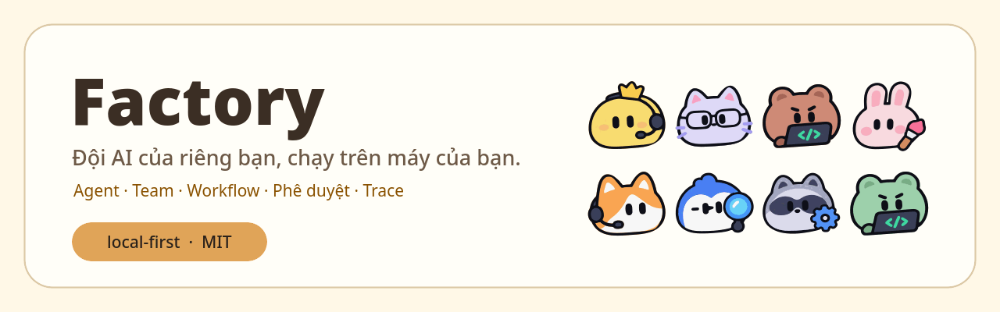
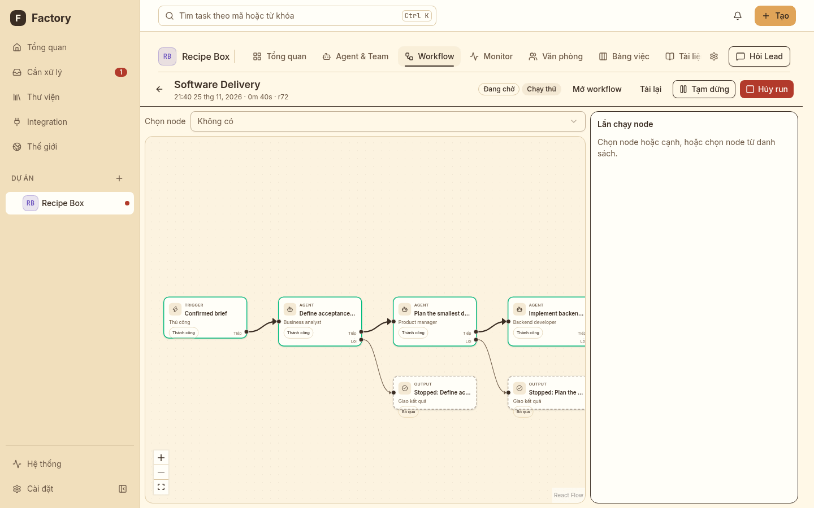
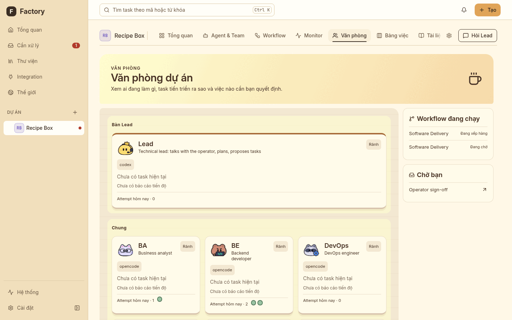
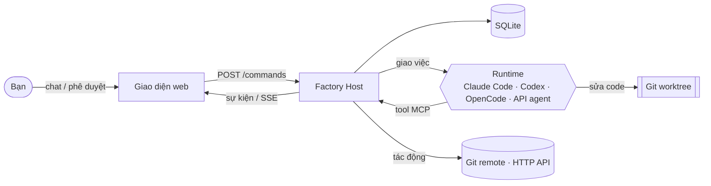

<p align="center">
  
</p>

<p align="center">
  <a href="README.md">English</a> · <b>Tiếng Việt</b>
</p>

**Factory** là nền tảng chạy một đội agent AI ngay trên máy của bạn. Bạn trao đổi công việc với agent **Lead** trong khung
chat. Khi hai bên đã chốt phương án, Lead viết một **Bản chốt** ngắn rồi chạy **workflow** phù hợp. Mỗi agent làm việc trong
Git worktree riêng, review chéo nhau, và dừng lại chờ **bạn duyệt** ở những chỗ cần người quyết. Mọi việc chúng làm đều truy
vết được, từ tin nhắn đầu tiên của bạn tới file cuối cùng được sửa.

Agent, team, skill, tool, integration và workflow đều là dữ liệu: bạn tạo và chỉnh trên giao diện web, riêng cho từng
project. Không có gì về đội của bạn bị viết cứng trong code.

<p align="center">
  
  
</p>

## Có gì

- **Agent và team là dữ liệu.** Mỗi project có agent riêng (vai trò, hướng dẫn, model, runtime, skill, tool, ngân sách), team
  và sơ đồ quan hệ (`manages`, `reviews`, `collaborates`, `approves`). Bắt đầu từ project trống, từ team template, hoặc mô tả
  bằng lời để Lead đề xuất cách thiết lập.
- **Engine workflow thật.** Canvas trực quan (Trigger, Agent, Condition, Loop, Approval, Orchestrate, Sub-workflow, Wait,
  Action, Output) chạy trên engine có trạng thái: Draft và Version, tạm dừng / chạy tiếp / retry / huỷ, hết giờ, khôi phục
  sau khi sập mà không làm trùng việc, chạy thử bằng mock agent không tốn token.
- **Bàn trước, làm sau.** Cứ trao đổi thoải mái với Lead. Khi bạn chốt bằng lời của mình ("ok, làm theo phương án 2"), Lead
  tổng hợp toàn bộ cuộc trò chuyện thành **Bản chốt** có version rồi chạy đúng workflow. Host kiểm tra chắc chắn bạn đã nói
  câu đó. Thích bấm nút hơn? Chuyển project sang chế độ *Cổ điển*.
- **Dùng runtime bạn có.** Agent chạy bằng Claude Code, Codex CLI, OpenCode (trong sandbox bubblewrap) hoặc gọi thẳng bất kỳ
  API model tương thích OpenAI. Agent nói chuyện với Host qua MCP và không bao giờ thấy API key của bạn.
- **Phê duyệt và chính sách.** Quyền dùng tool theo từng agent (`allow` / `ask` / `deny`), ngân sách, mức tự chủ, cầu dao an
  toàn. Mọi tác động ra bên ngoài (push branch, gọi HTTP API, publish bundle) đi qua một bộ thực thi duy nhất và không bao giờ
  tự thử lại mù quáng: kết quả chưa rõ thì chờ bạn đối soát.
- **Thấy hết.** Monitor trực tiếp, Trace đầu-cuối (yêu cầu → run → node → task → attempt → tool call → tài liệu), chi phí theo
  node và agent (chưa rõ thì ghi "chưa rõ", không bao giờ ghi 0), và phân tích run gợi ý cải tiến dưới dạng **Draft** mới —
  không bao giờ tự publish.
- **Tổ chức kiểu GitLab.** Group lồng nhau tối đa 5 cấp, kế thừa cấu hình mặc định, thư viện và ngân sách dùng chung.
- **Extension.** Gói team, skill và workflow tuỳ chọn. `extensions/portal` biến Factory thành một xưởng game web nhỏ: làm game
  turn-based chạy trên trình duyệt và publish lên cổng game.

## Hoạt động thế nào



- Một tiến trình, một file SQLite, chỉ nghe trên `127.0.0.1`, trừ khi bạn chủ động mở ra mạng LAN.
- Mọi thay đổi đi qua `POST /commands`: không bị chạy trùng, kiểm tra revision, mỗi lệnh một transaction kèm sự kiện.
- **Model chỉ đề xuất; code xác định kiểm tra rồi mới ghi.** Kế hoạch, thiết lập và đề xuất cải tiến do LLM viết đều được
  kiểm theo schema và chính sách trước khi lưu.

Chi tiết ở [docs/architecture.md](docs/architecture.md) (tiếng Anh).

## Bắt đầu nhanh

Cần: Linux x64 (hoặc WSL2), `git`; tuỳ chọn thêm một nhà cung cấp model tương thích OpenAI (OpenAI, OpenRouter, Ollama, LM
Studio, gateway nội bộ…) và/hoặc Claude Code CLI, Codex CLI.

```bash
git clone https://github.com/daubong240705-art/AI-SOFTWARE-FACTORY-6-AI-AGENT.git factory
cd factory
bash scripts/install.sh --yes        # tự tải Node 22 đã ghim, build, cài lệnh `factory`
export PATH="$HOME/.local/bin:$PATH"

factory setup                        # nhà cung cấp model, API key, model, cổng, CLI agent
factory doctor                       # kiểm từng điều kiện và chỉ cách sửa
factory start                        # rồi mở http://127.0.0.1:8787/
```

Sau đó: tạo project (trống hoặc từ team template) → mở **Agent & Team** → chat với Lead → chốt phương án. Hướng dẫn đầy đủ
(nhà cung cấp model, mở truy cập LAN, tra lỗi theo mã `doctor`) ở [docs/setup/README.md](docs/setup/README.md).

## Khái niệm

| Từ | Nghĩa |
|---|---|
| **Project** | Một Git repo cùng agent, team, workflow, task và tài liệu của nó. Project nằm trong **group**. |
| **Agent** | Một "nhân viên" đã cấu hình: vai trò, hướng dẫn, runtime + model, skill, tool, ngân sách. Có version; tạm dừng hoặc lưu trữ được. |
| **Team / quan hệ** | Nhóm agent và sơ đồ tổ chức, dùng để chọn người review, người duyệt, người quản lý. |
| **Thư viện** | Skill và agent template có version, dùng chung toàn hệ thống hoặc theo group. Team template đến từ **pack**. |
| **Workflow** | Đồ thị node có version. Sửa **Draft**, **Publish** một version, **Chạy** (hoặc chạy thử bằng mock agent). |
| **Task / Attempt** | Một đơn vị việc của agent và một lần làm việc đó, trong worktree riêng. |
| **Phê duyệt** | Quyết định chỉ con người được đưa ra. Hiện ở mục *Cần xử lý*. |
| **Bản chốt** | Phương án đã thống nhất, do Lead viết từ cuộc trò chuyện; là đầu vào của workflow được chạy. |
| **Integration** | MCP server hoặc HTTP API, kèm secret được mã hoá và quyền dùng tool theo từng agent. |

## Cấu trúc repo

| Đường dẫn | Nội dung |
|---|---|
| `apps/factory-host` | Host: Fastify API, pipeline lệnh, engine workflow, giao việc, runtime, MCP endpoint (Node 22, TypeScript, SQLite) |
| `apps/factory-ui` | Giao diện web (React 19, Vite, Tailwind 4, shadcn/ui, React Flow) |
| `packages/factory-contracts` | Contract zod dùng chung: lệnh, sự kiện, thực thể |
| `packs/` | Team template: phần mềm, nghiên cứu, kiến trúc, thiết kế (+ `_template` để tự viết) |
| `extensions/` | Gói tuỳ chọn, ví dụ `portal` (xưởng game web) |
| `scripts/` | Bộ cài, lệnh `factory`, file dịch vụ |
| `docs/` | Kiến trúc, hướng dẫn cài đặt, glossary giao diện |

## Phát triển

```bash
# Node >= 22.20 (dùng được Node do bộ cài tải về: ~/.factory/node/bin)
(cd packages/factory-contracts && npm ci && npm run build && npm test)
(cd apps/factory-host && npm ci && npm run check && npm run build && npm test)
(cd apps/factory-ui && npm ci && npm run check && npm run build)
(cd apps/factory-ui && npm run dev)              # Vite ở 127.0.0.1:5173, API chuyển tới Host
node apps/factory-ui/e2e/audit/run.mjs           # audit giao diện: mọi màn hình, hai theme, thêm/sửa/xoá (cần Chrome)
```

Repo không có workspace gốc: build contracts trước, rồi tới Host và UI. Quy tắc cho người đóng góp (người hay AI) ở
[CLAUDE.md](CLAUDE.md).

## Bảo mật

- Mặc định chỉ nghe trên loopback; mở ra LAN cần cấu hình riêng và token đăng nhập.
- Mọi thao tác ghi cần cookie phiên, `Origin` chính xác và CSRF token; lần đầu khởi động có token bootstrap dùng một lần.
- API key của model chỉ nằm trong tiến trình Host. Agent nhận token proxy ngắn hạn, không bao giờ nhận key.
- Secret được mã hoá AES-256-GCM; giá trị secret không bao giờ xuất hiện rõ trong UI, log, sự kiện hay database.
- Agent OpenCode chạy trong sandbox bubblewrap; agent CLI cục bộ chạy với quyền bạn cấp.

## Tình trạng

Factory còn mới và thay đổi nhanh. Nó đang chạy hằng ngày trên một máy chủ nhỏ ở nhà (RAM 4 GB) với hai agent. Các giới hạn
đã biết ghi ở [docs/setup/README.md](docs/setup/README.md#8-giới-hạn-hiện-tại-25112026). Rất hoan nghênh issue và pull request.

## Giấy phép

[MIT](LICENSE). Các team pack phỏng theo ý tưởng của một số dự án dùng giấy phép MIT; xem [packs/NOTICE.md](packs/NOTICE.md).
