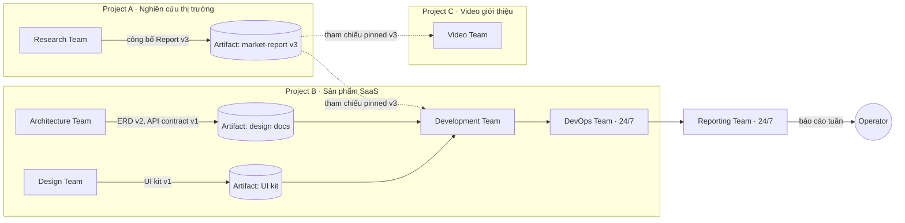
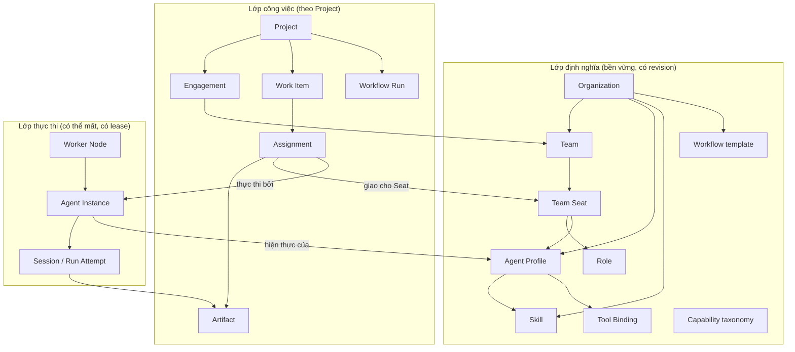
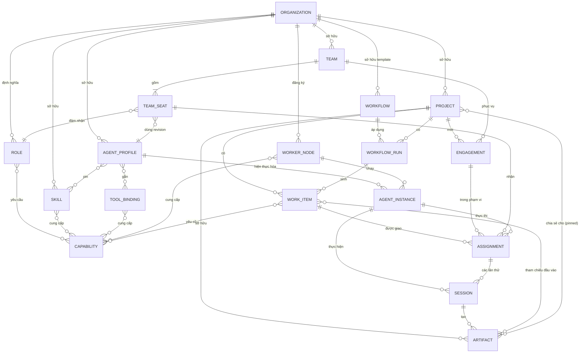
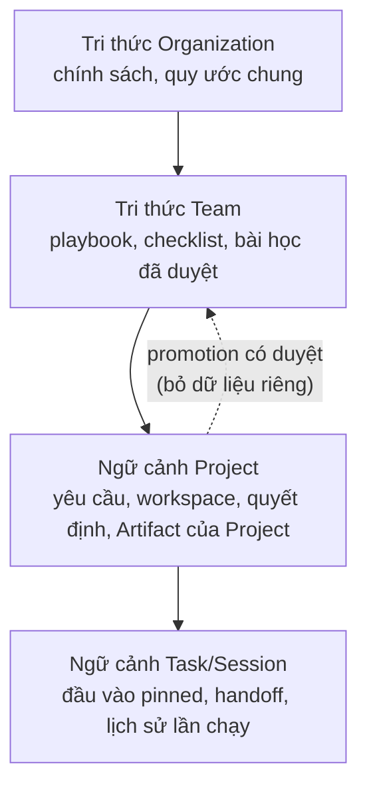
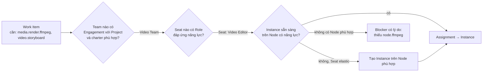
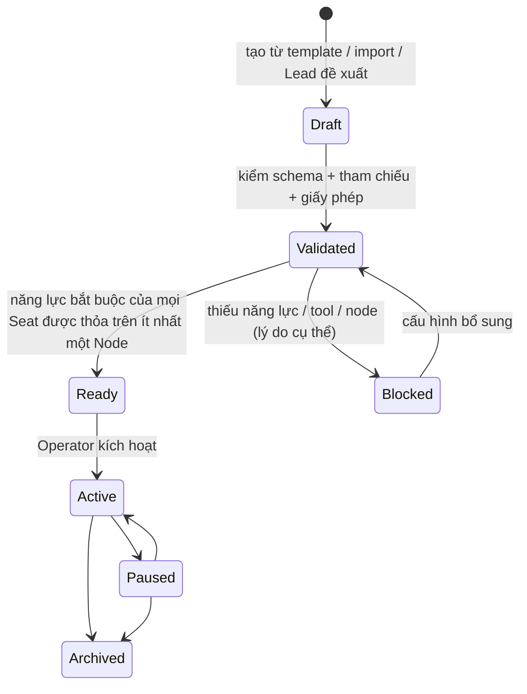

# 01 · Tầm nhìn sản phẩm và Domain Model Multi-Team AI

| Mục | Giá trị |
|---|---|
| Trạng thái | **Bản phân tích để duyệt**: chưa phải quyết định kiến trúc, chưa thiết kế database/protocol |
| Ngày | 07/11/2026 |
| Baseline | commit `692ad3f`, branch `architecture/multi-team-research` |
| Đầu vào | Khảo sát giai đoạn 1 (Windows Worker V1, Factory V2 F0–F1-01, nền tảng Python cũ) |
| Phạm vi | Tầm nhìn, thuật ngữ, quan hệ thực thể, so sánh mô hình Team, khuyến nghị, quyết định cần duyệt |
| Không thuộc phạm vi | Schema DB, API/protocol giữa máy, code, kế hoạch triển khai |

**Quy ước:** **[Hiện tại]** là điều đã có bằng chứng trong source/tài liệu tại baseline. **[V2 kế hoạch]** là quyết định Factory V2 đã ghi nhưng chưa có code Host. **[Đề xuất]** là phân tích của tài liệu này, chưa được duyệt.

---

## 1. Tầm nhìn sản phẩm

### 1.1 Phát biểu tầm nhìn

> Một nền tảng cho phép một người (về sau là một nhóm nhỏ) **vận hành nhiều Team AI chuyên môn bền vững**, giao việc cho chúng theo **Project**, để các Team **bàn giao kết quả có phiên bản cho nhau** qua nhiều Project, trong khi **Agent thực thi trên nhiều máy** khác nhau theo năng lực và tài nguyên của từng máy, và người vận hành luôn biết ai đang làm gì, chờ gì, tốn bao nhiêu và kết quả nằm đâu.

### 1.2 Nguyên tắc định hướng [Đề xuất]

1. **Team là đơn vị năng lực có thể tái sử dụng**, không phải một thư mục con của Project. Một Team được định nghĩa một lần và phục vụ nhiều Project.
2. **Tách lớp logic khỏi lớp runtime.** Team, Role và Agent Profile là định nghĩa bền vững, có phiên bản. Agent Instance và Session là thứ đang chạy trên một máy cụ thể, có thể sinh ra, mất kết nối hoặc bị thay thế.
3. **Kết quả là giao diện giữa các Team.** Research không "nói chuyện" với Dev qua log. Research công bố Artifact có phiên bản, Dev tham chiếu đúng phiên bản đó.
4. **Một nguồn điều phối logic, nhiều nơi thực thi.** Phù hợp D03 của V2 (một coordinator/queue), chỉ mở rộng phần thực thi ra nhiều máy. Topology cụ thể là quyết định cần duyệt (mục 12).
5. **Quy mô cá nhân trước, mở rộng sau.** Mọi khái niệm mới phải có giá trị mặc định đủ đơn giản để một người dùng trên một máy không phải cấu hình Organization, Engagement hay Capability bằng tay.
6. **Năng lực khác quyền.** Agent *có thể* làm được việc gì (capability) tách khỏi việc nó *được phép* làm gì (grant). Điều này kế thừa ADR-004 của V2.
7. **Không giả trạng thái.** Team "24/7" chỉ đúng khi có máy luôn bật. Năng lực "đã xác minh" chỉ đúng khi có probe/bằng chứng.

### 1.3 Người dùng mục tiêu

| Persona | Nhu cầu | Giai đoạn |
|---|---|---|
| **Operator cá nhân** (người dùng hiện tại) | Vận hành 3–8 Team trên 1–3 máy (Windows + WSL, Linux `.60`, VM), nhiều Project song song, ngân sách token có kiểm soát | Mục tiêu chính |
| **Cộng tác viên** | Xem/duyệt kết quả, trả lời câu hỏi nghiệp vụ ở một số Project | Về sau |
| **Nhóm nhỏ** | Nhiều người vận hành chung, phân quyền theo Project/Team, audit | Ngoài phạm vi gần |

### 1.4 Kịch bản tham chiếu



Ý nghĩa: một Research Team phục vụ hai Project. Một Artifact được nhiều Project tiêu thụ theo phiên bản cố định. DevOps/Reporting chạy theo lịch/sự kiện, không cần Operator mở ứng dụng.

### 1.5 Phạm vi sản phẩm [Đề xuất]

| Tầng | Trong phạm vi | Ghi chú |
|---|---|---|
| **S1 · Cá nhân, một máy** | Team bền vững từ template, Engagement Team↔Project, capability matching, nhiều Project chạy đồng thời, Artifact chia sẻ xuyên Project | Tương ứng mở rộng F2–F4 của V2 |
| **S2 · Cá nhân, nhiều máy** | Đăng ký Worker Node, probe năng lực máy, giao việc theo năng lực/tài nguyên, Team 24/7 trên máy luôn bật, phục hồi khi máy mất kết nối | Đang nằm ở F9 của V2, cần đưa lên sớm hơn nếu được duyệt |
| **S3 · Nhóm nhỏ** | Nhiều người dùng, phân quyền theo Project/Team, audit | Chỉ giữ chỗ trong domain model, không triển khai gần |

**Ngoài phạm vi:** SaaS đa tenant, marketplace Team/Skill công khai, billing, điều phối P2P không có control plane, agent tự chi tiêu/publish ra ngoài khi chưa được cấp quyền, điều khiển GUI NLE (Premiere/DaVinci) khi chưa có bridge.

---

## 2. Hạn chế của mô hình Agent/Team hiện tại

### 2.1 Windows Worker V1 [Hiện tại]

| # | Hạn chế | Bằng chứng | Hệ quả với tầm nhìn |
|---|---|---|---|
| L1 | Danh sách agent cố định đúng 7 role; quyền gắn theo tên role | `shared/contracts.ts:54` `.length(7)`; `team/role-policy.ts` | Không thêm được Research/Video/Reporting Team mà không sửa core |
| L2 | "Team" chỉ là 7 role được Lead điều phối **bên trong một run**; không có thực thể Team bền vững | `team/coordinator.ts` `coordinate()` | Không có Team để tái sử dụng, không có lịch sử/tri thức riêng của Team |
| L3 | Một run active cho toàn ứng dụng | `storage/database.ts:91` `one_active_run`; `controller/runs.ts:499` | Hai Team không thể làm hai Project cùng lúc |
| L4 | Tối đa 2 execution mỗi run, 10 task mỗi kế hoạch | `runtime/executions.ts:22`; `shared/team.ts` `validatePlan` | Không có song song ở mức nhiều Team |
| L5 | "Agent" thực chất là một tiến trình OpenCode sinh ra cho từng task rồi dừng | `runtime/opencode.ts` | Không có danh tính Agent Instance, không theo dõi sức chứa hoặc trạng thái rảnh/bận lâu dài |
| L6 | 4 skill cố định, tối đa 3 skill/task; MCP, external skills và native task tool bị tắt | `team/skills.ts`; `runtime/opencode.ts` | Năng lực không mở rộng được theo lĩnh vực |
| L7 | Chỉ một máy: loopback, Windows Job Object, DPAPI, IPC polling | `runtime/owned-process.ts`, `main.ts` | Không có Worker Node từ xa |
| L8 | Project gắn một thư mục local; kết quả là file trong repo hoặc report trong run | `workspace/*`, `storage/reports.ts` | Research không thể bàn giao có phiên bản sang Project khác |
| L9 | Lịch chỉ tạo backlog và chỉ chạy khi ứng dụng mở | `controller/schedules.ts`, `shared/schedules.ts:4` | Không có Team 24/7 |
| L10 | Chỉ một runtime: OpenCode pin cứng 1.19.5 | `runtime/security.ts:5` | Không chọn runtime/model theo năng lực Team |

### 2.2 Factory V2 [V2 kế hoạch] — đã sửa gì, còn thiếu gì

| Đã giải quyết trong thiết kế V2 | Vẫn chưa có trong V2 |
|---|---|
| Agent và role tự do, không enum (D05; `models.ts` agent có role text) | **Không có thực thể Team.** Agent gắn trực tiếp với Project qua membership, tức là mô hình Project-specific |
| Bỏ khóa một run toàn ứng dụng; khóa theo work item (`one_live_assignment_per_work`) | **Không có Worker Node.** Một Host, một SQLite (D02); nhiều máy nằm ở F9 sau 2.0 |
| Adapter đa runtime có probe capability (D06, `adapter.ts`) | Capability chỉ ở **mức runtime** (resume, interrupt...), chưa có capability của Agent/Team/Node theo chuyên môn |
| Execution profile và effective grant (ADR-004) | **Không có chia sẻ Artifact xuyên Project**; event stream và output đều theo project |
| Assignment, epoch, lease, fencing, callback inbox (ADR-003) | Không có Engagement, hạn mức/ưu tiên khi một Team phục vụ nhiều Project |
| Domain packs (F6), rule engine (F5) | Team template, tri thức Team, quy tắc Team 24/7 |

### 2.3 Nền tảng Python cũ [Hiện tại, đóng băng]

Pipeline cố định PM→BA→BE→FE→TEST→DEVOPS và một run toàn nền tảng, nên không phù hợp mô hình Team. Tuy vậy, đây là **bằng chứng thực tế duy nhất** về giao việc qua nhiều máy: worker `.60` chủ động `claim/heartbeat/complete` qua HTTPS, có lease 60 giây, fence bằng `generation`, và model proxy để sandbox không thấy API key. Đây là tài liệu tham khảo cho tầng Worker Node.

---

## 3. Định nghĩa thực thể [Đề xuất]

Mười thực thể được yêu cầu, cộng các thực thể hỗ trợ cần thiết để mô hình đóng kín. Thuộc tính liệt kê ở mức khái niệm, **không phải schema**.

### 3.1 Bảng tóm tắt

| Thực thể | Lớp | Một câu định nghĩa | Bền vững? | Tương đương hiện tại |
|---|---|---|---|---|
| Organization | Sở hữu | Ranh giới sở hữu cao nhất cho Team, Profile, Skill, Node, Secret, Policy | Có | Không có (ngầm là một người dùng) |
| Project | Công việc | Đơn vị mục tiêu có kết quả, ngân sách, workspace và các Team được mời tham gia | Có | V1 project = thư mục local; V2 project |
| Team | Logic | Đơn vị chuyên môn bền vững gồm các Seat, có Lead, charter, chính sách và tri thức riêng | Có | Không có |
| Role | Logic | Vị trí trách nhiệm trong Team: kỳ vọng, năng lực bắt buộc, thẩm quyền | Có | V1: 7 role enum; V2: chuỗi tự do |
| Skill | Năng lực | Gói tri thức/hướng dẫn có phiên bản, cung cấp năng lực nhận thức | Có | V1 `skills/*/SKILL.md` (4 cái) |
| Capability | Năng lực | Một khả năng có tên, kiểm chứng được, mà task yêu cầu và agent/máy cung cấp | Có (taxonomy) | V2 adapter capability (mức runtime) |
| Agent Profile | Logic | Bản thiết kế của một agent: hướng dẫn, skill, tool, runtime/model ưa dùng, năng lực khai báo | Có, theo revision | V1 `agent-profiles/*.md`; V2 `agent` |
| Agent Instance | Runtime | Một agent cụ thể sẵn sàng làm việc trên một Worker Node, có trạng thái và sức chứa | Bán bền | Không có (V1 sinh process theo task) |
| Worker Node | Runtime | Một máy/môi trường thực thi đã đăng ký, có năng lực, tài nguyên, độ sẵn sàng | Có | Python: `coding_workers`; V1/V2: không có |
| Workflow | Quy trình | Mẫu quy trình có phiên bản gồm các giai đoạn, bàn giao giữa Team/Role và cổng duyệt | Có, theo revision | V1: luồng Lead cứng; V2: workflow status/rules |

**Thực thể hỗ trợ:**

| Thực thể | Định nghĩa |
|---|---|
| **Engagement** | Thỏa thuận Team phục vụ Project: phạm vi, vai trò trong Project, ưu tiên, hạn mức, quyền được cấp, thời hạn. Là chìa khóa của tái sử dụng (mục 6) |
| **Team Seat** | Một vị trí trong Team: Role + Agent Profile + chính sách gắn Instance (dedicated / elastic / pooled) + số lượng |
| **Tool Binding** | Một công cụ MCP/CLI/job đã đăng ký, gắn với Profile hoặc Team, cung cấp năng lực công cụ |
| **Runtime Adapter** | Lớp tích hợp Codex/Claude/OpenCode (V2 ADR-004) |
| **Work Item** | Ticket/task trong Project, có năng lực yêu cầu, đầu vào, đầu ra, tiêu chí (V2 `work_items`) |
| **Assignment** | Giao một Work Item cho một Team Seat và sau đó một Agent Instance, có epoch/lease (V2 `assignments`) |
| **Session / Run Attempt** | Một lần thực thi cụ thể của Agent Instance cho một Assignment (V2 `run_attempts`, runtime session) |
| **Artifact** | Đầu ra có phiên bản, hash và nguồn gốc; có thể được chia sẻ cho Project khác |
| **Execution Profile / Grant** | Phạm vi quyền thực thi đã cấp (V2 ADR-004) |
| **Workflow Run** | Một lần áp dụng Workflow trong một Project |
| **Trigger / Schedule** | Sự kiện hoặc lịch tạo command, là đầu vào cho Team 24/7 (V2 F5) |

### 3.2 Định nghĩa chi tiết

#### Organization
- **Trách nhiệm:** sở hữu và cô lập mọi tài nguyên dùng chung: catalog Team/Profile/Skill/Tool, danh sách Worker Node, secret, chính sách mặc định, ngân sách tổng.
- **Thuộc tính khái niệm:** tên, chính sách mặc định (review, ngân sách, giờ yên lặng), danh sách thành viên người dùng (S3).
- **Quy mô cá nhân:** đúng **một Organization mặc định, ẩn trong UI**. Thực thể tồn tại trong model để không phải thay core khi lên S3.
- **Bất biến:** mọi Team, Node, Project thuộc đúng một Organization. Không chia sẻ tài nguyên xuyên Organization.

#### Project
- **Trách nhiệm:** định nghĩa *cần đạt điều gì*: mục tiêu, workspace (Git, thư mục hoặc chỉ artifact — V2 D09), ngân sách, chính sách review, Work Item, Workflow Run và Artifact của mình.
- **Không** sở hữu Team. Project **mời** Team qua Engagement.
- Có một **Project Lead** (agent điều phối ở mức Project): một Seat của Team được chỉ định làm điều phối, hoặc Lead riêng của Project. Đây là quyết định mở (D-04, mục 12).
- **Bất biến:** dữ liệu Project (workspace, secret của Project, hội thoại) mặc định không nhìn thấy được từ Project khác, trừ Artifact được công bố rõ ràng.

#### Team
- **Trách nhiệm:** *ai có chuyên môn làm*. Team gồm:
  - **Charter / service catalog:** loại việc Team nhận (ví dụ Research nhận "nghiên cứu thị trường", "tổng hợp tài liệu").
  - **Seats:** danh sách Role + Profile + chính sách Instance.
  - **Team Lead seat:** nhận việc từ Project, chia việc trong Team, review nội bộ.
  - **Policies:** review mặc định, WIP limit, khung giờ hoạt động (24/7 hay theo giờ), ngân sách Team, chính sách node (ví dụ Video chỉ chạy trên node có GPU).
  - **Team knowledge:** playbook, checklist, bài học đã được duyệt để dùng lại (không chứa dữ liệu thô của Project).
- **Team không chứa process.** Trạng thái "Team đang làm việc" được *suy ra* từ Assignment và Agent Instance.
- **Vòng đời:** Draft → Validated → Active → Paused → Archived. Mỗi thay đổi tạo revision; Assignment đang chạy giữ revision cũ.

#### Role
- **Trách nhiệm:** mô tả vị trí trong Team: kỳ vọng đầu ra, **năng lực bắt buộc**, **thẩm quyền nghiệp vụ** (có được chia việc, review, phê duyệt nội bộ, gọi Team khác hay không).
- **Không phải quyền hệ điều hành.** Quyền đọc/sửa/shell đến từ Execution Grant, không từ tên Role. Đây là sửa lỗi trực tiếp của V1 (L1).
- Role có thể dùng chung giữa các Team (ví dụ "Reviewer"), hoặc riêng một Team.

#### Skill
- **Trách nhiệm:** gói tri thức có phiên bản (hướng dẫn, quy trình, ví dụ, template) giúp agent làm tốt một loại việc. Ví dụ `erd-design@1.2`, `video-storyboard@0.3`.
- **Cung cấp** năng lực nhận thức; **không cấp quyền** và không cài phần mềm (V2 ADR-004: skills/tools/presets không nâng quyền).
- Được pin theo version và hash cho từng lần chạy (kế thừa V1 profile hash và kế hoạch F3-04).

#### Capability
- **Trách nhiệm:** "ngôn ngữ chung" để ghép việc với người làm. Một Capability là một ID có namespace, ví dụ `code.typescript`, `db.schema-design`, `media.render.ffmpeg`, `research.web-search`, `runtime.resume-session`, `node.gpu.cuda`, `node.always-on`.
- **Năm nguồn cung cấp:**

  | Nguồn | Ví dụ | Kiểm chứng |
  |---|---|---|
  | Skill | `db.schema-design` | Khai báo; về sau có thể đánh giá bằng eval task |
  | Tool Binding | `research.web-search`, `media.render.ffmpeg` | Health check công cụ |
  | Runtime Adapter | `runtime.resume-session`, `runtime.child-agents` | Probe adapter (V2 `adapterProbeSchema`) |
  | Model | `model.vision`, `model.context-128k` | Catalog gateway/9Router |
  | Worker Node | `node.gpu.cuda`, `node.always-on`, `node.os.linux` | Probe máy (kiểu F1-01 preflight) |

- **Ba mức tin cậy:** *declared* (khai báo), *verified* (đã probe, có `observedAt/staleAfter` như V2 contracts), *observed* (đã hoàn thành việc thực tế có bằng chứng).

#### Agent Profile
- **Trách nhiệm:** bản thiết kế một agent: hướng dẫn/persona, danh sách Skill pinned, Tool Binding, runtime và model ưa dùng (kèm fallback cho phép), Capability khai báo, Execution Profile mặc định, giới hạn ngân sách mỗi lần chạy.
- **Bất biến theo revision.** Đổi Profile tạo revision mới; Instance và Assignment đang chạy vẫn giữ revision cũ (V2 ADR-004: Host pin snapshot agent/model/profile/skills/tools mỗi attempt).
- Một Profile có thể dùng trong nhiều Team Seat ("Senior TypeScript Dev" dùng ở cả Development Team và DevOps Team).

#### Agent Instance
- **Trách nhiệm:** một agent **cụ thể có thể nhận việc**: Profile revision + Worker Node + Runtime Adapter + sức chứa (số slot) + trạng thái.
- **Trạng thái:** Provisioning → Ready → Busy (n/N slot) → Draining → Offline/Lost → Retired.
- **Khác Session:** Instance là "người làm việc" có danh tính để theo dõi, xếp lịch, đo tải. Session/Run Attempt là "một lần làm việc" cho một Assignment. Một Instance có nhiều Session theo thời gian.
- Instance có thể **thường trực** (dedicated: luôn tồn tại trên một node, ví dụ Reporting 24/7) hoặc **co giãn** (elastic: sinh ra khi có việc, thu hồi khi rảnh). Lựa chọn này nằm ở Team Seat, không trong core.

#### Worker Node
- **Trách nhiệm:** môi trường thực thi đã đăng ký: danh tính máy, hệ điều hành, runtime đã cài, công cụ, tài nguyên (CPU/RAM/disk/GPU), phạm vi filesystem/network, độ sẵn sàng (luôn bật hay không), mức tin cậy, secret được phép dùng.
- **Ví dụ thực tế:** Windows desktop (không luôn bật), WSL2 trên cùng máy (đã có Node/OpenCode F1-01), Linux `.60` (2 vCPU, ~5,3 GiB; trạng thái hiện tại chưa xác minh), VM về sau.
- Node chỉ **thực thi**. Quyết định ai làm gì thuộc về control plane.

#### Workflow
- **Trách nhiệm:** mẫu quy trình có phiên bản: các giai đoạn, Role/Team đảm nhận mỗi giai đoạn, Artifact đầu vào/đầu ra mỗi giai đoạn, cổng duyệt (Human-final/Automatic/Hybrid của V2), điều kiện chuyển.
- Hai cấp:
  - **Team-internal workflow:** cách Team tự làm việc bên trong (ví dụ Research: thu thập → tổng hợp → kiểm chứng nguồn).
  - **Cross-team workflow:** chuỗi bàn giao giữa Team trong một Project (ví dụ Research → Architecture → Dev + Design → DevOps).
- Workflow là **template sửa được**; việc nhỏ không bắt đi qua mọi giai đoạn (giữ nguyên tinh thần V2 workflows §1).

---

## 4. Quan hệ thực thể

### 4.1 Ba lớp của mô hình



### 4.2 Sơ đồ quan hệ thực thể (khái niệm, không phải schema)



### 4.3 Quy tắc quan hệ then chốt

| # | Quy tắc | Lý do |
|---|---|---|
| R1 | Project và Team là **nhiều–nhiều**, nhưng **chỉ qua Engagement** | Có chỗ đặt ưu tiên, hạn mức, quyền và thời hạn riêng cho từng cặp |
| R2 | Assignment luôn thuộc **một Engagement**: Team chỉ nhận việc của Project đã mời nó | Kiểm soát chi phí và cô lập dữ liệu |
| R3 | Assignment gắn **Seat** trước (logic), **Instance** sau (runtime). Instance có thể đổi khi node mất kết nối; Seat thì không | Trách nhiệm ổn định, thực thi linh hoạt |
| R4 | Instance thuộc đúng **một Node** và đúng **một Profile revision** | Năng lực hiệu lực tính được, có thể tái hiện |
| R5 | Artifact thuộc **một Project chủ**; Project khác chỉ dùng qua **tham chiếu pinned version** | Nguồn gốc rõ, đổi bản mới không lặng lẽ thay đầu vào của bên dùng |
| R6 | Session không mang ngữ cảnh từ Project này sang Project khác | Tránh rò rỉ dữ liệu khi một Team phục vụ nhiều Project |
| R7 | Team knowledge chỉ nhận nội dung **được đưa lên có chủ đích** (promotion), không tự hút dữ liệu Project | Tái sử dụng tri thức mà không rò rỉ |
| R8 | Capability của Work Item được thỏa khi có Seat (logic) **và** Instance trên Node (runtime) cùng đáp ứng | Tránh giao việc video cho node không có FFmpeg |

---

## 5. So sánh bốn mô hình Team

### 5.1 Mô tả ngắn

| Mô hình | Bản chất | Ví dụ |
|---|---|---|
| **Persistent Team** | Team cố định với thành viên cố định (agent thường trực), nhận việc từ mọi Project qua hàng đợi chung | "Research Team" luôn có 2 agent cố định chạy trên `.60` |
| **Project-specific Team** | Mỗi Project tự lập đội agent riêng; hết Project thì đội giải tán | V1 (7 role mỗi run), V2 (agent membership theo project) |
| **Capability-based Agent Pool** | Không có Team; mỗi task khai báo năng lực cần có, bộ lập lịch chọn agent bất kỳ đủ năng lực | Kiểu cluster scheduler (Kubernetes/Nomad), không có "đội" |
| **Hybrid Team Model** | Team bền vững là đơn vị logic (charter, Lead, Seat, chính sách, tri thức); Project mời Team qua Engagement; Instance được cấp linh hoạt theo năng lực/Node, có thể thường trực hoặc co giãn theo Seat | Research Team có Lead thường trực và Seat "Researcher" co giãn 0–3 instance trên bất kỳ node có `research.web-search` |

### 5.2 Bảng so sánh

Thang: ●●● tốt · ●● trung bình · ● kém.

| Tiêu chí | Persistent | Project-specific | Capability Pool | Hybrid |
|---|---|---|---|---|
| Tái sử dụng giữa Project | ●●● | ● | ●●● | ●●● |
| Tích lũy tri thức/chuyên môn theo thời gian | ●●● | ● | ● | ●●● (qua team knowledge có duyệt) |
| Cô lập dữ liệu giữa Project | ● (dễ mang ngữ cảnh chéo) | ●●● | ●● | ●●● (Session theo Project, R6/R7) |
| Trách nhiệm rõ ("ai làm, ai review") | ●●● | ●●● | ● | ●●● |
| Tận dụng tài nguyên, tránh rảnh/kẹt | ● (agent thường trực rảnh, hoặc nghẽn) | ●● | ●●● | ●● đến ●●● (tùy chính sách Seat) |
| Nhiều Project đồng thời | ●● (nghẽn ở hàng đợi Team) | ●●● (mỗi Project đội riêng) | ●●● | ●●● (Engagement + hạn mức) |
| Phù hợp nhiều Worker Node | ●● (gắn cứng node) | ●● | ●●● | ●●● |
| Team 24/7 | ●●● | ● | ●● (không có chủ thể "Team") | ●●● (Seat dedicated trên node luôn bật) |
| Tạo Team mới không sửa core | ●● | ●● | ●●● (không có Team) | ●●● (Team là dữ liệu khai báo) |
| Dễ hiểu với người vận hành | ●●● | ●●● | ● | ●● (phải hiểu cả Team và Instance) |
| Độ phức tạp triển khai | ●● | ●●● (đơn giản nhất) | ● (cần taxonomy và scheduler tốt) | ● đến ●● (nhiều khái niệm nhất) |
| Khả thi ở quy mô cá nhân, 1 máy | ●● | ●●● | ●● | ●● (cần mặc định ẩn bớt khái niệm) |
| Gần hiện trạng V1/V2 | ● | ●●● (V2 đang theo hướng này) | ● | ●● (mở rộng V2, thêm Team/Engagement/Node) |
| Chi phí token | ●● (agent thường trực có thể tốn token giữ ngữ cảnh) | ●● (lặp lại khởi tạo ngữ cảnh) | ●●● | ●● |

### 5.3 Đánh giá theo yêu cầu tầm nhìn

| Yêu cầu từ tầm nhìn | Persistent | Project-specific | Pool | Hybrid |
|---|---|---|---|---|
| Team chuyên môn có bản sắc (Research, Dev, Video...) | Đáp ứng | Đáp ứng một phần (bản sắc chỉ trong Project) | **Không** | Đáp ứng |
| Team phục vụ nhiều Project | Đáp ứng, dễ nghẽn | **Không** | Đáp ứng nhưng không còn "Team" | Đáp ứng |
| Project dùng nhiều Team | Đáp ứng | Đáp ứng | Không có khái niệm | Đáp ứng |
| Agent trên nhiều máy | Có, gắn cứng | Có | Tốt nhất | Tốt |
| DevOps/Reporting 24/7 | Tốt | Kém | Trung bình | Tốt |
| Khả thi cho một người | Trung bình | Tốt | Trung bình | Trung bình, cần mặc định tốt |

**Kết luận phân tích:** Project-specific không đáp ứng yêu cầu cốt lõi "một Team phục vụ nhiều Project". Capability Pool đánh mất khái niệm Team mà tầm nhìn đặt ở trung tâm. Persistent Team đáp ứng tầm nhìn nhưng gắn cứng agent với Team, gây nghẽn và rò rỉ ngữ cảnh khi nhiều Project. **Hybrid** là mô hình duy nhất thỏa cả năm yêu cầu, với cái giá là độ phức tạp khái niệm cao hơn. Khuyến nghị và cách giảm độ phức tạp ở mục 11.

---

## 6. Tái sử dụng Team giữa nhiều Project

### 6.1 Ba cấp tái sử dụng

| Cấp | Cái được tái sử dụng | Cơ chế |
|---|---|---|
| **Định nghĩa** | Cấu trúc Team (Seat, Role, Profile, Skill, Workflow nội bộ) | **Team Template / Team Pack** có phiên bản, import/export không kèm secret. Tạo Team mới từ template |
| **Thực thể** | Một Team cụ thể (cùng Lead, cùng tri thức) phục vụ nhiều Project | **Engagement**: mỗi Project mời cùng một Team, mỗi Engagement có phạm vi/ưu tiên/hạn mức riêng |
| **Kết quả** | Đầu ra của Team (báo cáo, ERD, UI kit, video) | **Artifact chia sẻ** với tham chiếu pinned version và provenance |

### 6.2 Hai cách một Team phục vụ nhiều Project

| Cách | Mô tả | Khi nào dùng |
|---|---|---|
| **Shared Team + Engagement** (khuyến nghị mặc định) | Một Team, một hàng đợi; mỗi Engagement có ưu tiên và hạn mức; Session cô lập theo Project | Team chuyên môn chung: Research, Architecture, Reporting |
| **Fork Team** | Sao một Team thành Team mới cho một Project vì cần tùy biến lớn (Profile, Skill, chính sách) | Project có yêu cầu đặc thù hoặc bảo mật riêng; về bản chất quay về Project-specific có chủ đích |

### 6.3 Phân lớp ngữ cảnh để tái sử dụng an toàn



- Session nhận ngữ cảnh theo chiều từ trên xuống, chỉ của **đúng một Project**.
- Đưa tri thức từ Project lên Team chỉ qua **promotion có duyệt** (Lead đề xuất, Operator hoặc chính sách chấp thuận). Không tự động hút dữ liệu Project.

### 6.4 Bàn giao xuyên Project (Research → Development)

1. Research Team hoàn thành Work Item trong Project A và tạo Artifact `market-report v3` (có hash, nguồn, tiêu chí đạt).
2. Artifact được đánh dấu **chia sẻ** cho Project B (hoặc toàn Organization).
3. Work Item trong Project B tham chiếu `market-report@v3`. Bản v4 ra sau **không** tự thay đầu vào. Bên dùng nhận thông báo "có bản mới" và quyết định nâng cấp (kế thừa cơ chế stale dependency của V2 workflows §3).
4. Nếu cần trao đổi, Project B tạo Work Item gửi Research Team qua Engagement của B, không trò chuyện all-to-all.

---

## 7. Quản lý năng lực của Agent và Team

### 7.1 Công thức năng lực hiệu lực

```text
Năng lực hiệu lực của Instance =
      Năng lực khai báo của Profile (Skill + Tool + Model)
    ∩ Năng lực đã probe của Runtime Adapter
    ∩ Năng lực đã probe của Worker Node
    (∩ Effective Grant — quyền để *dùng* năng lực đó)

Năng lực của Seat  = năng lực yêu cầu bởi Role, được thỏa nếu có ít nhất một Instance hợp lệ
Năng lực của Team  = hợp các Seat đang sẵn sàng + thẩm quyền Team (review, chia việc)
```

Capability ≠ Permission: Node có FFmpeg (capability) nhưng Project chưa cấp quyền ghi thư mục xuất (grant) thì task bị chặn bằng **một** blocker cấu hình, không phải hàng loạt yêu cầu Accept (kế thừa ADR-004 và F1-04).

### 7.2 Ghép việc với người làm



- **Bắt buộc vs ưu tiên:** năng lực bắt buộc lọc cứng; năng lực ưu tiên (ví dụ `model.context-200k`) chỉ xếp hạng.
- **Team Lead quyết định trong Team**, control plane quyết định **Instance/Node**. Lead không chọn máy.

### 7.3 Vòng đời và độ tin cậy của năng lực

| Mức | Cách có | Hết hạn | Dùng để |
|---|---|---|---|
| Declared | Profile/Skill/Tool khai báo | Theo revision | Lọc ban đầu, hiển thị |
| Verified | Probe Node/Adapter/Tool (giống F1-01 preflight, V2 `observedAt/staleAfter`) | Theo `staleAfter` | Điều kiện để giao việc |
| Observed | Hoàn thành việc có bằng chứng đạt | Không hết hạn, nhưng giảm trọng số theo thời gian | Xếp hạng, gợi ý chọn Instance |

### 7.4 Taxonomy

- Bắt đầu với **taxonomy nhỏ có namespace** (khoảng 20–40 ID) cho các domain đã biết: `code.*`, `db.*`, `research.*`, `design.*`, `media.*`, `ops.*`, `report.*`, `runtime.*`, `model.*`, `node.*`.
- Cho phép **tag tự do** cho năng lực chưa chuẩn hóa nhưng chỉ dùng để hiển thị, không để ghép cứng.
- Taxonomy là **dữ liệu**, không phải enum trong code.

---

## 8. Tạo Team mới mà không sửa core

### 8.1 Nguyên tắc
Core chỉ biết các khái niệm chung (Team, Seat, Role, Profile, Capability, Engagement, Workflow). **Không có tên Team hay tên Role nào trong code.** Đây là đảo ngược trực tiếp lỗi L1 của V1.

### 8.2 Team Pack: định nghĩa khai báo có phiên bản

Một Team Pack (khái niệm, chưa phải định dạng file) gồm:

| Thành phần | Nội dung |
|---|---|
| Metadata | Tên, mô tả, charter/service catalog, phiên bản, giấy phép |
| Roles | Role mới hoặc tham chiếu Role có sẵn, kèm năng lực bắt buộc và thẩm quyền |
| Profiles | Agent Profile (hướng dẫn, Skill pinned, Tool, runtime/model ưa dùng) |
| Skills | Gói Skill đi kèm (hash, giấy phép) |
| Tool requirements | Công cụ MCP/CLI cần có; **không tự cài** (V2 F3-04: import không chạy installer) |
| Seats | Role + Profile + chính sách Instance (dedicated/elastic/pooled, min/max) |
| Workflows | Workflow nội bộ Team, đầu vào/đầu ra chuẩn |
| Policies | Review mặc định, WIP, khung giờ, ngân sách, yêu cầu node |

### 8.3 Quy trình kích hoạt



### 8.4 Điểm mở rộng vẫn cần code (plugin boundary)

Không phải mọi thứ đều khai báo được. Những thứ sau **cần code nhưng không cần sửa core**, nếu core định nghĩa interface:

| Điểm mở rộng | Ví dụ | Interface hiện có |
|---|---|---|
| Runtime Adapter mới | Codex, Claude Code, Gemini CLI | V2 `RuntimeAdapter` (đã có trong contracts) |
| Loại Tool/Job mới | Render FFmpeg, chạy notebook | Kế hoạch F6-02 job runner |
| Loại Artifact preview | Video, Figma, ERD | Kế hoạch F6-01 |
| Loại Node probe | GPU, phần mềm chuyên dụng | Mở rộng từ `preflight-linux.py` |

Thêm Team Video **không** phải sửa core. Thêm năng lực render video lần đầu **cần** một job/tool plugin.

---

## 9. Team logic và Agent Instance thực tế

### 9.1 Phân biệt

| Khía cạnh | Team / Seat / Profile (logic) | Agent Instance (runtime) | Session / Run Attempt |
|---|---|---|---|
| Câu hỏi trả lời | Ai *chịu trách nhiệm*? | Ai *đang sẵn sàng làm*, ở đâu? | Lần làm việc *này* ra sao? |
| Tồn tại | Bền vững, có revision | Bán bền: có thể mất khi node tắt | Ngắn hạn, theo Assignment |
| Gắn với máy | Không | Đúng một Node | Đúng một Instance |
| Có process | Không | Có thể (thường trực) hoặc không (co giãn chưa sinh) | Có |
| Trạng thái | Draft/Active/Paused | Ready/Busy/Draining/Lost | queued/running/waiting-input/... (V2 `models.ts`) |
| Lỗi máy ảnh hưởng | Không | Lost → reconcile | Interrupted, outcome unknown |
| Hiển thị cho Operator | Team, Seat, ai phụ trách | Đang chạy ở đâu, tải, sức khỏe | Tiến độ, log, đầu ra |

### 9.2 Ba chính sách gắn Seat với Instance

| Chính sách | Mô tả | Phù hợp |
|---|---|---|
| **Dedicated** | Seat có Instance thường trực trên Node chỉ định | Reporting/DevOps 24/7, Video trên node GPU |
| **Elastic** | Instance được tạo khi có việc, trong khoảng min–max, thu hồi khi rảnh | Phần lớn Seat ở quy mô cá nhân |
| **Pooled** | Seat lấy Instance từ pool chung của Organization theo năng lực | Seat phổ thông (ví dụ "General Coder") |

### 9.3 Hiện trạng tương ứng

- **[Hiện tại] V1:** chỉ có Session (một tiến trình OpenCode cho mỗi task). Không có Instance, không có Node.
- **[V2 kế hoạch]:** có Session (`runtime session`, `run_attempts`), Assignment có epoch/lease, adapter probe. Chưa có Instance, Node.
- **[Đề xuất]:** thêm Instance và Node **giữa** Seat và Session. Lease/fencing của V2 chuyển từ "Host cấp cho adapter cục bộ" thành "control plane cấp cho Instance trên Node", giữ nguyên ý nghĩa.

---

## 10. Agent hoặc Team phục vụ nhiều Project đồng thời

### 10.1 Ở mức Agent Instance

| Phương án | Mô tả | Đánh giá |
|---|---|---|
| **1 Instance = 1 slot** | Mỗi lúc chỉ làm một Assignment | Đơn giản, cô lập tốt nhất, kém tận dụng |
| **1 Instance = N slot** (khuyến nghị, mặc định N=1) | Mỗi slot là một Session riêng, workspace riêng, ngữ cảnh riêng của một Project | Cân bằng, N tùy tài nguyên Node |
| **Một Session đa Project** | Một hội thoại xử lý việc nhiều Project | **Loại bỏ**: rò rỉ ngữ cảnh/secret, không truy vết được |

### 10.2 Ở mức Team

- **Hàng đợi Team có công bằng:** ưu tiên theo Engagement, hạn mức đồng thời theo Engagement (ví dụ Project B tối đa 2 việc song song của Research Team), tăng ưu tiên theo thời gian chờ (aging) để không bỏ đói.
- **WIP limit theo Team** để Team không nhận quá sức Node.
- **Không cướp việc đang chạy (no preemption)**: không giết Session để nhường việc khác; ưu tiên chỉ áp cho việc chưa bắt đầu. Lý do: dừng giữa chừng tạo outcome unknown (ADR-003).
- **Team Lead nhiều Project:** Lead chạy **một Session cho mỗi Engagement đang hoạt động** (cùng Profile, ngữ cảnh tách riêng), không phải một Lead đọc tất cả Project.

### 10.3 Xung đột cần quản lý

| Xung đột | Cơ chế đề xuất |
|---|---|
| Tài nguyên Node (CPU, GPU, disk) | Reservation theo Node trước khi giao (V2 đã có `reservations`) |
| Ngân sách token | Ngân sách ở ba cấp: Project, Engagement, Team. Việc chạy khi **cả ba** còn hạn mức |
| Secret | Secret theo Project/Node, Session chỉ nhận secret của đúng Project, đúng Node |
| Workspace | Workspace theo Project và Assignment; không dùng chung thư mục giữa Project |
| Ngữ cảnh | Quy tắc R6/R7 |
| Phụ thuộc xuyên Project | Pinned Artifact + thông báo stale |

### 10.4 Team 24/7 (DevOps, Reporting)

- Kích hoạt bằng **Trigger/Schedule** (V2 F5), không cần UI mở.
- Seat **dedicated** trên Node có `node.always-on`. Nếu không có Node như vậy, Team hiển thị "chỉ chạy khi máy X bật", không quảng cáo 24/7.
- Bắt buộc có: ngân sách theo ngày, giới hạn số lần lặp (hop limit F5-05), chính sách review cho hành động có tác động (deploy), khung giờ yên lặng cho thông báo.
- Hành động ngoài phạm vi grant (publish, chi tiêu) vẫn chờ người duyệt, kể cả lúc 3 giờ sáng.

---

## 11. Mô hình khuyến nghị

### 11.1 Khuyến nghị: **Hybrid Team Model**, triển khai theo từng mức

**Cốt lõi:** Team bền vững là đơn vị logic, gồm Seat, Lead, chính sách và tri thức. Project mời Team qua Engagement. Assignment đi Seat → Instance. Instance được cấp theo năng lực trên Worker Node, với chính sách dedicated/elastic/pooled theo Seat. Artifact có phiên bản là kênh bàn giao giữa Team và giữa Project.

**Lộ trình mức độ (không phải kế hoạch triển khai):**

| Mức | Người dùng thấy gì | Khái niệm được ẩn/mặc định |
|---|---|---|
| **M0 · Một máy, như V2** | Tạo Project, chọn Team từ template ("Software Team" tương đương 7 role V1), chat với Lead | Organization ẩn; một Node local tự đăng ký; Engagement tự tạo khi chọn Team; mọi Seat elastic 1 Instance |
| **M1 · Nhiều Team, nhiều Project** | Team dùng chung giữa Project, Artifact chia sẻ, hạn mức theo Project | Capability chỉ hiện khi bị thiếu |
| **M2 · Nhiều máy** | Thêm Node (WSL, `.60`, VM), Team 24/7, xem Instance chạy ở đâu | Chính sách Seat nâng cao |
| **M3 · Nhóm nhỏ** | Nhiều người dùng, phân quyền | — |

### 11.2 Đánh đổi

| Được | Phải trả |
|---|---|
| Tái sử dụng Team và tri thức thật sự | Thêm 4 khái niệm mới so với V2: Team, Seat, Engagement, Instance/Node |
| Trách nhiệm rõ ở mức Team/Seat dù Instance thay đổi | Lập lịch hai tầng (Lead chọn Seat, control plane chọn Instance) phức tạp hơn |
| Mở rộng ra nhiều máy mà không đổi mô hình | Cần taxonomy năng lực có kỷ luật; taxonomy kém làm ghép việc sai |
| Thêm Team mới bằng dữ liệu, không sửa core | Cần validator, readiness và UI quản trị Team Pack |
| Cô lập Project dù dùng chung Team | Phải thực thi R6/R7 nghiêm ngặt; tri thức Team tăng chậm vì cần promotion có duyệt |
| Phù hợp D03 (một coordinator) | **Mâu thuẫn D02** (một Host local) và lịch F9 của V2 nếu muốn M2 sớm |
| Giữ được giá trị V1 (7 role thành "Software Team template") | Contracts V2 (`agents`, membership theo Project) cần điều chỉnh **trước** F1-02 để không phải làm lại |

### 11.3 Ánh xạ tài sản hiện có sang mô hình đề xuất

| Tài sản hiện có | Vai trò trong mô hình mới |
|---|---|
| V1 `agent-profiles/*.md` (7 file) | Agent Profile revision 1 của "Software Team" template |
| V1 `skills/*/SKILL.md` | Skill có version/hash |
| V1 Lead plan → delegate → review | Workflow nội bộ của Software Team |
| V1 role-policy (shell theo role) | Thay bằng Execution Grant; Role chỉ giữ thẩm quyền nghiệp vụ |
| V2 contracts: assignment, epoch, lease, callback inbox | Giữ nguyên ý nghĩa; mở rộng chủ thể nhận lease thành Instance trên Node |
| V2 `RuntimeAdapter.probe` | Nguồn năng lực `runtime.*` |
| V2 execution profile / effective grant | Giữ nguyên; thêm phạm vi theo Node |
| `scripts/factory-v2/preflight-linux.py` | Mẫu cho Node capability probe |
| Python `/api/worker/claim|heartbeat|complete` | Mẫu tham khảo cho giao thức Node (pull-based, outbound HTTPS) |
| V2 `reservations` | Reservation tài nguyên Node |

---

## 12. Các quyết định cần người dùng phê duyệt

> **Cập nhật 07/11/2026:** phương án được chọn và trạng thái duyệt của từng quyết định được ghi tại [Sổ quyết định](00-decision-register.md). Bảng dưới giữ nguyên phân tích ban đầu.

| ID | Quyết định | Phương án | Khuyến nghị và lý do |
|---|---|---|---|
| **D-01** | Mô hình tổ chức Team | Persistent / Project-specific / Pool / **Hybrid** | **Hybrid**: duy nhất thỏa cả tái sử dụng, nhiều Project, 24/7 và nhiều máy (mục 5.3) |
| **D-02** | Quan hệ với Factory V2 | (a) **Mở rộng V2**, điều chỉnh contracts trước F1-02; (b) sản phẩm/nhánh riêng; (c) phát triển tiếp trên V1 Electron | **(a)**: V2 đã bỏ các ràng buộc gây hại của V1 (L1–L3, L10); V1 có coupling Windows và role cố định quá sâu |
| **D-03** | Topology phân tán | (a) **Một control plane + nhiều Worker Node chủ động nhận việc**; (b) nhiều Host ngang hàng liên kết; (c) P2P | **(a)**: giữ D03 "một coordinator", tránh chia sẻ SQLite qua mạng, đã có tiền lệ Python `.60`. Cần quyết thêm control plane đặt ở đâu (D-07) |
| **D-04** | Ai điều phối trong Project dùng nhiều Team | (a) Project Lead riêng điều phối các Team Lead; (b) Team chủ trì của Project kiêm điều phối; (c) Operator tự điều phối | **(a)** cho Project nhiều Team; **(b)** làm mặc định khi Project chỉ có một Team. Cần duyệt vì ảnh hưởng UX chat |
| **D-05** | Đơn vị đồng thời của Agent Instance | 1 slot / **N slot, mặc định 1** / Session đa Project | **N slot, mặc định 1**: an toàn ở quy mô cá nhân, mở rộng được; loại bỏ Session đa Project |
| **D-06** | Tri thức Team | Không có / tự động học / **promotion có duyệt** | **Promotion có duyệt**: tái sử dụng mà không rò rỉ dữ liệu Project |
| **D-07** | Nơi đặt control plane để có Team 24/7 | (a) WSL trên máy Windows (theo V2 D02); (b) Linux luôn bật (`.60` hoặc VM mới); (c) bắt đầu (a), chuyển (b) khi lên M2 | **(c)**, nhưng cần Operator xác nhận có máy luôn bật đủ tài nguyên |
| **D-08** | Chia sẻ Artifact xuyên Project | Tự do / **công bố rõ + tham chiếu pinned** / không chia sẻ | **Công bố rõ + pinned**: nguồn gốc rõ, không thay đầu vào ngầm |
| **D-09** | Thời điểm đưa Worker Node vào lộ trình | Giữ ở F9 sau 2.0 / **thiết kế khái niệm Node từ F1-02, triển khai nhiều máy sau M1** / làm ngay | **Thiết kế từ F1-02, triển khai sau M1**: tránh viết lại contracts, không làm chậm alpha |
| **D-10** | Quản trị taxonomy năng lực | Tự do hoàn toàn / **taxonomy nhỏ có namespace + tag tự do** / taxonomy cứng | **Taxonomy nhỏ + tag**: đủ để ghép việc, không thành enum trong code |

---

## 13. Giả định chưa được xác minh

| # | Giả định | Vì sao chưa chắc | Cách xác minh |
|---|---|---|---|
| A1 | Người dùng chính là **một Operator**; multi-user chưa cần trong gần hạn | Suy ra từ hiện trạng, chưa được nói rõ | Hỏi Operator |
| A2 | Máy `.60` vẫn hoạt động và có thể làm Worker Node | Lần kiểm cuối 04/11; 2 vCPU/~5,3 GiB có thể không đủ cho nhiều Instance | Probe máy |
| A3 | Có hoặc sẽ có **một máy luôn bật** cho Team 24/7 | Máy Windows có thể ngủ; WSL có thể tắt (V2 README §6) | Operator xác nhận |
| A4 | Các máy kết nối ổn định qua LAN/NetBird | NetBird ngoài LAN chưa thử (lo-trinh-code-v0) | Thử kết nối và đo độ trễ |
| A5 | 9Router chịu được nhiều Instance gọi đồng thời | Chưa đo rate limit/quota khi song song | Thử tải có kiểm soát |
| A6 | Codex/Claude CLI chạy được headless trên Node Linux với auth hợp lệ | Chưa cài trên WSL (F1-01) | Probe adapter F1-03/F3-02 |
| A7 | Model giá rẻ (DeepSeek Flash) đủ năng lực cho Lead điều phối nhiều Team | Chỉ nghiệm thu mẫu nhỏ trong V1 | Benchmark trên Project thật |
| A8 | Song song nhiều Team thực sự nhanh hơn | V1.2C ghi mẫu nhỏ chưa cho thấy song song nhanh hơn | Đo trên repo lớn |
| A9 | Năng lực nhận thức (Skill) có thể kiểm chứng bằng eval task | Chưa có cơ chế eval nào | Thử nghiệm với 1–2 Skill |
| A10 | Video Team làm được việc hữu ích chỉ với FFmpeg, không cần GPU/NLE | Không có bằng chứng node GPU; NLE ngoài phạm vi | Thử domain Video Basic (F6-04) |
| A11 | Tri thức Team tái sử dụng có lợi hơn rủi ro/chi phí duy trì | Chưa có số liệu | Thử với Research Team |
| A12 | Quy mô mục tiêu nằm trong mức F7-04 (1.000 task, 50 agent, 10.000 event) | Chưa có yêu cầu quy mô từ Operator | Hỏi Operator |
| A13 | Một Node chạy được nhiều OpenCode/Codex Session cùng lúc với tài nguyên chấp nhận được | V1 sinh một server mỗi execution; chưa đo bộ nhớ mỗi Instance | Đo trên WSL |
| A14 | Điều chỉnh contracts V2 trước F1-02 không ảnh hưởng 4 ticket đã Done | F0-03 tests kiểm boundary hiện tại; chưa có consumer | Rà soát tác động ở giai đoạn thiết kế |

---

## 14. Những gì tài liệu này không làm

- Không chọn công nghệ lưu trữ/hàng đợi, không thiết kế bảng, không định nghĩa API hay giao thức Node.
- Không thay đổi kế hoạch F0–F8 của Factory V2; chỉ chỉ ra các điểm cần quyết định.
- Không sửa source, cấu hình hay database.
- Không tự chuyển sang giai đoạn thiết kế tiếp theo khi các quyết định ở mục 12 chưa được duyệt.
