# 02 · Cộng tác giữa các Team và Quản lý tri thức

| Mục | Giá trị |
|---|---|
| Trạng thái | **Bản phân tích để duyệt**: mức giao thức và schema khái niệm, chưa phải thiết kế database, API hay code |
| Ngày | 07/11/2026 |
| Baseline | commit `692ad3f`, branch `architecture/multi-team-research` |
| Tài liệu trước | [01 · Tầm nhìn sản phẩm và Domain Model](01-product-and-domain-model.md) |
| Phạm vi | Giao thức giao việc giữa Team, các kiểu giao tiếp, ownership, vòng đời Task, Context có cấu trúc, các lớp tri thức, Artifact và trạng thái tài liệu, quyết định, nguồn gốc, khôi phục bối cảnh, phân quyền tri thức |
| Không thuộc phạm vi | Bảng/chỉ mục DB, endpoint, giao thức mạng giữa Worker Node, chọn thư viện, kế hoạch triển khai |

**Quy ước nhãn:** **[Hiện tại]** là điều có bằng chứng trong source V1. **[V2 kế hoạch]** là quyết định hoặc contract Factory V2 đã ghi (có thể đã có trong `packages/factory-contracts` nhưng chưa có Host). **[Đề xuất]** là phân tích của tài liệu này.

---

## 0. Quyết định nền đang áp dụng

Người dùng yêu cầu dùng các quyết định đã phê duyệt. Tài liệu 01 **chưa ghi trạng thái duyệt của từng mục**, nên tài liệu này coi **10 khuyến nghị ở 01 §12 là baseline đã được chấp thuận**. Phần phụ thuộc trực tiếp:

| Quyết định (01) | Nội dung áp dụng | Phần của tài liệu này bị ảnh hưởng nếu quyết định khác |
|---|---|---|
| D-01 Hybrid Team Model | Team bền vững, Seat, Engagement, Instance co giãn | Toàn bộ §3–§6 |
| D-03 Một control plane + nhiều Worker Node | "Orchestrator" là dịch vụ điều phối duy nhất, mọi bản ghi giao tiếp đi qua đây | §2, §3, §16 |
| D-04 Project Lead điều phối nhiều Team | Project Lead là người nhận yêu cầu của Operator và tổng hợp | §4, kịch bản §1 |
| D-05 Instance có N slot, mặc định 1; không Session đa Project | Session ngắn, theo Task | §8, §10, §15 |
| D-06 Tri thức Team qua promotion có duyệt | Lớp Team Knowledge | §11 |
| D-08 Artifact công bố rõ + tham chiếu pinned | Artifact và chia sẻ xuyên Project | §12–§14 |
| D-10 Taxonomy năng lực nhỏ + tag | Định tuyến Cross-Team Request theo năng lực | §3 |

**Thuật ngữ bổ sung trong tài liệu này:**

| Thuật ngữ | Nghĩa |
|---|---|
| **Orchestrator** | Dịch vụ điều phối **xác định (deterministic), không phải LLM** trong control plane: ghi nhận command, kiểm quyền, xếp hàng, cấp lease, phát event. Tương ứng "một coordinator" của V2 (D03). Không tự ra quyết định nghiệp vụ |
| **Lead** | Agent LLM giữ Seat trưởng nhóm của một Team, hoặc Project Lead. Ra quyết định nghiệp vụ trong phạm vi thẩm quyền được cấp |
| **Operator** | Người dùng, có thẩm quyền cao nhất |
| **Cross-Team Request (CTR)** | Yêu cầu có cấu trúc từ một Task gửi tới một Team khác |
| **Context Pack** | Gói ngữ cảnh có cấu trúc, có giới hạn token, được dựng cho một Session cụ thể |
| **Knowledge Store** | Kho tri thức logic gồm Artifact, Decision Record, chỉ mục và đồ thị liên kết. Không mặc định là vector database |
| **Execution Gate** | Cổng chặn giữa "đã sẵn sàng" và "được phép thực thi", chỉ người có thẩm quyền mở |

---

## 1. Kịch bản thực tế và yêu cầu suy ra

### 1.1 Phân rã kịch bản

| Bước | Diễn biến | Yêu cầu suy ra |
|---|---|---|
| S1 | Operator giao **Research Team** nghiên cứu một ý tưởng | Engagement Research↔Project, Task có output contract |
| S2 | Research hoàn thành; tài liệu và kết quả được lưu | Artifact có phiên bản, trạng thái, tóm tắt; tri thức truy xuất được về sau |
| S3 | **Nhiều ngày sau**, Operator yêu cầu **Development Lead** tiếp nhận ý tưởng | Tìm đúng ý tưởng, khôi phục bối cảnh, phát hiện tri thức cũ, không phụ thuộc Session cũ |
| S4 | Dev Lead giao **BA** phân tích yêu cầu | Delegation trong Team, ownership rõ |
| S5 | BA yêu cầu **Architecture Team** (kiến trúc, DB) và **Design Team** (UI/UX) | Cross-Team Request, bất đồng bộ, chạy song song, có thể cần hỏi đáp nhanh |
| S6 | Tổng hợp xong, dự án **sẵn sàng triển khai nhưng chờ lệnh** Operator | Trạng thái "sẵn sàng nhưng bị giữ", Execution Gate |
| S7 | Dev Team triển khai, **phát sinh vấn đề mới** | CTR trong lúc thực thi, leo thang quyết định lên Operator, đánh dấu tài liệu cũ |
| S8 | (Ngầm định) Team khác cũng đang cần Architecture Team | Hàng đợi công bằng, chống nghẽn |

### 1.2 Yêu cầu chất lượng

- **Bất đồng bộ mặc định**, vì Team và Node không luôn sẵn sàng và Operator không trực liên tục.
- **Truy vết đầy đủ**: mọi yêu cầu, câu trả lời, quyết định và Artifact có nguồn gốc, người chịu trách nhiệm, phiên bản.
- **Không phụ thuộc trí nhớ của model**: sau nhiều ngày hay khi đổi runtime, bối cảnh được dựng lại từ bản ghi bền vững.
- **Chi phí token có kiểm soát**: không chuyển nguyên hội thoại giữa các Team.

---

## 2. Ba kiểu giao tiếp

### 2.1 Tách ba chiều của "giao tiếp"

Ba kiểu giao tiếp được hỏi thực ra trả lời ba câu hỏi khác nhau. Tách ra giúp tránh chọn sai:

| Chiều | Câu hỏi | Các lựa chọn |
|---|---|---|
| **Transport** | Thông điệp đi qua đâu, có được ghi lại không? | Trực tiếp giữa runtime / **Qua Orchestrator (bản ghi bền vững)** |
| **Addressing** | Gửi cho ai? | Một agent cụ thể / **Một Team (Lead hoặc bộ phận tiếp nhận)** |
| **Authority** | Ai được quyết định nhận việc, đổi kế hoạch? | Agent nhận / Lead / Operator |

### 2.2 So sánh

| Tiêu chí | Agent-to-Agent trực tiếp | Lead-to-Lead | Orchestrator-mediated |
|---|---|---|---|
| Mô tả | Agent của Team A gửi thẳng tới agent của Team B (qua runtime, MCP, socket) | Mọi trao đổi giữa Team đi qua Lead hai bên | Mọi thông điệp là bản ghi trong control plane; Orchestrator kiểm quyền, xếp hàng, định tuyến |
| Truy vết | ● Dễ mất nếu không ghi | ●● Có nếu Lead ghi | ●●● Mặc định đầy đủ |
| Độ trễ | ●●● Thấp nhất | ● Cao (thêm hai lượt Lead) | ●● Phụ thuộc định tuyến |
| Chi phí token | ●● | ● (Lead đọc mọi thứ) | ●●● (định tuyến không dùng LLM) |
| Ownership và thẩm quyền | ● Agent tự nhận việc của Team khác | ●●● Lead kiểm soát | ●●● Kiểm bằng policy |
| Hoạt động khi bên nhận offline | ● Thất bại | ●● | ●●● Bản ghi chờ |
| Hoạt động qua nhiều Worker Node | ● Cần kết nối trực tiếp giữa node | ●● | ●●● Node chỉ cần nói chuyện với control plane |
| Chống vòng lặp, trùng lặp | ● Khó | ●● | ●●● Có causation và idempotency tập trung |
| Phù hợp hợp đồng V2 | Trái V2 workflows §4 ("không dùng all-to-all chat") | Phù hợp một phần | Phù hợp (Host API/tool có schema, model không ghi SQL) |
| Nút thắt | Không | **Lead** | Orchestrator (nhưng không dùng LLM nên rẻ) |

### 2.3 Khuyến nghị: kết hợp theo từng chiều [Đề xuất]

1. **Transport: luôn Orchestrator-mediated.** Agent không bao giờ gọi trực tiếp agent khác. Mọi trao đổi là một command qua tool có schema (V2 workflows §4), ghi thành bản ghi bền vững. Không cần message broker: bản ghi + outbox + event stream theo Project của V2 đã đủ cho hàng đợi bền vững ở quy mô này.
2. **Addressing: gửi tới Team, không tới cá nhân.** Cross-Team Request nhắm vào Team. Team quyết định ai trả lời. Agent gửi có thể *gợi ý* Seat nhận, nhưng chỉ là gợi ý.
3. **Triage: Lead-to-Lead có điều kiện.** Lead của Team nhận triage các yêu cầu tạo việc mới (`produce`, `review`). Các yêu cầu nhỏ (`clarify`, `consult`) được **định tuyến tự động** tới Seat trực (responder seat) theo chính sách Team, không đánh thức Lead, để tiết kiệm token và độ trễ.
4. **Hội thoại trực tiếp trong phạm vi.** Sau khi Team nhận đã giao người trả lời, hai agent hỏi đáp trong **thread gắn với CTR đó**. Đây là "agent-to-agent về nội dung" nhưng vẫn mediated về transport và giới hạn về số vòng (§7).

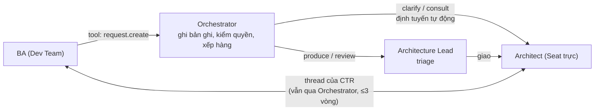

### 2.4 Khi nào cần phản hồi trực tiếp (đồng bộ)

Với agent LLM, "đồng bộ" nghĩa là **Session bên hỏi chờ câu trả lời trước khi làm tiếp**. Điều này tốn slot và có thể tốn token giữ ngữ cảnh. Các trường hợp cần:

| Trường hợp | Ví dụ | Cơ chế đề xuất |
|---|---|---|
| Câu hỏi làm rõ ngắn, chặn việc, trả lời được trong vài phút | BA hỏi Designer "form đăng ký có bắt buộc số điện thoại?" | CTR `clarify` với `responseMode: blocking` và **wait budget** (§2.5) |
| Câu hỏi tra cứu được từ tri thức đã có | "Research đã kết luận phân khúc khách hàng nào?" | **Không gửi cho Team**: tra Knowledge Store trước (§9). Chỉ gửi CTR khi không tìm thấy |
| Thương lượng hợp đồng giữa hai bên đang cùng làm | FE và BE chốt một trường API | Thread trong CTR, tối đa 3 vòng, sau đó leo thang lên Lead |
| Tín hiệu an toàn | Dừng, thu hồi quyền, hủy | **Không qua hàng đợi nghiệp vụ**: control command ưu tiên, xử lý ngay (V2 `runs.cancel`) |
| Quyết định của Operator có hạn chót | Deploy production, vượt ngân sách | Decision Request có `neededBy`, thông báo chủ động; các nhánh không phụ thuộc vẫn chạy (V2 workflows §2) |
| Sự cố 24/7 | DevOps phát hiện lỗi production | Seat dedicated nhận sự kiện ngay; quyết định có tác động vẫn chờ người duyệt |

### 2.5 Wait budget: chờ hay nhả slot

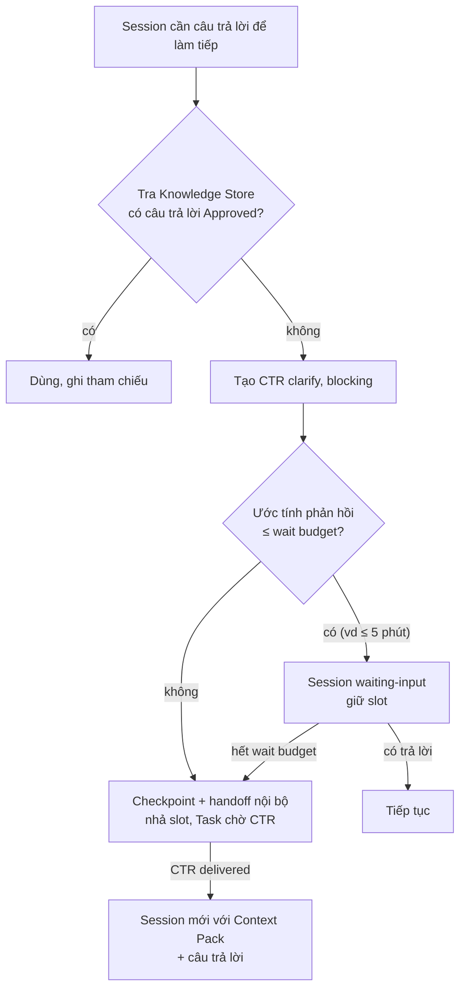

Lý do: giữ Session sống lâu làm tăng chi phí và rủi ro mất kết nối Node. Tạo Session mới với Context Pack là cách V2 đã chọn khi đổi runtime ("tạo run mới nhận context pack") và V1 đã dùng khi khôi phục (không replay Session cũ).

---

## 3. Giao thức giao việc giữa Team

### 3.1 Phân loại yêu cầu

| Loại | Mục đích | Đầu ra mong đợi | Tạo Task con ở Team nhận? | Ai triage |
|---|---|---|---|---|
| `clarify` | Hỏi làm rõ một điểm | Câu trả lời ngắn, có thể kèm tham chiếu | Không | Định tuyến tự động tới Seat trực |
| `consult` | Xin tư vấn chuyên môn | Khuyến nghị có lý do, có thể thành Decision Record đề xuất | Không, trừ khi Team nhận nâng cấp lên `produce` | Seat trực, Lead có thể can thiệp |
| `produce` | Yêu cầu tạo một đầu ra | Artifact theo output contract | **Có** | Lead của Team nhận |
| `review` | Yêu cầu thẩm định một Artifact | Review verdict gắn đúng phiên bản | **Có** (Task review) | Lead hoặc Seat reviewer |
| `decision` | Xin quyết định vượt thẩm quyền | Decision Record | Không; gửi tới Operator hoặc Lead có thẩm quyền | Orchestrator định tuyến theo ma trận thẩm quyền (§4.4) |
| `notify` | Thông báo thay đổi có thể ảnh hưởng | Không cần phản hồi; bên nhận đánh giá tác động | Không | Lead nhận thông báo |

### 3.2 Các pha của giao thức

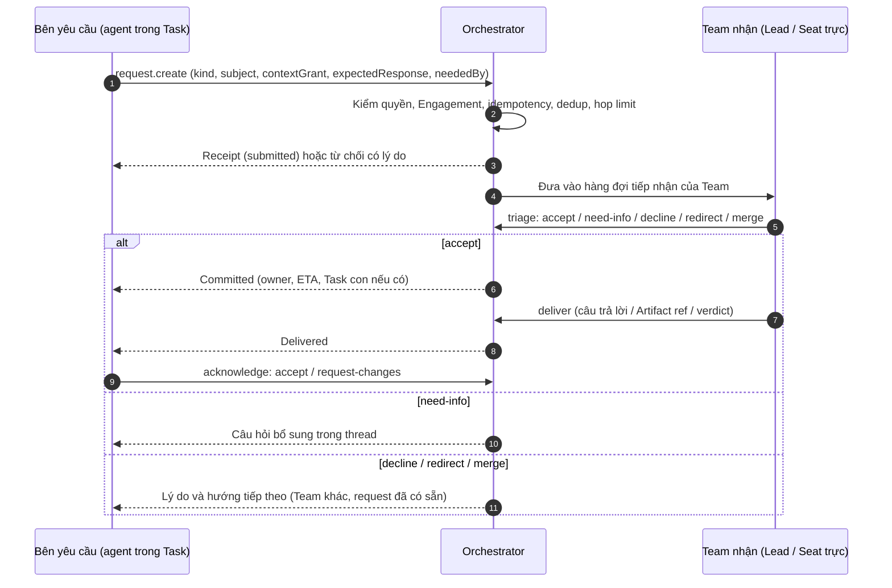

**Quy tắc của giao thức:**

1. **Mọi yêu cầu phải gắn một Task nguồn** (`requesterTaskId`). Không có "câu hỏi lơ lửng" không ai chịu trách nhiệm.
2. **Triage có hạn.** Mỗi loại có thời hạn triage mặc định; quá hạn thì Orchestrator báo bên yêu cầu và Lead của bên yêu cầu, không tự động chấp nhận.
3. **Team nhận có quyền từ chối** với lý do (`over-capacity`, `out-of-charter`, `insufficient-context`, `duplicate`). Từ chối không phải lỗi; bên yêu cầu có thể leo thang lên Project Lead hoặc Operator.
4. **Bàn giao bằng tham chiếu.** Câu trả lời dài hơn ngưỡng (ví dụ 1–2 nghìn token) phải được đăng ký thành Artifact; thread chỉ chứa tóm tắt và tham chiếu.
5. **Bên yêu cầu xác nhận.** CTR chỉ đóng khi bên yêu cầu `accept` hoặc hết hạn xác nhận (mặc định coi là accept, có ghi nhận).

### 3.3 Schema khái niệm: Cross-Team Request

> Mức khái niệm: tên trường và ý nghĩa, **không phải schema database hay API**. Kiểu dữ liệu chỉ để minh họa.

```yaml
CrossTeamRequest:
  # Định danh và chống trùng
  id: uuid
  commandId: uuid                 # idempotency, như V2 ADR-003
  dedupKey: string                # chuẩn hóa từ (targetTeam, kind, subjectRefs, câu hỏi) để gợi ý gộp
  # Phạm vi
  projectId: uuid                 # Project của bên yêu cầu
  engagementId: uuid              # Engagement Project ↔ Team nhận (bắt buộc, xem §3.5)
  requesterTaskId: uuid           # Task nguồn chịu trách nhiệm
  requester: { teamId, seatId, sessionId }
  targetTeamId: uuid
  targetSeatHint: seatId | null   # chỉ là gợi ý
  # Nội dung
  kind: clarify | consult | produce | review | decision | notify
  subject: string                 # một dòng
  ask: text                       # câu hỏi hoặc yêu cầu, giới hạn độ dài
  neededFor: { taskId, impact }   # việc nào bị chặn, hậu quả nếu chậm
  responseMode: async | blocking
  neededBy: timestamp | null
  expectedEffort: S | M | L
  expectedResponse:
    form: answer | artifact | verdict | decision
    format: string                # ví dụ "ERD + data dictionary", "OpenAPI 3.1"
    acceptance: [string]          # tiêu chí bên yêu cầu sẽ dùng để chấp nhận
  # Ngữ cảnh được cấp cho Team nhận (need-to-know)
  contextGrant:
    refs: [ artifactId@version ]  # chỉ những tham chiếu này được đọc
    excerpt: text                 # trích đoạn ngắn nếu cần, có giới hạn
    expiresWith: request          # quyền đọc hết khi CTR đóng
  constraints: { tokenBudget, mustNot: [string] }
  # Truy vết nhân quả
  causation: { rootId, parentRequestId | null, hop: int }
  # Trạng thái và kết quả
  state: <xem §5.3>
  triage: { by, at, decision, reason, eta }
  resolution: { responseRef | null, childTaskId | null, decisionIds: [] }
  revision: int
```

### 3.4 Schema khái niệm: Task

Task mở rộng `workItemSchema` của V2 (`models.ts`), không thay thế nó.

```yaml
Task:
  id: uuid
  code: string                    # ví dụ DEV-0042, như W-0001 của V1
  projectId: uuid
  engagementId: uuid              # Team nào thực hiện, trong phạm vi Project nào
  parentTaskId: uuid | null
  origin:
    kind: operator | delegation | cross-team-request | rule | schedule
    ref: uuid                     # message, CTR, rule trace...
  causation: { rootId, depth }    # chống vòng lặp
  # Mô tả
  title: string
  goal: string                    # một câu: kết quả cần đạt
  brief: text
  acceptanceCriteria: [string]
  outputContract: [ { kind, format, location, validators } ]
  # Trách nhiệm
  requester: { kind: operator | task | rule, ref }
  owner: { teamId, seatId }       # accountable, ổn định
  assignee: { instanceId } | null # runtime, có thể đổi
  reviewer: { seatId | operator } | null
  reviewPolicy: human-final | automatic | hybrid
  # Năng lực và đầu vào
  requiredCapabilities: [capabilityId]
  preferredCapabilities: [capabilityId]
  inputs: [ { ref: artifactId@version, purpose, required: bool } ]
  dependencies: [ { on: taskId | requestId | decisionId, type: blocks | informs } ]
  # Điều khiển
  gate: { requiresGo: bool, releasedBy, releasedAt } # Execution Gate
  state: <xem §5.1>
  holds: [ { reason, ref, since } ] # lý do chờ, trực giao với state
  disposition: active | parked | archived      # như V2
  budget: { tokens, wallTime, fixRoundsPerIssue: ≤3 }
  priority: int
  dueAt: timestamp | null
  revision: int
```

### 3.5 Task con của CTR nằm ở đâu?

| Phương án | Mô tả | Ưu | Nhược |
|---|---|---|---|
| **A. Trong Project của bên yêu cầu** [khuyến nghị] | Task con thuộc Project yêu cầu, thực hiện bởi Team nhận theo Engagement của Project đó | Chi phí, quyền, Artifact đều thuộc đúng Project; truy vết một chỗ | Team nhận phải xem việc của mình rải trên nhiều Project (cần view "hàng đợi Team" xuyên Project) |
| B. Trong backlog riêng của Team nhận | Team có Project nội bộ riêng | Team quản lý việc tập trung | Artifact và chi phí nằm sai Project; phải chia sẻ ngược; rò rỉ ngữ cảnh |

**Engagement chưa có thì sao?** Khi BA gửi CTR tới Architecture Team mà Project chưa mời Architecture Team:
- `clarify`/`consult`/`review`: Orchestrator **tự tạo Engagement tư vấn** với hạn mức nhỏ nếu chính sách Organization cho phép, có ghi nhận và thông báo.
- `produce`: cần Project Lead chấp thuận (trong hạn mức ngân sách Project) hoặc Operator (nếu vượt).

---

## 4. Delegation, Cross-Team Request và Ownership

### 4.1 Bốn đường giao việc

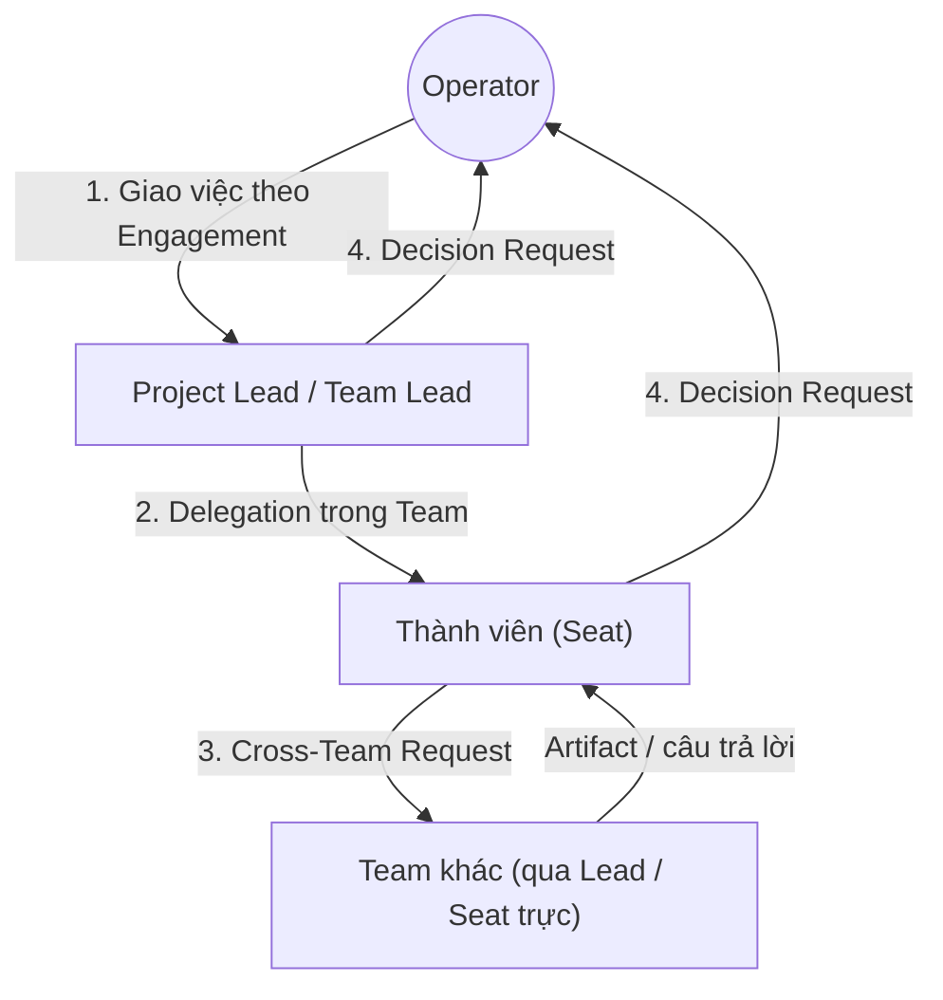

| Đường | Ai tạo | Ai nhận trách nhiệm | Cơ chế | Ownership |
|---|---|---|---|---|
| Operator → Lead | Operator | Lead của Team được Engagement | `work.create` + assign Seat | Lead sở hữu Task gốc |
| Delegation trong Team | Lead | Thành viên (Seat) | Task con, cùng Engagement | Thành viên sở hữu Task con; Lead vẫn sở hữu Task cha |
| Cross-Team Request | Thành viên hoặc Lead | Team nhận | CTR → (Task con nếu `produce`/`review`) | Team nhận sở hữu Task con; **bên yêu cầu vẫn sở hữu Task nguồn và việc tích hợp kết quả** |
| Decision Request | Bất kỳ agent | Operator hoặc Lead có thẩm quyền | Decision (V2 `decisionSchema`) | Người quyết định sở hữu quyết định; Task nguồn giữ hold `decision` |

### 4.2 Quy tắc ownership [Đề xuất]

| # | Quy tắc |
|---|---|
| O1 | **Mỗi Task có đúng một owner (Seat) tại mọi thời điểm.** Instance có thể đổi; owner thì không, trừ khi chuyển giao có chủ đích |
| O2 | **Ownership không chuyển ngầm.** Chuyển giao cần bản ghi handover và bên nhận chấp nhận. Tin nhắn thường không tự nhận việc (V2 workflows §4) |
| O3 | **Giao việc không chuyển trách nhiệm kết quả cuối.** Lead giao BA thì Lead vẫn chịu trách nhiệm Task cha |
| O4 | **Mỗi Artifact có một Team chủ.** Chỉ Team chủ tạo phiên bản mới. Team khác đề xuất sửa bằng CTR `review` hoặc `produce` |
| O5 | **Mỗi chủ đề có một nguồn chuẩn (canonical).** Ví dụ "data model của Project B" chỉ có một Artifact chuẩn; xem §14 |
| O6 | **Agent không được hủy hay đóng việc của Team khác.** Chỉ owner, Lead của owner, hoặc Operator |

### 4.3 Vai trò trên một Task (RACI rút gọn)

| Vai trò | Ý nghĩa | Ví dụ trong kịch bản |
|---|---|---|
| Requester | Người cần kết quả | BA khi gửi CTR tới Architecture |
| Owner (Accountable) | Chịu trách nhiệm kết quả | Architecture Lead với Task "ERD v1" |
| Assignee (Responsible) | Instance đang làm | Instance "Architect" trên WSL |
| Reviewer | Thẩm định chuyên môn | Senior Architect seat |
| Approver | Chấp thuận làm căn cứ | Project Lead hoặc Operator theo §4.4 |
| Informed | Nhận thông báo | Design Lead khi ERD đổi |

### 4.4 Ma trận thẩm quyền quyết định [Đề xuất]

| Loại quyết định | Agent thực hiện | Team Lead | Project Lead | Operator |
|---|---|---|---|---|
| Cách làm bên trong Task, trong scope và grant | ✔ | | | |
| Chia việc trong Team, chọn Seat | | ✔ | | |
| Chấp nhận/từ chối CTR gửi tới Team | | ✔ | | |
| Gửi CTR `produce` cho Team khác trong ngân sách Project | | đề xuất | ✔ | |
| Chọn giữa các phương án kỹ thuật tương đương | | ✔ (trong Team) | ✔ (xuyên Team) | |
| Thay đổi phạm vi, yêu cầu nghiệp vụ, tiêu chí nghiệm thu | | | đề xuất | ✔ |
| Giải quyết mâu thuẫn giữa hai Artifact Approved của hai Team | | | ✔ nếu trong thẩm quyền | ✔ nếu ảnh hưởng phạm vi/chi phí |
| Mở Execution Gate | | | đề xuất | ✔ (mặc định) |
| Tăng ngân sách, chi tiêu, publish ra ngoài, hành động không đảo ngược | | | | ✔ |
| Promotion tri thức lên Team Knowledge | | ✔ (theo D-06) | | ✔ với Global |

Thẩm quyền là **cấu hình theo Organization/Project**, không hardcode. Agent hỏi Operator chỉ khi quyết định nằm ở cột Operator; ngược lại, việc hỏi Operator vượt cấp bị Orchestrator chuyển về đúng người quyết định.

---

## 5. Vòng đời Task

### 5.1 Task State Machine

> **Cập nhật 07/11/2026 (ADR-T04, 05 §8.2, 07 AR-M4): sơ đồ và bảng dưới đây đã được thay thế ở các điểm sau.**
> - Task lifecycle **chỉ gồm trạng thái nghiệp vụ**: `Draft · Proposed · Accepted · Ready · AwaitingGo · Active · InReview · Done · Failed · Cancelled · Declined · Superseded`, cộng *holds* (điều kiện chờ) và *disposition* (`active/parked/archived`).
> - Các trạng thái `Queued`, `InProgress`, `Waiting`, `Interrupted`, `Paused` **không còn là trạng thái của Task**: `Queued/Running/Interrupted/...` thuộc **Attempt** (03 §12.2); `Paused` là `disposition: parked`; `Waiting` chỉ còn là trạng thái **hiển thị** (04 §8.1), không lưu.
> - `Active` nghĩa là Task đang có (hoặc sắp có) một Attempt sống; mọi chi tiết thực thi đọc từ Attempt.
> - Yêu cầu giữa các Team (CTR) **là một Task** có `origin = cross-team`, `requestKind`, `requesterTaskId` (AP-R8); triage là chuyển Proposed → Accepted/Declined. Mục 5.3 (state machine CTR riêng) chỉ còn giá trị tham khảo về hành vi.
>
> Khi bản sơ đồ cũ mâu thuẫn với ghi chú này, ghi chú này đúng.

Thiết kế giữ nguyên nguyên tắc V2: **trạng thái nghiệp vụ** (category/status của workflow) tách khỏi **trạng thái thực thi** (run attempt) và **lý do chờ** (holds) là điều kiện trực giao, không phải thêm cột.

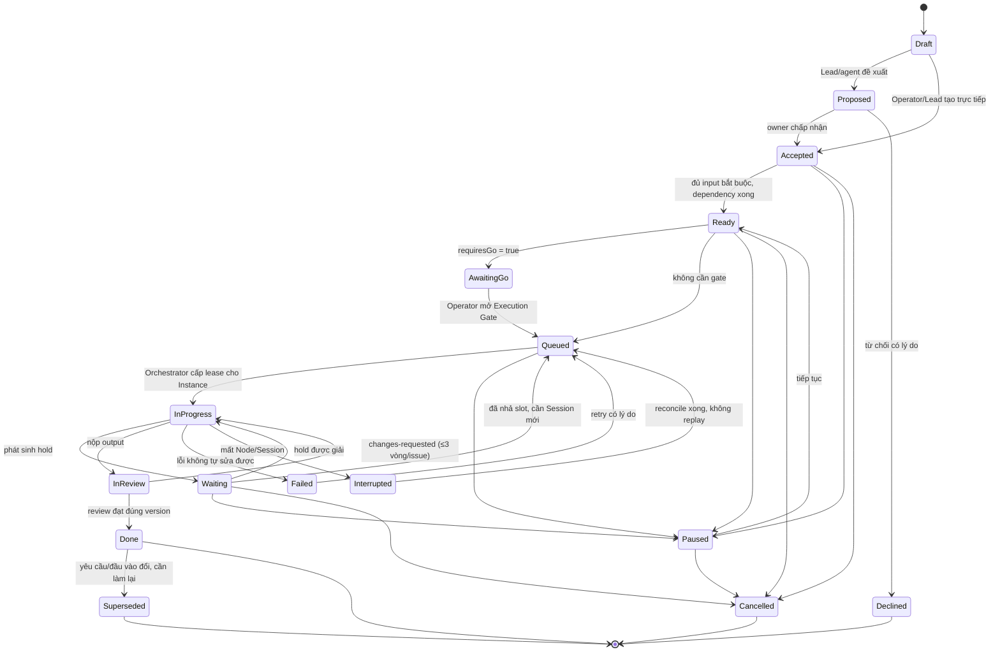

### 5.2 Ý nghĩa và ai được chuyển

| Trạng thái | Ý nghĩa | Ai/điều gì chuyển vào | Ánh xạ V2 category | Ánh xạ run state V2 |
|---|---|---|---|---|
| Draft | Đang soạn, chưa ai cam kết | Người tạo | backlog | — |
| Proposed | Được đề xuất (Lead hoặc từ CTR), chờ owner nhận | Agent/Lead qua tool | backlog | — |
| Accepted | Owner đã nhận, chưa đủ điều kiện chạy | Owner | planned | — |
| Ready | Đủ input bắt buộc, dependency xong | Orchestrator tính tự động | planned | — |
| **AwaitingGo** | **Sẵn sàng nhưng chờ lệnh** (Execution Gate) | Orchestrator khi `requiresGo` | planned | — |
| Queued | Được phép chạy, chờ năng lực/slot | Orchestrator | active | queued |
| InProgress | Có Instance đang làm | Orchestrator khi cấp lease | active | starting/running |
| Waiting | Đang làm nhưng bị chặn bởi hold | Orchestrator khi có hold | active | waiting-input hoặc đã nhả |
| InReview | Đã nộp output, chờ review theo policy | Agent nộp | review | succeeded |
| Done | Review đạt đúng phiên bản output | Reviewer/Approver | done | — |
| Failed | Lỗi không tự xử lý được trong giới hạn | Orchestrator/Owner | active + blocker | failed |
| Interrupted | Mất Node/Session, kết quả chưa rõ | Orchestrator | active | interrupted, outcome unknown |
| Paused | Tạm dừng có chủ đích, không auto-dispatch | Owner/Lead/Operator | giữ nguyên + disposition parked | — |
| Superseded | Đã xong nhưng không còn đúng vì đầu vào/yêu cầu đổi | Orchestrator khi phát hiện stale, Lead xác nhận | done (lịch sử) | — |
| Declined / Cancelled | Không làm | Owner/Lead/Operator | archived | — |

**Holds (lý do chờ) trực giao với state:**

| Hold | Ví dụ | Giải khi |
|---|---|---|
| `input` | Thiếu Artifact Approved bắt buộc | Artifact được Approved |
| `dependency` | Chờ Task khác | Task kia Done |
| `cross-team` | Chờ CTR | CTR Delivered và được accept |
| `decision` | Chờ Operator/Lead quyết định | Decision answered |
| `capacity` | Không có Instance/Node đủ năng lực | Có Instance phù hợp |
| `budget` | Hết ngân sách Project/Engagement/Team | Được cấp thêm |
| `permission` | Thiếu grant (một blocker cấu hình, V2 F1-04) | Grant được cấu hình |

### 5.3 State machine của Cross-Team Request

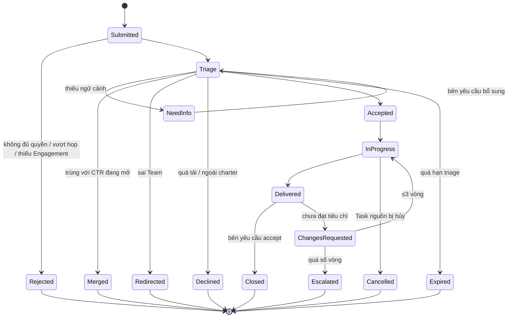

`Merged`: bên yêu cầu được đăng ký làm **người theo dõi** CTR gốc và nhận cùng kết quả. `Redirected`: Orchestrator tạo CTR mới tới Team đúng, giữ causation.

### 5.4 Trạng thái cấp Project (giai đoạn)

Kịch bản S6 cần một khái niệm ở cấp lớn hơn Task: **giai đoạn dự án**.

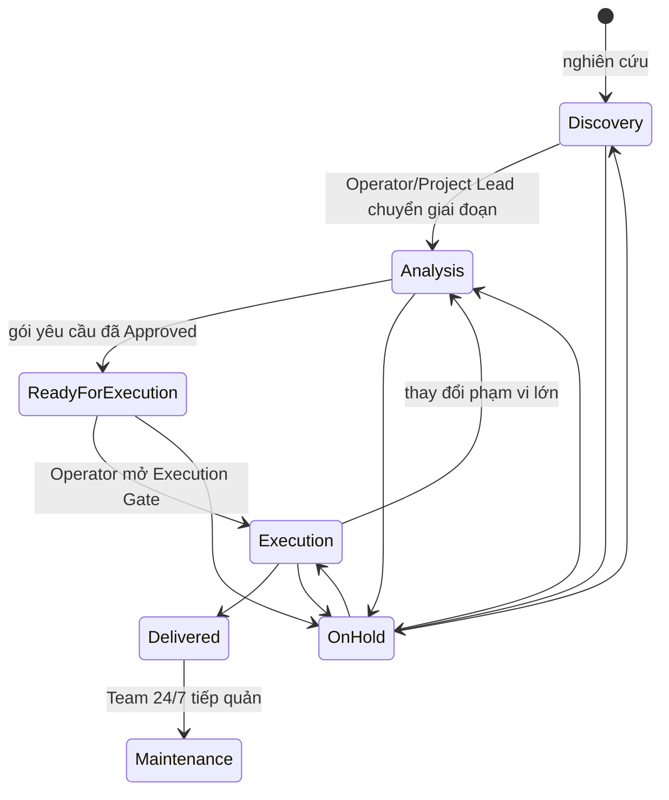

- Giai đoạn là **nhãn trên Project**, không phải workflow engine thứ hai. Mỗi giai đoạn có danh sách Task gốc và tiêu chí chuyển.
- `ReadyForExecution` là trạng thái tổng hợp: tất cả Task triển khai đang ở `AwaitingGo`, gói yêu cầu (requirements, architecture, UI spec) đều **Approved**.
- Mở gate là **một** hành động của Operator, áp cho một tập Task (theo giai đoạn hoặc chọn từng phần), có ghi Decision Record.

---

## 6. Nhiều Team cùng yêu cầu một Team chuyên môn

### 6.1 Hàng đợi tiếp nhận của Team

Mỗi Team có một **intake queue** xuyên Project (view, không phải hàng đợi vật lý riêng). Lựa chọn thứ tự:

| Yếu tố | Cách tính đề xuất |
|---|---|
| Mức chặn | `blocking` và đang chặn Task `InProgress` > chặn Task chưa chạy > không chặn |
| Ưu tiên Engagement | Do Operator đặt cho từng cặp Project–Team |
| Hạn chót | `neededBy` gần hơn được ưu tiên |
| Aging | Thời gian chờ tăng dần ưu tiên để tránh bỏ đói |
| Hạn mức | Mỗi Engagement có số việc song song tối đa ở Team nhận |
| Kích thước | Việc `S` có thể chen giữa các việc `L` (tránh việc nhỏ chờ lâu) |

Thứ tự là **xác định** (Orchestrator tính), không để LLM quyết định thứ tự hàng đợi. Lead chỉ triage nội dung (nhận/từ chối/gộp) và có thể đề xuất điều chỉnh ưu tiên.

### 6.2 Kỹ thuật giảm tải cho Team chuyên môn

| Kỹ thuật | Mô tả |
|---|---|
| **Knowledge-first** | Trước khi CTR vào hàng đợi, Orchestrator tra Knowledge Store; nếu có Artifact/Decision Approved trả lời được, gợi ý cho bên hỏi và cho phép rút CTR |
| **Gộp yêu cầu trùng** | Cùng `dedupKey` hoặc Lead nhận thấy trùng → `Merged`, trả lời một lần cho nhiều bên |
| **Trả lời tái sử dụng** | Câu trả lời mang tính tổng quát được đề xuất promotion lên Team Knowledge (D-06), lần sau trả lời bằng tra cứu |
| **Gom lô (batching)** | Các `consult` không chặn được gom và xử lý theo lượt, giảm số lần dựng ngữ cảnh |
| **Seat trực** | `clarify`/`consult` đi thẳng tới Seat trực, Lead chỉ xử lý `produce`/`review` |
| **Co giãn Instance** | Seat elastic tăng Instance khi hàng đợi dài, trong giới hạn Node và ngân sách |
| **Backpressure** | Hàng đợi vượt ngưỡng → Team trả ETA dài hoặc từ chối `over-capacity`; bên yêu cầu thấy ngay để leo thang thay vì chờ mù |

### 6.3 Xung đột ưu tiên

- Hai Project cùng có yêu cầu `blocking` tới Architecture Team và chỉ có một slot: Orchestrator xếp theo bảng §6.1. Nếu cả hai cùng mức, ưu tiên Engagement do Operator đặt quyết định.
- **Không cướp việc đang chạy** (đã chốt ở 01 §10.2).
- Operator có thể **ghi đè ưu tiên** bằng một command, có ghi nhận.

---

## 7. Chống vòng lặp, trùng tác vụ và tranh chấp kết quả

### 7.1 Vòng lặp giao việc

| Rủi ro | Ví dụ | Cơ chế |
|---|---|---|
| Ping-pong | BA hỏi Architect, Architect hỏi ngược BA, lặp lại | Thread trong CTR tối đa **3 vòng**, sau đó tự leo thang lên hai Lead |
| Chu trình giữa Team | Dev → Arch → Design → Dev cùng một chủ đề | `causation.rootId` + đồ thị yêu cầu; Orchestrator từ chối CTR tạo chu trình **không có Artifact mới** trên cùng root |
| Đệ quy sâu | Mỗi Team lại giao tiếp cho Team khác | Giới hạn **hop** (mặc định 3) từ Task gốc |
| Sửa lỗi vô tận | Review → sửa → review không đạt | **≤3 vòng sửa mỗi issue** (V2 ADR-003), quá thì blocked có lý do |
| Rule/automation tự kích hoạt lại | Event tạo Task tạo event | Hop limit, no-op detection, quarantine (V2 F5-05) |
| Đốt ngân sách | Vòng lặp tốn token | Ngân sách theo `rootId`: tổng chi phí của mọi Task/CTR cùng gốc có trần |

### 7.2 Trùng tác vụ

| Lớp | Cơ chế |
|---|---|
| Gửi lại cùng một lệnh | `commandId` idempotent, cùng ID + cùng nội dung trả receipt cũ (V2 ADR-003; V1 đã có `chat_requests`) |
| Hai agent tạo cùng một yêu cầu | `dedupKey` chuẩn hóa → gợi ý gộp khi triage |
| Một Task có hai lần chạy | Một live assignment mỗi Task, một live attempt mỗi assignment, fencing theo epoch (V2 schema reference) |
| Callback trễ của lần chạy cũ | Callback mang epoch/lease, bản cũ bị từ chối (V2 ADR-003) |
| Hai Team cùng làm một đầu ra | Quy tắc O4/O5: một Team chủ cho mỗi Artifact và một Artifact chuẩn cho mỗi chủ đề |

### 7.3 Tranh chấp kết quả

Ví dụ: Architecture đề xuất bảng `users` có trường `phone` bắt buộc; Design làm form không có số điện thoại.

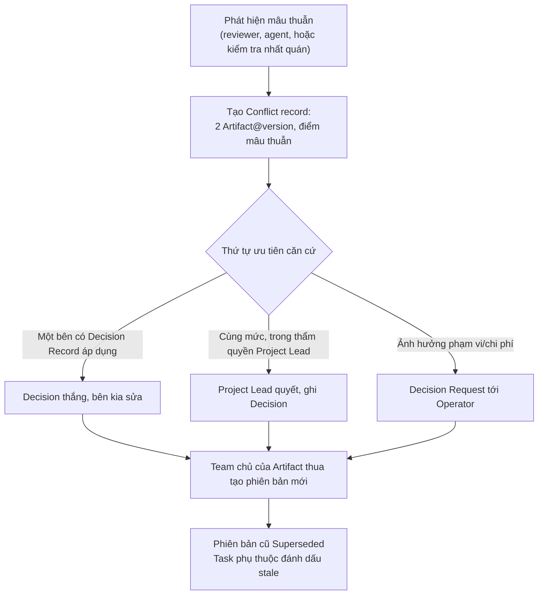

**Thứ tự ưu tiên căn cứ:** Decision Record đã chấp nhận > Artifact Approved > Artifact Reviewed > Artifact Draft > phát ngôn trong hội thoại. Hội thoại **không bao giờ** là căn cứ cuối cùng; điều gì quan trọng phải được ghi thành Decision hoặc Artifact.

**Không giải tranh chấp bằng cách để hai agent làm song song rồi lấy kết quả sau cùng** (V2 workflows §7). Ghi đồng thời dùng compare-and-swap theo revision (V2 `expectedRevision`), không last-write-wins.

---

## 8. Truyền Context có cấu trúc

### 8.1 Nguyên tắc

1. **Tham chiếu, không sao chép.** Truyền `artifactId@version` và tóm tắt; nội dung đầy đủ lấy khi cần.
2. **Phân tầng.** Mỗi đơn vị tri thức có tối thiểu ba mức chi tiết.
3. **Theo mục đích.** Context Pack được dựng cho một Task cụ thể, theo Role của người nhận.
4. **Có ngân sách.** Mỗi pack có trần token; vượt trần thì giảm tầng chi tiết, không cắt ngẫu nhiên.
5. **Không có transcript mặc định.** Chỉ đưa đoạn hội thoại đã được đánh dấu liên quan (V2 workflows §4 đã quy định).

### 8.2 Ba tầng chi tiết của mỗi Artifact

| Tầng | Nội dung | Kích thước gợi ý | Khi nào dùng |
|---|---|---|---|
| **L0 · Thẻ** | Tiêu đề, loại, trạng thái, phiên bản, Team chủ, một câu tóm tắt | ≤ 100 token | Danh sách, chỉ mục, Context Pack mặc định |
| **L1 · Tóm lược** | Mục tiêu, kết luận chính, quyết định, giả định, câu hỏi mở, các mục con | ≤ 1.500 token | Đầu vào bắt buộc của Task |
| **L2 · Toàn văn** | Nội dung đầy đủ hoặc một phần (theo mục) | Không giới hạn, lấy theo mục | Agent chủ động truy xuất qua tool |

L1 là **bắt buộc khi công bố Artifact** (sinh bởi agent tạo Artifact, được review cùng Artifact), không sinh lại mỗi lần đọc. Điều này đổi chi phí tóm tắt một lần lấy lợi ích đọc nhiều lần.

### 8.3 Cấu trúc Context Pack (khái niệm)

```yaml
ContextPack:
  forTask: taskId
  forSeat: seatId                  # chọn góc nhìn theo Role
  builtAt: timestamp
  budget: { maxTokens }
  sections:
    brief:        { goal, acceptanceCriteria, outputContract }       # luôn có
    constraints:  { grants, budget, deadline, mustNot }               # luôn có
    inputs:       [ { ref: artifact@version, tier: L1 | L0, why } ]   # đầu vào bắt buộc ở L1
    decisions:    [ { decisionId, oneLine } ]                         # quyết định liên quan đang hiệu lực
    openQuestions:[ { ref, text } ]
    handoff:      { fromTask, done, remaining, checks }               # nếu tiếp nối (V2 handoff envelope)
    threadExcerpt:[ messageId ]                                       # chỉ tin đã đánh dấu liên quan
    teamPlaybook: [ knowledgeRef ]                                    # Team Knowledge áp dụng
    retrievalHints: [ "knowledge.search scope=project tags=db" ]      # gợi ý tra thêm
  omitted: [ { ref, reason: "over-budget" | "not-relevant" | "no-access" } ]  # minh bạch phần bị bỏ
```

`omitted` quan trọng: agent biết có thông tin bị lược và có thể chủ động lấy, thay vì tưởng đã đủ.

### 8.4 Ai dựng Context Pack

| Phương án | Ưu | Nhược |
|---|---|---|
| Lead (LLM) dựng thủ công mỗi lần giao | Chọn lọc thông minh | Tốn token, không nhất quán, Lead thành nút thắt |
| **Orchestrator dựng theo luật + Lead bổ sung** [khuyến nghị] | Rẻ, nhất quán, kiểm quyền chắc chắn; Lead chỉ thêm ghi chú/chọn input khi giao | Luật chọn lọc cần tinh chỉnh |
| Agent tự truy xuất hoàn toàn | Linh hoạt | Agent mất bước đầu "định hướng", dễ đọc sai phiên bản |

Pack dựng bởi Orchestrator luôn là **tập con những gì Session được phép đọc** (§16). Kiểm quyền nằm ở đây, không trong prompt.

### 8.5 Handoff khi kết thúc Task

Giữ nguyên handoff envelope của V2 workflows §4: đã làm gì, output versions/hashes, quyết định đã áp dụng, kiểm tra pass/fail/not-run, phần chưa làm, phụ thuộc và owner tiếp theo. Bổ sung: **"điều người kế tiếp cần biết mà không có trong Artifact"**, giới hạn ngắn. V1 đang giới hạn handoff 32.000 ký tự (`team/handoff.ts`); đề xuất giới hạn theo token và theo tầng thay vì một trần ký tự.

---

## 9. Chia sẻ Context trực tiếp và truy xuất qua Knowledge Store

### 9.1 So sánh

| Tiêu chí | Chia sẻ trực tiếp (đẩy nội dung/hội thoại vào prompt bên nhận) | Truy xuất qua Knowledge Store (đẩy tham chiếu, kéo nội dung khi cần) |
|---|---|---|
| Chi phí token | ● Cao, lặp lại mỗi lần | ●●● Thấp, chỉ L0/L1 + phần cần thiết |
| Độ tươi | ● Bản sao có thể cũ ngay khi gửi | ●●● Tham chiếu pinned + biết có bản mới |
| Truy vết | ● Khó biết agent dựa vào đâu | ●●● Mỗi lần đọc là một tham chiếu có phiên bản |
| Context pollution | ● Cao (lẫn nháp, lan man) | ●●● Thấp, có trạng thái tài liệu |
| Kiểm soát quyền | ● Nội dung đã nằm trong prompt | ●●● Kiểm ở tool truy xuất |
| Hoạt động sau thời gian dài | ● Hội thoại cũ mất ngữ cảnh | ●●● Tri thức có trạng thái, có tóm lược |
| Độ trễ | ●●● Không cần thêm bước | ●● Thêm lượt gọi tool |
| Nguy cơ thiếu thông tin | ●●● Ít (có đủ mọi thứ) | ●● Agent có thể không biết cần tra (giảm bằng `retrievalHints`, `omitted`) |
| Độ phức tạp hạ tầng | ●●● Đơn giản | ●● Cần chỉ mục, tóm lược, kiểm quyền |
| Phù hợp nhiều Worker Node | ● Đẩy khối lớn qua mạng | ●●● Node chỉ nhận pack và lấy thêm theo yêu cầu |

### 9.2 Khuyến nghị: đẩy tối thiểu, kéo khi cần

- **Đẩy**: Context Pack gồm L0/L1 của đầu vào bắt buộc, quyết định đang hiệu lực, ràng buộc.
- **Kéo**: agent dùng tool `knowledge.search` / `knowledge.get(ref, section)` cho L2 và tri thức liên quan khác.
- **Ngoại lệ chia sẻ trực tiếp**: đoạn trao đổi ngắn trong thread CTR đang mở (dưới vài trăm token), và trích đoạn được bên yêu cầu chọn trong `contextGrant.excerpt`.

### 9.3 Truy xuất không mặc định cần Vector DB

| Cơ chế | Dùng cho | Ghi chú |
|---|---|---|
| **Tra theo tham chiếu** | Đầu vào pinned, quyết định | Nhanh, chính xác, chiếm phần lớn nhu cầu |
| **Lọc theo metadata** | Theo Project, Team, loại Artifact, trạng thái, tag năng lực, thời gian | Đủ cho "tài liệu Approved về database của Project B" |
| **Đồ thị liên kết** | Task → Artifact → Decision → Artifact nguồn | Khôi phục bối cảnh, phân tích tác động (§14) |
| **Tìm kiếm toàn văn** | Từ khóa trong nội dung | Ví dụ SQLite FTS5; là lựa chọn triển khai, chưa chốt |
| **Tìm theo ngữ nghĩa (embedding)** | Câu hỏi diễn đạt khác từ khóa, kho lớn | **Hoãn**. Chỉ xét khi đo được tra cứu theo metadata + toàn văn thất bại thường xuyên |

Khi Operator nói "ý tưởng hôm trước" (kịch bản S3), truy xuất kết hợp toàn văn + metadata + danh sách gần đây, rồi **Operator xác nhận đúng mục** trước khi Dev Lead tiếp nhận. Không để hệ thống tự chọn khi có nhiều ứng viên.

---

## 10. Tối ưu token và giảm Context Pollution

### 10.1 Các dạng ô nhiễm ngữ cảnh

| Dạng | Ví dụ | Biện pháp |
|---|---|---|
| Lịch sử không liên quan | Toàn bộ hội thoại Research trong Session của BA | Không có transcript mặc định; chỉ L1 + quyết định |
| Phiên bản lỗi thời | ERD v1 trong khi v2 đã Approved | Tham chiếu pinned + cảnh báo "có bản mới"; Superseded không vào pack trừ khi được yêu cầu |
| Nháp chưa duyệt bị coi là sự thật | Bản Draft của Designer | Pack ghi rõ trạng thái; Draft không làm input bắt buộc của Execution |
| Suy đoán trình bày như sự thật | Model "nhớ" sai một quyết định | Mọi khẳng định quan trọng phải trỏ tới Decision/Artifact |
| Dữ liệu Project khác | Research cho Project A lẫn vào Project B | Session chỉ thuộc một Project (01 R6); Artifact khác Project chỉ qua chia sẻ rõ ràng |
| Nhiễu công cụ | Log Bash, output build dài | Không vào pack; chỉ tóm tắt kết quả kiểm tra (V2 đã tách raw tool events khỏi feed) |
| Mâu thuẫn chưa giải quyết | Hai tài liệu trái nhau | Conflict record hiện trong pack thay vì để agent tự chọn |

### 10.2 Kỹ thuật tối ưu

| Kỹ thuật | Tác dụng |
|---|---|
| Session ngắn theo Task (D-05) | Không tích lũy rác qua nhiều việc |
| Tóm lược L1 sinh một lần lúc công bố | Không tóm tắt lại mỗi lần đọc |
| Góc nhìn theo Role | BA nhận phần yêu cầu; Dev nhận API contract và data model; Designer nhận user flow |
| Nén hội thoại tại mốc | Khi thread CTR đóng, phần hội thoại được rút thành câu trả lời + Decision; transcript chỉ giữ để kiểm toán |
| Knowledge-first cho câu hỏi | Không đánh thức Team để trả lời điều đã có |
| Context diff khi tiếp tục | Session mới chỉ nhận "điều gì đã đổi từ checkpoint trước" thêm vào pack cơ sở |
| Pinned version | Không đọc lại để kiểm tra "có đổi không"; Orchestrator báo khi đổi |
| Ngân sách theo pack và theo root | Trần rõ, báo `omitted` thay vì cắt im lặng |
| Gom lô consult | Một lần dựng ngữ cảnh cho nhiều câu hỏi cùng chủ đề |

### 10.3 Chỉ số cần đo (chưa có số liệu)

- Token đầu vào trung bình mỗi Task, theo loại Task.
- Tỷ lệ agent phải truy xuất thêm sau khi nhận pack (cao → pack thiếu; quá thấp có thể → pack thừa).
- Tỷ lệ CTR được trả lời bằng Knowledge-first.
- Tỷ lệ hỏi lại cùng một câu (re-ask) giữa các Team.
- Số lần review thất bại do dùng đầu vào lỗi thời.

---

## 11. Bốn lớp tri thức

### 11.1 Phân biệt

| Lớp | Phạm vi | Nội dung | Ai ghi | Ai đọc | Vòng đời |
|---|---|---|---|---|---|
| **Agent Memory** | Một Session (và tùy chọn: ghi chú của một Seat) | Bộ nhớ làm việc, kế hoạch tạm, scratchpad | Agent trong Session | Chính Session đó | Hết khi Session kết thúc; phần đáng giữ phải đi vào Handoff hoặc Artifact |
| **Project Knowledge** | Một Project | Artifact, Decision Record, glossary, dossier, câu hỏi mở của Project | Agent qua đăng ký Artifact/Decision; Lead/Operator duyệt | Mọi Session thuộc Project; Team khác chỉ qua `contextGrant` hoặc chia sẻ | Theo Project; Superseded vẫn lưu |
| **Team Knowledge** | Một Team, mọi Engagement | Playbook, checklist, mẫu, bài học, câu trả lời tổng quát đã duyệt | Promotion có duyệt (D-06) | Mọi Session của Team, ở mọi Project | Có revision; nội dung lỗi thời bị retire |
| **Global Knowledge** | Organization | Chính sách, quy ước chung, sở thích của Operator, taxonomy năng lực, Artifact chia sẻ toàn Organization | Operator hoặc người được ủy quyền | Mọi Session (theo nhãn nhạy cảm) | Có revision |

### 11.2 Về Agent Memory dài hạn

Ở mô hình Hybrid, Instance co giãn và có thể bị thay. **Không nên lưu bộ nhớ dài hạn gắn với Instance** vì:
- Instance mất thì bộ nhớ mất, hoặc phải đồng bộ giữa Node.
- Bộ nhớ ẩn trong một agent không được review, không truy vết, dễ mang dữ liệu Project này sang Project khác (vi phạm 01 R6).
- Hai Instance cùng Seat sẽ có "trí nhớ" khác nhau, kết quả không nhất quán.

Đề xuất: điều đáng nhớ được **ghi thành tri thức có chủ** (Project hoặc Team) qua cơ chế ở 11.3. Tính năng "memory" riêng của runtime (nếu có) bị tắt hoặc giới hạn trong Session.

### 11.3 Luồng nâng cấp tri thức

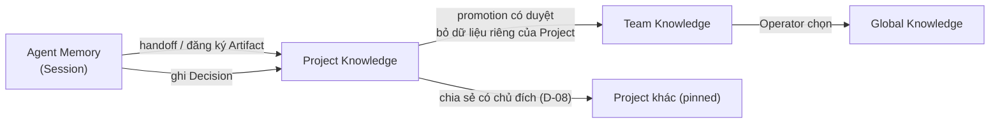

**Promotion lên Team Knowledge** gồm: Lead đề xuất mục cần nâng (ví dụ "checklist thiết kế bảng audit log"), nội dung được viết lại dạng tổng quát, kiểm tra không chứa dữ liệu riêng, tên khách hàng, secret; Lead Team hoặc Operator duyệt; ghi nguồn gốc (từ Project nào, Artifact nào).

---

## 12. Artifact: lưu trữ, phiên bản và truy xuất

### 12.1 Định danh

| Khái niệm | Ý nghĩa |
|---|---|
| **Artifact** | Một tài liệu/đầu ra logic, có danh tính ổn định. Ví dụ "Data model của Project B" |
| **Artifact Version** | Một bản cụ thể, **bất biến**, có số phiên bản tăng dần, hash nội dung, trạng thái riêng |
| **Working Copy** | Bản nháp có thể sửa trước khi nộp thành một Version. Chỉ Team chủ thấy |
| **Ref** | `artifactId@version` (pinned) hoặc alias `artifactId@approved` (chỉ được giải thành số cụ thể **lúc dựng pack** rồi ghim) |

### 12.2 Schema khái niệm: Artifact Version

Mở rộng `outputSchema` của V2 (đã có `sha256`, `evidenceIds`, `workItemId`, `runId`).

```yaml
ArtifactVersion:
  artifactId: uuid
  version: int                      # tăng dần, bất biến
  projectId: uuid                   # Project chủ
  ownerTeamId: uuid                 # Team chủ (O4)
  kind: research-report | requirements | adr | data-model | api-contract
        | ui-spec | design-asset | media | code-ref | dataset | dossier | other
  mediaType: string
  contentHash: sha256
  blobRefs: [assetId]               # nội dung lưu theo hash
  abstract: { L0: string, L1: structured }   # bắt buộc khi nộp
  status: draft | in-review | reviewed | approved | superseded | rejected | withdrawn
  canonicalFor: subjectKey | null   # ví dụ "data-model" của Project (O5)
  visibility: team-draft | project | shared | organization
  sharedWith: [projectId | teamId]
  sensitivity: normal | confidential
  provenance:
    producedBy: { taskId, runId, seatId, profileRevision, model, skills }
    inputs: [ artifactId@version ]
    decisionsApplied: [decisionId]
    reviewedBy: [ { reviewer, verdict, at } ]
    approvedBy: { actor, authority, at } | null
  supersedes: artifactId@version | null
  supersededBy: artifactId@version | null
  validUntil: timestamp | null      # cho tri thức có tính thời điểm (nghiên cứu thị trường)
  tags: [capabilityId | freeTag]
  evidenceIds: [id]
```

### 12.3 Lưu trữ [Đề xuất ở mức nguyên tắc]

- **Nội dung lưu theo hash (content-addressed)** trong state của control plane; metadata tách riêng. Hai bản giống nhau không nhân đôi dung lượng.
- **Artifact sinh trên Worker Node** được tải lên control plane khi nộp, qua staging → kiểm tra → công bố nguyên tử (V2 workflows §6 cho media). Node không là nơi lưu trữ chuẩn.
- **Artifact là code** (Git) được lưu dưới dạng `code-ref`: repo, commit, đường dẫn, không sao chép toàn bộ source vào Knowledge Store.
- **Media lớn** có thể chỉ lưu bản final + bản preview; bản trung gian theo chính sách retention, không xóa bản còn được tham chiếu (V2 README §6).

### 12.4 Truy xuất

| Cách | Ví dụ |
|---|---|
| Theo ref | `knowledge.get("data-model@3", section="tables.users")` |
| Theo alias đã giải | `data-model@approved` → `@3` lúc dựng pack |
| Theo tìm kiếm có phạm vi | `knowledge.search(scope=project, kind=adr, status=approved, text="xác thực")` |
| Theo liên kết | "Tất cả Artifact đầu vào của Task DEV-0042", "Mọi Task dùng data-model@2" |
| Theo nguồn chuẩn | "Data model chuẩn hiện hành của Project B" |

---

## 13. Trạng thái tài liệu

### 13.1 Vòng đời của một Artifact Version

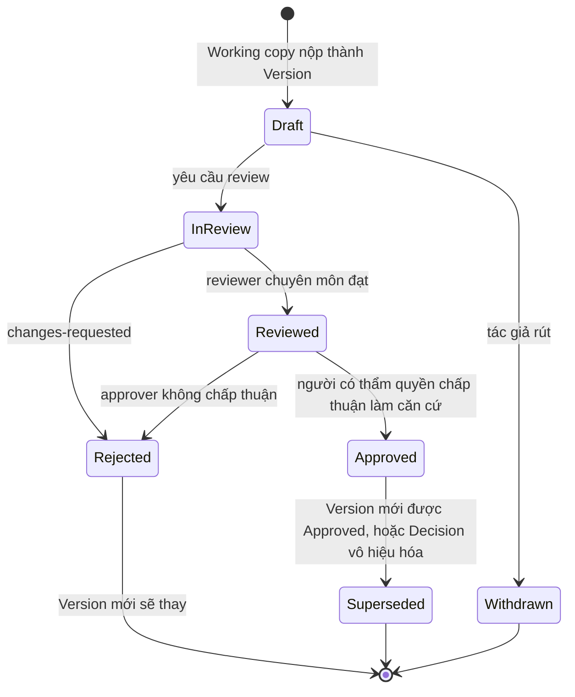

### 13.2 Ý nghĩa

| Trạng thái | Nghĩa | Ai chuyển | Có thể làm đầu vào |
|---|---|---|---|
| **Draft** | Bản đã nộp nhưng chưa thẩm định | Tác giả | Chỉ cho việc khám phá trong Team chủ; **không** làm đầu vào bắt buộc của Execution |
| **InReview** | Đang được thẩm định | Tác giả/Lead | Như Draft |
| **Reviewed** | Đạt thẩm định chuyên môn (đúng, đủ, nhất quán) | Reviewer của Team chủ hoặc Team khác qua CTR `review` | Được dùng cho Analysis; dùng cho Execution chỉ khi policy cho phép |
| **Approved** | Được chấp thuận **làm căn cứ** cho bên khác | Approver theo §4.4 (Project Lead hoặc Operator) | Có, là căn cứ chuẩn |
| **Superseded** | Có bản mới hơn đã Approved hoặc bị Decision vô hiệu | Orchestrator tự động khi bản mới Approved | Không cho việc mới; Task đang dùng được báo stale |
| Rejected / Withdrawn | Không dùng | Reviewer / tác giả | Không |

**Tách Reviewed và Approved** vì hai câu hỏi khác nhau: "có đúng chuyên môn không?" (Team chuyên môn trả lời) và "có được dùng làm căn cứ cho dự án không?" (người chịu trách nhiệm phạm vi trả lời). Với tài liệu nhỏ, policy có thể gộp hai bước.

**Trạng thái gắn với Version, không gắn với Artifact.** "Data model" có thể đồng thời có `@2 Approved`, `@3 InReview`. Ánh xạ V2: review `pending/accepted/changes-requested/superseded` là bản ghi review của một Version; trạng thái tài liệu là tổng hợp từ các review đó và quyết định chấp thuận.

### 13.3 Tri thức có thời hạn

Kết quả nghiên cứu thị trường, so sánh công cụ, giá cả có thể lỗi thời. `validUntil` (hoặc ngưỡng tuổi theo `kind`) khiến Artifact được đánh dấu **stale** trong pack và khi khôi phục bối cảnh (§15), nhưng không tự đổi sang Superseded vì chưa có bản thay thế.

---

## 14. Quyết định, nguồn gốc dữ liệu và tính nhất quán

### 14.1 Decision Request và Decision Record

> **Cập nhật 07/11/2026 (05 I5, 07 AR-M4):** Decision Request **không còn là cơ chế riêng**: nó là một **Approval** loại `decision` (04 §10). **Decision Record** là kết quả bền vững của một Approval đã được quyết; **Review** là verdict trên một Artifact Version và chỉ hiện ra qua Approval khi policy yêu cầu người duyệt.

V2 đã có `decisionSchema` (`pending/answered/superseded`), tương ứng **Decision Request** (câu hỏi gửi người quyết định). Đề xuất thêm **Decision Record** là kết quả bền vững, dạng ADR, áp dụng cho mọi cấp (Operator, Project Lead, Team Lead).

```yaml
DecisionRecord:
  id: uuid
  code: string                    # ví dụ DEC-B-012
  scope: project | team | organization
  scopeId: uuid
  question: string
  options: [ { id, summary, tradeoffs } ]
  chosen: optionId
  rationale: text
  decidedBy: { actor, authority }  # theo ma trận §4.4
  inputs: [ artifactId@version ]   # căn cứ
  affects: [ artifactId | taskId ] # phạm vi tác động
  status: proposed | accepted | superseded | revoked
  supersedes: decisionId | null
  requestRef: decisionRequestId | null
  at: timestamp
```

Mọi điều sau **phải** thành Decision Record: mở Execution Gate, thay đổi phạm vi/tiêu chí, giải tranh chấp giữa Artifact, chọn phương án kiến trúc có tác động xuyên Team, chấp nhận rủi ro đã biết.

### 14.2 Nguồn gốc dữ liệu (provenance)

Mô hình theo tinh thần W3C PROV: **Entity** (Artifact Version, Decision), **Activity** (Task, Run Attempt, Review), **Agent** (Seat, Profile revision, Operator).

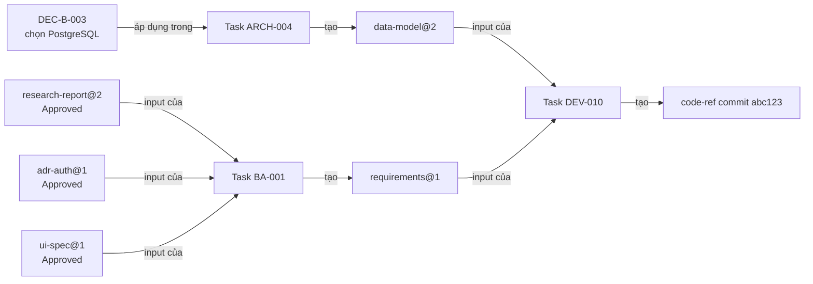

Đồ thị này trả lời được: "kết quả này dựa trên gì?", "nếu data-model đổi thì ảnh hưởng ai?", "quyết định nào dẫn tới thiết kế này?".

### 14.3 Tính nhất quán

| Cơ chế | Mô tả |
|---|---|
| **Pinning** | Đầu vào luôn ghim phiên bản; bản mới không thay ngầm |
| **Phân tích tác động** | Khi một Version bị Superseded hoặc Decision bị revoke, Orchestrator duyệt đồ thị provenance để liệt kê Task/Artifact phụ thuộc và đánh dấu **stale** |
| **Stale không tự làm lại** | Lead của Task bị ảnh hưởng đánh giá: bỏ qua (có lý do), cập nhật, hoặc tạo việc sửa. Kế thừa V2 workflows §3 ("Host đánh dấu dependency stale, Lead so tác động") |
| **Một nguồn chuẩn mỗi chủ đề** | Project có danh mục `canonicalFor` (data-model, api-contract, requirements, ui-spec...). Hai Artifact không thể cùng chuẩn cho một chủ đề |
| **Kiểm tra nhất quán khi review** | Reviewer kiểm Artifact mới với các Artifact chuẩn liên quan (ví dụ ui-spec so với data-model) trước khi Approved |
| **Nhật ký bất biến** | Event log append-only theo Project (V2 cursor/sequence) là nguồn kiểm toán; báo cáo V1 đã có trigger bất biến (`storage/reports.ts`) |

---

## 15. Khôi phục bối cảnh dự án sau thời gian dài

### 15.1 Project Dossier

Một Artifact đặc biệt `kind: dossier`, **sống cùng Project**, được cập nhật tại các mốc (đóng giai đoạn, mở gate, quyết định lớn), có phiên bản và được Project Lead review:

| Mục | Nội dung |
|---|---|
| Mục tiêu và phạm vi hiện hành | Một đoạn ngắn + tham chiếu requirements chuẩn |
| Giai đoạn và trạng thái gate | Discovery/Analysis/Ready/Execution... |
| Artifact chuẩn | Danh sách `canonicalFor` → ref Approved |
| Quyết định đang hiệu lực | Danh sách Decision Record + một dòng |
| Câu hỏi mở và CTR đang mở | Ai đang chờ ai |
| Rủi ro và giả định | Kèm ngày kiểm tra gần nhất |
| Team tham gia | Engagement, vai trò, hạn mức |
| Bước tiếp theo | Đã thống nhất gì |

Dossier là **L1 của cả Project**: đọc một tài liệu là định hướng được.

### 15.2 Quy trình tiếp nhận lại (resume)

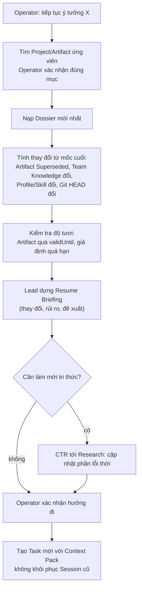

**Nguyên tắc:**
- **Không bao giờ resume Session cũ sau thời gian dài.** Bối cảnh dựng lại từ Dossier + Artifact + Decision. Phù hợp V1 (khôi phục không replay Session) và V2 (Session runtime không chuyển giữa runtime).
- **Profile/Skill có thể đã đổi.** Task mới dùng revision hiện hành; Resume Briefing nêu rõ khác biệt so với lúc làm trước.
- **Tri thức cũ được đánh dấu, không bị âm thầm tin.**

---

## 16. Phân quyền truy cập tri thức

### 16.1 Chủ thể và phạm vi

Quyền được tính **cho từng Session** (không cho cả agent hay cả Team), vì Session luôn thuộc đúng một Project, một Engagement, một Seat, một Node.

```text
Quyền đọc của Session =
    Global Knowledge (theo nhãn nhạy cảm)
  ∪ Team Knowledge của Team chứa Seat
  ∪ Project Knowledge của Project của Session (trừ team-draft của Team khác)
  ∪ Artifact được chia sẻ rõ ràng cho Project/Team này (D-08)
  ∪ refs trong contextGrant của CTR mà Session đang xử lý (hết hạn khi CTR đóng)
```

### 16.2 Ma trận

| Lớp tri thức | Session cùng Project, cùng Team | Session cùng Project, Team khác | Session Team chủ, Project khác | Session Project khác, Team khác | Operator |
|---|---|---|---|---|---|
| Team-draft của Project | Đọc/ghi | Không | Không | Không | Đọc |
| Project Knowledge (Reviewed/Approved) | Đọc | Đọc | Không (trừ chia sẻ) | Không (trừ chia sẻ) | Đọc/duyệt |
| Artifact chia sẻ cho Project/Team | Đọc | Đọc | Đọc nếu Team được chia sẻ | Đọc nếu Project được chia sẻ | Đọc |
| Team Knowledge | Đọc | Không | Đọc | Không | Đọc/duyệt |
| Global Knowledge | Đọc | Đọc | Đọc | Đọc | Đọc/ghi |
| contextGrant của CTR | — | Đọc trong thời gian CTR | — | — | Đọc |
| Nhãn `confidential` | Đọc nếu Seat được phép | Theo chính sách | Không | Không | Đọc |

**Ghi:** chỉ qua đăng ký Artifact/Decision của Task mình sở hữu; promotion qua duyệt. Không Session nào sửa Artifact của Team khác (O4).

### 16.3 Nguyên tắc thực thi

1. **Kiểm quyền ở tool truy xuất và khi dựng Context Pack**, không dựa vào hướng dẫn trong prompt.
2. **Worker Node không đồng bộ Knowledge Store.** Node chỉ nhận Context Pack và nội dung được truy xuất cho Session đang chạy trên nó. Mất Node không làm lộ toàn bộ tri thức.
3. **Secret không bao giờ là tri thức.** Secret đi qua credential ref (V2 ADR-006), không vào Artifact, pack, export hay log.
4. **Đọc tài liệu `confidential` được ghi nhật ký.**
5. **Chia sẻ có thể thu hồi cho truy cập mới**, nhưng không xóa tham chiếu đã ghim trong lịch sử (giữ truy vết).

---

## 17. Luồng dữ liệu chính

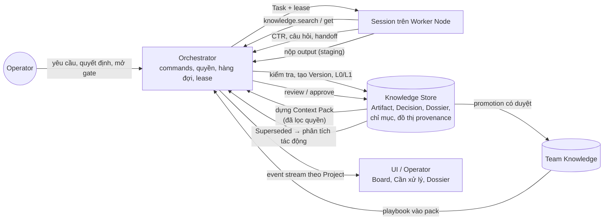

| Luồng | Nguồn → Đích | Dữ liệu | Đặc điểm |
|---|---|---|---|
| F1 Giao việc | Operator/Lead → Orchestrator → Session | Task, Context Pack | Bất đồng bộ, có lease |
| F2 Truy xuất | Session → Orchestrator → Knowledge Store | Ref, nội dung theo mục | Kiểm quyền mỗi lần |
| F3 Cross-team | Session → Orchestrator → Team khác | CTR, thread, câu trả lời | Bất đồng bộ, blocking có wait budget |
| F4 Công bố | Session → staging → Knowledge Store | Artifact Version + L0/L1 + provenance | Nguyên tử, bất biến |
| F5 Thẩm định | Reviewer/Approver → Knowledge Store | Verdict, approval | Gắn đúng Version |
| F6 Quyết định | Agent → Operator/Lead → Decision log | Decision Request → Record | Chặn đúng nhánh phụ thuộc |
| F7 Tác động | Knowledge Store → Orchestrator → Lead | Danh sách stale | Không tự làm lại |
| F8 Hiển thị | Orchestrator → UI | Event stream theo Project (V2 cursor) | Phát lại theo cursor |
| F9 Nâng tri thức | Project Knowledge → Team/Global | Bản tổng quát hóa | Có duyệt |

---

## 18. Sequence diagram cho kịch bản

### 18.1 Giai đoạn A: Research → tiếp nhận → BA → Architecture/Design → sẵn sàng

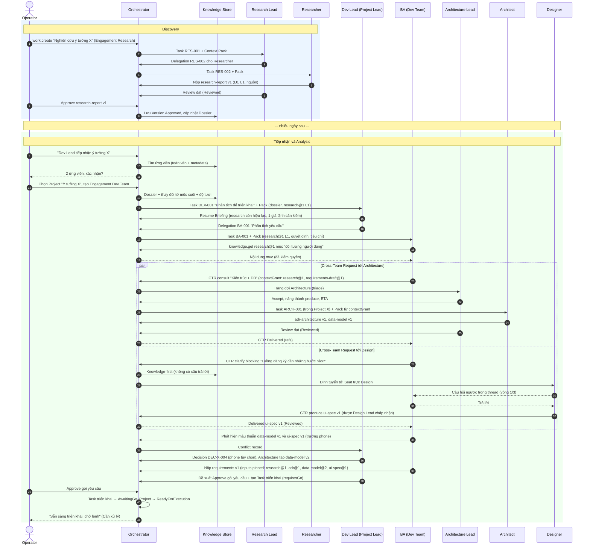

### 18.2 Giai đoạn B: thực thi và vấn đề mới

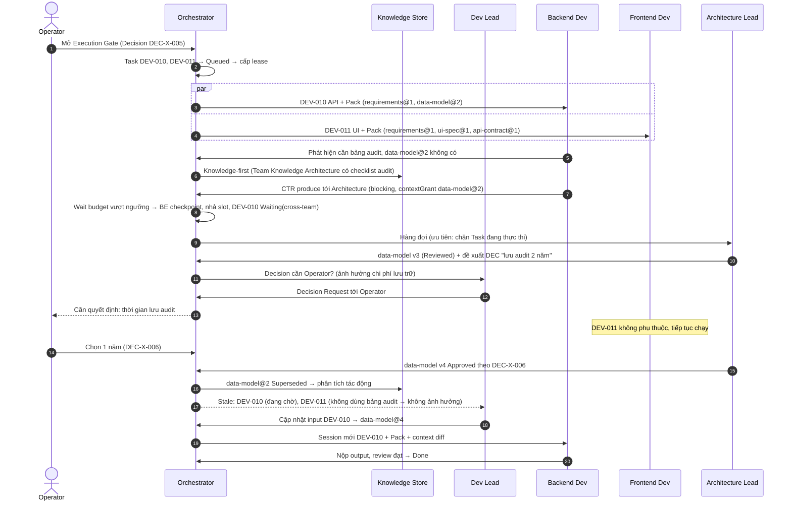

---

## 19. Quyết định cần người dùng phê duyệt

> **Cập nhật 07/11/2026:** phương án được chọn và trạng thái duyệt của từng quyết định được ghi tại [Sổ quyết định](00-decision-register.md). Bảng dưới giữ nguyên phân tích ban đầu.

| ID | Quyết định | Phương án | Khuyến nghị và lý do |
|---|---|---|---|
| **C-01** | Mô hình giao tiếp | (a) **Transport luôn qua Orchestrator + gửi tới Team + thread trực tiếp có giới hạn trong CTR**; (b) Agent-to-Agent tự do; (c) chỉ Lead-to-Lead | **(a)**: truy vết, chống vòng lặp tập trung, chạy được qua nhiều Node; tránh Lead thành nút thắt bằng định tuyến tự động cho `clarify`/`consult` |
| **C-02** | Nơi đặt Task con của CTR | (a) **Trong Project của bên yêu cầu**; (b) trong backlog riêng của Team nhận | **(a)**: chi phí, quyền, Artifact thuộc đúng Project |
| **C-03** | Tự tạo Engagement khi CTR tới Team chưa được mời | (a) **Tự tạo cho `clarify`/`consult`/`review` với hạn mức nhỏ; `produce` cần Project Lead hoặc Operator**; (b) luôn cần Operator; (c) luôn tự tạo | **(a)**: không làm phiền Operator cho câu hỏi nhỏ, vẫn kiểm soát chi phí |
| **C-04** | Execution Gate | (a) **Bật mặc định cho chuyển từ Analysis sang Execution, Operator mở**; (b) tùy Project; (c) không có gate | **(a)**: đúng kịch bản "sẵn sàng nhưng chờ lệnh"; có thể tắt theo Project về sau |
| **C-05** | Ma trận thẩm quyền quyết định | Theo bảng §4.4, có thể cấu hình | Duyệt bảng mặc định, nhất là những gì **bắt buộc** về Operator |
| **C-06** | Trạng thái tài liệu hai bước | (a) **Reviewed (chuyên môn) và Approved (căn cứ) tách riêng, có thể gộp theo policy**; (b) chỉ một bước Approved | **(a)**: tách "đúng chuyên môn" khỏi "được dùng làm căn cứ"; tài liệu nhỏ vẫn gộp được |
| **C-07** | Cách truy xuất tri thức ban đầu | (a) **Ref + metadata + đồ thị liên kết + toàn văn; chưa dùng embedding/vector DB**; (b) vector DB ngay | **(a)**: đủ cho quy mô cá nhân, rẻ, giải thích được; xét embedding khi có số liệu thất bại tra cứu |
| **C-08** | Bộ nhớ dài hạn của agent | (a) **Không có ở mức Instance; điều đáng nhớ thành tri thức Project/Team có duyệt**; (b) memory riêng mỗi agent | **(a)**: Instance co giãn, tránh rò rỉ giữa Project, giữ nhất quán |
| **C-09** | Giao tiếp đồng bộ | (a) **Chỉ qua CTR `blocking` với wait budget; quá ngưỡng thì nhả slot và dùng Session mới**; (b) giữ Session chờ đến khi có trả lời | **(a)**: tiết kiệm slot và token, chịu được Node mất kết nối |
| **C-10** | Giới hạn chống vòng lặp mặc định | Hop ≤ 3, thread ≤ 3 vòng, sửa ≤ 3 vòng/issue, ngân sách theo `rootId` | Duyệt các giá trị khởi đầu; tinh chỉnh sau khi đo |
| **C-11** | Ý tưởng chuyển từ nghiên cứu sang phát triển | (a) **Cùng một Project, chuyển giai đoạn Discovery → Analysis**; (b) Project mới tiêu thụ Artifact chia sẻ | **(a)** khi là cùng một sáng kiến; **(b)** khi nghiên cứu là tài sản chung cho nhiều sản phẩm. Cần Operator chọn mặc định |
| **C-12** | Project Dossier | (a) **Artifact sống, cập nhật tại mốc, Project Lead review**; (b) sinh lại mỗi lần resume; (c) không có | **(a)**: chi phí một lần, tiếp nhận lại nhanh và nhất quán |

---

## 20. Giả định chưa được xác minh

| # | Giả định | Vì sao chưa chắc | Cách xác minh |
|---|---|---|---|
| B1 | Agent LLM sinh được tóm lược L1 có cấu trúc, đủ chính xác để thay toàn văn trong đa số Task | Chưa thử; V1 chỉ có handoff/review context giới hạn ký tự | Thử trên vài Artifact thật, so kết quả Task dùng L1 với dùng L2 |
| B2 | Agent tuân thủ giao thức (dùng tool CTR, không tự hỏi lan man) khi chỉ được cấp tool phù hợp | Phụ thuộc runtime và model; DeepSeek Flash mới được kiểm mẫu nhỏ | Thử nghiệm với adapter F1-03 |
| B3 | Tra cứu theo metadata + toàn văn đủ tốt ở quy mô cá nhân | Chưa có kho tri thức thật để đo | Đo tỷ lệ tra cứu thất bại khi có vài trăm Artifact |
| B4 | Wait budget khoảng vài phút là hợp lý | Phụ thuộc tốc độ phản hồi của Team nhận và chi phí giữ Session | Đo thời gian phản hồi `clarify` |
| B5 | Giới hạn hop 3 và 3 vòng không chặn việc hợp lệ | Giá trị suy từ V2 (3 vòng sửa), chưa có dữ liệu cross-team | Theo dõi số lần chạm giới hạn |
| B6 | Operator phản hồi Decision Request đủ nhanh để không làm nghẽn dự án | Chưa biết thói quen sử dụng | Đo thời gian chờ quyết định |
| B7 | Orchestrator xác định (không LLM) dựng Context Pack đủ tốt khi có Lead bổ sung | Chưa có luật chọn lọc thật | Thử với kịch bản §18 |
| B8 | Chi phí sinh L1 khi công bố nhỏ hơn chi phí tiết kiệm khi đọc | Phụ thuộc số lần một Artifact được đọc | Đo trên vài Project |
| B9 | Phân tích tác động theo đồ thị provenance không tạo quá nhiều cảnh báo stale | Đồ thị dày có thể đánh dấu tràn lan | Thử với Project có nhiều phụ thuộc |
| B10 | Runtime (OpenCode/Codex/Claude) cho phép tắt hoặc giới hạn bộ nhớ dài hạn riêng của nó | Chưa kiểm từng runtime | Probe adapter F1-03/F3-02 |
| B11 | Lưu nội dung Artifact tập trung ở control plane không gây nghẽn khi có media lớn | Chưa có Video Team thật | Thử với Video Basic (V2 F6-04) |
| B12 | Một người vận hành chấp nhận số lượng Decision/Approve phát sinh theo ma trận §4.4 | Có thể quá nhiều thao tác duyệt | Đếm số yêu cầu duyệt mỗi tuần trong thử nghiệm |

---

## 21. Những gì tài liệu này không làm

- Không thiết kế bảng, chỉ mục, API endpoint hay giao thức mạng giữa control plane và Worker Node.
- Không chọn thư viện tìm kiếm, công cụ lưu trữ hay định dạng file cụ thể (FTS5 chỉ là ví dụ khả thi).
- Không thay đổi contracts V2, source V1 hay kế hoạch F0–F8.
- Không tự chuyển sang giai đoạn tiếp theo khi các quyết định ở §19 chưa được duyệt.
