# 03 · Distributed Agent Runtime và Multi-Machine Architecture

| Mục                   | Giá trị                                                                                                                                                                                                          |
| ---------------------- | ------------------------------------------------------------------------------------------------------------------------------------------------------------------------------------------------------------------ |
| Trạng thái           | **Bản phân tích để duyệt**: kiến trúc và giao thức ở mức khái niệm; chưa thiết kế bảng DB, endpoint chi tiết hay code                                                                     |
| Ngày                  | 07/11/2026                                                                                                                                                                                                         |
| Baseline               | commit `692ad3f`, branch `architecture/multi-team-research`                                                                                                                                                    |
| Tài liệu trước     | [00 · Sổ quyết định](00-decision-register.md), [01 · Domain Model](01-product-and-domain-model.md), [02 · Cộng tác và Tri thức](02-collaboration-and-knowledge.md), [Rà soát open-source](oss-options.md) |
| Phạm vi               | Control Plane/Execution Plane, Worker Registry, định danh, lập lịch, khởi tạo agent, giao tiếp, lease/heartbeat/retry, sự cố, chống trùng, truy cập dữ liệu, bảo mật, phương án triển khai     |
| Không thuộc phạm vi | Dựng server, cài đặt, sửa source/cấu hình/database                                                                                                                                                          |

**Quy ước nhãn:** **[Hiện có]** là điều có bằng chứng trong repo hoặc hạ tầng đã khảo sát. **[Đã duyệt]** là quyết định trong sổ quyết định. **[Đề xuất]** là phân tích của tài liệu này. **[Chưa xác minh]** là giả định chưa có bằng chứng.

---

## 1. Quyết định nền và bằng chứng hạ tầng

### 1.1 Quyết định đã duyệt áp dụng

| ID                             | Nội dung                                                                                   | Ảnh hưởng tới tài liệu này        |
| ------------------------------ | ------------------------------------------------------------------------------------------- | ---------------------------------------- |
| D-03                           | Một control plane + nhiều Worker Node chủ động nhận việc qua HTTPS                   | Khung toàn bộ kiến trúc              |
| D-05                           | Instance có N slot, mặc định 1; không Session đa Project                              | Sức chứa node, cô lập Session        |
| D-07                           | Bắt đầu trên WSL; chuyển control plane sang Linux luôn bật ở mức M2                | §3 làm rõ thời điểm chuyển        |
| D-09                           | Thiết kế Node từ F1-02; chạy nhiều máy sau M1                                         | Phạm vi MVP §20                        |
| C-01                           | Mọi giao tiếp qua Orchestrator, agent gọi tool qua MCP                                   | MCP relay trên node §10                |
| C-08                           | Không có bộ nhớ dài hạn gắn với Instance                                            | Instance có thể bị thay ở node khác |
| C-09, C-10                     | Wait budget 5 phút; giới hạn hop/vòng                                                   | Hành vi khi chờ và retry              |
| OSS-02, OSS-03, OSS-04, OSS-08 | ACP cho runtime, MCP cho tool, sandbox-runtime cho grant Linux, coordinator SQLite tự xây | Cách khởi tạo agent và hàng đợi   |

### 1.2 Hạ tầng hiện có

> **Bổ sung 07/11/2026 (05 §21.1):** laptop có GPU **NVIDIA GeForce RTX 4060 Laptop**, VMware Workstation 25.0.1, 31,7 GB RAM. Ghi nhận "không có bằng chứng GPU" ở bảng dưới đã lỗi thời; GPU không dùng được trong VM VMware, chỉ qua Windows/WSL.

| Thành phần          | Bằng chứng                                                                                                                                                             | Nguồn                                                                                               |
| --------------------- | ------------------------------------------------------------------------------------------------------------------------------------------------------------------------ | ---------------------------------------------------------------------------------------------------- |
| `.12`               | OpenProject; 4 vCPU, RAM 3,3 GiB (còn ~0,5 GiB lúc đo)                                                                                                                | [infra-inventory](../infra-inventory.md) §2                                                          |
| `.13`               | GitLab CE 19.3.1; 4 vCPU, 7,75 GiB                                                                                                                                       | infra-inventory §2–3                                                                               |
| `.14`               | `cicd-server`: 6 vCPU, 11,7 GiB; đang chạy control plane ASF cũ (PostgreSQL, Redis, API, dispatcher) cùng ứng dụng khác (Safe School, ITCare, Portainer)        | infra-inventory §2, [ADR-002](../adr/ADR-002-phan-bo-ha-tang.md), [phase-5](../phase-5-completion.md) |
| `.51`               | Caddy 2.11.4 (TLS nội bộ bằng CA riêng); 1 vCPU, 512 MiB                                                                                                             | infra-inventory §2, §6                                                                             |
| `.56`               | Backend của 9Router (`ai.lazy.local` → Caddy → `.56:20128`)                                                                                                       | infra-inventory §5                                                                                  |
| `.54`               | NetBird quản lý và relay; các host dùng subnet routing                                                                                                              | infra-inventory §6                                                                                  |
| `.50`               | DNS AdGuard nội bộ                                                                                                                                                     | [worker-bootstrap](../worker-bootstrap-2026-11-04.md)                                                 |
| `.60`               | VM worker: Ubuntu 26.04, 2 vCPU, ~5,3 GiB RAM, 60 GiB; Docker; GitLab Runner; image `asf-worker:opencode-1.19.5`; worker cũ chạy bằng systemd                       | worker-bootstrap, [infrastructure/worker](../../infrastructure/worker/README.md), phase-5             |
| Hypervisor, NAS       | Caddy có route tới Proxmox và NAS; `.60` là VM người dùng cấp                                                                                                  | infra-inventory §6, ADR-002. **Dung lượng hypervisor và giao thức NAS chưa xác minh**   |
| WSL trên Windows PC  | Ubuntu 24.04, 20 CPU logic, ~15,5 GiB RAM; Node 22.23.4 và OpenCode 1.19.5 Linux đã cài trong `/home/lazy/factory-v2`                                              | [F1-01](../../plan/factory-v2/f1-01-preflight.md)                                                     |
| Runtime trên Windows | Codex CLI 0.166.0, OpenCode 1.19.5 (03/11/2026). **Không có bằng chứng Claude Code đã cài**                                                                 | infra-inventory §5                                                                                  |
| 9Router               | 62–68 model/alias (ví dụ `coding-main`, `ds/deepseek-v4-flash`); có `/v1/chat/completions` và `/v1/responses`; key qua biến môi trường, không ghi file | infra-inventory §5, F1-01. **Quota, rate limit, provider phía sau chưa xác minh**          |
| VPN                   | NetBird; máy làm việc đã nối; client ngoài LAN chưa thử trực tiếp                                                                                             | [phase-0](../../plan/phase-0-khao-sat-ha-tang.md), [lộ trình v0](../../plan/lo-trinh-code-v0.md)     |
| GPU                   | **Không có bằng chứng** GPU trong hạ tầng                                                                                                                    | Tìm trong docs/plan/research                                                                        |

### 1.3 Tiền lệ phân tán đã chạy thật (nền tảng Python cũ)

Đây là bằng chứng quan trọng nhất cho giai đoạn này: **hệ thống cũ đã chạy control plane trên `.14` và worker từ xa trên `.60`**, đã nghiệm thu ở Phase 5.

| Cơ chế          | Hiện thực cũ                                                                                                                                    | Nguồn                                                                              |
| ----------------- | -------------------------------------------------------------------------------------------------------------------------------------------------- | ----------------------------------------------------------------------------------- |
| Đăng ký worker | Admin tạo worker, token trả **một lần**, lưu hash; rotate/revoke                                                                        | `apps/api/src/asf_api/execution_routes.py` (`register`, `rotate`, `revoke`) |
| Nhận việc       | Worker gọi `claim`; control plane lọc theo capability (role)                                                                                   | `orchestrator/executions.py` `claim`                                            |
| Lease             | Lease token (lưu hash), `lease_until` 60 s, `deadline` 900 s; `generation` tăng mỗi lần claim; quá giới hạn khôi phục (2) thì fail | `executions.py` `claim`, `owned`; `.env.example`                            |
| Heartbeat         | Mỗi `lease/3`; mất lease thì worker xóa container (`docker rm -f`) và dừng                                                               | `workers/coding.py` `heartbeat`                                                 |
| Side effect       | **Worker trả thay đổi file; control plane mới commit lên GitLab, kiểm CI và deploy**                                                  | `executions.complete`, phase-5                                                    |
| Credential        | Key model chỉ ở tiến trình cha; sandbox nhận token proxy theo execution                                                                       | `workers/model_proxy.py`, phase-5                                                 |
| Cô lập          | Container UID 10001, root FS read-only, không Docker socket, giới hạn CPU/RAM/pids; TEST chạy network none                                     | worker-bootstrap §3                                                                |
| Vận hành        | Worker chạy systemd, enable theo boot, outbound HTTPS, không cần truy cập DB/Redis                                                             | phase-5                                                                             |

Giới hạn của hệ cũ không mang sang: một run toàn nền tảng, role cố định, mỗi worker giữ một lease, stack Python/LangGraph (đã loại ở D-02/V2 D04).

### 1.4 Windows Worker V1 dùng lại được gì

Kiểm tra trong `apps/windows-worker/electron`: các thư mục `runtime`, `gateway`, `workspace`, `team`, `controller` **không import Electron** (chỉ `main.ts` phụ thuộc Electron). Như vậy có thể sao chép có chọn lọc (không import xuyên app, theo F0-01) sang một node agent chạy nền trên Windows:

| Module V1                                                                                               | Giá trị cho node Windows                                                                           |
| ------------------------------------------------------------------------------------------------------- | ---------------------------------------------------------------------------------------------------- |
| `runtime/owned-process.ts` + `owned-job.cs`                                                         | Quản lý cây tiến trình bằng Job Object, receipt và `recoverOwnedJobs` sau khởi động lại |
| `gateway/model-proxy.ts`, `request-budget.ts`                                                       | Proxy model cục bộ với token tạm và ngân sách                                                 |
| `runtime/opencode.ts`, `permissions.ts`                                                             | Chạy OpenCode với HOME/XDG cách ly, terminate có xác nhận                                      |
| `workspace/worktrees.ts`, `snapshot.ts`, `checkpoint.ts`, `git-evidence.ts`, `integration.ts` | Worktree cách ly, bằng chứng trước/sau, tích hợp không ghi repo gốc                         |
| `workspace/projects.ts`, `readiness.ts`                                                             | Phát hiện công cụ (OpenCode/Git/Node/Python), nền cho capability probe                          |

---

## 2. Control Plane và Execution Plane

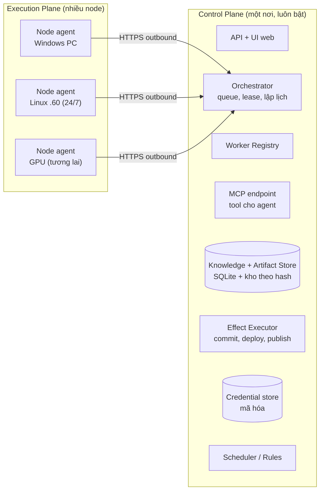

| Khía cạnh                                     | Control Plane                                                                                                                         | Execution Plane                                                                                              |
| ----------------------------------------------- | ------------------------------------------------------------------------------------------------------------------------------------- | ------------------------------------------------------------------------------------------------------------ |
| Câu hỏi trả lời                             | **Ai làm gì, khi nào, được phép gì?**                                                                                   | **Làm thế nào, trên máy này?**                                                                   |
| Thành phần                                    | API/UI, Orchestrator, Registry, Scheduler/Rules, MCP endpoint, Knowledge/Artifact Store, Effect Executor, Credential store, Event log | Node agent, Agent Instance, Session, tiến trình runtime, sandbox, model proxy cục bộ, workspace cục bộ |
| Trạng thái chuẩn                             | Có: là nguồn sự thật duy nhất                                                                                                   | Không: chỉ có trạng thái tạm và receipt để khôi phục                                              |
| Chạy code do agent sinh ra                     | **Không bao giờ**                                                                                                             | Có, trong sandbox                                                                                           |
| Gọi LLM                                        | Không cần (Orchestrator xác định, không phải LLM)                                                                              | Có, qua proxy                                                                                               |
| Tác động ra ngoài (commit, deploy, publish) | Có, qua Effect Executor                                                                                                              | Không trực tiếp; chỉ đề xuất (§14)                                                                   |
| Số lượng                                     | Một                                                                                                                                  | Nhiều, thêm bớt tự do                                                                                    |
| Mất kết nối                                  | Toàn hệ thống dừng nhận việc mới                                                                                               | Chỉ ảnh hưởng việc của node đó                                                                       |

---

## 3. Có cần Central Coordinator chạy 24/7 không?

### 3.1 Yêu cầu quyết định

> Khi máy Windows tắt, các Team và Scheduled Task chạy trên server phải tiếp tục nếu cấu hình cho phép.

Yêu cầu này cần **ba thứ cùng chạy khi Windows tắt**: (1) bộ lập lịch phát sinh việc theo giờ, (2) hàng đợi và lease để giao việc, (3) kho trạng thái để ghi kết quả. Cả ba là chức năng của control plane.

### 3.2 So sánh

| Phương án                                                                                          | Windows tắt thì sao?                                                                                                                                            | Đánh giá                                                                                                                              |
| ----------------------------------------------------------------------------------------------------- | ----------------------------------------------------------------------------------------------------------------------------------------------------------------- | ---------------------------------------------------------------------------------------------------------------------------------------- |
| **Coordinator trên Windows/WSL** (V2 D02 ban đầu)                                            | Không còn ai lập lịch, giao việc hay ghi kết quả. Node `.60` rảnh nhưng không nhận được việc                                                     | **Không đạt** yêu cầu                                                                                                         |
| **Coordinator trên server 24/7**                                                               | Scheduler vẫn phát việc; `.60` tiếp tục nhận việc; việc cần Windows (Claude Code đăng nhập trên PC, thư mục cục bộ) chờ tới khi PC bật lại | **Đạt**; phù hợp D-03                                                                                                          |
| **Hai coordinator liên kết** (Windows và server đều có coordinator, đồng bộ với nhau) | Server tự chạy phần của mình                                                                                                                                 | **Loại**: hai nguồn sự thật, cần giải xung đột, vi phạm "một coordinator" (V2 D03, D-03), rất khó ở quy mô cá nhân |
| Coordinator trên Windows + cron trên server chỉ để "đánh thức"                                | Cron chạy nhưng không có hàng đợi/kho trạng thái để giao việc                                                                                         | **Loại**: không giải quyết được vấn đề                                                                                   |

### 3.3 Kết luận [Đề xuất]

**Có, cần một Central Coordinator trên máy luôn bật**, ngay khi bật chế độ nhiều máy. Điều này làm rõ D-07: WSL vẫn dùng cho phát triển và chế độ một máy; còn **khi đã có node thứ hai, control plane phải nằm trên máy Linux luôn bật**.

Coordinator này **nhẹ**: một tiến trình Node.js + SQLite + kho file. Không cần PostgreSQL, Redis, Kubernetes hay broker. Nó không chạy code agent, không gọi LLM, nên tài nguyên cần thiết nhỏ hơn nhiều so với node thực thi. **[Chưa xác minh]** con số RAM/CPU cụ thể; cần đo khi có Host V2.

### 3.4 Đặt control plane ở đâu?

| Vị trí                                                   | Ưu                                                                                                    | Nhược                                                                                                                                                    | Đánh giá                                     |
| ---------------------------------------------------------- | ------------------------------------------------------------------------------------------------------ | ---------------------------------------------------------------------------------------------------------------------------------------------------------- | ----------------------------------------------- |
| **VM nhỏ chuyên dụng** trên hypervisor hiện có | Tách biệt hoàn toàn, sao lưu/khôi phục theo VM, không chung tài nguyên với ứng dụng khác | Cần còn tài nguyên trên hypervisor (**chưa xác minh**)                                                                                        | **Khuyến nghị**                         |
| Container trên `.14`                                    | Máy đã luôn bật, đã được ADR-002 chỉ định làm control plane, đã có Caddy route        | Chung máy với nhiều ứng dụng khác và control plane cũ; đĩa từng thiếu                                                                          | **Dự phòng** khi không tạo được VM |
| `.60`                                                    | Đã luôn bật                                                                                        | **Chạy code agent**: nếu sandbox bị thoát, control plane và mọi credential bị lộ. Trái nguyên tắc "control plane không chạy code agent" | **Loại**                                 |
| `.51`, `.12`, `.13`                                  | —                                                                                                     | Quá nhỏ hoặc đã dành cho dịch vụ khác; ADR-002 cấm                                                                                               | **Loại**                                 |

---

## 4. Sơ đồ kiến trúc phân tán

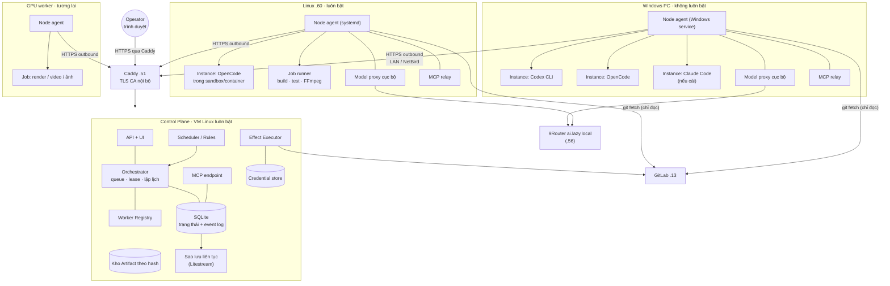

Điểm chính:

- **Mọi node chỉ kết nối ra** (outbound) tới control plane qua Caddy. Không mở cổng vào node, không cần port forwarding vào máy cá nhân (giống ADR-002 và worker cũ).
- **Node không truy cập DB hay kho file của control plane trực tiếp**; mọi thứ qua API có xác thực.
- **9Router chỉ được gọi từ model proxy của node**, không từ sandbox trực tiếp.
- **Commit/deploy do Effect Executor thực hiện**; node chỉ đọc Git.

---

## 5. Logical Agent, Agent Instance, Session và Process

| Khái niệm              | Định nghĩa                                                                                        | Gắn với máy?            | Tồn tại bao lâu                                    | Ai sở hữu                                      | Ví dụ                                                          |
| ------------------------ | ---------------------------------------------------------------------------------------------------- | -------------------------- | ----------------------------------------------------- | ------------------------------------------------ | ---------------------------------------------------------------- |
| **Logical Agent**  | Team Seat + Agent Profile revision: "ai chịu trách nhiệm"                                         | **Không**           | Bền vững                                            | Control plane                                    | Seat "Architect" của Architecture Team, Profile `architect@3` |
| **Agent Instance** | Một "người làm" sẵn sàng trên một node: Profile revision + runtime adapter + node + số slot | **Đúng một node** | Bán bền: sống khi node còn, có thể bị thu hồi | Node agent (control plane theo dõi)             | "Architect trên `.60` bằng OpenCode, 1 slot"                 |
| **Session**        | Ngữ cảnh hội thoại của runtime cho **một** Run Attempt                                   | Đúng một Instance       | Ngắn, theo attempt                                   | Runtime (ID mờ do runtime cấp)                 | Session OpenCode `ses_…`                                      |
| **Process**        | Cây tiến trình hệ điều hành chạy runtime/tool                                                | Đúng một máy           | Ngắn nhất                                           | Node agent (Job Object / process group / cgroup) | `opencode acp` + các tiến trình con                         |

**Quy tắc:**

1. Gán Agent vào Team là gán **Logical Agent**, không gán máy.
2. Session **không di chuyển** giữa node hay runtime. Muốn tiếp tục ở nơi khác thì tạo Session mới với Context Pack (02 §8, V2 workflows §4).
3. Process chỉ do node agent sở hữu; không giết theo tên, chỉ giết đúng cây tiến trình mình tạo (V1 `owned-process.ts`, V2 ADR-004).
4. Một Instance có thể phục vụ nhiều Project **theo thời gian** (mỗi Session một Project), không cùng lúc trong một Session (D-05).

| Khái niệm    | V1 Windows Worker                     | V2 contracts                                 | Python cũ                                        |
| -------------- | ------------------------------------- | -------------------------------------------- | ------------------------------------------------- |
| Logical Agent  | Role cố định (7)                   | `agent` + membership                       | Role cố định (6)                               |
| Agent Instance | Không có                            | Không có                                   | `coding_workers` (mức máy, không mức agent) |
| Session        | Session OpenCode trong mỗi execution | `runtimeSessionSchema`                     | Session OpenCode trong container                  |
| Process        | `opencode serve` trong Job Object   | `OwnedExecution`                           | Container Docker                                  |
| Attempt        | `Executions` lane                   | `run_attempts` + `attemptIdentitySchema` | `executions` + `generation`                   |

---

## 6. Worker Registry và Capability Discovery

### 6.1 Thông tin của một Worker Node (khái niệm, không phải schema)

| Nhóm                | Thông tin                                                                                                |
| -------------------- | --------------------------------------------------------------------------------------------------------- |
| Định danh          | Node ID, tên, khóa công khai, mức tin cậy, chủ sở hữu (Operator)                                  |
| Nền tảng           | Hệ điều hành, kiến trúc CPU, phiên bản node agent                                                 |
| Tài nguyên         | CPU, RAM, đĩa trống, GPU (model, VRAM, encoder), tổng slot và slot đang dùng                       |
| Runtime              | Từng runtime: tên, phiên bản, đã đăng nhập chưa, có hỗ trợ ACP không, model khả dụng      |
| Công cụ            | Git, Node, Python, Docker/Podman, bubblewrap/sandbox-runtime, FFmpeg + encoder, trình duyệt headless... |
| Mạng                | Truy cập được control plane, 9Router, GitLab, Internet hay không                                     |
| Dữ liệu cục bộ   | Workspace/repo đã đăng ký trên máy (ví dụ thư mục dự án chỉ có trên Windows PC)           |
| Độ sẵn sàng      | Luôn bật / theo lịch / không định trước; khung giờ được phép chạy                           |
| Năng lực bảo mật | Có sandbox thật không (container, bubblewrap, Job Object), có network none không                     |
| Quyền               | Project/Team nào được giao cho node; secret nào node được nhận                                   |
| Trạng thái         | Online/Busy/Draining/Offline/Lost/Quarantined (§7.3), lần heartbeat cuối                               |

### 6.2 Capability Discovery

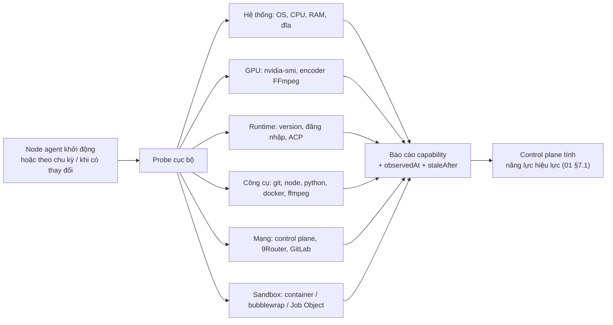

- **Ba mức tin cậy** (01 §7.3): *declared* (người dùng khai báo), *verified* (probe đạt, còn hạn), *observed* (đã hoàn thành việc thật). Chỉ *verified* mới được dùng làm điều kiện cứng để giao việc.
- **Tái sử dụng:** mẫu probe của [`scripts/factory-v2/preflight-linux.py`](../../scripts/factory-v2/preflight-linux.py) (Linux, đã chạy ở F1-01) và `checkTools`/`ReadinessProbe` của V1 (Windows).
- **Probe không gửi prompt và không tốn token**, trừ kiểm tra đăng nhập runtime khi runtime không có lệnh kiểm tra rẻ hơn (V2 ADR-004: probe/reconcile không resend prompt).
- **Năng lực gắn với máy** là thông tin quan trọng nhất cho lập lịch: runtime đã đăng nhập bằng tài khoản cá nhân, thư mục chỉ có trên máy đó, công cụ có license, ứng dụng GUI, GPU.

---

## 7. Đăng ký, xác thực và quản lý Worker

### 7.1 Đăng ký (enrollment)

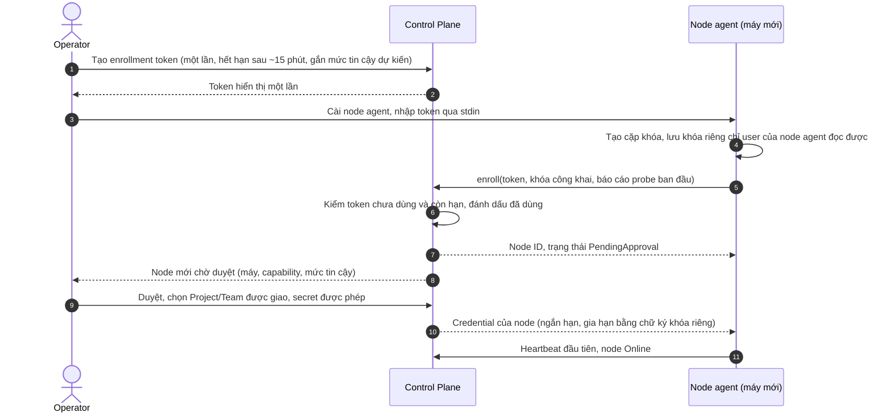

**So với hệ cũ:** hệ cũ trả một token dài hạn khi admin tạo worker và lưu hash. Đề xuất giữ tinh thần đó (token một lần, lưu hash, rotate/revoke) nhưng thêm **cặp khóa trên node** để credential ngắn hạn được gia hạn bằng chữ ký, không cần lưu bí mật dài hạn trên đường truyền. Ở MVP có thể dùng đúng mô hình cũ (token dài hạn lưu hash, rotate/revoke) nếu muốn đơn giản hơn; đây là một lựa chọn trong §21.

### 7.2 Mức tin cậy của node

| Mức                 | Ví dụ                                                     | Được làm                                                                                                                                   |
| -------------------- | ----------------------------------------------------------- | ---------------------------------------------------------------------------------------------------------------------------------------------- |
| `personal-trusted` | Windows PC của Operator                                    | Dùng đăng nhập runtime cá nhân; truy cập thư mục dự án cục bộ đã đăng ký; **không** chạy code không tin cậy (§17) |
| `server-sandboxed` | `.60`                                                     | Chạy code do agent sinh ra trong sandbox; chạy lịch 24/7; nhận secret theo assignment                                                      |
| `shared-compute`   | GPU worker dùng chung, máy mượn                         | Chỉ nhận job có đầu vào/đầu ra rõ; không nhận secret của Project; không đọc Knowledge Store ngoài pack                         |
| `quarantined`      | Node vừa lỗi reconcile hoặc có dấu hiệu bất thường | Không nhận việc mới                                                                                                                        |

### 7.3 Worker Lifecycle

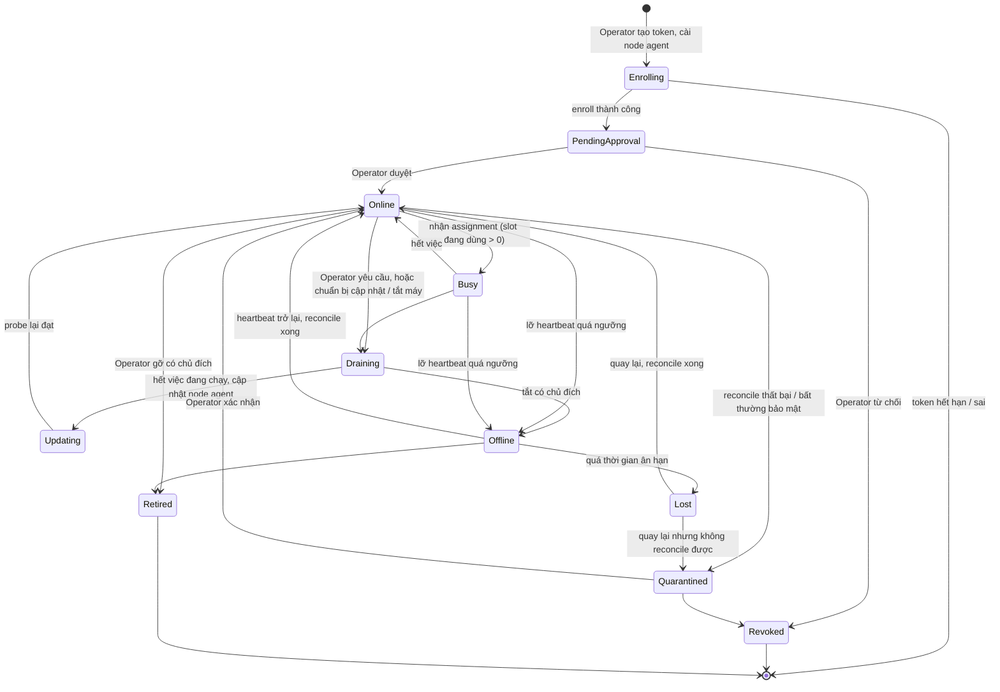

| Trạng thái      | Nhận việc mới     | Việc đang chạy                                               | Ghi chú                                                                    |
| ----------------- | -------------------- | --------------------------------------------------------------- | --------------------------------------------------------------------------- |
| Online / Busy     | Có (nếu còn slot) | Tiếp tục                                                      |                                                                             |
| Draining          | Không               | Chạy tới hết                                                 | Dùng trước khi tắt PC hoặc cập nhật                                  |
| Offline           | Không               | Lease còn hạn thì chờ; hết hạn thì xử lý theo §13     | Ngưỡng gợi ý: lỡ 3 heartbeat liên tiếp                               |
| Lost              | Không               | Đã xử lý như interrupted                                   | Ngưỡng gợi ý: vài phút đến vài giờ tùy mức sẵn sàng khai báo |
| Quarantined       | Không               | Không giao lại cho node này cho tới khi Operator xác nhận |                                                                             |
| Revoked / Retired | Không               | —                                                              | Credential bị thu hồi                                                     |

---

## 8. Tính di chuyển của Task

**Không mặc định Task nào cũng chạy được trên mọi node.** Mỗi Task khai báo hai thuộc tính.

### 8.1 Lớp vị trí (placement)

| Lớp              | Nghĩa                                                                                                                        | Ví dụ                                                                                                                                | Chuyển node khi lỗi                                                                                                                       |
| ----------------- | ----------------------------------------------------------------------------------------------------------------------------- | -------------------------------------------------------------------------------------------------------------------------------------- | ------------------------------------------------------------------------------------------------------------------------------------------- |
| `portable`      | Chỉ cần Context Pack + Artifact theo hash + năng lực chung                                                                | Viết báo cáo nghiên cứu, phân tích yêu cầu, review tài liệu                                                                 | Được, sau khi lease cũ hết hạn và không có side effect                                                                             |
| `repo-bound`    | Cần repo Git mà node nào cũng fetch được từ GitLab                                                                    | Sửa code của repo trên GitLab                                                                                                       | Được, workspace dựng lại từ commit gốc; thay đổi dở dang ở node cũ bị bỏ hoặc salvage có duyệt                             |
| `node-bound`    | Cần thứ chỉ có trên một máy: thư mục cục bộ, đăng nhập runtime cá nhân, license, ứng dụng GUI, GPU cụ thể | Sửa code trong `E:\GIT\...` chưa có remote; dùng Claude Code đăng nhập bằng tài khoản cá nhân trên PC; render trên GPU | **Không**; chờ node đó trở lại hoặc Operator chọn đổi phương án                                                          |
| `session-bound` | Cần tiếp tục đúng Session runtime đang có                                                                              | Tiếp tục một phiên dài đang dở trên Codex                                                                                      | **Không**; nếu mất node thì chuyển thành Session mới với Context Pack (tức là đổi thành lớp khác, có Lead xác nhận) |

### 8.2 Lớp side effect

| Lớp                      | Nghĩa                                                    | Ví dụ                                                              | Retry tự động                                                                                                  |
| ------------------------- | --------------------------------------------------------- | -------------------------------------------------------------------- | ----------------------------------------------------------------------------------------------------------------- |
| `none`                  | Chỉ tác động workspace tạm của node                 | Phân tích, viết nháp, chạy test                                 | Được                                                                                                           |
| `artifact`              | Đăng ký Artifact vào kho theo hash của control plane | Báo cáo, ERD, video preview                                        | Được; trùng hash thì bỏ qua (idempotent tự nhiên)                                                         |
| `external-idempotent`   | Tác động ra ngoài có khóa idempotency               | Tạo issue có khóa idempotency, đẩy branch có tên theo attempt | Được, qua Effect Executor với cùng khóa                                                                     |
| `external-irreversible` | Không đảo ngược hoặc không có idempotency         | Deploy production, gửi email, publish mạng xã hội, thanh toán   | **Không bao giờ tự động**; outcome unknown thì reconcile và hỏi người có thẩm quyền (02 §4.4) |

**Mặc định an toàn:** Task không khai báo thì coi là `node-bound` + `external-irreversible` cho tới khi Lead hoặc template khai báo rõ. Template Team Pack (01 §8) khai báo sẵn cho các loại việc phổ biến.

---

## 9. Phân bổ Task

### 9.1 Ba chiến lược

| Chiến lược                | Mô tả                                                                                                                    | Ưu                                                  | Nhược                                                                                           |
| ---------------------------- | -------------------------------------------------------------------------------------------------------------------------- | ---------------------------------------------------- | ------------------------------------------------------------------------------------------------- |
| **Static Assignment**  | Mỗi Seat gắn cố định một node                                                                                        | Dễ hiểu, dễ dự đoán, dễ cấu hình            | Node tắt là Seat chết; không tận dụng node rảnh; trái tinh thần "Agent không gắn máy" |
| **Dynamic Scheduling** | Mỗi việc chọn node bất kỳ đủ năng lực theo điểm                                                                 | Tận dụng tài nguyên, chịu lỗi tốt             | Bỏ qua dữ liệu cục bộ, đăng nhập cá nhân, session; dễ giao sai việc node-bound        |
| **Hybrid Scheduling**  | Ràng buộc cứng (bắt buộc đúng máy khi cần) + chọn động trong phần còn lại; Seat có thể có node ưu tiên | Đúng với thực tế việc portable lẫn node-bound | Cần khai báo lớp vị trí và capability chuẩn                                                |

**[Đề xuất] Hybrid.** Mặc định động trong giới hạn ràng buộc; chỉ ghim máy khi Task là `node-bound`/`session-bound` hoặc Seat được cấu hình *dedicated* (01 §9.2, ví dụ Reporting 24/7 trên `.60`).

### 9.2 Quy trình chọn node (mô hình pull)

Node chủ động `claim`; control plane chọn **việc phù hợp với node đang hỏi** (giống `claim` của hệ cũ lọc theo capability).

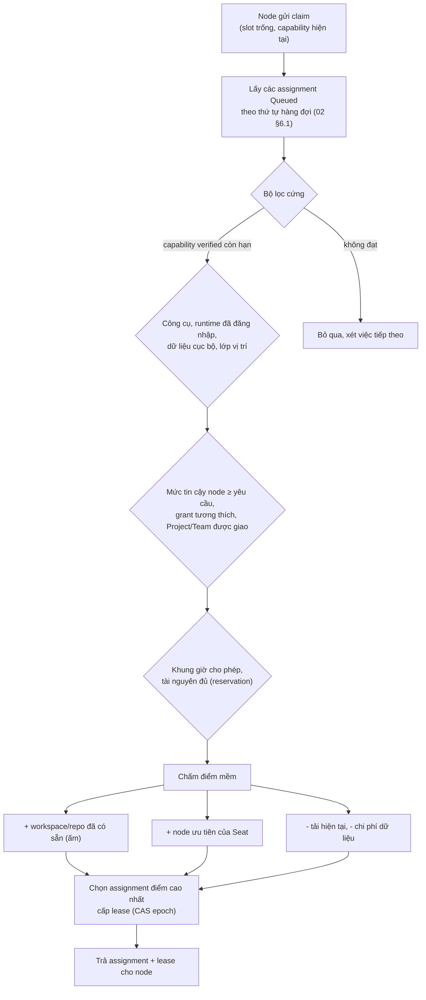

- Việc không node nào đủ điều kiện → hold `capacity` có lý do cụ thể (02 §5.2), ví dụ "cần node có Claude Code đăng nhập; Windows PC đang offline".
- Không để LLM chọn node; Lead chỉ chọn Seat (01 §7.2).
- Pull đảm bảo node offline không bao giờ được giao việc mới.

---

## 10. Khởi tạo Agent trên Worker

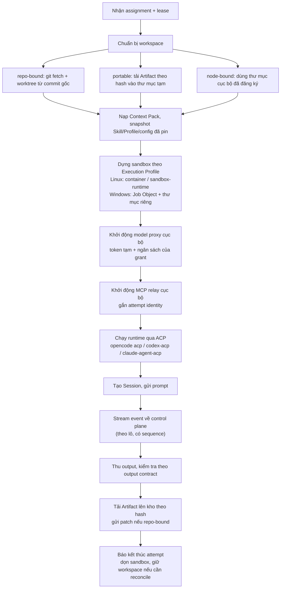

- **MCP relay cục bộ**: runtime trong sandbox chỉ thấy một MCP server cục bộ. Relay gắn `attempt identity` (project/run/assignment/epoch/lease) vào mỗi lời gọi rồi chuyển tới MCP endpoint của control plane. Sandbox **không cầm credential** của control plane.
- **Model proxy cục bộ**: kế thừa V1 `ModelProxy` và proxy của hệ cũ. Runtime chỉ nhận token tạm cho đúng attempt; key 9Router nằm ở node agent.
- **Instance dedicated** (Seat 24/7) có thể giữ sẵn workspace và tiến trình runtime "ấm" giữa các assignment, nhưng **Session luôn mới** cho mỗi attempt (D-05, C-08).

---

## 11. Giao tiếp Worker ↔ Control Plane

### 11.1 Nguyên tắc

1. **Chỉ node kết nối ra.** Control plane không gọi vào node. Node sau NAT, sau NetBird hay đổi IP đều hoạt động.
2. **HTTPS qua Caddy với CA nội bộ** đã có (không tắt kiểm tra TLS; mẫu `NODE_EXTRA_CA_CERTS` đã kiểm ở F1-01).
3. **Không broker.** Hàng đợi nằm trong SQLite của control plane (OSS-08); kênh xuống dùng kết nối do node mở.
4. **Mọi thông điệp có danh tính và chống trùng**: node ID, attempt identity, `callbackId`, `sequence` (V2 ADR-003).

### 11.2 Các kênh

| Kênh                               | Hướng    | Cơ chế                                                                                | Nội dung                                                                                 |
| ----------------------------------- | ---------- | --------------------------------------------------------------------------------------- | ----------------------------------------------------------------------------------------- |
| `enroll` / `credential.refresh` | Node → CP | Request/response                                                                        | Đăng ký, gia hạn credential                                                           |
| `node.heartbeat`                  | Node → CP | Định kỳ (gợi ý 20 s)                                                               | Trạng thái node, slot, tài nguyên, capability thay đổi                              |
| `claim`                           | Node → CP | Long-poll (chờ tối đa vài chục giây nếu chưa có việc)                         | Trả về assignment + lease, hoặc rỗng                                                  |
| `lease.renew`                     | Node → CP | Định kỳ theo lease/3 cho mỗi attempt                                                | Gia hạn lease; trả lệnh dừng nếu attempt bị hủy                                    |
| `events`                          | Node → CP | Gửi theo lô, có `sequence`                                                         | Tiến độ, tin nhắn, kết quả tool đã tóm tắt; raw log giữ ở node, tải khi cần |
| `artifacts.upload`                | Node → CP | Theo khối, kiểm hash                                                                  | Output, patch, bằng chứng                                                               |
| `mcp`                             | Node → CP | Request/response qua relay                                                              | Tool của agent: tra tri thức, gửi yêu cầu, xin quyết định, đăng ký output      |
| `commands`                        | CP → Node | Đi kèm phản hồi `node.heartbeat`/`lease.renew`, hoặc qua kênh SSE do node mở | Dừng attempt, drain, probe lại, cập nhật cấu hình                                   |

Độ trễ lệnh dừng tối đa bằng chu kỳ heartbeat/renew nếu không dùng SSE; đủ cho quy mô cá nhân. SSE do node mở giúp lệnh dừng gần như tức thời mà vẫn giữ nguyên tắc "chỉ node kết nối ra".

---

## 12. Queue, Lease, Heartbeat, Retry và Timeout

### 12.1 Giá trị khởi đầu [Đề xuất]

Lấy từ hệ cũ đã chạy thật (`.env.example`, `executions.py`, `coding.py`), điều chỉnh cho agent dài hơn:

| Tham số                        | Giá trị khởi đầu                                                                   | Ghi chú                           |
| ------------------------------- | --------------------------------------------------------------------------------------- | ---------------------------------- |
| Lease TTL                       | 60 s                                                                                    | Như `ASF_WORKER_LEASE_SECONDS`  |
| Gia hạn lease                  | Mỗi 20 s (lease/3)                                                                     | Như `coding.py`                 |
| Node heartbeat                  | 20 s                                                                                    |                                    |
| Node Offline                    | Lỡ 3 heartbeat                                                                         |                                    |
| Self-fencing trên node         | Khi không gia hạn được trước hạn lease trừ biên an toàn (ví dụ 10 s)       | Node dừng runtime, giữ workspace |
| Deadline của attempt           | Theo Task (agent turn mặc định 30 phút như V1; job render có deadline riêng)     | Hệ cũ dùng 900 s                |
| Số lần khôi phục tự động | Tối đa 2                                                                              | Như `ASF_WORKER_RECOVERY_LIMIT` |
| Waiting-input                   | Không tính vào deadline; lease vẫn gia hạn; quá wait budget (C-09) thì nhả slot | 02 §2.5                           |

Lease tính theo **đồng hồ control plane**; không tin thời gian do node báo để kéo dài lease (V2 ADR-003).

### 12.2 Task Dispatch và Execution Lifecycle

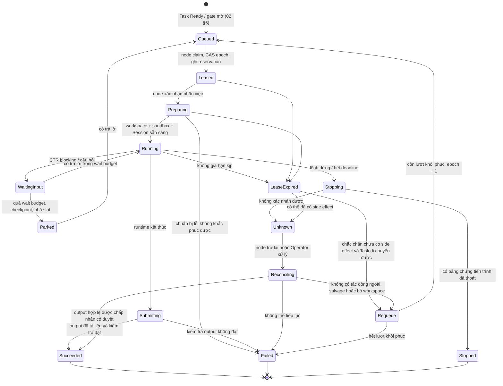

Ánh xạ sang `runStateSchema` V2: Queued/Leased → `queued`; Preparing → `starting`; Running → `running`; WaitingInput → `waiting-input`; Stopping → `stopping`; Succeeded/Failed → `succeeded`/`failed`; LeaseExpired/Unknown/Reconciling → `interrupted` với `outcome: unknown`.

### 12.3 Phân loại retry

| Tình huống                                                                       | Tự động retry?                             | Điều kiện                                                     |
| ---------------------------------------------------------------------------------- | --------------------------------------------- | ---------------------------------------------------------------- |
| Node mất trước khi `Preparing` xong                                           | Có                                           | Chưa có output, chưa có side effect                          |
| Lỗi mạng/protocol tạm thời khi gọi model                                      | Có, backoff có giới hạn                   | Trong model proxy; không vượt ngân sách                     |
| Runtime crash, Task `portable`/`repo-bound`, side effect `none`/`artifact` | Có, tối đa 2 lần khôi phục              | Workspace mới, Session mới, Context Pack + handoff             |
| Lease hết hạn, Task `node-bound`/`session-bound`                             | **Không chuyển node**; chờ node đó | Hold `capacity`, báo Operator nếu chờ lâu                  |
| Outcome unknown với side effect bên ngoài                                       | **Không**                              | Reconcile trước; quyết định thuộc người có thẩm quyền |
| Lỗi nội dung (review không đạt)                                               | Theo vòng sửa (≤3/issue, C-10)             | Không phải retry hạ tầng                                     |
| Quota/auth/permission                                                              | **Không**                              | Một blocker cấu hình (V2 F1-04)                               |

---

## 13. Sequence: Task chạy từ xa

### 13.1 BA trên node `.60` thực hiện phân tích và hỏi Architecture Team

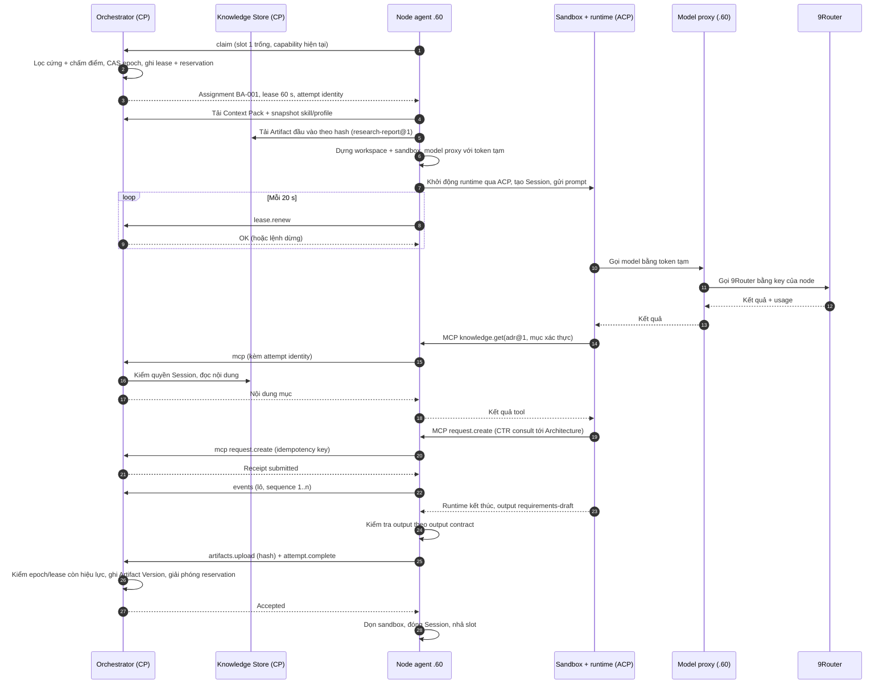

### 13.2 Scheduled Task khi Windows tắt

Ví dụ: Reporting Team có lịch báo cáo tuần, Seat *dedicated* trên `.60`; Windows PC đang tắt.

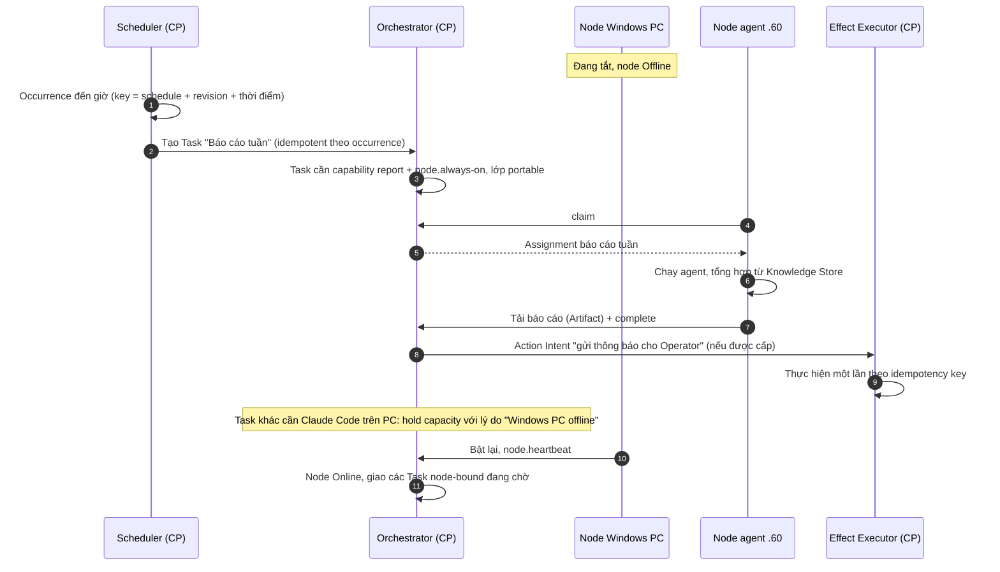

Điều kiện để chạy được khi Windows tắt: Seat của Team có Instance trên node luôn bật, Task không phụ thuộc thứ chỉ có trên PC, và Team/lịch được cấu hình cho phép chạy không cần Operator trực tuyến (02 §10.4).

---

## 14. Chống thực thi trùng Task và side effect

### 14.1 Các lớp bảo vệ

| Lớp                                                              | Cơ chế                                                                                                                                                   | Nguồn                                                                |
| ----------------------------------------------------------------- | ---------------------------------------------------------------------------------------------------------------------------------------------------------- | --------------------------------------------------------------------- |
| Một live assignment mỗi Task, một live attempt mỗi assignment | Ràng buộc unique + CAS epoch khi claim                                                                                                                   | V2 schema reference, ADR-003                                          |
| Fencing                                                           | Mọi gọi lại từ node mang epoch/lease; epoch cũ bị từ chối                                                                                          | ADR-003; hệ cũ dùng `generation`                                 |
| Self-fencing trên node                                           | Không gia hạn được lease thì node tự dừng runtime trước khi control plane giao lại                                                              | Hệ cũ: mất lease thì `docker rm -f`                             |
| Idempotency của lệnh                                            | `commandId`, `callbackId`, `sequence`                                                                                                                | ADR-003                                                               |
| Artifact idempotent                                               | Kho theo hash; tải lại cùng nội dung không tạo bản mới                                                                                             | §16                                                                  |
| **Side effect tập trung**                                  | Node không tự commit, deploy, publish hay gọi API tác động; chỉ gửi **Action Intent**; control plane thực thi qua **Effect Executor** | Hệ cũ: worker trả thay đổi file, control plane commit và deploy |

### 14.2 Effect Executor

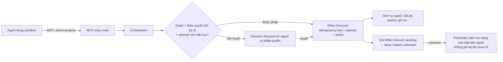

- Effect Record ghi trước khi gọi ra ngoài (`pending`), cập nhật sau (`done`/`failed`/`unknown`). Crash giữa chừng → `unknown` → reconcile, không gửi lại.
- Với `external-irreversible`, không bao giờ retry tự động (§8.2).
- Ngoại lệ có kiểm soát: thao tác cục bộ trong sandbox (chạy test, build) không phải side effect bên ngoài.

---

## 15. Worker offline, mất mạng, tiến trình bị dừng

| #  | Kịch bản                                                               | Node làm gì                                                                                                                                                                      | Control plane làm gì                                                                                             | Kết quả                                                                                                         |
| -- | ------------------------------------------------------------------------ | ---------------------------------------------------------------------------------------------------------------------------------------------------------------------------------- | ------------------------------------------------------------------------------------------------------------------ | ----------------------------------------------------------------------------------------------------------------- |
| K1 | **Mất mạng ngắn** (< lease)                                     | Runtime vẫn chạy; event được đệm cục bộ; thử gia hạn liên tục                                                                                                         | Không thay đổi                                                                                                  | Kết nối lại → gia hạn thành công → gửi event đệm theo `sequence` (trùng thì bỏ qua)               |
| K2 | **Mất mạng dài** (> lease)                                      | Tới hạn self-fencing: dừng runtime, giữ workspace + receipt                                                                                                                    | Lease hết hạn → attempt `Unknown`/`Requeue` theo lớp vị trí và side effect                              | Kết nối lại → node báo những gì đang giữ → reconcile; gọi lại với epoch cũ bị từ chối            |
| K3 | **Tiến trình runtime chết**, node vẫn sống                    | Phát hiện exit, thu log/bằng chứng, báo `failed` kèm lý do                                                                                                                | Phân loại retry (§12.3)                                                                                         | Retry trên cùng hoặc node khác nếu được phép                                                             |
| K4 | **Node khởi động lại**                                         | Node agent khởi động, đọc receipt tiến trình cũ, kết thúc tiến trình mồ côi đúng cây mình sở hữu (V1 `recoverOwnedJobs`), báo các attempt bị gián đoạn | Nhận báo cáo, đưa attempt vào Reconciling                                                                    | Không có attempt "ma" chạy tiếp                                                                               |
| K5 | **Windows tắt khi đang chạy Claude Code** (node-bound)          | — (máy tắt)                                                                                                                                                                     | Lease hết hạn → `Unknown`; Task node-bound **không chuyển node**; hold `capacity` "chờ Windows PC" | PC bật lại → reconcile workspace cục bộ → tiếp tục bằng Session mới hoặc Operator chọn cách khác    |
| K6 | **Control plane ngừng**                                           | Không gia hạn được → self-fencing tại hạn lease; giữ workspace; thử kết nối lại theo backoff                                                                          | —                                                                                                                 | Control plane lên lại → node báo cáo → reconcile. Việc dài (render) dùng lease dài hơn, gia hạn đều |
| K7 | **Claim trùng / split-brain** (node cũ tưởng mình còn lease) | Node cũ gửi kết quả với epoch cũ                                                                                                                                             | Từ chối; chỉ attempt epoch hiện hành được ghi                                                              | Không có hai kết quả cạnh tranh; output của node cũ có thể salvage có duyệt                            |
| K8 | **Node bị nghi xâm phạm**                                       | —                                                                                                                                                                                 | Operator chuyển node sang Quarantined, thu hồi credential, xoay secret liên quan                                | Việc của node chuyển trạng thái Reconciling                                                                  |

### 15.1 Sequence: mất mạng dài, khôi phục và retry

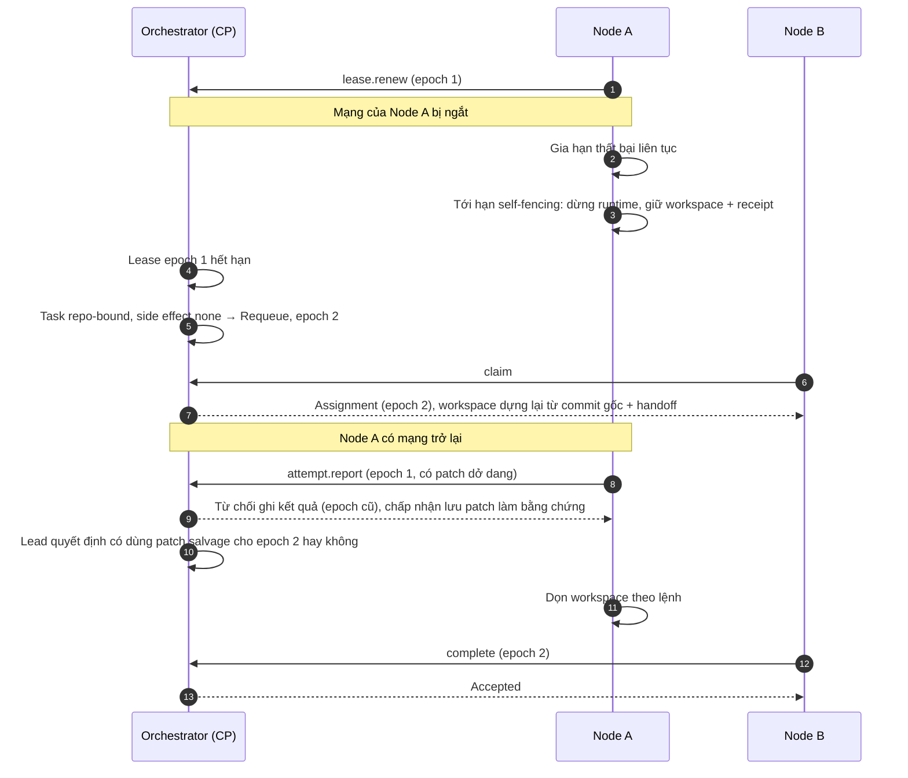

---

## 16. Worker Recovery và Task Rescheduling

| Câu hỏi                                     | Quy tắc                                                                                                                                                                                                         |
| --------------------------------------------- | ---------------------------------------------------------------------------------------------------------------------------------------------------------------------------------------------------------------- |
| Khi nào được dời Task sang node khác?   | Lease cũ đã hết hạn **và** Task là `portable`/`repo-bound` **và** side effect `none`/`artifact` **và** còn lượt khôi phục **và** có node khác đủ điều kiện |
| Workspace ở node cũ xử lý thế nào?      | Giữ lại tới khi reconcile xong; patch dở dang chỉ là bằng chứng; dùng lại cần Lead quyết định (salvage)                                                                                            |
| Node cũ quay lại thì sao?                  | Báo cáo những gì đang giữ; control plane trả lệnh dọn hoặc yêu cầu tải bằng chứng; không cho ghi kết quả với epoch cũ                                                                        |
| Lượt khôi phục tính thế nào?           | Theo assignment, tối đa 2 lượt tự động (hệ cũ); quá thì Failed có lý do, Lead/Operator quyết định                                                                                                |
| Task phụ thuộc máy thì sao?               | Chờ máy đó; báo rõ "chờ Windows PC" trong Cần xử lý; Operator có thể đổi Task thành lớp khác nếu chấp nhận hậu quả                                                                         |
| Phiên runtime có tiếp tục được không? | Không giữa node; trên cùng node chỉ khi adapter hỗ trợ resume **và** workspace còn nguyên; mặc định Session mới + Context Pack + context diff (02 §10.2)                                    |

---

## 17. Truy cập Artifact, Credential và Project Workspace

### 17.1 Workspace

| Loại Project                                                                         | Cách node có workspace                                                                     | Cách trả kết quả                                                                                                                                                                               |
| ------------------------------------------------------------------------------------- | -------------------------------------------------------------------------------------------- | -------------------------------------------------------------------------------------------------------------------------------------------------------------------------------------------------- |
| Có Git trên GitLab (`.13`)                                                        | Node `git fetch` chỉ đọc (credential đọc theo Project), tạo worktree từ commit gốc | **MVP: node trả patch/bundle; Effect Executor commit lên branch theo attempt** (hệ cũ đã làm vậy). Mở rộng: node đẩy branch riêng theo attempt bằng token chỉ ghi branch đó |
| Thư mục cục bộ chỉ có trên một máy (ví dụ `E:\GIT\...` chưa có remote) | Chỉ node đó truy cập                                                                     | Task `node-bound`; output ghi vào worktree cục bộ theo cơ chế V1 (không ghi repo gốc), đăng ký Artifact lên kho                                                                       |
| Không Git (artifact/directory, V2 D09)                                               | Tải Artifact theo hash từ control plane                                                    | Tải Artifact mới lên kho theo hash                                                                                                                                                              |

### 17.2 Artifact

- Kho chuẩn là **kho theo hash trên control plane** (02 §12.3). Node chỉ có bản cache tạm.
- Node tải Artifact theo `artifactId@version` + hash, đúng phạm vi Context Pack/`contextGrant` của attempt (02 §16).
- Media lớn: tải theo khối, kiểm hash, staging rồi công bố nguyên tử (V2 workflows §6).

### 17.3 Credential

| Loại                                                                | Nằm ở đâu                                                                                                                              | Session nhận gì                                                                                          |
| -------------------------------------------------------------------- | ------------------------------------------------------------------------------------------------------------------------------------------ | ---------------------------------------------------------------------------------------------------------- |
| Key 9Router                                                          | Node agent (key riêng cho node nếu 9Router hỗ trợ nhiều key; **[Chưa xác minh]**), hoặc proxy trung tâm trên control plane | Token proxy tạm của attempt                                                                              |
| Đăng nhập runtime cá nhân (Claude Code, Codex theo tài khoản) | **Chỉ trên máy đã đăng nhập**, trong HOME của node agent hoặc user tương ứng                                            | Runtime dùng trực tiếp; trở thành capability node-bound (`runtime.claude.authenticated@windows-pc`) |
| Credential Git đọc                                                 | Control plane cấp theo Project, ngắn hạn                                                                                                | Chỉ node agent dùng để fetch; không vào sandbox nếu không cần                                     |
| Credential ghi Git, deploy, API ngoài                               | **Chỉ ở control plane** (Effect Executor)                                                                                          | Không bao giờ                                                                                            |
| Secret của Project cho tool (ví dụ API key dịch vụ)             | Credential store control plane, cấp đúng lúc theo assignment, hết hạn cùng attempt                                                  | Theo Execution Profile; không ghi log/Artifact (V2 ADR-006)                                               |
| Credential của node                                                 | Khóa riêng trên node, quyền chỉ user node agent                                                                                       | Không                                                                                                     |

**Lựa chọn về key 9Router:**

| Phương án                          | Ưu                                                                                  | Nhược                                                                                    |
| ------------------------------------- | ------------------------------------------------------------------------------------ | ------------------------------------------------------------------------------------------ |
| Key trên từng node (proxy cục bộ) | Độ trễ thấp; giống V1 và hệ cũ; node vẫn gọi model khi control plane chậm | Key nằm trên nhiều máy; cần thu hồi theo node                                        |
| Proxy trung tâm trên control plane  | Key ở một nơi; đo ngân sách tập trung                                         | Mọi token model đi qua control plane; control plane thành điểm nghẽn và điểm lỗi |

**[Đề xuất]** Key trên từng node ở MVP, kèm ngân sách do control plane cấp theo grant (như hệ cũ cấp request/token mỗi execution); xét proxy trung tâm nếu 9Router không cấp được key riêng từng node.

---

## 18. Bảo mật, phân quyền, audit và cô lập

### 18.1 Các vùng tin cậy

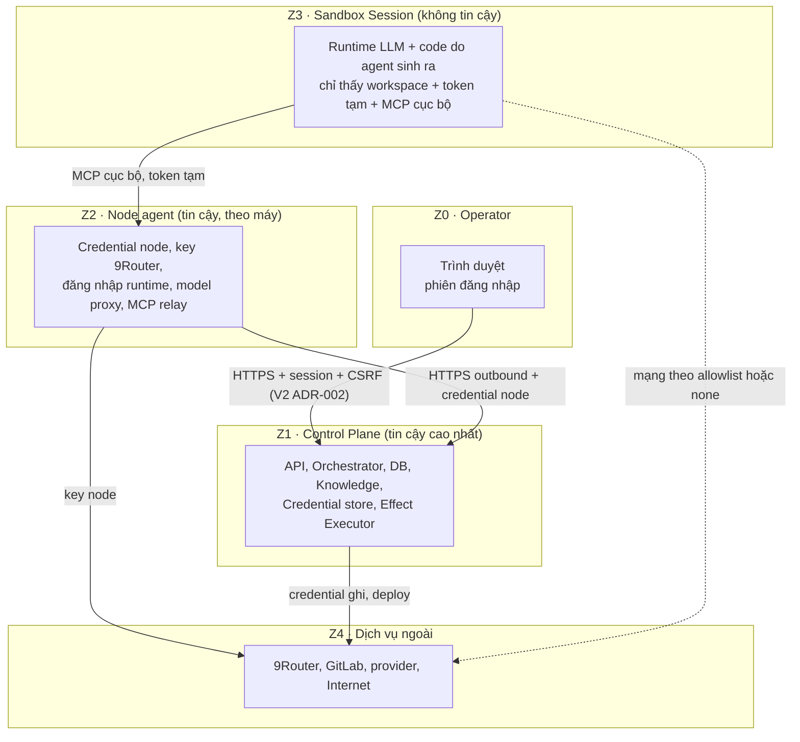

| Ranh giới | Quy tắc                                                                                                                    |
| ---------- | --------------------------------------------------------------------------------------------------------------------------- |
| Z0 → Z1   | Bind sau Caddy; phiên đăng nhập, CSRF, kiểm Origin (V2 ADR-002); chỉ truy cập qua LAN/NetBird, không public         |
| Z2 → Z1   | Credential node ngắn hạn; mỗi node chỉ thấy assignment, Project, secret được giao; rate limit theo node             |
| Z3 → Z2   | Sandbox chỉ có token tạm của attempt; MCP relay gắn attempt identity, không cho sandbox tự xưng attempt khác       |
| Z3 → Z4   | Mạng theo allowlist trong Execution Profile; test chạy network none (hệ cũ); sandbox-runtime/proxy trên Linux (OSS-04) |
| Z1 → Z4   | Chỉ Effect Executor cầm credential ghi; mọi hành động có Effect Record                                               |

### 18.2 Phân quyền

- **Theo node**: Project/Team được giao, mức tin cậy, secret được phép, loại Task (lớp side effect tối đa).
- **Theo Session**: quyền đọc tri thức theo 02 §16; quyền hành động theo Execution Profile + ma trận thẩm quyền 02 §4.4.
- **Theo Operator**: duyệt node, thu hồi node, mở Execution Gate, hành động không đảo ngược.

### 18.3 Audit

Event log append-only trên control plane ghi: đăng ký/duyệt/thu hồi node, claim/lease/hết hạn, lệnh dừng, cấp secret (không ghi giá trị), Effect Record, đọc tri thức `confidential`, thay đổi cấu hình. Mỗi bản ghi có actor (Operator, node, instance, session) và attempt identity. Log trên node chỉ là bản tạm; bằng chứng cần giữ được tải lên.

### 18.4 Cô lập tác vụ rủi ro

| Loại tác vụ                                                               | Nơi chạy                                     | Cơ chế                                                                                                                                                                                                                                                                               |
| ---------------------------------------------------------------------------- | ---------------------------------------------- | -------------------------------------------------------------------------------------------------------------------------------------------------------------------------------------------------------------------------------------------------------------------------------------- |
| Chạy code do agent sinh ra, build, cài package                             | **Chỉ Linux node `server-sandboxed`** | Container không root, root FS read-only, không socket, giới hạn CPU/RAM/pids (đã kiểm trên `.60`); hoặc sandbox-runtime                                                                                                                                                     |
| Test                                                                         | Linux node                                     | Container network none, không model key (hệ cũ)                                                                                                                                                                                                                                     |
| Coding trên thư mục cục bộ Windows bằng runtime đăng nhập cá nhân | Windows node `personal-trusted`              | Job Object quản lý vòng đời; thư mục làm việc riêng; quyền runtime giới hạn đọc/sửa trong scope (V1 `permissions.ts`); **không** chạy lệnh tùy ý ngoài scope. **[Chưa xác minh]** mức cô lập filesystem trên Windows yếu hơn Linux sandbox |
| Job GPU                                                                      | GPU node `shared-compute`                    | Đầu vào/đầu ra theo hash; không secret Project                                                                                                                                                                                                                                   |
| Tác động ngoài                                                           | Control plane                                  | Effect Executor                                                                                                                                                                                                                                                                        |

Nguyên tắc chống prompt injection: quyền thực thi do node và control plane áp, không dựa vào lời dặn trong prompt; tri thức và nội dung từ Team khác là dữ liệu, không phải lệnh (02 §16).

---

## 19. Tận dụng tài sản hiện có

| Tài sản                                                                                 | Cách dùng                                                                                                                                                                                   | Không làm                                                                           |
| ----------------------------------------------------------------------------------------- | --------------------------------------------------------------------------------------------------------------------------------------------------------------------------------------------- | ------------------------------------------------------------------------------------- |
| Windows Worker V1                                                                         | Sao chép có chọn lọc module không phụ thuộc Electron (§1.4) để dựng **node agent Windows chạy nền** (Windows service); V1 vẫn chạy độc lập cho tới khi V2 đủ dùng | Không biến app Electron V1 thành node; không import xuyên app                    |
| VM `.60` + image `asf-worker:opencode-1.19.5`                                         | Node Linux 24/7 đầu tiên; dùng lại cấu hình container đã kiểm (UID 10001, read-only, không socket, giới hạn tài nguyên)                                                        | Không đặt control plane trên `.60`                                              |
| Giao thức worker cũ (`claim`/`heartbeat`/`complete`, token lưu hash, generation) | Mẫu cho giao thức node V2 (viết lại bằng TypeScript theo contracts V2)                                                                                                                   | Không chạy lại stack Python/Redis/Postgres                                         |
| NetBird                                                                                   | Đường mạng cho node ngoài LAN; không mở cổng vào node                                                                                                                                | Không coi NetBird là thay thế xác thực ứng dụng (process-first-wsl)            |
| Caddy `.51` + CA nội bộ                                                               | Reverse proxy và TLS cho control plane                                                                                                                                                       | Không tắt kiểm tra TLS                                                             |
| 9Router                                                                                   | Gateway model cho mọi node qua model proxy                                                                                                                                                   | Không cho sandbox gọi trực tiếp bằng key thật                                   |
| GitLab `.13`                                                                            | Nguồn repo; Effect Executor commit/MR                                                                                                                                                        | Không cấp token ghi cho node ở MVP                                                 |
| GitLab Runner `.60`                                                                     | Chạy CI/build/test như **job** khi Project cần pipeline                                                                                                                              | Không dùng làm runtime agent (không có session tương tác/streaming phù hợp) |
| WSL + `/home/lazy/factory-v2` (F1-01)                                                   | Môi trường phát triển Host V2; có thể là node Linux thứ hai khi PC bật                                                                                                              | Không làm control plane khi chạy nhiều máy                                       |

---

## 20. So sánh phương án triển khai

| Tiêu chí                      | **A** · Control plane trên Windows/WSL + node từ xa  | **B** · Control plane trên server 24/7 + node chủ động nhận việc | **C** · Mở rộng nền tảng Python cũ trên `.14`               | **D** · Nhiều host liên kết, mỗi máy một coordinator |
| ------------------------------- | ------------------------------------------------------------- | ----------------------------------------------------------------------------- | -------------------------------------------------------------------------- | ----------------------------------------------------------------- |
| Server chạy khi Windows tắt   | **Không**                                              | **Có**                                                                 | Có                                                                        | Có (phần của server)                                           |
| Độ phức tạp                 | Thấp                                                         | Trung bình                                                                   | Thấp ban đầu, cao khi thêm Team/Engagement                             | **Cao** (đồng bộ, xung đột)                            |
| Khớp quyết định đã duyệt | Trái yêu cầu 24/7; hợp D-07 giai đoạn đầu             | **Khớp D-03, D-07, D-09, OSS-08**                                      | **Trái D-02** (đã chọn V2 TypeScript), V2 D04 (không LangGraph) | Trái D-03 (một coordinator)                                     |
| Tái sử dụng                  | V1 + WSL                                                      | V1 module, giao thức cũ, `.60`, NetBird, Caddy                            | Toàn bộ stack cũ đã chạy                                             | Ít                                                               |
| Bảo mật                       | Control plane trên máy cá nhân có nhiều dữ liệu khác | Control plane tách riêng, chỉ nhận kết nối từ node đã đăng ký     | Đã kiểm ở Phase 5                                                      | Bề mặt tấn công nhân theo số máy                           |
| Tài nguyên                    | Dùng PC                                                      | Cần VM nhỏ (hoặc `.14`)                                                  | `.14` đã có                                                           | Mọi máy                                                         |
| Rủi ro chính                  | Không đạt 24/7                                             | Cần tài nguyên VM (**chưa xác minh**)                              | Mắc kẹt với role cố định, một run toàn nền tảng                  | Split-brain, mất nhất quán                                     |
| Kết luận                      | Chỉ cho phát triển/một máy                               | **Khuyến nghị**                                                       | Loại (chỉ học thiết kế)                                               | Loại                                                             |

**Phương án bổ trợ E · GitLab Runner làm execution plane:** Runner đã có trên `.60`, có đăng ký bằng token và pull job (mẫu tốt). Nhưng CI job không phù hợp agent tương tác: không có session dài, không MCP hai chiều, không waiting-input, lập lịch theo pipeline. **Chỉ dùng cho job CI/build/test** do Effect Executor kích hoạt, không làm runtime agent.

---

## 21. Kiến trúc đề xuất cho MVP và khi mở rộng

> **Sửa đổi 07/11/2026:** MVP trong giai đoạn phát triển thay `.60` bằng VM VMware trên laptop (topology T-B ở [05 §21](05-target-architecture.md)). Các nguyên tắc dưới đây giữ nguyên; chỉ vị trí máy thay đổi.

### 21.1 MVP (cá nhân, nhiều máy)

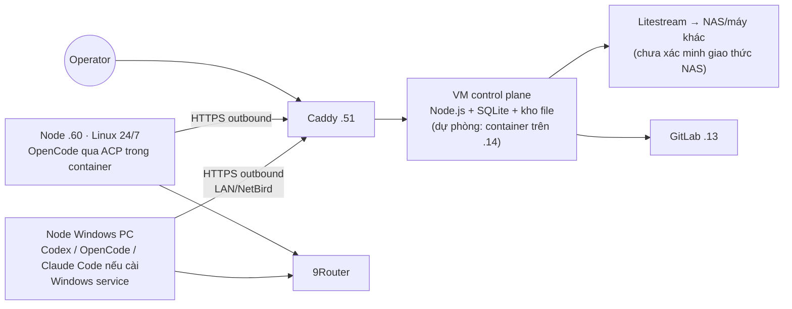

| Thành phần      | MVP                                                                                                                                                                           |
| ----------------- | ----------------------------------------------------------------------------------------------------------------------------------------------------------------------------- |
| Control plane     | Một VM Linux nhỏ luôn bật (dự phòng: container trên `.14`); Host V2 (F1-02) + Registry + MCP endpoint + Effect Executor; SQLite + kho theo hash; sao lưu liên tục |
| Node              | `.60` (Linux 24/7, sandbox container) và Windows PC (node agent chạy nền)                                                                                                |
| Mạng             | LAN + NetBird; TLS qua Caddy CA nội bộ; node chỉ kết nối ra                                                                                                              |
| Định danh node  | Enrollment token một lần + Operator duyệt; credential theo node, rotate/revoke                                                                                             |
| Lập lịch        | Hybrid, pull; lớp vị trí + lớp side effect bắt buộc                                                                                                                     |
| Lease             | 60 s / gia hạn 20 s / self-fencing / khôi phục tối đa 2                                                                                                                  |
| Workspace         | Git qua GitLab, node trả patch, Effect Executor commit; Artifact theo hash                                                                                                   |
| Credential        | Key 9Router trên node + ngân sách theo grant; credential ghi chỉ ở control plane                                                                                         |
| Cô lập          | Code không tin cậy chỉ trên `.60`; Windows chỉ workspace tin cậy                                                                                                      |
| Không có ở MVP | GPU node, mTLS, secret broker riêng, HA control plane, node `shared-compute`                                                                                               |

**Thứ tự gợi ý** (để chèn vào lộ trình V2, chưa phải kế hoạch triển khai): contracts có Node/Instance/lease theo node (F1-02, theo D-09) → Host chạy trên WSL một máy → node agent Linux trên `.60` → chuyển control plane lên VM → node agent Windows.

### 21.2 Khi mở rộng

| Nhu cầu                      | Bổ sung                                                                                                                                     |
| ----------------------------- | -------------------------------------------------------------------------------------------------------------------------------------------- |
| GPU, render, video            | GPU node `shared-compute`; job runner riêng; capability `node.gpu.*`, encoder; công cụ như FFmpeg, ComfyUI chạy tiến trình riêng |
| Nhiều node hơn              | Node pool và nhãn; hạn mức theo pool; cập nhật node agent theo đợt                                                                   |
| Bảo mật cao hơn            | mTLS cho node (ví dụ `step-ca`); secret broker riêng (ví dụ OpenBao); máy ảo dùng một lần cho code rủi ro                       |
| Nhiều người dùng          | Theo 01 S3; phân quyền theo Project/Team                                                                                                   |
| Độ sẵn sàng control plane | Bản sao chờ (standby) từ bản sao lưu liên tục; chỉ chuyển sang DB máy chủ (Postgres) khi có nhu cầu thật (OSS-08)              |
| Máy ngoài LAN               | NetBird client trên máy đó; kiểm ACL NetBird (**chưa xác minh** policy hiện tại)                                              |

---

## 22. Quyết định kiến trúc đề xuất

> **Cập nhật 07/11/2026:** người dùng đã chốt toàn bộ E-01..E-14. Trạng thái ghi tại [Sổ quyết định](00-decision-register.md) §3A.
>
> **Sửa đổi sau (05 §21):** giai đoạn phát triển dùng **máy ảo VMware trên laptop** thay `.60`: control plane ở VM `factory-cp`, node Linux ở VM `factory-node-1`, node Windows trên laptop. E-01 (24/7) tạm chưa đạt cho tới mốc M2b; E-02, E-14 đã sửa trong sổ. `.60` giữ cho hệ cũ.

| ID             | Quyết định                     | Phương án đề xuất                                                                                                                                                                                                       | Lý do chính                                                                |
| -------------- | --------------------------------- | ----------------------------------------------------------------------------------------------------------------------------------------------------------------------------------------------------------------------------- | ---------------------------------------------------------------------------- |
| **E-01** | Có cần Central Coordinator 24/7 | **Có.** Control plane chạy trên Linux luôn bật **ngay khi bật chế độ nhiều máy**; WSL chỉ cho phát triển/một máy                                                                                  | Duy nhất đáp ứng "Windows tắt thì server vẫn chạy"; làm rõ D-07    |
| **E-02** | Vị trí control plane            | **VM nhỏ chuyên dụng** trên hypervisor hiện có; dự phòng container trên `.14`; **không** đặt trên `.60`                                                                                          | Tách biệt; `.60` chạy code agent nên không được giữ control plane |
| **E-03** | Giao tiếp node ↔ control plane  | **Chỉ HTTPS outbound từ node** qua Caddy/CA nội bộ, LAN/NetBird; long-poll claim; lệnh xuống qua kênh do node mở; **không broker**                                                                       | Đã chứng minh ở hệ cũ; không mở cổng vào máy cá nhân            |
| **E-04** | Định danh node                  | **Enrollment token một lần + keypair trên node + Operator duyệt**; credential ngắn hạn theo node; rotate/revoke; mức tin cậy node                                                                               | An toàn hơn token dài hạn; vẫn đơn giản cho một người             |
| **E-05** | Chiến lược lập lịch          | **Hybrid theo mô hình pull**: lọc cứng (capability verified, công cụ, dữ liệu, đăng nhập, tin cậy, grant, khung giờ, tài nguyên) + chấm điểm mềm; ghim máy chỉ khi node-bound hoặc Seat dedicated | Đúng với việc vừa portable vừa phụ thuộc máy                        |
| **E-06** | Tính di chuyển                  | **Mọi Task khai báo lớp vị trí** (portable / repo-bound / node-bound / session-bound) **và lớp side effect**; không khai báo thì coi là node-bound + irreversible                                      | Đáp ứng yêu cầu "không mặc định mọi Task di chuyển được"       |
| **E-07** | Side effect bên ngoài           | **Node không tự thực hiện**; chỉ gửi Action Intent; **Effect Executor** trên control plane thực hiện với idempotency, Effect Record và reconcile; outcome unknown không tự retry                     | Kế thừa cách hệ cũ chống commit/deploy trùng                          |
| **E-08** | Lease và timeout                 | **Lease 60 s, gia hạn 20 s, node Offline sau 3 heartbeat lỡ, self-fencing, deadline theo Task, tối đa 2 lượt khôi phục tự động**                                                                             | Giá trị đã chạy thật ở hệ cũ; chỉnh sau khi đo                    |
| **E-09** | Workspace và kết quả code      | **Git qua GitLab; node trả patch, Effect Executor commit** ở MVP; Artifact qua kho theo hash; thư mục cục bộ là node-bound                                                                                       | Một nơi cầm credential ghi; idempotent theo attempt                       |
| **E-10** | Credential                        | **Sandbox chỉ nhận token tạm**; key 9Router trên node agent kèm ngân sách theo grant; credential ghi/deploy chỉ ở control plane; đăng nhập runtime cá nhân là capability node-bound                      | Giảm phạm vi lộ khi sandbox bị xâm phạm                                |
| **E-11** | Cô lập                          | **Code không tin cậy, build, cài package chỉ chạy trên Linux node có sandbox**; Windows node chỉ chạy việc trên workspace tin cậy với runtime đăng nhập cá nhân                                       | Windows thiếu sandbox filesystem mạnh như Linux container                 |
| **E-12** | Tận dụng Windows Worker V1      | **Dựng node agent Windows chạy nền** (Windows service) bằng cách sao chép module V1 không phụ thuộc Electron; V1 vẫn chạy độc lập                                                                         | Dùng lại Job Object, model proxy, worktree đã kiểm chứng               |
| **E-13** | Độ bền control plane           | **SQLite + sao lưu liên tục** (Litestream) sang NAS/máy khác; chưa làm HA                                                                                                                                        | Đủ cho quy mô cá nhân; khôi phục nhanh khi VM hỏng                   |
| **E-14** | Phạm vi MVP                      | **Control plane VM + node `.60` + node Windows PC**; GPU node khi có phần cứng; GitLab Runner chỉ cho job CI                                                                                                      | Bắt đầu từ hạ tầng có bằng chứng                                    |

---

## 23. Giả định chưa xác minh

| #   | Giả định                                                                                                                         | Cách xác minh                                            |
| --- | ----------------------------------------------------------------------------------------------------------------------------------- | ---------------------------------------------------------- |
| F1  | Hypervisor (Proxmox) còn tài nguyên cho một VM control plane nhỏ                                                               | Operator kiểm dung lượng hypervisor                     |
| F2  | Control plane Node.js + SQLite cần ít tài nguyên (ước lượng vài trăm MiB RAM)                                             | Đo khi Host V2 chạy (F1-02)                              |
| F3  | NAS hỗ trợ giao thức Litestream dùng được (thư mục mạng, SFTP hoặc tương thích S3)                                    | Kiểm NAS                                                  |
| F4  | 9Router cấp được key riêng cho từng node, và chịu được nhiều node gọi đồng thời                                     | Kiểm cấu hình 9Router, thử tải có kiểm soát        |
| F5  | Claude Code có/sẽ được cài và đăng nhập trên Windows PC; Codex CLI 0.166.0 vẫn hoạt động                             | Probe Windows node                                         |
| F6  | Có GPU worker trong tương lai; loại GPU và encoder                                                                             | Chưa có phần cứng                                      |
| F7  | `.60` (2 vCPU, ~5,3 GiB) đủ cho 1 slot agent + job nhỏ; chạy nhiều slot cần nâng cấp (ADR-002 khuyến nghị 4 vCPU/8 GiB) | Đo tải trên `.60`                                     |
| F8  | NetBird ACL cho phép node ngoài LAN tới control plane, và không mở rộng hơn mức cần                                       | Đọc policy NetBird (chưa có quyền ở lần khảo sát) |
| F9  | ACP chạy ổn định dưới node agent chạy nền (không có terminal tương tác) cho từng runtime                              | Thử ở F1-03                                              |
| F10 | sandbox-runtime/bubblewrap hoạt động trên `.60` (Ubuntu 26.04) cùng với container hiện có                                 | Thử khi triển khai                                       |
| F11 | Mức cô lập trên Windows (Job Object + quyền runtime) chấp nhận được cho workspace tin cậy                                | Đánh giá rủi ro cùng Operator                         |
| F12 | Độ trễ lệnh dừng bằng chu kỳ gia hạn (≤ 20 s) chấp nhận được ở MVP                                                   | Thử thực tế                                             |

---

## 24. Những gì tài liệu này không làm

- Không thiết kế bảng DB, endpoint chi tiết hay định dạng wire.
- Không dựng VM, không cài node agent, không sửa cấu hình Caddy/NetBird/9Router.
- Không thay đổi contracts V2, source V1 hay kế hoạch F0–F8; chỉ chỉ ra những gì cần chèn.
- Không tự chuyển sang giai đoạn tiếp theo khi các quyết định ở §22 chưa được duyệt.
