# 04 · Workflow Orchestration, Human Approval và Automation

| Mục | Giá trị |
|---|---|
| Trạng thái | **Đã duyệt 07/11/2026** (W-01..W-18): mô hình workflow, phê duyệt, lịch, giới hạn ở mức khái niệm; chưa thiết kế bảng DB, API chi tiết hay code |
| Ngày | 07/11/2026 |
| Baseline | commit `692ad3f`, branch `architecture/multi-team-research` |
| Tài liệu trước | [00 · Sổ quyết định](00-decision-register.md), [01 · Domain Model](01-product-and-domain-model.md), [02 · Cộng tác và Tri thức](02-collaboration-and-knowledge.md), [03 · Distributed Worker](03-distributed-worker.md), [Rà soát open-source](oss-options.md) |
| Phạm vi | Project Lifecycle, Workflow Definition/Instance, lập kế hoạch, chọn Team, tạo Project bằng ngôn ngữ tự nhiên, trạng thái, phụ thuộc/song song/rẽ nhánh, phê duyệt, tạm dừng dài, lịch/sự kiện/giám sát, thông báo, giới hạn chi phí và mức tự chủ |
| Ghi chú phạm vi sửa | Theo yêu cầu, chỉ tài liệu này được tạo. Quyết định mới (W-xx) và rà soát open-source của giai đoạn 5 nằm trong tài liệu này; đã đồng bộ sang `00-decision-register.md` §3B và `oss-options.md` §6B (07/11/2026) |

**Quy ước nhãn:** **[Hiện có]** có bằng chứng trong source/hạ tầng. **[Đã duyệt]** quyết định trong sổ. **[Kế hoạch V2]** ghi trong `plan/factory-v2`. **[Đề xuất]** phân tích của tài liệu này. **[Chưa xác minh]** giả định.

---

## 1. Quyết định nền và thuật ngữ

### 1.1 Quyết định đã duyệt áp dụng

| ID | Nội dung | Dùng ở |
|---|---|---|
| D-01 | Hybrid Team Model: Team bền vững, Engagement, Instance co giãn | §6 chọn Team |
| D-04 | Lead của Team chủ trì kiêm Project Lead; Project Lead riêng là tùy chọn | §21 số tầng điều phối |
| D-05, C-08 | Session ngắn theo Task; không bộ nhớ dài hạn trong Instance | §13 agent theo lịch |
| C-01 | Mọi giao tiếp qua Orchestrator, tool qua MCP | §3 kiến trúc |
| C-03 | Tự tạo Engagement cho hỏi/tư vấn/thẩm định; `produce` cần Project Lead/Operator | §6 |
| C-04 | Execution Gate bật mặc định trước Execution | §8, §10 |
| C-05 | Ma trận thẩm quyền 02 §4.4; danh sách việc bắt buộc hỏi Operator | §10, §21 |
| C-06 | Project Lead Approved từng tài liệu căn cứ; Operator duyệt một lần cho cả gói khi mở gate | §10 |
| C-09, C-10 | Wait budget 5 phút; hop ≤3, thread ≤3 vòng, sửa ≤3 vòng/issue, trần ngân sách theo chuỗi gốc | §17 |
| C-12 | Project Dossier | §11 khôi phục |
| E-01, E-13 | Control plane 24/7; SQLite + sao lưu liên tục | §12 Scheduler |
| E-05, E-06 | Lập lịch Hybrid theo pull; lớp vị trí và lớp side effect | §6, §12 |
| E-07 | Side effect bên ngoài chỉ qua Effect Executor | §10, §18 |
| E-08 | Lease 60 s, khôi phục tối đa 2 | §17, §21 |

### 1.2 Thuật ngữ mới

| Thuật ngữ | Nghĩa |
|---|---|
| **Workflow Definition** | Mẫu quy trình có revision: các bước (Stage), cạnh phụ thuộc, cổng phê duyệt, điều kiện, giới hạn |
| **Workflow Pack** | Gói phân phối Workflow Definition (cùng tinh thần Team Pack 01 §8 và domain pack V2 F6) |
| **Workflow Instance** | Đồ thị công việc cụ thể của một Project, tạo từ một Definition revision, thay đổi bằng **Plan Patch** có revision |
| **Stage** | Một bước trong Definition (ví dụ "Architecture"); khi chạy sinh ra một hoặc nhiều Task |
| **Plan Patch** | Thay đổi có cấu trúc lên Workflow Instance: thêm/bỏ/tách/đảo bước, chèn Task |
| **Approval** | Yêu cầu một người có thẩm quyền chấp thuận một việc cụ thể, gắn với ngữ cảnh và phiên bản |
| **Standing Approval** | Chấp thuận trước, có phạm vi và hạn, cho một loại việc lặp lại rủi ro thấp |
| **Trigger** | Nguồn phát sinh việc: lịch (Schedule), sự kiện (Event), giám sát (Monitor) |
| **Occurrence** | Một lần kích hoạt của Trigger, có khóa chống trùng |
| **Watermark** | Mốc dữ liệu đã xử lý của một tác vụ định kỳ (cursor sự kiện hoặc thời điểm) |
| **Circuit Breaker** | Cơ chế tạm ngắt một nguồn đang lỗi liên tục để tránh lãng phí và lặp |
| **Autonomy Level** | Mức tự chủ L0–L4 của agent theo Project/loại việc (§18) |

---

## 2. Project Lifecycle, Workflow Definition, Workflow Instance và Task

| Khái niệm | Câu hỏi trả lời | Phạm vi | Ai thay đổi | Ví dụ |
|---|---|---|---|---|
| **Project Lifecycle** | Project đang ở **giai đoạn** nào? | Một Project | Operator/Project Lead (chuyển giai đoạn) | Discovery → Analysis → ReadyForExecution → Execution → Delivered → Maintenance (02 §5.4) |
| **Workflow Definition** | Loại việc này **thường** diễn ra thế nào? | Organization, tái sử dụng | Người soạn template; mỗi lần sửa là revision mới | "Software Delivery" revision 3 |
| **Workflow Instance** | Project **này** đang làm theo kế hoạch nào? | Một Project; một Project có thể có nhiều Instance | Project Lead qua Plan Patch; Operator | "Software Delivery @3 cho Project B, đã bỏ bước Design, thêm bước Migration" |
| **Task** | **Ai** làm **việc gì** cụ thể? | Một Instance (hoặc độc lập) | Owner/Lead theo 02 §5 | `ARCH-004 Data model v2` |
| **Run Attempt** | Lần thực thi này trên máy nào, kết quả ra sao? | Một Task | Orchestrator + node (03 §12) | Attempt epoch 2 trên `.60` |

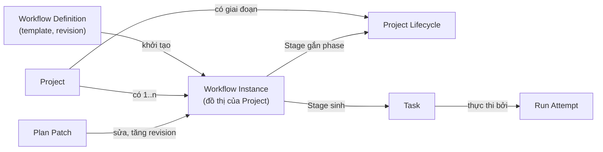

- **Giai đoạn Project được suy ra** từ Stage đang hoạt động (mỗi Stage gắn `phase`), Operator có thể chuyển thủ công. Không cần workflow engine thứ hai cho lifecycle (02 §5.4).
- **Một Project có nhiều Workflow Instance**: quy trình chính (Software Delivery), quy trình định kỳ (Báo cáo ngày), quy trình nhỏ phát sinh (Sửa lỗi gấp).
- **Task có thể tồn tại không cần Workflow** (§19): việc đơn lẻ không cần quy trình.

---

## 3. Workflow Architecture

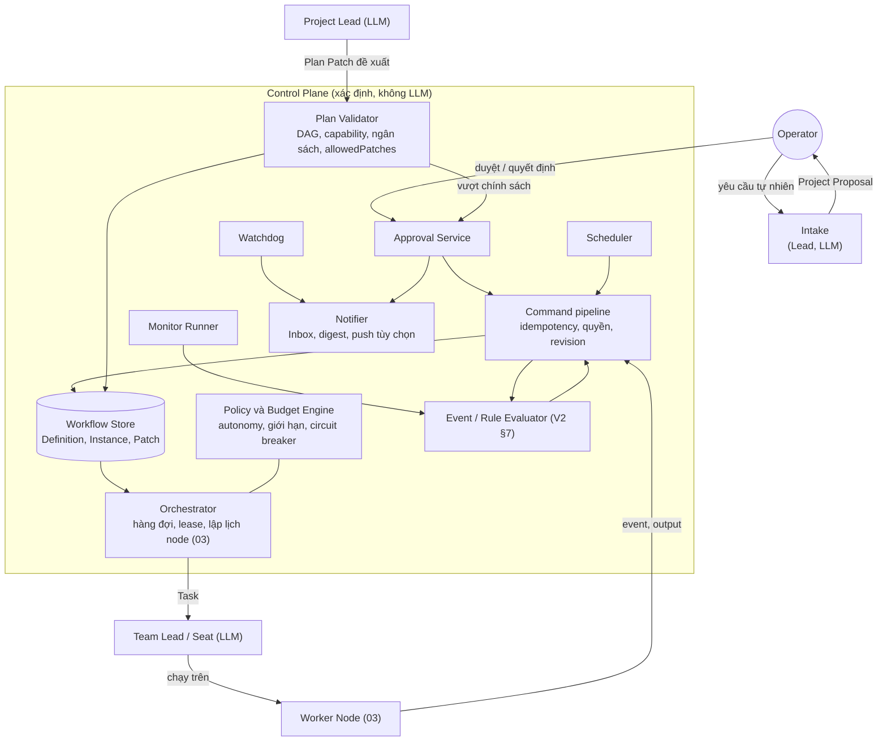

**Phân vai rõ ràng:**

| Thành phần | Có dùng LLM? | Vai trò |
|---|---|---|
| Intake, Project Lead, Team Lead, agent thực hiện | Có | Hiểu yêu cầu, đề xuất kế hoạch, ra quyết định nghiệp vụ trong thẩm quyền, làm việc |
| Command pipeline, Plan Validator, Orchestrator, Approval Service, Policy/Budget, Scheduler, Rule Evaluator, Monitor, Watchdog, Notifier | **Không** | Ghi nhận, kiểm tra, xếp hàng, thực thi chính sách, phát sinh việc theo lịch, phát hiện treo, thông báo |

Nguyên tắc: **LLM đề xuất, phần xác định kiểm và ghi**. Không thành phần LLM nào ghi trực tiếp trạng thái (V2 workflows §4: model không ghi SQL trực tiếp).

---

## 4. Workflow Definition Model

### 4.1 Schema khái niệm

> Mức khái niệm, không phải schema DB hay định dạng file chốt.

```yaml
WorkflowDefinition:
  key: software-delivery
  revision: 3
  title: "Phát triển phần mềm"
  domain: software                      # gắn domain pack (V2 F6)
  parameters:                           # điền khi khởi tạo Instance
    - { name: hasUI, type: bool, default: true }
    - { name: deployTarget, type: enum, values: [none, staging, production], default: staging }
  phases: [discovery, analysis, ready, execution, delivered]
  stages:
    - key: research
      phase: discovery
      requiredCapabilities: [research.web-search, research.synthesis]
      teamHint: research                # gợi ý charter, không bắt buộc
      inputs:  [ { kind: brief, required: true } ]
      outputs: [ { kind: research-report, mustReach: approved } ]
      optional: true
      skipIf: { fact: project.hasApprovedArtifact, kind: research-report, op: eq, value: true }
      placement: portable               # lớp vị trí mặc định (E-06)
      sideEffect: artifact
      limits: { maxTasks: 5, budgetShare: 0.10 }
    - key: design
      phase: analysis
      includeIf: { param: hasUI, op: eq, value: true }
      parallelGroup: analysis-specialists
      # ...
  edges:
    - { from: research, to: ba, type: artifact-approved, artifact: research-report }
    - { from: architecture, to: development, type: artifact-approved, artifact: data-model }
    - { from: qa, to: development, type: rework, when: { fact: review.verdict, op: eq, value: changes-requested }, maxLoops: 3 }
  joins:
    - { group: analysis-specialists, policy: all }   # all | any | quorum(n)
  gates:
    - { before: development, kind: execution-gate, approver: operator }        # C-04
    - { before: deploy, kind: irreversible-action, approver: operator, when: { param: deployTarget, op: eq, value: production } }
  allowedPatches:                       # Lead được tự làm gì
    addTaskWithinStage: auto
    skipOptionalStage: auto
    splitStage: auto
    addStage: approval
    reorderStages: approval
    removeRequiredStage: operator
  autonomy: { default: L2, crossTeam: L3 }          # §18
  budgets: { suggestedTokens: 600000, stageShares: true }
  timeouts: { stallAfter: PT24H, maxDuration: P30D }
```

### 4.2 Thành phần

| Thành phần | Ý nghĩa | Ghi chú |
|---|---|---|
| Stage gắn **capability**, không gắn tên Team | Chọn Team lúc chạy theo §6 | Thêm Team mới không phải sửa template |
| `inputs`/`outputs` theo **loại Artifact** và trạng thái cần đạt | Kết nối với vòng đời tài liệu (02 §13) | Ví dụ ERD phải `approved` mới mở Development |
| `optional`, `skipIf`, `includeIf` | Bỏ bước có điều kiện | Điều kiện có kiểu (§9.3) |
| `parallelGroup` + `joins` | Chạy song song và cách gộp | `all`, `any`, `quorum(n)` |
| `edges` có loại | `finish-to-start`, `artifact-approved`, `informs`, `rework` | §9.1 |
| `gates` | Cổng phê duyệt | §10 |
| `allowedPatches` | Phạm vi Lead tự sửa kế hoạch | §5 |
| `placement`, `sideEffect` | Lớp mặc định cho Task của Stage | E-06 |
| `limits`, `budgets`, `timeouts` | Giới hạn | §17 |

### 4.3 Workflow Instance (khái niệm)

```yaml
WorkflowInstance:
  id: uuid
  projectId: uuid
  definition: software-delivery@3       # ghim revision
  revision: 7                           # tăng mỗi Plan Patch
  parameters: { hasUI: false, deployTarget: staging }
  state: active                          # §8.3
  stages:
    - { key: research, status: skipped, reason: "đã có research-report@1 Approved" }
    - { key: ba, status: done, tasks: [BA-001] }
    - { key: architecture, status: running, tasks: [ARCH-003, ARCH-004] }
    - { key: design, status: excluded, reason: "hasUI=false" }
  patches:
    - { revision: 6, kind: add-stage, stage: migration, by: dev-lead, approval: APR-031 }
  budget: { reserved: 120000, used: 210500, limit: 600000 }
  watermarks: {}                         # cho Instance định kỳ
  holds: []
```

---

## 5. Static Workflow, Dynamic Workflow và Agent-driven Planning

| Tiêu chí | Static Workflow | Dynamic Workflow (theo luật) | Agent-driven Planning | **Template-guided, Lead-adapted** [Đề xuất] |
|---|---|---|---|---|
| Mô tả | Đồ thị cố định, chạy đúng thứ tự | Đồ thị cố định + luật thêm/bỏ bước theo sự kiện | LLM tự lập và sửa kế hoạch | Template là khung và giới hạn; Lead đề xuất Plan Patch; phần xác định kiểm và áp |
| Dự đoán được | ●●● | ●● | ● | ●●● |
| Linh hoạt với tình huống mới | ● | ●● | ●●● | ●●● |
| Truy vết, kiểm toán | ●●● | ●●● | ● (kế hoạch nằm trong ngữ cảnh model) | ●●● (mọi thay đổi là Patch có revision) |
| Rủi ro lặp, kế hoạch phình to | Thấp | Trung bình | **Cao** | Thấp (giới hạn trong `allowedPatches` + §17) |
| Chi phí token | Thấp | Thấp | Cao (lập lại kế hoạch nhiều lần) | Trung bình |
| Hợp với V1 | Không | Không | Gần V1 (Lead lập plan JSON mỗi run) | Kế thừa V1 (`validatePlan`) nhưng plan thành dữ liệu bền vững |

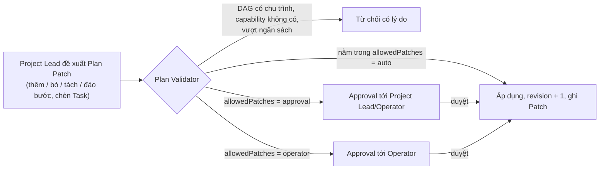

**Kế hoạch luôn là dữ liệu.** Lead không "nhớ" kế hoạch; Session mới nhận Workflow Instance hiện hành trong Context Pack. Điều này giải quyết giới hạn V1: kế hoạch JSON của Lead chỉ sống trong một run.

---

## 6. Chọn Team dựa trên Capability

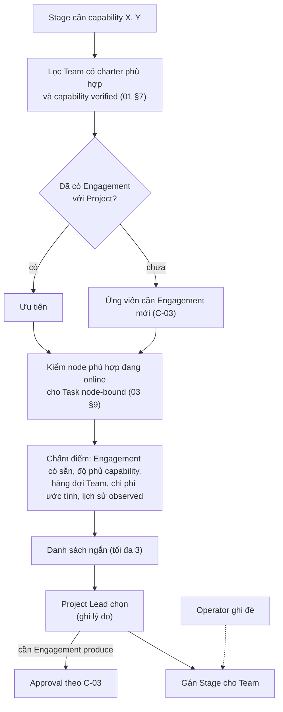

| Bước | Thực hiện bởi | Ghi chú |
|---|---|---|
| Lọc và chấm điểm | Phần xác định | Không để LLM tự liệt kê Team (tránh bịa) |
| Chọn trong danh sách ngắn | Project Lead | Khi điểm gần nhau hoặc cần hiểu ngữ cảnh |
| Không có Team đủ năng lực | Phần xác định báo blocker | "Thiếu capability `media.render.ffmpeg`; chưa có Team/node đáp ứng" |
| Ghi đè | Operator | Có ghi nhận |

---

## 7. Tạo Project bằng yêu cầu ngôn ngữ tự nhiên

### 7.1 Luồng

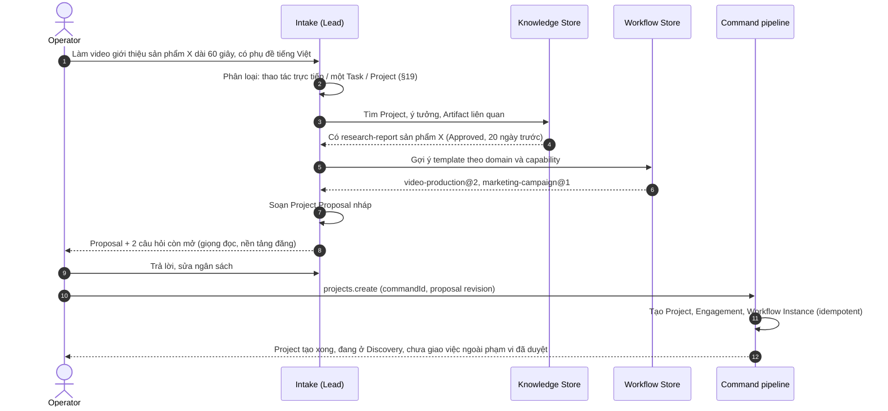

### 7.2 Project Proposal (khái niệm)

| Mục | Nội dung |
|---|---|
| Brief | Mục tiêu một câu, phạm vi, ngoài phạm vi, tiêu chí thành công |
| Template | Workflow Definition + revision + tham số đã điền |
| Bước dự kiến bỏ/thêm | Kèm lý do (ví dụ bỏ Research vì đã có báo cáo Approved; đánh dấu "cần làm mới" nếu quá `validUntil`) |
| Team đề xuất | Theo §6, kèm Engagement cần tạo |
| Ngân sách ước tính | Token theo Stage; chi phí "Chưa có giá" nếu provider không báo giá |
| Gate và mức tự chủ | Mặc định theo template, có thể chỉnh |
| Câu hỏi còn mở | Chỉ những gì không suy ra được (02 §4.4, C-05) |
| Rủi ro, giả định | Ví dụ "chưa có GPU node, render chạy CPU" |

**Nguyên tắc:**
- Proposal là **nháp**; không tạo Task, không gọi Team khác trước khi Operator xác nhận.
- Tạo Project bằng command có `commandId` (V2 ADR-003): bấm hai lần không tạo hai Project.
- Intake hỏi tối đa một lượt câu hỏi gộp; phần không chắc ghi thành giả định có thể sửa sau.
- Execution Gate (C-04) vẫn áp dụng sau khi tạo.

---

## 8. Trạng thái: Waiting, Running, Blocked, Approval Required, Completed

### 8.1 Năm trạng thái người dùng nhìn thấy là projection

Năm trạng thái là **cách hiển thị** tính từ Task state và holds của 02 §5, không phải năm trạng thái lưu riêng. Như vậy giữ một nguồn sự thật.

| Trạng thái hiển thị | Task state (02 §5.1) và holds | Ý nghĩa với người dùng |
|---|---|---|
| **Waiting** | Accepted, Ready, Queued; hoặc Waiting với hold `dependency`, `input`, `cross-team` (trong hạn), `capacity` (node dự kiến quay lại) | **Sẽ tự chạy** khi điều kiện được đáp ứng; không cần làm gì |
| **Running** | InProgress (Leased/Preparing/Running ở 03 §12.2) | Đang có agent làm |
| **Blocked** | Hold `permission`, `budget`; phụ thuộc đã Failed; `capacity` không có node đủ điều kiện; circuit breaker mở; Stalled; Failed chờ quyết định | **Cần người hoặc cấu hình can thiệp**; luôn kèm lý do và việc cần làm |
| **Approval Required** | AwaitingGo; InReview với policy human-final; hold `decision` chờ Operator; Action Intent chờ duyệt | Cần người có thẩm quyền quyết định |
| **Completed** | Done | Đạt và đã review đúng phiên bản |
| *(Đã đóng khác)* | Cancelled, Declined, Superseded, Failed đã chốt | Hiển thị riêng, không lẫn với Completed |

**Waiting khác Blocked**: Waiting tự giải; Blocked thì không. Một Task chờ CTR quá hạn triage hoặc chờ node offline quá ngưỡng chuyển từ Waiting sang Blocked kèm lý do, để người dùng không chờ mù.

### 8.2 Hiển thị ở cấp Workflow và Project

- Workflow Instance hiển thị trạng thái tổng hợp + số Task theo từng trạng thái + **lý do chặn chính**.
- "Cần xử lý" của Operator chỉ chứa **Approval Required** và **Blocked cần Operator** (V2 loops-parity: không trộn log tool, một blocker không nhân bản theo số lần retry).

### 8.3 Workflow State Machine

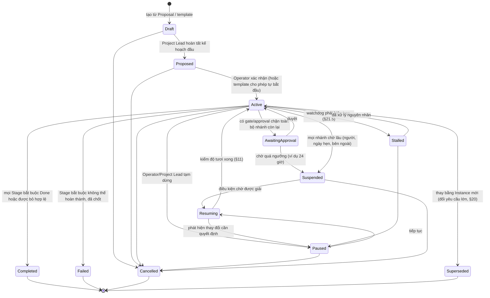

| Trạng thái | Dispatch việc mới | Giữ slot/Session | Ghi chú |
|---|---|---|---|
| Active | Có | Có | |
| AwaitingApproval | Chỉ nhánh không phụ thuộc approval | Không giữ Session chờ | |
| Paused | **Không** | Việc đang chạy: drain hoặc dừng theo lựa chọn | Tạm dừng có chủ đích |
| Suspended | Không | **Không** | Chờ dài; nhả mọi tài nguyên |
| Resuming | Không, cho tới khi kiểm xong | Không | §11 |
| Stalled | Không tự dispatch thêm | Tùy nguyên nhân | Watchdog gửi chẩn đoán |

---

## 9. Dependency, Parallel Execution và Conditional Branch

### 9.1 Loại phụ thuộc

| Loại cạnh | Nghĩa | Ví dụ |
|---|---|---|
| `finish-to-start` | B chạy sau khi A Done | Integrate sau BE và FE |
| `artifact-approved` | B chạy khi Artifact cụ thể của A đạt trạng thái yêu cầu | Development chờ `data-model` Approved |
| `informs` | A cung cấp thông tin nhưng không chặn B; A đổi thì B nhận cảnh báo stale | UI spec informs BE |
| `rework` | Quay lại bước trước khi điều kiện đúng, có giới hạn vòng | QA `changes-requested` → Development, tối đa 3 vòng/issue |
| `wait-until` | Chờ tới thời điểm hoặc sự kiện bên ngoài | Chờ ngày ra mắt; chờ pipeline CI xong |

### 9.2 Song song

- Các Stage cùng `parallelGroup` chạy đồng thời khi đủ đầu vào và không tranh scope/tài nguyên (V2 workflows §6, 03 §9).
- **Join policy**: `all` (chờ tất cả), `any` (một nhánh xong là đi tiếp, nhánh còn lại hủy hoặc tiếp tục theo cấu hình), `quorum(n)`.
- Song song có giới hạn: số Task chạy đồng thời theo Workflow, theo Engagement (02 §6.1) và theo slot node (D-05).

### 9.3 Rẽ nhánh có điều kiện

- Điều kiện là biểu thức **có kiểu** trên các *fact* được liệt kê: tham số Workflow, verdict review, trạng thái/trường của Artifact, nhãn, kết quả kiểm tra, giá trị số từ Monitor. Phép so sánh giới hạn (`eq`, `ne`, `in`, `gt`, `lt`, `exists`, `and`, `or`, `not`).
- **Không cho JavaScript hay code tùy ý** trong điều kiện (V2 workflows §7).
- Phân loại cần AI (ví dụ "đánh giá cảm xúc bình luận") là **một Task riêng** tạo ra fact, không gọi LLM ẩn trong điều kiện (V2 workflows §7).

### 9.4 Quay lại bước trước và chèn Task mới

- Quay lại qua cạnh `rework` hoặc Plan Patch; giữ lịch sử, đánh dấu output cũ Superseded, không xóa (02 §13).
- Chèn Task mới khi phát sinh: Lead dùng Plan Patch `addTaskWithinStage` (tự áp nếu trong ngân sách) hoặc tạo CTR (02 §3).

### 9.5 Kiểm tra cấu trúc

| Kiểm tra | Khi nào | Hành động |
|---|---|---|
| Chu trình trong DAG (không tính cạnh `rework` có giới hạn) | Mỗi Plan Patch | Từ chối Patch |
| Deadlock: các Task chờ lẫn nhau, không Task nào chạy được | Watchdog định kỳ | Workflow → Stalled, chẩn đoán gửi Lead |
| Stage bắt buộc không có Team/capability | Khi khởi tạo và khi Patch | Blocked có lý do |
| Vượt số vòng rework | Mỗi lần rework | Blocked, cần Lead/Operator quyết định |

---

## 10. Human Approval

### 10.1 Loại phê duyệt

| Loại | Phát sinh khi | Người duyệt mặc định | TTL gợi ý | Hết hạn thì | Duyệt gộp |
|---|---|---|---|---|---|
| Execution Gate | Chuyển Analysis → Execution (C-04) | Operator | 7 ngày | Nhắc; Workflow Suspended | Có, theo gói căn cứ (C-06) |
| Decision Request | Câu hỏi nghiệp vụ vượt thẩm quyền (02 §4.4) | Operator hoặc Project Lead | 3 ngày | Nhắc, leo thang; nhánh phụ thuộc chờ | Không |
| Review human-final | Output cần người nghiệm thu | Operator | 7 ngày | Nhắc | Có, cùng gói |
| Tăng ngân sách | Ngân sách chạm trần | Operator | 2 ngày | Việc giữ hold `budget` | Có, theo Project |
| Action Intent không đảo ngược | Deploy production, publish, gửi ra ngoài (E-07) | Operator | 1 ngày | **Hết hạn = không thực hiện**; phải tạo lại | **Không** |
| Plan Patch vượt chính sách | `allowedPatches` = approval/operator | Project Lead / Operator | 3 ngày | Patch hết hiệu lực | Không |
| Tạo Engagement `produce` | C-03 | Project Lead (Operator khi vượt ngân sách) | 3 ngày | CTR Expired | Không |
| Node mới | Đăng ký node (03 §7) | Operator | 1 ngày | Token hết hạn | Không |

TTL là giá trị khởi đầu, **chưa đo** thực tế.

### 10.2 Bản ghi Approval (khái niệm)

```yaml
Approval:
  id: uuid
  kind: execution-gate | decision | review | budget | action-intent | plan-patch | engagement | node
  projectId, workflowInstanceId, taskId
  subject: "Mở Execution Gate cho gói yêu cầu v1"
  request:
    summary: string                       # ngắn, đọc được trên điện thoại
    options: [ { id, label, consequence } ]
    recommendation: optionId | null
    impactIfWaiting: string               # chậm thì ảnh hưởng gì
    cost: { tokens, money: known | unknown }
  context:
    refs: [ artifactId@version, decisionId ]
    digest: sha256                        # thay đổi thì Approval Superseded
  approver: { role: operator | project-lead, userId? }
  ttl: duration
  state: <xem §10.3>
  outcome: { optionId, actor, at, comment }
  appliedBy: commandId                    # áp dụng đúng một lần
```

### 10.3 Human Approval Lifecycle

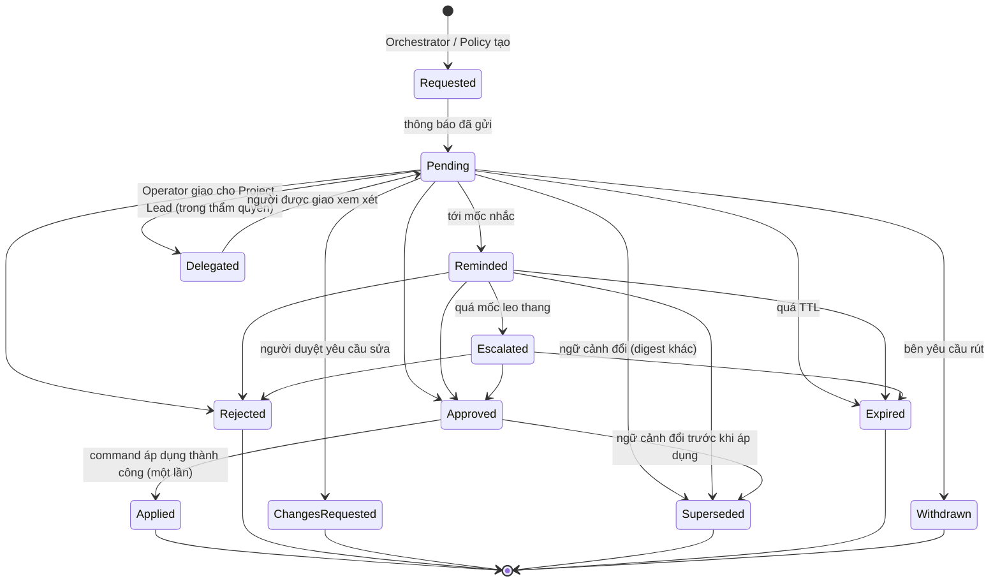

**Quy tắc:**
1. **Gắn ngữ cảnh**: Approval gắn `digest` của các Artifact/Decision liên quan. Ngữ cảnh đổi thì Approval cũ Superseded, không tự áp lên bản mới (V2 workflows §2; 02 §13).
2. **Áp dụng đúng một lần** qua command idempotent.
3. **Không tự duyệt khi hết hạn.** Hết hạn là không làm. Đặc biệt Action Intent không đảo ngược (E-07).
4. **Leo thang** chỉ là nhắc lại mạnh hơn hoặc gửi kênh khác; không chuyển quyền cho agent.
5. **Nhánh không phụ thuộc vẫn chạy** (V2 workflows §2).

### 10.4 Standing Approval

Chấp thuận trước cho việc lặp lại rủi ro thấp, để Operator không phải bấm duyệt từng lần.

| Thuộc tính | Ví dụ |
|---|---|
| Loại hành động | `notify.send-internal`, `deploy.staging`, `artifact.publish-to-project` |
| Phạm vi | Project B; Team DevOps; nhánh `release/*` |
| Giới hạn | Tối đa 5 lần/ngày; mỗi lần ≤ 50.000 token |
| Hạn | 30 ngày, tự hết hạn |
| Thu hồi | Bất kỳ lúc nào, có hiệu lực ngay với việc mới |
| Không áp dụng | Deploy production, chi tiêu tiền, publish ra ngoài, xóa dữ liệu (luôn cần Approval từng lần) |

### 10.5 Approval Inbox

| Khu vực | Nội dung |
|---|---|
| Cần quyết định ngay | Approval sắp hết hạn hoặc đang chặn việc đang chạy |
| Chờ duyệt | Theo Project, sắp xếp theo hạn và mức ảnh hưởng |
| Duyệt gộp | Các Approval cùng loại, cùng gói ngữ cảnh (ví dụ 4 tài liệu căn cứ của một gate) |
| Bị chặn cần cấu hình | Blocked do quyền, ngân sách, node, circuit breaker |
| Đã xử lý gần đây | 7 ngày, có thể mở lại xem |

Mỗi mục hiển thị: việc gì, vì sao cần, các lựa chọn và khuyến nghị, ảnh hưởng nếu chờ, chi phí, liên kết ngữ cảnh. Thao tác: Duyệt, Từ chối, Yêu cầu sửa, Giao cho Project Lead. Kế thừa "Cần xử lý" của V1 (Cần quyết định / Bị chặn, lọc dự án, đã đọc, đóng cảnh báo).

---

## 11. Tạm dừng Workflow nhiều ngày và khôi phục

### 11.1 Vì sao tạm dừng dài không tốn tài nguyên

- Toàn bộ trạng thái nằm trong dữ liệu: Workflow Instance, Task, Approval, Artifact, Decision, Dossier.
- **Không giữ phiên LLM** nào trong lúc chờ (D-05, C-08). Suspended nhả mọi slot và Session.
- Bước "chờ đến ngày" dùng **durable timer**: một bản ghi thời điểm trong Scheduler, không phải tiến trình ngủ.

### 11.2 Khôi phục

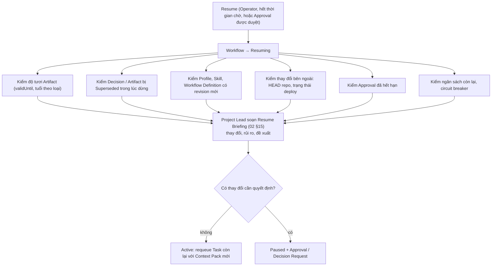

- Task đang dở khi tạm dừng được tiếp tục bằng **Session mới** với Context Pack + context diff, không replay prompt cũ (03 §16).
- Workflow Definition có revision mới **không tự nâng cấp** Instance; Lead có thể đề xuất Plan Patch để áp phần mới.

---

## 12. Scheduler Architecture: Schedule, Event Trigger, Conditional Monitoring

### 12.1 Hiện trạng [Hiện có]

V1 (`shared/schedules.ts`, `controller/schedules.ts`): lịch `once` hoặc `daily` theo múi giờ IANA và thứ trong tuần; `missedPolicy` chỉ có `skip`; hành động duy nhất `create_work_item` (backlog thụ động, **không tự giao agent**, không có event trigger); timer 30 giây; chỉ chạy khi ứng dụng mở. Kế hoạch V2 §7 mở rộng thành rule engine dùng chung pipeline, misfire skip/coalesce, khóa occurrence `scheduleId+revision+occurrenceUTC`.

### 12.2 Kiến trúc

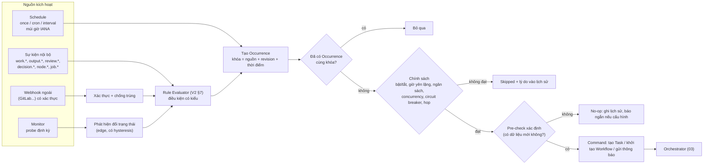

### 12.3 Chính sách của Schedule

| Chính sách | Lựa chọn | Mặc định [Đề xuất] |
|---|---|---|
| Biểu thức thời gian | `once`, `cron` (5–6 trường), `interval`, danh sách thứ + giờ (như V1) | Giữ dạng V1 cho UI đơn giản; cron cho người dùng nâng cao |
| Múi giờ | IANA, xử lý chuyển giờ mùa | `Asia/Saigon` |
| Lỡ lịch (control plane tắt, đang tạm dừng) | `skip`, `coalesce-once` (chạy bù một lần), `catch-up-limited(n)` | **skip** (như V1); Reporting có thể chọn `coalesce-once` |
| Lần trước chưa xong | `skip-if-running`, `queue-one`, `allow-parallel(n)` | **skip-if-running** |
| Giờ yên lặng | Không gửi thông báo không khẩn trong khung giờ | 22:00–07:00 |
| Ngân sách | Trần token mỗi lần và mỗi ngày | Theo §17 |
| Thất bại liên tiếp | Circuit breaker của Schedule (§17.4) | 3 lần → tự tắt (quarantine) + thông báo |

### 12.4 Event Trigger

- Nguồn: event log theo Project (V2 cursor) và webhook ngoài.
- Webhook phải có xác thực (token/chữ ký), chống trùng theo delivery ID, và **xác nhận lại qua API** trước khi tin (hệ cũ: GitLab webhook chỉ là bằng chứng, không phải phê duyệt).
- Chống lặp: causation/root ID, hop limit, no-op transition không phát event mới, debounce, phát hiện chu trình và quarantine rule (V2 workflows §7, F5-05).

### 12.5 Conditional Monitoring

| Loại probe | Ví dụ | Chạy ở |
|---|---|---|
| HTTP health | `https://asf.lazy.local/healthz` trả 200 | Control plane hoặc node gần dịch vụ |
| Ngưỡng số | Dung lượng `.14` < 20 GiB (ngưỡng đã ghi ở ADR-002) | Node có quyền đọc |
| Thay đổi Git | Repo có commit mới trên `main` | Control plane qua GitLab API |
| Tuổi Artifact | research-report quá `validUntil` | Control plane |
| Hàng đợi/Workflow | Approval quá hạn, Workflow Stalled | Control plane (Watchdog) |

- **Kiểm tra xác định trước, LLM sau**: probe không gọi model; chỉ khi điều kiện đổi trạng thái mới tạo Task cho agent (ví dụ "phân tích nguyên nhân health check fail").
- **Kích hoạt theo cạnh** (edge-triggered): chỉ phát sự kiện khi trạng thái đổi (ổn → lỗi), có hysteresis (ví dụ lỗi 3 lần liên tiếp) để tránh nhiễu và tạo việc trùng.

### 12.6 Khi Windows tắt

Scheduler chạy trên control plane 24/7 (E-01). Occurrence tạo Task bình thường; Task portable chạy trên `.60`; Task node-bound chờ máy với hold `capacity` (03 §13.2).

---

## 13. Agent chạy theo lịch mà không giữ phiên LLM

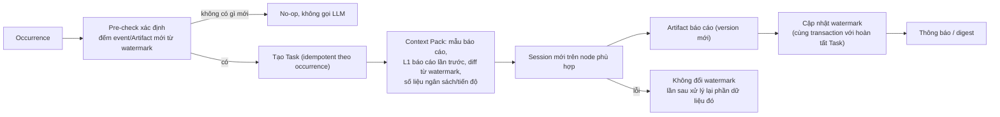

| Nguyên tắc | Lý do |
|---|---|
| Mỗi lần chạy là **Session mới** | Không tích lũy ngữ cảnh rác; chịu được node thay đổi (D-05, C-08) |
| Trạng thái giữa các lần nằm trong **Artifact và watermark** | Bền vững, truy vết được, không phụ thuộc trí nhớ model |
| Watermark chỉ tăng khi Task thành công | Lỗi thì lần sau không mất dữ liệu |
| Pre-check xác định trước khi gọi LLM | Ngày không có thay đổi thì không tốn token |
| Context Pack nhỏ: L1 lần trước + diff | Không đọc lại toàn bộ lịch sử (02 §10) |
| Seat dedicated chỉ giữ **workspace ấm**, không giữ Session | Khởi động nhanh mà vẫn đúng nguyên tắc |

---

## 14. Thông báo, báo cáo định kỳ và Approval Inbox

### 14.1 Phân loại thông báo

| Loại | Ví dụ | Cách gửi |
|---|---|---|
| **Cần hành động** | Approval mới, Blocked cần Operator, circuit breaker mở | Inbox ngay; push ngoài (nếu bật) kể cả trong giờ yên lặng khi mức khẩn |
| **Thông tin quan trọng** | Hoàn thành giai đoạn, deploy staging xong | Inbox; push ngoài ngoài giờ yên lặng |
| **Digest** | Tiến độ trong ngày, việc Done, chi phí | Gộp theo lịch (ví dụ 18:00) |
| **Không thông báo** | Log tool, event kỹ thuật, retry nội bộ | Chỉ xem khi mở chi tiết (V2 workflows §10) |

**Chống trùng:** khóa thông báo theo `(entity, revision, loại)`; một blocker chỉ một thông báo dù retry nhiều lần (V2 loops-parity). Cập nhật trạng thái thay vì gửi thêm.

### 14.2 Kênh

| Kênh | Hiện trạng | Đề xuất |
|---|---|---|
| Inbox trong ứng dụng | **[Hiện có]** ở V1 ("Cần xử lý", đã đọc, đóng cảnh báo) | **Bắt buộc** |
| Push điện thoại tự host (ntfy) | Không có bằng chứng đang dùng | **Tùy chọn**, chạy trong mạng nội bộ qua NetBird; nội dung tối thiểu, có liên kết mở Inbox |
| Email, Telegram, Zalo... | Không có bằng chứng | Hoãn; có thể thêm qua Apprise nếu cần nhiều kênh |

Nội dung push không chứa secret hay dữ liệu nhạy cảm; chỉ tiêu đề + mức độ + liên kết.

### 14.3 Báo cáo định kỳ

| Báo cáo | Tần suất gợi ý | Nội dung | Người tạo |
|---|---|---|---|
| Báo cáo ngày theo Project | Hằng ngày 07:00 | Việc xong, đang chạy, bị chặn, chờ duyệt, chi phí, rủi ro | Reporting Team (§16) |
| Báo cáo tuần toàn bộ | Thứ Hai | Tổng hợp nhiều Project, xu hướng chi phí, Team quá tải | Reporting Team |
| Báo cáo sự cố | Theo sự kiện | Node mất, circuit breaker, deploy lỗi | Tự động xác định + agent phân tích nếu cần |

Báo cáo là **Artifact có version**; thông báo chỉ chứa tóm tắt và liên kết.

---

## 15. Ví dụ quy trình

### 15.1 Software Delivery

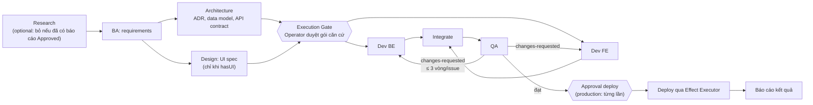

| Tình huống | Workflow xử lý |
|---|---|
| Không có giao diện | `hasUI=false` → Design excluded; FE excluded |
| Đã có nghiên cứu Approved còn hạn | Research skipped có lý do |
| Architecture phát hiện cần migration | Plan Patch `addStage: migration` (cần duyệt) |
| Dev phát hiện thiếu bảng audit | CTR tới Architecture (02 §18.2); data model version mới; Task phụ thuộc stale |
| `deployTarget=staging` | Deploy staging qua Standing Approval; production cần Approval từng lần |

### 15.2 Video Production

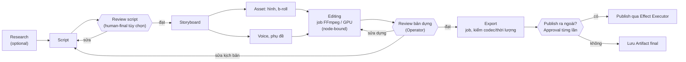

| Điểm đặc thù | Cách xử lý |
|---|---|
| Editing/Export là **job** dài, không phải lượt agent | Job runner, agent có thể rảnh khi render (V2 workflows §8); lease dài + heartbeat (03 §15 K6) |
| Cần GPU hoặc FFmpeg cụ thể | Task `node-bound`; chưa có GPU thì chạy CPU và ghi rõ trong Proposal |
| Review quay lại Script | Cạnh `rework` tới Script; Storyboard, Asset, Editing đánh dấu stale |
| Publish lên nền tảng | `external-irreversible` → Approval từng lần, không Standing Approval |

### 15.3 Marketing (khung)

| Stage | Capability chính | Song song/điều kiện | Gate |
|---|---|---|---|
| Research | `research.market` | optional | — |
| Planning | `marketing.planning` | — | Operator duyệt kế hoạch và ngân sách chiến dịch |
| Creative | `content.copy`, `design.visual` | Copy ∥ Visual | Review human-final |
| Execution | `marketing.publish` | Theo kênh | **Approval từng lần** cho mỗi lần đăng/chi tiền |
| Reporting | `report.analytics` | Lịch hằng tuần | — |

---

## 16. Ví dụ: Reporting Agent chạy tự động mỗi ngày

### 16.1 Cấu hình (khái niệm)

```yaml
Schedule:
  name: "Báo cáo ngày Project B"
  projectId: project-b
  timing: { kind: weekly, days: [1,2,3,4,5,6,7], time: "07:00", timeZone: Asia/Saigon }
  missedPolicy: coalesce-once
  concurrency: skip-if-running
  action:
    kind: run-task
    seat: reporting-team/reporter          # Seat dedicated trên node luôn bật
    template: daily-project-report@2
    placement: portable
    sideEffect: artifact
  precheck: { kind: events-since-watermark, minEvents: 1 }
  budget: { perRunTokens: 40000, perDayTokens: 60000 }
  notify: { channel: inbox+digest, pushIfBlockedItems: true }
  autonomy: L4-standing                     # chỉ cho notify.send-internal
```

### 16.2 Sequence

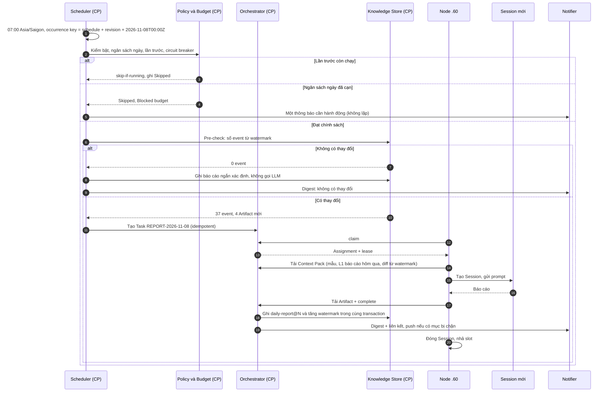

| Tình huống | Hành vi |
|---|---|
| Control plane tắt lúc 07:00, lên lại 09:00 | `coalesce-once`: chạy bù một lần, dữ liệu tính từ watermark nên không mất |
| Node `.60` offline | Task portable chờ node khác đủ điều kiện; nếu không có, Blocked `capacity` sau ngưỡng, thông báo một lần |
| Session lỗi | Retry hạ tầng tối đa 2 (E-08); watermark không đổi |
| 3 ngày lỗi liên tiếp | Circuit breaker của Schedule mở → tự tắt lịch + thông báo cần hành động |
| Windows PC tắt | Không ảnh hưởng (E-01) |

---

## 17. Chính sách giới hạn chi phí và an toàn

### 17.1 Ngân sách nhiều cấp

| Cấp | Gợi ý khởi đầu | 80% | 100% | Ai được nâng |
|---|---|---|---|---|
| Organization / tháng | Operator đặt | Cảnh báo digest | Dừng dispatch mới mọi Project trừ việc đã duyệt khẩn | Operator |
| Project | Theo Proposal (§7) | Cảnh báo Project Lead + Operator | Hold `budget` cho việc mới; việc đang chạy chạy hết lượt | Operator |
| Engagement (Team trong Project) | Phần chia từ Project | Cảnh báo Team Lead | Hold `budget` cho việc của Team đó | Project Lead trong ngân sách Project; Operator nếu vượt |
| Chuỗi gốc (`rootId`) | C-10 | Cảnh báo | Dừng chuỗi, Blocked | Project Lead |
| Task / lượt | Từ cấu hình đã chạy thật: run 200.000, grant 90.000, ≤12 request/lượt, output 1.000/request (hệ cũ Phase 5); V1: 30 phút, 40 request | — | Lượt kết thúc có lý do | Project Lead |
| Schedule / lần và / ngày | Ví dụ §16.1 | — | Skipped | Operator |

- **Reservation trước dispatch**, settle theo usage thật (V2 multidomain; hệ cũ `reserve_call`/`finish_call`).
- Chi phí chưa biết hiển thị **"Chưa có giá"**, không tính là 0 (V2 README §5).
- Không tự đổi sang model đắt hơn khi cạn quota (V2 workflows §8).

### 17.2 Retry

| Loại | Giới hạn | Nguồn |
|---|---|---|
| Hạ tầng (node mất, runtime crash) | Tối đa 2 lượt khôi phục tự động | E-08 |
| Gọi model lỗi tạm thời | Backoff có giới hạn trong model proxy, tính vào ngân sách | V2 workflows §6 |
| Nội dung (review không đạt) | ≤3 vòng sửa mỗi issue | C-10, ADR-003 |
| Outcome unknown có side effect | **0**, phải reconcile | E-07 |
| Quota, auth, quyền | **0**, thành blocker cấu hình | V2 F1-04 |

### 17.3 Recursion

| Giới hạn | Giá trị khởi đầu | Nguồn / lý do |
|---|---|---|
| Hop chuyển yêu cầu xuyên Team | ≤3 | C-10 |
| Vòng hỏi đáp trong thread CTR | ≤3 | C-10 |
| Độ sâu cây Task dưới một Stage | ≤3 cấp | Tránh chia việc vô hạn |
| Số Task con trong một lần lập kế hoạch | ≤10 | V1 `validatePlan` |
| Task do Plan Patch tự áp mỗi Workflow mỗi ngày | ≤30 [Chưa xác minh] | Chặn kế hoạch phình to |
| CTR đang mở mỗi Task | ≤5 [Chưa xác minh] | Tránh một agent hỏi tràn lan |
| Rule kích hoạt rule (hop sự kiện) | ≤3 | V2 F5-05 |

### 17.4 Circuit Breaker

| Phạm vi | Mở khi | Khi mở | Thử lại (half-open) | Đóng khi |
|---|---|---|---|---|
| Route model trên 9Router | 5 lỗi liên tiếp hoặc >50% lỗi trong 20 lần gọi gần nhất | Gọi model qua route này fail nhanh; Task hold có lý do | Sau 5 phút, cho 1 lượt thử | Lượt thử thành công |
| Runtime trên một node | Lỗi auth/protocol | Node không nhận việc cần runtime đó | Khi probe runtime đạt | Probe đạt |
| Node | 3 attempt liên tiếp lỗi hạ tầng | Không nhận việc mới (gần Quarantined, 03 §7.3) | Probe lại sau 10 phút | Probe và 1 attempt đạt |
| Rule / Schedule | 3 lần thất bại liên tiếp, hoặc phát hiện vòng lặp | **Tự tắt** (quarantine) + thông báo | Operator bật lại | Operator |
| Team | ≥5 Task Failed trong 1 giờ | Tạm dừng hàng đợi Team, báo Team Lead và Operator | Operator/Team Lead mở lại | Thủ công |
| Ngân sách | Chạm 100% | Dừng cứng theo §17.1 | — | Nâng ngân sách |

Các ngưỡng là giá trị khởi đầu [Chưa xác minh], cần chỉnh sau khi đo. Có thể hiện thực bằng thư viện `cockatiel` (§22).

### 17.5 Thời gian

| Giới hạn | Giá trị khởi đầu |
|---|---|
| Deadline lượt agent | 30 phút (V1), cấu hình theo Stage |
| Job dài (render) | Theo job, lease dài + heartbeat |
| Workflow tối đa | Cảnh báo khi quá `maxDuration` của template |
| TTL Approval | §10.1 |
| Stall Workflow | Không có việc chạy/xếp hàng và không chờ người/ngoài trong 24 giờ (template chỉnh được) |
| Không có tiến độ trong Task | Không có event tiến độ 15 phút dù lease còn → hỏi trạng thái runtime, sau đó dừng [Chưa xác minh] |

---

## 18. Mức độ tự chủ

| Mức | Agent được tự làm | Cần hỏi | Ví dụ |
|---|---|---|---|
| **L0 · Gợi ý** | Chỉ đề xuất | Mọi hành động | Project mới, chưa tin cậy |
| **L1 · Trong Task** | Đọc/sửa/chạy lệnh trong scope và grant của Task | Mọi thay đổi kế hoạch | Agent thực hiện thông thường |
| **L2 · Trong Team** | Chia việc trong Team, chọn Seat, CTR clarify/consult, vòng sửa, thêm Task trong Stage trong ngân sách | Thay đổi xuyên Team, ngân sách, phạm vi | **Mặc định** cho Team Lead |
| **L3 · Xuyên Team trong ngân sách** | CTR `produce`, Plan Patch `auto`, tạo Engagement tư vấn | Tăng ngân sách, đổi phạm vi, gate | **Mặc định** cho Project Lead |
| **L4 · Tác động ngoài theo Standing Approval** | Hành động bên ngoài đúng phạm vi Standing Approval | Mọi hành động ngoài phạm vi | Reporting gửi thông báo nội bộ; DevOps deploy staging |

**Luôn cần Operator, ở mọi mức**: danh sách bắt buộc của C-05 (đổi phạm vi/tiêu chí, mở gate, tăng ngân sách, chi tiêu, publish ra ngoài, hành động không đảo ngược, mâu thuẫn ảnh hưởng phạm vi/chi phí, tri thức Global).

| Loại Project | Mặc định gợi ý |
|---|---|
| Software | Team Lead L2, Project Lead L3; deploy staging L4 qua Standing Approval; production luôn hỏi |
| Video | L2/L3; publish luôn hỏi |
| Marketing | L2/L3; mọi lần đăng/chi tiền luôn hỏi |
| Reporting/DevOps 24/7 | L4 cho thông báo nội bộ và thao tác đọc; hành động sửa hệ thống luôn hỏi |

---

## 19. Thao tác trực tiếp, Task hay Workflow

| Mức | Khi nào | Ví dụ | Đi qua |
|---|---|---|---|
| **Thao tác trực tiếp** | Đọc/tra cứu; hoặc một thay đổi đơn lẻ, đảo ngược được, trên dữ liệu của Factory; không cần agent làm việc dài | "Tiến độ Project B?", đổi tên Task, đổi ưu tiên, gắn nhãn, trả lời từ tri thức đã có | Command trực tiếp hoặc chat với Lead (không tạo Task, V2 workflows §1) |
| **Một Task** | Cần agent làm việc, một owner, một đầu ra, không cần gate hay nhiều Team | "Viết tóm tắt tài liệu này", "Sửa lỗi chính tả trong README" | Task độc lập, có thể review |
| **Workflow nhỏ (ad-hoc)** | Vài bước, có phụ thuộc, có thể có review, nhưng không có template phù hợp | "Sửa lỗi gấp: tái hiện → sửa → test" | Lead tạo Instance từ template nhỏ hoặc Plan Patch |
| **Workflow theo template** | Nhiều giai đoạn, nhiều Team, gate, Artifact bàn giao, chạy dài hoặc định kỳ, có side effect bên ngoài | Phát triển tính năng, sản xuất video, chiến dịch marketing, báo cáo định kỳ | Proposal (§7) → Workflow Instance |

Nguyên tắc chọn: **mức thấp nhất đáp ứng đủ yêu cầu**. Intake nâng mức khi phát hiện cần gate, nhiều Team, side effect bên ngoài, hoặc việc kéo dài nhiều ngày.

---

## 20. Người dùng thay đổi yêu cầu khi Workflow đang chạy

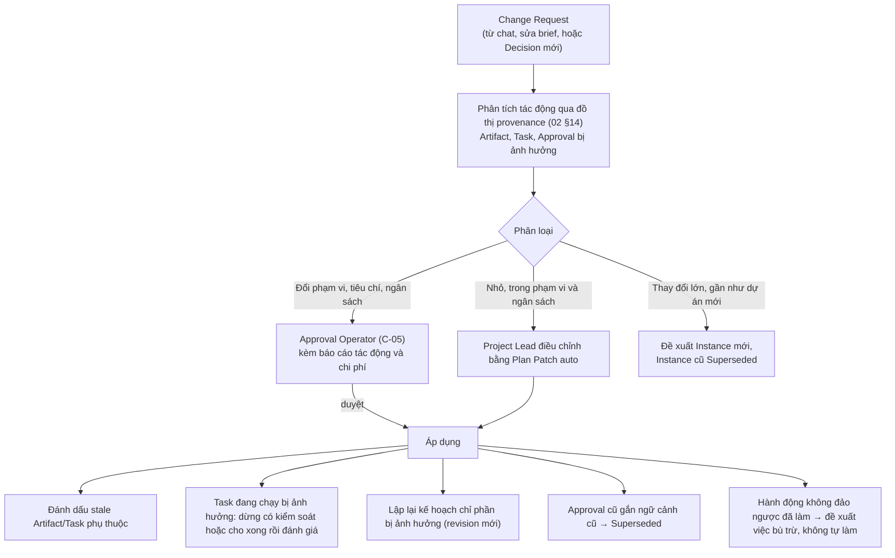

| Nguyên tắc | Lý do |
|---|---|
| Không khởi động lại toàn bộ | Giữ việc đã đúng, tiết kiệm chi phí |
| Không xóa lịch sử | Artifact cũ Superseded, vẫn truy vết được |
| Báo trước chi phí phát sinh | Operator quyết định có tác động ngân sách |
| Ngữ cảnh đổi thì Approval cũ mất hiệu lực | Tránh áp quyết định cũ lên yêu cầu mới |
| Task đang dùng input cũ có thể chạy hết lượt | Kết quả được đánh giá lại, không tự hủy nếu vẫn dùng được |

---

## 21. Phân tích đặc biệt

### 21.1 Khi nào cần Global Orchestrator?

Phải tách hai nghĩa:

| Nghĩa | Kết luận |
|---|---|
| **Orchestrator xác định** (không LLM) điều phối toàn hệ thống | **Luôn cần, và chỉ một** (D-03, E-01). Xử lý: hàng đợi chung, công bằng giữa Project, ngân sách nhiều cấp, lịch, circuit breaker, tác động xuyên Project, watchdog |
| **Agent LLM "tổng điều phối"** đứng trên mọi Project | **Không cần thường trực.** Các vấn đề xuyên Project đều có luật xác định giải được, rẻ hơn và kiểm toán được. Một agent "Portfolio" chỉ chạy **theo yêu cầu** (ví dụ "tuần này nên ưu tiên Project nào?"), chỉ tư vấn, không có thẩm quyền giao việc hay duyệt |

Cân nhắc lại khi: số Project hoạt động đồng thời lớn (nhiều hơn khoảng 10) và tranh chấp ưu tiên cần phán đoán nghiệp vụ thường xuyên [Chưa xác minh].

### 21.2 Khi nào Team Lead được tự điều phối?

| Được tự làm (L2) | Phải hỏi Project Lead | Phải hỏi Operator |
|---|---|---|
| Chia việc trong Team, chọn Seat | CTR `produce` tới Team khác vượt hạn mức | Danh sách bắt buộc C-05 |
| Thứ tự việc trong Team | Plan Patch `approval` | Tăng ngân sách Project |
| CTR `clarify`/`consult` | Đổi output contract của Stage | Mở gate |
| Vòng sửa ≤3/issue | Bỏ bước optional ảnh hưởng Team khác | Hành động không đảo ngược |
| Thêm Task trong Stage trong ngân sách Engagement | | |
| Từ chối CTR quá tải (02 §3.2) | | |

### 21.3 Khi nào cần hỏi người dùng?

**Hỏi khi:**
1. Thuộc danh sách bắt buộc C-05.
2. Intake gặp mơ hồ không suy ra được (mục tiêu, đối tượng, ràng buộc cứng).
3. Plan Patch vượt chính sách (`allowedPatches: operator`).
4. Circuit breaker cấp Team/Schedule mở.
5. Chạm ngưỡng ngân sách.
6. Hai Artifact Approved mâu thuẫn, ảnh hưởng phạm vi/chi phí (02 §7.3).
7. Task node-bound chờ máy offline quá ngưỡng (03 §15 K5).

**Không hỏi về:** quyền tool đã cấp trước (V2 D07), lựa chọn kỹ thuật trong thẩm quyền Team, thứ tự việc nội bộ, retry hạ tầng, điều đã có câu trả lời trong tri thức.

**Cách hỏi:** gộp câu hỏi, có khuyến nghị, nói rõ ảnh hưởng nếu chờ, một nơi trả lời (Approval Inbox), không hỏi lại khi ngữ cảnh chưa đổi.

### 21.4 Tránh quá nhiều tầng Agent quản lý

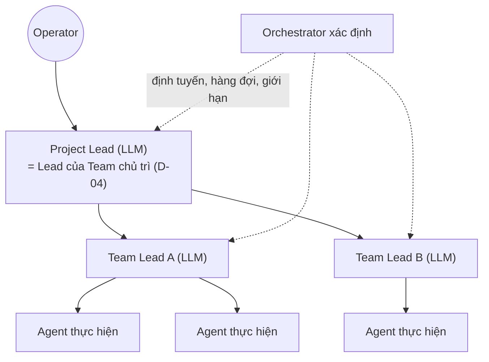

| Quy tắc | Lý do |
|---|---|
| **Tối đa 2 tầng LLM điều phối**: Project Lead → Team Lead | Mỗi tầng LLM thêm chi phí, độ trễ và chỗ hiểu sai |
| Project chỉ có một Team: **gộp** Project Lead và Team Lead (D-04) | Bỏ tầng thừa |
| Team chỉ có một Seat đang làm: Lead **tự làm** thay vì giao | Không cần quản lý một người |
| **Không có Lead-of-Leads** trên Project | Xuyên Project do Orchestrator xác định (§21.1) |
| Điều phối bằng **dữ liệu** (Workflow Instance, Task, CTR), không bằng chat chuyển tiếp | Không có tầng chỉ để chuyển lời |
| Mỗi tầng phải **ra quyết định** (chọn, chia, duyệt), không chỉ chuyển tiếp | Tầng chuyển tiếp bị loại |
| **Trần token cho vai trò Lead**, ví dụ ≤20% ngân sách Project [Chưa xác minh] | Phát hiện Lead "nói nhiều làm ít" |

### 21.5 Workflow bị treo hoặc mất Worker

| Cấp | Phát hiện | Xử lý |
|---|---|---|
| Attempt | Lease hết hạn (E-08) | Theo 03 §15 K1–K8 |
| Attempt | Lease vẫn gia hạn nhưng không có event tiến độ trong 15 phút | Hỏi trạng thái runtime qua adapter; không có phản hồi thì dừng có xác nhận, phân loại retry |
| Task | Waiting quá ngưỡng (CTR quá hạn triage, node-bound offline) | Chuyển Blocked có lý do, thông báo một lần |
| Workflow | Không có Task Running/Queued, không chờ người hay bên ngoài, trong 24 giờ | **Stalled** → chẩn đoán (Task nào chặn, vì sao) gửi Project Lead; không tự xử lý được thì Operator |
| Workflow | Deadlock phụ thuộc | Stalled + đề xuất Plan Patch gỡ |
| Approval | Quá mốc nhắc | Nhắc, leo thang; quá TTL → Expired |
| Node | Offline/Lost | 03 §7.3; Task portable dời node, node-bound chờ |
| Schedule | Lỡ liên tục, lỗi liên tiếp | Circuit breaker của Schedule |

Watchdog là thành phần **xác định** trên control plane, chạy định kỳ; chỉ gọi LLM khi cần phân tích nguyên nhân phức tạp (tạo Task chẩn đoán có ngân sách nhỏ).

---

## 22. Rà soát open-source giai đoạn 5

Dữ liệu từ GitHub API ngày 07/11/2026. Đã đồng bộ sang `oss-options.md` §6B (OSS-11).

### 22.1 Áp dụng

| Dự án | License | Hoạt động | Dùng cho |
|---|---|---|---|
| `Hexagon/croner` | MIT, TypeScript | push 04/11/2026 | Biểu thức cron và múi giờ IANA cho Scheduler; V1 chỉ có `once`/`daily` |
| `connor4312/cockatiel` | MIT, TypeScript | push 29/10/2026 | Retry, backoff, circuit breaker, timeout, bulkhead (§17) |

### 22.2 Tùy chọn

| Dự án | License | Hoạt động | Dùng cho |
|---|---|---|---|
| `dagrejs/dagre` | MIT, TypeScript | push 24/10/2026 | Tự sắp xếp đồ thị Workflow trong UI cùng xyflow/React Flow (oss-options §3 O9) |
| `binwiederhier/ntfy` | Apache-2.0, Go | push 04/11/2026 | Push điện thoại tự host (§14.2) |
| `caronc/apprise` | BSD-2-Clause, Python | push 05/11/2026 | Nhiều kênh thông báo qua một dịch vụ riêng |

### 22.3 Học thiết kế

| Dự án | License | Học điều gì |
|---|---|---|
| `open-workflow-specification/specification` (trước là Serverless Workflow) | Apache-2.0 | Cấu trúc DSL: switch, parallel, event, timeout, retry |
| `statelyai/xstate` | MIT | Statechart; chỉ xét cho logic UI phức tạp. State machine nghiệp vụ là bảng chuyển trạng thái trong transaction DB |
| `CacheControl/json-rules-engine` | ISC (push 02/2026) | Biểu diễn điều kiện dạng JSON; ta dùng điều kiện có kiểu riêng (V2 §7) |
| Paperclip routines, task watchdogs (MIT, đã khảo sát ở oss-options §2) | MIT | Chính sách concurrency và catch-up của routine; watchdog cho task |
| Hệ cũ trong repo | Nội bộ | GitLab manual deploy gate + ReleaseApproval; webhook chỉ là bằng chứng |

### 22.4 Thay thế cân nhắc

| Dự án | License | Ghi chú |
|---|---|---|
| `harrisiirak/cron-parser` | MIT (push 06/11/2026) | Thay croner nếu chỉ cần parse |
| `nodeshift/opossum` | Apache-2.0 (push 21/08/2026) | Chỉ có circuit breaker; cockatiel đầy đủ hơn |
| `gotify/server` | GitHub chưa nhận diện license | Thay ntfy; cần kiểm license |

### 22.5 Loại

| Dự án | Lý do |
|---|---|
| `n8n-io/n8n` | License fair-code, không phải OSS chuẩn; nền tảng riêng trùng vai trò |
| `windmill-labs/windmill` | AGPL + phần thương mại; nền tảng riêng |
| `activepieces/activepieces` | MIT lõi + phần EE; nền tảng riêng trùng vai trò |
| `kestra-io/kestra` | Apache-2.0 nhưng Java, nặng, khác stack |
| `bpmn-io/bpmn-js` | License riêng; BPMN quá nặng cho người dùng cá nhân |
| `kieler/elkjs` | EPL-2.0; không cần khi đã có dagre |
| `jwadhams/json-logic-js` | Không cập nhật từ 07/2024 |
| `jkbrzt/rrule` | Không cập nhật từ 06/2024; license chưa nhận diện |
| Temporal, Hatchet, Inngest (đã loại ở OSS-08) | Máy chủ workflow riêng |

---

## 23. Giả định chưa được xác minh

| # | Giả định | Cách xác minh |
|---|---|---|
| G1 | Project Lead (model rẻ như DeepSeek Flash) đề xuất Plan Patch đủ chất lượng để phần lớn được tự áp | Thử với kịch bản Software và Video |
| G2 | Intake phân loại đúng thao tác trực tiếp / Task / Workflow trong đa số trường hợp | Đo tỷ lệ Operator sửa phân loại |
| G3 | TTL Approval và ngưỡng nhắc phù hợp thói quen của Operator | Theo dõi thời gian phản hồi |
| G4 | Ngưỡng circuit breaker và stall (§17.4, §17.5) không quá nhạy | Đo tần suất mở và báo động giả |
| G5 | Pre-check theo watermark đủ để quyết định có cần gọi LLM | Thử với báo cáo ngày |
| G6 | Người dùng muốn thông báo đẩy ra điện thoại | Hỏi Operator (W-12) |
| G7 | Giới hạn recursion (≤30 Task tự áp/ngày, ≤5 CTR/Task, ≤20% token cho Lead) không chặn việc hợp lệ | Đo khi chạy thật |
| G8 | Không cần agent LLM điều phối toàn cục ở quy mô hiện tại | Xem lại khi có nhiều hơn khoảng 10 Project đồng thời |
| G9 | Job video (FFmpeg) chạy được trên `.60` khi chưa có GPU, thời gian chấp nhận được | Thử Video Basic |
| G10 | Chi phí token theo Stage ước tính được đủ tin cậy cho Proposal | So sánh ước tính và thực tế |

---

## 24. Những gì tài liệu này không làm

- Không thiết kế bảng DB, API hay định dạng file chốt cho Workflow Definition.
- Không sửa source, cấu hình, database; không cài thư viện; không dựng dịch vụ thông báo.
- Không sửa `00-decision-register.md` hay `oss-options.md` (theo yêu cầu giai đoạn này).
- Không tự chuyển sang giai đoạn tiếp theo.

---

## 25. Phương án cần người dùng phê duyệt

> **Cập nhật 07/11/2026: người dùng đã duyệt toàn bộ W-01..W-18.** Riêng W-12: thiết kế được duyệt (Inbox bắt buộc, ntfy là kênh push tùy chọn); việc **có bật** push hay không vẫn do người dùng quyết định khi triển khai. Đã đồng bộ sang [Sổ quyết định](00-decision-register.md) §3B.

| ID | Quyết định | Phương án đề xuất | Lý do chính |
|---|---|---|---|
| **W-01** | Mô hình khái niệm | **Tách Project Lifecycle, Workflow Definition, Workflow Instance, Task**; Workflow Instance là đồ thị dữ liệu bền vững có revision | Linh hoạt mà vẫn truy vết; kế hoạch không nằm trong trí nhớ LLM |
| **W-02** | Cách lập kế hoạch | **Template-guided, Lead-adapted**: Lead đề xuất Plan Patch, phần xác định kiểm; ngoài `allowedPatches` cần duyệt | Cân bằng linh hoạt và kiểm soát; tránh kế hoạch phình to |
| **W-03** | Workflow Definition | **Dữ liệu có revision (Workflow Pack)**; Stage gắn capability, không gắn tên Team; preset Software, Video, Marketing | Thêm loại Project và Team không cần sửa core |
| **W-04** | Chọn Team | **Danh sách ngắn xác định** (capability verified, Engagement, node online, hàng đợi, chi phí) → Project Lead chọn → Operator ghi đè | Không để LLM bịa Team; vẫn có phán đoán khi cần |
| **W-05** | Tạo Project bằng ngôn ngữ tự nhiên | **Intake → Project Proposal nháp → Operator xác nhận → tạo idempotent**; không giao việc trước khi xác nhận | Người dùng nói tự nhiên mà vẫn kiểm soát phạm vi và chi phí |
| **W-06** | Trạng thái hiển thị | **5 trạng thái là projection** trên Task state + holds; **phân biệt Waiting (tự giải) và Blocked (cần can thiệp)** | Một nguồn sự thật; người dùng biết khi nào phải làm gì |
| **W-07** | Phụ thuộc và rẽ nhánh | **DAG + nhóm song song (all/any/quorum) + điều kiện có kiểu + rework có giới hạn**; không cho code tùy ý | An toàn, kiểm tra được, đủ cho Software/Video/Marketing |
| **W-08** | Human Approval | **Một mô hình Approval chung** gắn ngữ cảnh, TTL, nhắc, leo thang; **không tự duyệt** hành động không đảo ngược; **Standing Approval** có phạm vi, giới hạn và hạn cho việc rủi ro thấp lặp lại | Giảm số lần bấm duyệt mà không mất quyền kiểm soát |
| **W-09** | Tạm dừng dài | **Trạng thái bền vững, không giữ Session**; Resume có kiểm độ tươi + Resume Briefing; Approval hết hạn phải xin lại | Chờ nhiều ngày không tốn tài nguyên, không dùng dữ liệu cũ |
| **W-10** | Scheduler | **Trên control plane**; lịch, sự kiện, giám sát đi chung pipeline; **misfire skip mặc định**, **skip-if-running mặc định**; pre-check xác định trước LLM; giám sát kích hoạt theo cạnh | Chạy khi Windows tắt; không tạo việc trùng; tiết kiệm token |
| **W-11** | Agent theo lịch | **Session mới mỗi lần**; trạng thái trong Artifact + watermark (chỉ tăng khi thành công) | Không cần phiên LLM liên tục; không mất dữ liệu khi lỗi |
| **W-12** | Kênh thông báo | **Inbox trong app bắt buộc**; **một kênh push tùy chọn: ntfy tự host qua NetBird** (người dùng chọn bật hay không); digest, giờ yên lặng, chống trùng | Không có bằng chứng đang dùng kênh ngoài; ntfy tự host giữ dữ liệu nội bộ |
| **W-13** | Giới hạn | **Ngân sách nhiều cấp có reservation**; retry/recursion theo E-08, C-10 và §17.3; **circuit breaker** theo route model, runtime, node, rule/lịch, Team; watchdog stall | Chặn lặp và lãng phí trước khi người dùng phát hiện |
| **W-14** | Mức tự chủ | **Team Lead L2, Project Lead L3, L4 chỉ qua Standing Approval**; danh sách bắt buộc C-05 luôn hỏi Operator | Tự chủ đủ để chạy, giữ quyết định quan trọng cho người |
| **W-15** | Tầng điều phối | **Không có agent LLM điều phối toàn cục thường trực**; Orchestrator xác định xử lý xuyên Project; **tối đa 2 tầng LLM** (Project Lead → Team Lead), gộp khi một Team | Giảm chi phí, độ trễ, chỗ hiểu sai |
| **W-16** | Mức xử lý yêu cầu | **Thang: Thao tác trực tiếp → Task → Workflow nhỏ → Workflow theo template**, chọn mức thấp nhất đủ dùng | Việc đơn giản không phải đi qua quy trình nặng |
| **W-17** | Đổi yêu cầu giữa chừng | **Change Request → phân tích tác động → điều chỉnh phần bị ảnh hưởng**; đổi phạm vi cần Operator; không khởi động lại toàn bộ; không tự làm việc bù trừ | Giữ việc đúng, minh bạch chi phí |
| **W-18** | Open-source giai đoạn 5 | **Áp dụng `croner` và `cockatiel`**; `dagre` và `ntfy` tùy chọn; các dự án khác chỉ học hoặc loại (§22) | Thư viện nhỏ, MIT, TypeScript, đang hoạt động; không thêm nền tảng workflow riêng |

Sau khi duyệt, các quyết định W-xx và phần open-source §22 có thể được đồng bộ sang [Sổ quyết định](00-decision-register.md) và [oss-options.md](oss-options.md) nếu người dùng yêu cầu.
