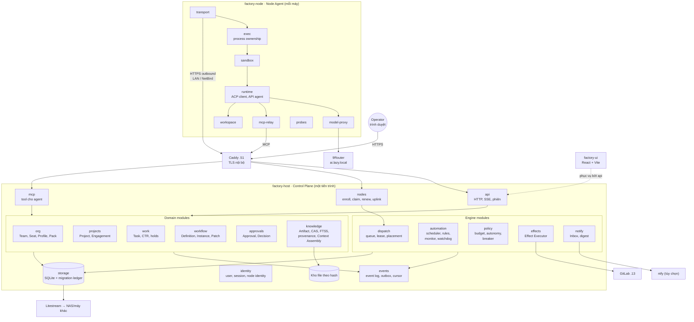
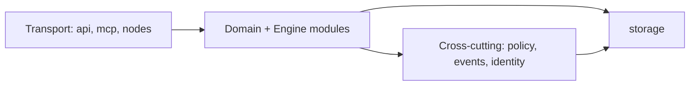
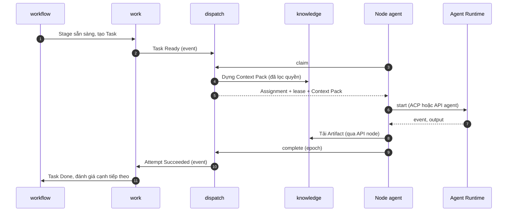
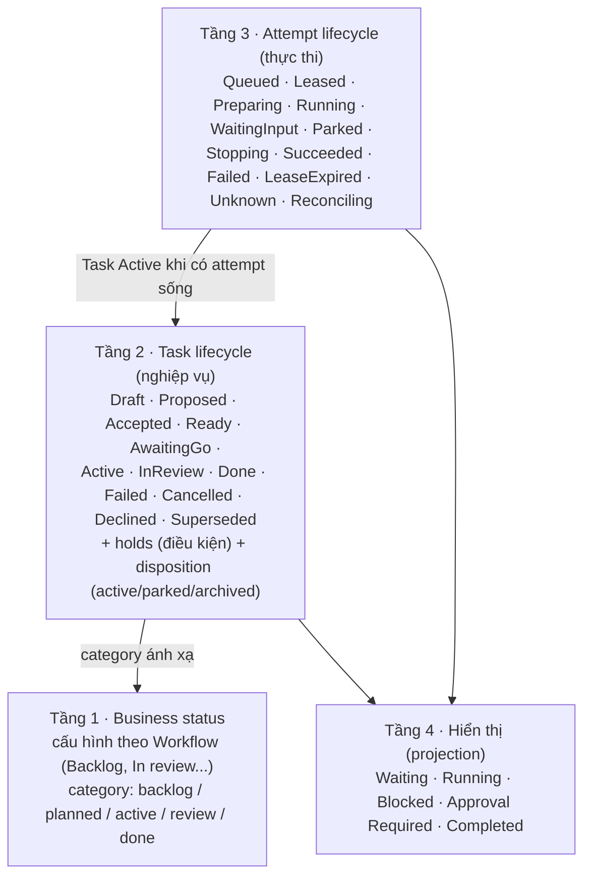
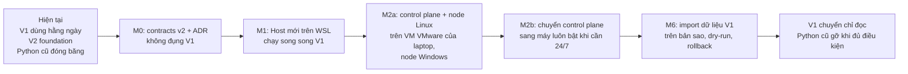
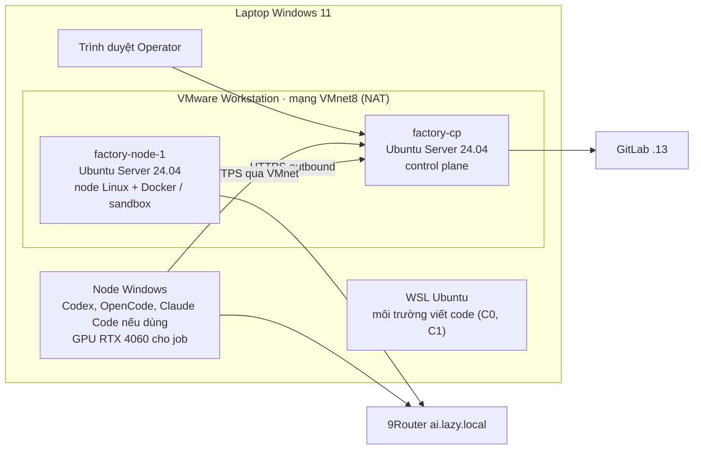

# 05 · Kiến trúc mục tiêu thống nhất

| Mục | Giá trị |
|---|---|
| Trạng thái | **Accepted 07/11/2026** với điều chỉnh: giai đoạn phát triển dùng **máy ảo VMware trên laptop** thay cho `.60` (§21). ADR-T01..T14 Accepted; ADR-T14 đã sửa theo §21 |
| Ngày | 07/11/2026 |
| Baseline | commit `692ad3f`, branch `architecture/multi-team-research` |
| Tổng hợp từ | [00 · Sổ quyết định](00-decision-register.md), [01 · Domain Model](01-product-and-domain-model.md), [02 · Cộng tác và Tri thức](02-collaboration-and-knowledge.md), [03 · Distributed Worker](03-distributed-worker.md), [04 · Workflow và Governance](04-workflow-and-governance.md), [Rà soát open-source](oss-options.md) |
| Phạm vi | Kiểm tra nhất quán, so sánh phương án tổng thể, kiến trúc khuyến nghị, module, interface, stack, rủi ro, ADR, quyết định khó đổi |
| Không làm | Viết code, cài package, đổi source hoặc hạ tầng, sửa các tài liệu khác |

**Quy ước nhãn:** **[Hiện có]** có bằng chứng trong source/hạ tầng. **[Đã duyệt]** quyết định đã duyệt (D-, C-, OSS-, E-, W-). **[Proposed]** đề xuất của tài liệu này, chờ duyệt. **[Chưa xác minh]** giả định chưa có bằng chứng.

---

## 1. Tóm tắt

- **Kiến trúc khuyến nghị:** *Modular Control Plane + Distributed Node Agents*. Control plane là **một tiến trình modular monolith** (TypeScript/Node, SQLite); mỗi máy chạy một **node agent** chủ động nhận việc. Triển khai **theo bậc**: một máy trước (control plane + node cục bộ trên WSL), sau đó tách control plane và node Linux sang **máy ảo VMware trên laptop** trong giai đoạn phát triển (§21), cùng node Windows; khi cần chạy 24/7 thì chuyển control plane sang máy luôn bật.
- **Không microservices, không Postgres/Redis/broker/object storage/vector DB ở MVP.** Mỗi thứ có điều kiện kích hoạt rõ ràng (§10).
- **Không dùng framework agent làm lõi** (LangGraph, CrewAI, AutoGen, Temporal...). Tự xây phần điều phối xác định nhỏ gọn; dùng thư viện chuẩn ở rìa: ACP cho runtime, MCP cho tool, sandbox-runtime, croner, cockatiel, Litestream.
- **12 điểm thiếu nhất quán** giữa các tài liệu đã được xác định và có cách gộp (§2), quan trọng nhất là **phân tầng trạng thái** và **sửa contracts V2 trước khi dựng Host**.
- **Lộ trình mới M0–M6** thay cho F1-02..F9 của Factory V2; Windows Worker V1 tiếp tục chạy song song tới khi chuyển dữ liệu.

---

## 2. Kiểm tra tính nhất quán

| # | Vấn đề | Vị trí | Loại | Cách xử lý [Proposed] |
|---|---|---|---|---|
| I1 | 01 gọi lần áp dụng quy trình là **Workflow Run**; 04 gọi là **Workflow Instance** | 01 §3, §4.2; 04 §2 | Thuật ngữ lệch | Chuẩn hóa **Workflow Instance**; 01 hiểu theo nghĩa này |
| I2 | Trạng thái Task `Waiting` (02 §5.1: đang làm nhưng bị hold) **trùng tên** trạng thái hiển thị `Waiting` (04 §8: sẽ tự chạy) | 02 §5.1; 04 §8.1 | Mâu thuẫn tên | Bỏ `Waiting` khỏi Task lifecycle; hold là điều kiện (§8.2). `Waiting` chỉ còn là trạng thái hiển thị |
| I3 | Bốn tầng trạng thái cùng có `Queued`, `Interrupted`, `Paused`: business status (V2 `workCategorySchema`), Task lifecycle (02 §5.1), Attempt lifecycle (03 §12.2, V2 `runStateSchema`), hiển thị (04 §8) | Nhiều nơi | Trùng | **ADR-T04 phân tầng trạng thái** (§8.2): Task chỉ giữ trạng thái nghiệp vụ; trạng thái thực thi thuộc Attempt; hiển thị là projection |
| I4 | `OnHold` của Project (02 §5.4) chồng với `Paused`/`Suspended` của Workflow Instance (04 §8.3) | 02, 04 | Trùng | Project `OnHold` **suy ra** khi mọi Workflow Instance đang Paused/Suspended; không lưu riêng |
| I5 | Decision Request (02 §14, V2 `decisionSchema`), Approval loại `decision`/`review` (04 §10), Review human-final (V2 `reviewSchema`) | 02, 04, V2 | Trùng | **Approval** là cơ chế hỏi–đáp duy nhất; **Decision Record** là kết quả bền vững; **Review** là verdict trên một Artifact version, được trình cho người qua Approval khi policy yêu cầu |
| I6 | Bốn cơ chế đóng gói: Team Pack (01 §8), Workflow Pack (04 §4), domain pack (V2 F6), Skill (OSS-05) | 01, 04, V2, oss | Trùng | Một **Pack Registry** chung (định dạng, revision, hash, license, import/export bỏ secret); Pack có thể chứa Team, Workflow, Skill, Profile |
| I7 | Thành phần control plane mang nhiều tên: Host (V2), Orchestrator (02), control plane (03), Command pipeline/Plan Validator/Approval Service/Policy/Scheduler/Watchdog (04) | Nhiều nơi | Thiếu bản đồ | Bảng module thống nhất (§6); "Orchestrator" = module `dispatch` + `events` |
| I8 | 03 §2: "control plane không gọi LLM"; 04 §3: Intake và Project Lead là LLM | 03, 04 | Có vẻ mâu thuẫn | **Mọi phiên LLM chạy trên node**, kể cả Lead và Intake; MVP có một node cục bộ cạnh control plane |
| I9 | V2 delivery plan để nhiều máy ở F9 sau 2.0; D-09/E-01 đưa node vào thiết kế từ đầu và chạy sớm hơn | V2 delivery-plan; 00 | Mâu thuẫn lộ trình | Lộ trình mốc M0–M6 (§13) thay F1-02..F9 |
| I10 | V2 contracts và schema reference chỉ có agent membership theo Project; thiếu Team, Engagement, Seat, Instance, Node, Approval, Pack, Workflow Instance | `packages/factory-contracts`, `schema/factory-v2` | Thiếu so với quyết định | Sửa contracts (wire v2) **trước** khi dựng Host (ADR-T03) |
| I11 | V2 ADR-002: Host bind loopback; E-03: control plane nhận kết nối từ LAN/NetBird | V2 f0-03; 03 | Cần làm rõ | Chế độ một máy: loopback. Chế độ nhiều máy: bật cấu hình mạng có TLS (Caddy) và xác thực (V2 ADR-002 đã cho phép "remote exposure là cấu hình riêng có auth/TLS") |
| I12 | Context Pack: 02 nói Orchestrator dựng; 03 nói node tải; 04 thêm watermark/diff | 02, 03, 04 | Thiếu chủ sở hữu | Module `knowledge` sở hữu **Context Assembly**; `dispatch` gọi khi cấp assignment; node chỉ tải về |

**Không tìm thấy mâu thuẫn** giữa: ranh giới side effect (E-07) và Approval (W-08); lease/self-fencing (E-08) và recovery (V2 ADR-003); lớp vị trí (E-06) và lập lịch (E-05); C-05 và mức tự chủ (W-14).

---

## 3. Architecture Decision Matrix

### 3.1 So sánh phương án tổng thể (có trọng số)

Thang điểm 1 (kém) – 5 (tốt). Điểm × trọng số; tổng tối đa 500.

| Tiêu chí | Trọng số | A · Mở rộng V1 | B · Monolith một máy | **C · Control Plane + Node Agents** | D · Microservices + Temporal | E · Framework-centric |
|---|---:|---:|---:|---:|---:|---:|
| K1 Khớp quyết định đã duyệt | 15 | 1 | 3 | **5** | 1 | 1 |
| K2 Chạy tiếp khi Windows tắt (E-01) | 10 | 1 | 1 | **5** | 5 | 3 |
| K3 Nhiều máy, node phân tán | 10 | 2 | 1 | **5** | 5 | 2 |
| K4 Vận hành đơn giản ở quy mô cá nhân | 15 | 4 | 5 | **4** | 1 | 3 |
| K5 Tận dụng code và hạ tầng hiện có | 10 | 5 | 3 | **4** | 2 | 2 |
| K6 Thời gian ra bản alpha dùng được | 10 | 4 | 5 | **4** | 1 | 3 |
| K7 Mở rộng dài hạn | 10 | 1 | 2 | **4** | 5 | 2 |
| K8 Bảo mật, cô lập | 10 | 2 | 3 | **4** | 4 | 2 |
| K9 Dễ thay công nghệ | 10 | 1 | 3 | **4** | 3 | 1 |
| **Tổng** | 100 | 235 (47%) | 300 (60%) | **435 (87%)** | 280 (56%) | 210 (42%) |

Điểm là đánh giá định tính dựa trên bằng chứng ở các tài liệu trước, không phải số đo.

### 3.2 Ma trận quyết định theo lĩnh vực

| Lĩnh vực | Lựa chọn đã xét | Chọn [Proposed] | Căn cứ |
|---|---|---|---|
| Kiểu kiến trúc | V1 mở rộng · monolith một máy · control plane + node · microservices · framework-centric | **Control plane (modular monolith) + node agent** | §3.1, D-03, E-01 |
| Ngôn ngữ/runtime | TypeScript/Node · Python | **TypeScript/Node 22 LTS** | V2 ADR-001; Node Linux đã cài (F1-01); V1 cùng ngôn ngữ |
| Lưu trữ chính | SQLite · PostgreSQL | **SQLite** (một tiến trình ghi) + repository abstraction | OSS-08, E-13; §10 |
| Hàng đợi | Bảng trong DB + lease · Redis/BullMQ · NATS · Temporal | **Bảng trong DB + lease/epoch** | OSS-08, V2 ADR-003 |
| Lưu file/Artifact | Filesystem theo hash · S3 (SeaweedFS) · MinIO | **Filesystem theo hash** + sao lưu | 02 §12.3; MinIO đã archived (§10) |
| Tìm kiếm tri thức | FTS5 · vector DB | **SQLite FTS5** | C-07, OSS-07 |
| Workflow engine | Tự xây dạng dữ liệu · Temporal · LangGraph · n8n | **Tự xây dạng dữ liệu** trong control plane | W-01..W-07, §11 |
| Tích hợp runtime CLI | ACP · adapter riêng mỗi runtime | **ACP**, adapter native dự phòng | OSS-02 |
| Agent điều phối (Lead/Intake) | Chạy bằng CLI agent · gọi model trực tiếp | **Cả hai qua `RuntimeAdapter`**; mặc định gọi model trực tiếp ("API agent") cho Lead/Intake không cần workspace | §9.3 |
| Tool cho agent | MCP · tool riêng | **MCP** | OSS-03, C-01 |
| Giao tiếp node | HTTPS outbound long-poll · WebSocket · broker | **HTTPS outbound** | E-03 |
| Sandbox | Container · sandbox-runtime · Job Object · VM | **Theo node qua `SandboxProvider`** | OSS-04, E-11 |
| Lịch | croner · tự viết | **croner** | W-18 |
| Chính sách lỗi | cockatiel · opossum · tự viết | **cockatiel** | W-18 |
| HTTP server | Fastify · Hono · node:http | **Fastify** (Hono thay thế) | §9 |
| Truy cập DB | Kysely · Drizzle · SQL thuần | **Kysely** | §9 |
| UI | Web (React + Vite) · Electron | **Web** | V2 D02 |

---

## 4. Các phương án kiến trúc tổng thể

### 4.1 Phương án A · Phát triển tối giản từ Windows Worker V1

**Mô tả:** giữ app Electron + SQLite của V1; thêm bảng Team/Engagement; gỡ khóa `one_active_run`; thêm khả năng gửi việc cho một "remote worker" trên `.60` theo giao thức của hệ Python cũ.

| Ưu | Nhược |
|---|---|
| Tận dụng tối đa code đang chạy (R0–R6, 280 test case) | Electron và IPC 88 kênh: không truy cập được từ máy khác, polling |
| Ra kết quả nhanh cho một máy | 7 role cố định thấm vào contracts, settings, policy, 3D (`shared/contracts.ts:54`) |
| Người dùng đã quen giao diện | Control plane nằm trên PC: **tắt PC là dừng mọi lịch và Team** (trái E-01) |
| | Process ownership chỉ có trên Windows; `RunController` 1.846 dòng, `App.tsx` 1.403 dòng |
| | **Trái D-02** (đã chọn tự xây Factory V2) |

**Migration nếu chọn A:** không có đường sạch sang mục tiêu dài hạn; phần lớn sẽ phải viết lại khi lên nhiều máy. Chỉ phù hợp nếu người dùng chấp nhận không chạy 24/7.

### 4.2 Phương án B · Modular Monolith một máy (Factory V2 ban đầu)

**Mô tả:** một tiến trình Host trong WSL chứa mọi module và adapter chạy cục bộ; UI web; không có node từ xa.

| Ưu | Nhược |
|---|---|
| Đơn giản nhất, một tiến trình, một DB | Không chạy khi PC tắt; không dùng được `.60`, GPU |
| Khớp kế hoạch V2 F1–F8 | Nếu không có ranh giới node từ đầu, thêm nhiều máy về sau phải sửa sâu (D-09 đã cảnh báo) |
| Ra alpha nhanh | |

### 4.3 Phương án C · Modular Control Plane + Distributed Node Agents (khuyến nghị)

**Mô tả:** control plane là modular monolith (một tiến trình, SQLite, kho file); node agent là tiến trình riêng trên mỗi máy, giao tiếp HTTPS outbound theo giao thức pull (03 §11).

**Triển khai theo bậc:**

| Bậc | Hình thái | Mục đích |
|---|---|---|
| **C0** | Control plane + node agent **cùng một máy (WSL)**, node agent có thể chạy trong cùng tiến trình qua cùng interface | Ra alpha nhanh như B nhưng ranh giới node đã đúng |
| **C1** | Node agent tách thành tiến trình riêng, vẫn một máy | Kiểm giao thức node thật (lease, self-fencing, reconnect) |
| **C2-dev** | Control plane và node Linux trên **máy ảo VMware của laptop**; node Windows trên chính laptop (§21) | Kiểm topology nhiều node thật trong giai đoạn phát triển; **chưa** đạt 24/7 |
| **C2-prod** | Control plane chuyển sang máy luôn bật (VM trên hypervisor, dự phòng `.14`); node Linux luôn bật | Đạt E-01 khi thật sự cần 24/7 |
| **C3** | Thêm GPU node, node pool, mTLS, secret broker khi cần | Mở rộng |

| Ưu | Nhược |
|---|---|
| Khớp toàn bộ quyết định đã duyệt | Phải thiết kế giao thức node và contracts kỹ ngay từ đầu |
| Đạt 24/7 và nhiều máy mà không đổi kiến trúc | Hai loại tiến trình phải phát hành và cập nhật đồng bộ |
| Một DB, không broker, vận hành nhẹ | Control plane là điểm lỗi duy nhất (giảm bằng sao lưu liên tục; HA để sau) |
| Bậc C0 nhanh gần bằng B | |

### 4.4 Phương án D · Microservices + workflow engine

**Mô tả:** Temporal (server + Postgres) cho workflow; Postgres cho dữ liệu; Redis cho hàng đợi/pub-sub; dịch vụ riêng cho knowledge, scheduler, notification; S3 cho artifact.

| Ưu | Nhược |
|---|---|
| Durable execution trưởng thành (Temporal) | Ít nhất 5–7 dịch vụ cần chạy, sao lưu, nâng cấp, giám sát cho một người |
| Mở rộng ngang tốt | Temporal không quản lý tiến trình CLI agent hay node trên LAN thay ta; vẫn phải tự xây node agent |
| | Trái OSS-08 (giữ coordinator SQLite), trái nguyên tắc "không thêm DB/queue/service khi chưa chứng minh nhu cầu" |

### 4.5 Phương án E · Lấy framework agent làm lõi

**Mô tả:** dùng LangGraph, CrewAI hoặc Microsoft Agent Framework để định nghĩa đội agent và luồng điều phối; agent là đối tượng trong tiến trình.

| Ưu | Nhược |
|---|---|
| Có sẵn mẫu multi-agent, handoff, checkpoint | Hệ thống của ta điều phối **CLI agent** (Claude Code, Codex, OpenCode) chạy trên nhiều máy; framework trong tiến trình không quản lý tiến trình ngoài, lease, sandbox, node |
| | CrewAI, MAF chủ yếu Python; AutoGen đang chuyển sang archived |
| | Trái V2 D04 (không bắt LangGraph); trạng thái nằm trong framework thay vì dữ liệu của ta |

### 4.6 Ghi chú về Paperclip

Phương án dựa trên Paperclip đã được người dùng loại ở D-02/OSS-01 (tự xây, chỉ học thiết kế). Mốc xét lại vẫn giữ: sau M1 (tương đương F2 cũ) hoặc khi M3 chậm đáng kể.

---

## 5. Kiến trúc khuyến nghị

### 5.1 Sơ đồ System Architecture

### 5.2 Nguyên tắc kiến trúc

| # | Nguyên tắc | Nguồn |
|---|---|---|
| P1 | **Một control plane, một nguồn sự thật**; mọi thay đổi trạng thái qua command có idempotency và revision | V2 ADR-003, D-03 |
| P2 | **Control plane không chạy code agent và không gọi LLM**; mọi phiên LLM chạy trên node | 03 §2, I8 |
| P3 | **Node chỉ kết nối ra**; không mở cổng vào node | E-03 |
| P4 | **LLM đề xuất, phần xác định kiểm và ghi** | 04 §3 |
| P5 | **Side effect bên ngoài chỉ qua Effect Executor** | E-07 |
| P6 | **Session ngắn, trạng thái nằm trong dữ liệu** (Artifact, watermark, Workflow Instance) | D-05, C-08, W-11 |
| P7 | **Module sở hữu dữ liệu của mình**; module khác dùng interface hoặc event, không đọc bảng của nhau | §6 |
| P8 | **Thêm hạ tầng chỉ khi có điều kiện kích hoạt** đã ghi | §10 |

---

## 6. Module Boundaries

### 6.1 Control plane (`apps/factory-host`)

| Module | Trách nhiệm | Sở hữu dữ liệu | Không làm |
|---|---|---|---|
| `api` | HTTP, SSE, phiên đăng nhập, CSRF, kiểm Origin, phục vụ UI tĩnh | — | Logic nghiệp vụ |
| `identity` | Người dùng, phiên, danh tính node (khóa công khai, credential), mức tin cậy | users, sessions, node_identities | Cấp việc |
| `org` | Organization, Team, Seat, Role, Agent Profile, Capability taxonomy, **Pack Registry** | teams, seats, roles, profiles, packs | Thực thi |
| `projects` | Project, Engagement, giai đoạn Project (suy ra), Dossier (qua `knowledge`) | projects, engagements | Lập lịch |
| `work` | Task, dependency, holds, Cross-Team Request, ownership | tasks, dependencies, ctrs | Chọn node |
| `workflow` | Workflow Definition (từ Pack), Workflow Instance, Plan Patch, Plan Validator, gate | wf_instances, wf_patches | Gọi LLM |
| `dispatch` | Hàng đợi, assignment, attempt, lease/epoch, placement (lọc cứng + điểm), reservation tài nguyên | assignments, attempts, leases, reservations | Ghi Artifact |
| `nodes` | Worker Registry, enrollment, capability, heartbeat, trạng thái node, endpoint giao thức node | nodes, node_capabilities | Quyết định việc nào làm trước (thuộc `dispatch`) |
| `approvals` | Approval (mọi loại), Decision Record, Standing Approval, Review verdict | approvals, decisions, standing_approvals, reviews | Tự áp kết quả ngoài command |
| `knowledge` | Artifact và version, kho theo hash, FTS5, provenance, trạng thái tài liệu, **Context Assembly**, phân quyền đọc, Dossier | artifacts, artifact_versions, provenance, fts | Thực hiện side effect |
| `automation` | Scheduler (croner), Rule Evaluator, Monitor, Watchdog, Occurrence, watermark | schedules, occurrences, rules, monitors, watermarks | Gọi LLM trực tiếp |
| `policy` | Ngân sách nhiều cấp, mức tự chủ, giới hạn retry/recursion, circuit breaker (cockatiel) | budgets, usage_ledger, breakers | Lưu Task |
| `effects` | Effect Executor, Effect Record, reconcile; tích hợp Git/GitLab, thông báo ngoài | effect_records | Chạy code agent |
| `notify` | Inbox, digest, giờ yên lặng, kênh (ntfy tùy chọn) | notifications | Quyết định thay người |
| `events` | Event log theo Project, outbox, cursor, projection cho UI | event_log, outbox, project_streams | Logic nghiệp vụ |
| `mcp` | Bề mặt tool cho agent; ánh xạ tool → command của module; gắn actor = attempt | — | Bỏ qua kiểm quyền |
| `storage` | Kết nối SQLite, migration ledger, repository base, transaction | migration_ledger | — |

**Quy tắc phụ thuộc:**

- Transport chỉ gọi command/query của module; không truy cập DB.
- Module gọi nhau qua **interface nội bộ** (đồng bộ, cùng transaction khi cần) hoặc **domain event** (bất đồng bộ qua outbox).
- `policy` và `events` được mọi module dùng; chúng không phụ thuộc ngược.
- Mỗi module có thư mục, interface công khai, và test riêng; có thể tách thành dịch vụ sau này nếu có lý do (không phải mục tiêu).

### 6.2 Node agent (`apps/factory-node`)

| Module | Trách nhiệm | Nguồn tái sử dụng |
|---|---|---|
| `enroll` | Đăng ký bằng token một lần, cặp khóa, lưu credential | Hệ cũ (register/rotate/revoke) |
| `transport` | Long-poll claim, heartbeat, gia hạn lease, gửi event theo lô, tải Artifact theo hash, nhận lệnh | Hệ cũ `workers/coding.py` (mẫu) |
| `exec` | Sở hữu cây tiến trình; Windows: Job Object; Linux: process group + cgroup | V1 `owned-process.ts`, `owned-job.cs` |
| `sandbox` | `SandboxProvider`: container (Linux), sandbox-runtime (Linux), Job Object + thư mục riêng (Windows) | Cấu hình container đã kiểm trên `.60` (dùng lại cho VM phát triển); OSS-04 |
| `runtime` | `RuntimeAdapter`: ACP client (OpenCode, Claude, Codex), adapter native dự phòng, **API agent** | V1 `opencode.ts`; V2 `adapter.ts` |
| `model-proxy` | Proxy cục bộ, token tạm, ngân sách theo grant | V1 `model-proxy.ts`, `request-budget.ts` |
| `workspace` | Git worktree, snapshot, checkpoint, patch, cache Artifact theo hash | V1 `worktrees.ts`, `snapshot.ts`, `checkpoint.ts`, `git-evidence.ts`, `integration.ts` |
| `mcp-relay` | MCP server cục bộ cho runtime, gắn attempt identity, chuyển tới control plane | Mới |
| `probes` | Capability discovery | `scripts/factory-v2/preflight-linux.py`, V1 `readiness.ts`, `projects.ts` |

### 6.3 Ranh giới năm thành phần chính

| Thành phần | Nằm ở | Ranh giới | Không làm |
|---|---|---|---|
| **Agent Runtime** | Node, module `runtime` | Sau interface `RuntimeAdapter`; nhận Context Pack + grant, trả event và output | Không biết về hàng đợi, Team, Workflow |
| **Orchestrator** | Control plane, `dispatch` + `events` | Nhận Task sẵn sàng, chọn node/slot, cấp lease, nhận kết quả | Không lập kế hoạch nghiệp vụ, không gọi LLM |
| **Worker** | Node agent | Giao thức node; quản lý tiến trình, sandbox, workspace, proxy | Không giữ trạng thái chuẩn; không tự side effect ngoài |
| **Workflow Engine** | Control plane, `workflow` + `automation` | Định nghĩa, Instance, Patch, gate, lịch, rule; phát Task sẵn sàng cho `work`/`dispatch` | Không thực thi; không là engine ngoài |
| **Knowledge Service** | Control plane, `knowledge` | Artifact, tìm kiếm, provenance, Context Assembly, phân quyền đọc | Không tự quyết định Approved (thuộc `approvals`) |

---

## 7. Interfaces và Communication Contracts

### 7.1 Danh sách contract

| # | Contract | Hai bên | Hình thức | Nền tảng hiện có |
|---|---|---|---|---|
| IC1 | **UI ↔ Host** | Trình duyệt ↔ `api` | HTTP JSON: `commands` (idempotent, `expectedRevision`), `queries` phân trang, SSE theo Project có cursor | V2 ADR-002, ADR-005; `commands.ts`, `events.ts` |
| IC2 | **Node ↔ Control Plane** | `factory-node` ↔ `nodes`/`dispatch` | HTTPS outbound: enroll, heartbeat, claim (long-poll), lease.renew, events (lô, sequence), artifacts (hash), commands xuống | 03 §11; hệ cũ |
| IC3 | **Agent tool surface** | Runtime trong sandbox ↔ `mcp` qua `mcp-relay` | MCP; mỗi gọi mang attempt identity + idempotency key | C-01; 02 §8 |
| IC4 | **RuntimeAdapter** | Node `runtime` ↔ CLI/API agent | `probe`, `prepareGrant`, `start`, `reconcile`, `requestStop`, `waitForExit`, callback có epoch/sequence | V2 `adapter.ts`, ADR-004; ACP |
| IC5 | **SandboxProvider** | Node `exec` ↔ cơ chế cô lập | Tạo môi trường theo Execution Profile (đọc/ghi/mạng/tài nguyên), báo năng lực thật, fail closed | OSS-04, E-11 |
| IC6 | **ModelGateway** | Node `model-proxy` ↔ 9Router | OpenAI-compatible (`/v1/chat/completions`, `/v1/responses`), token tạm, grant ngân sách, settle usage | V1 ModelProxy; 9Router đã kiểm function call |
| IC7 | **Effect** | Agent/automation ↔ `effects` | ActionIntent → kiểm grant/thẩm quyền → EffectRecord (pending/done/failed/unknown) → reconcile | E-07; 03 §14 |
| IC8 | **Knowledge API** | Module khác, `mcp` ↔ `knowledge` | search, get(ref, section), register version, transition status, build context pack, provenance, share | 02 §9, §12, §16 |
| IC9 | **Workflow API** | `api`, Lead qua `mcp` ↔ `workflow` | import definition (Pack), create instance (từ Proposal), propose patch, validate, apply, pause/resume | 04 §4, §5 |
| IC10 | **Approval API** | Mọi module ↔ `approvals` | request, decide, delegate, supersede, apply-once; Standing Approval | 04 §10 |
| IC11 | **Domain events** | Module ↔ module, UI | Event có `eventId`, `projectId`, cursor, causation/root, entity revision | V2 `events.ts` |

### 7.2 Bề mặt tool MCP cho agent (MVP)

| Tool | Module | Kiểm tra chính |
|---|---|---|
| `knowledge.search`, `knowledge.get` | `knowledge` | Phân quyền đọc của Session (02 §16) |
| `output.register` | `knowledge` | Attempt còn hiệu lực, hash, output contract |
| `request.create`, `request.reply` | `work` | Engagement, hop ≤3, idempotency (02 §3) |
| `decision.request` | `approvals` | Ma trận thẩm quyền (C-05) |
| `plan.propose_patch` | `workflow` | `allowedPatches`, DAG, ngân sách (W-02) |
| `task.progress`, `handoff.submit` | `work` | Attempt identity |
| `action.propose` | `effects` | Grant, mức tự chủ, Approval (E-07, W-14) |

### 7.3 Danh mục domain event (khởi đầu)

`project.created/updated` · `engagement.created/changed` · `workflow.instance.created/patched/paused/resumed/stalled/completed` · `task.created/accepted/ready/done/failed/cancelled/superseded` · `task.hold.added/removed` · `ctr.submitted/triaged/delivered/closed` · `attempt.leased/started/succeeded/failed/interrupted` · `artifact.version.registered/reviewed/approved/superseded` · `approval.requested/decided/expired/superseded/applied` · `decision.recorded` · `schedule.occurrence.created/skipped` · `node.online/offline/lost/quarantined` · `budget.threshold/exhausted` · `breaker.opened/closed` · `effect.pending/done/unknown`.

### 7.4 Abstraction để thay công nghệ về sau

| Abstraction | Hiện thực MVP | Thay bằng khi cần |
|---|---|---|
| Repository (truy cập DB) | Kysely + better-sqlite3 | Kysely + PostgreSQL |
| `BlobStore` | Filesystem theo hash | S3-compatible (ví dụ SeaweedFS) |
| `QueueLease` | Bảng SQLite + CAS epoch | Postgres `SKIP LOCKED` hoặc engine khác |
| `RuntimeAdapter` | ACP client + native OpenCode + API agent | Runtime mới qua ACP hoặc adapter riêng |
| `NodeTransport` | HTTPS long-poll | WebSocket/HTTP2 stream |
| `SandboxProvider` | Container, sandbox-runtime, Job Object | VM dùng một lần, gVisor, E2B |
| `ModelGateway` | 9Router OpenAI-compatible | Provider trực tiếp, gateway khác |
| `NotificationChannel` | Inbox, ntfy | Apprise, email, Telegram |
| `SearchIndex` | SQLite FTS5 | FTS + vector (`sqlite-vec`) hoặc engine riêng |
| `SecretStore` | Mã hóa trong SQLite (khóa trên máy control plane) | OpenBao |
| `EventBus` | Trong tiến trình + outbox | Broker ngoài khi có nhiều tiến trình |
| `AuthProvider` | Phiên local | OIDC khi có nhiều người dùng |
| `Clock` | Đồng hồ hệ thống | Đồng hồ giả lập trong test |

---

## 8. Mô hình dữ liệu cốt lõi và phân tầng trạng thái

### 8.1 Thực thể chuẩn (gộp từ 01–04)

| Nhóm | Thực thể | Ghi chú gộp |
|---|---|---|
| Tổ chức | Organization, Team, Seat, Role, Agent Profile, Capability, Pack | Pack gộp Team/Workflow/Skill/domain pack (I6) |
| Công việc | Project, Engagement, Workflow Definition, Workflow Instance, Plan Patch, Task, Dependency, Cross-Team Request | "Workflow Run" → Workflow Instance (I1) |
| Thực thi | Worker Node, Agent Instance, Assignment, Run Attempt, Lease, Reservation, Session ref | |
| Tri thức | Artifact, Artifact Version, Provenance, Dossier, Context Pack (tạm) | |
| Quản trị | Approval, Decision Record, Review, Standing Approval, Budget, Usage Ledger, Circuit Breaker | Gộp Decision Request vào Approval (I5) |
| Tự động | Schedule, Rule, Monitor, Occurrence, Watermark | |
| Tác động | Action Intent, Effect Record | |
| Hạ tầng | Command Receipt, Event Log, Outbox, Callback Inbox, Migration Ledger | Giữ từ V2 schema reference |

### 8.2 Phân tầng trạng thái (ADR-T04)

| Thay đổi so với tài liệu trước | Lý do |
|---|---|
| Task lifecycle bỏ `Queued`, `InProgress`, `Waiting`, `Interrupted`, `Paused` (02 §5.1); thay bằng **`Active`** + holds + disposition | Các trạng thái đó là thực thi (Attempt) hoặc điều kiện; tránh hai nơi cùng ghi |
| `Paused` của Task → `disposition: parked` (đã có trong V2 `workItemSchema`) | Dùng lại contract V2 |
| Project `OnHold` suy ra từ Workflow Instance (I4) | Một nguồn sự thật |
| Năm trạng thái hiển thị tính từ tầng 2 + 3 + holds (W-06) | Không lưu riêng |

---

## 9. Technology Stack

### 9.1 Đề xuất

| Lớp | Lựa chọn | Lý do | Thay thế đã xét |
|---|---|---|---|
| Ngôn ngữ, runtime | **TypeScript, Node 22 LTS** | Cùng V1 và V2 contracts; Node Linux 22.23.4 đã cài trong WSL (F1-01); một ngôn ngữ cho control plane, node, UI | Python (stack cũ): trái V2 D04/D-02 |
| Contracts | **Zod** (đã dùng ở `packages/factory-contracts`) | Một nguồn schema cho UI, Host, node | — |
| HTTP server | **Fastify** | Trưởng thành, validation theo schema, plugin đóng gói phù hợp modular monolith, SSE được | **Hono** (nhẹ, chuẩn Web; hợp nếu cần chạy edge, không cần ở đây); node:http (phải tự làm nhiều) |
| DB driver | **better-sqlite3** | V1 đã dùng ổn định (`apps/windows-worker`), đồng bộ, nhanh, phù hợp một tiến trình ghi | `node:sqlite` (đang phát triển trong Node, chưa ổn định để chốt) |
| Truy cập DB | **Kysely** | Query builder có kiểu, SQL rõ ràng, hỗ trợ SQLite và PostgreSQL → giữ đường nâng cấp; migration dùng ledger tự quản theo V2 ADR-006 | Drizzle (ORM, Apache-2.0); SQL thuần |
| Lưu file | **Filesystem theo hash** trên control plane | Đơn giản, đủ cho cá nhân | SeaweedFS khi cần S3 |
| Sao lưu | **Litestream** (OSS-09) + sao lưu kho file theo lịch | Khôi phục nhanh SQLite | — |
| Tìm kiếm | **SQLite FTS5** (OSS-07) | Không thêm dịch vụ | sqlite-vec về sau |
| Lịch | **croner** (W-18) | Cron + múi giờ IANA | cron-parser |
| Chính sách lỗi | **cockatiel** (W-18) | Retry, circuit breaker, timeout, bulkhead | opossum |
| Runtime CLI | **ACP SDK** `@agentclientprotocol/sdk` + `codex-acp`, `claude-agent-acp`, `opencode acp` (OSS-02) | Một giao thức cho nhiều runtime | Adapter riêng từng runtime (giữ làm dự phòng) |
| Tool agent | **MCP TypeScript SDK** (OSS-03) | Mọi runtime đều hỗ trợ | — |
| Sandbox Linux | **sandbox-runtime** (OSS-04) và Docker trong VM node Linux | Cấu hình container đã kiểm trên `.60`; srt cho grant; VM VMware có snapshot để khôi phục sạch | Podman rootless |
| Máy ảo phát triển | **VMware Workstation 25.0.1** (đã cài trên laptop) | §21 | Hyper-V (Windows 11 Home không có Hyper-V Manager) |
| Windows service | **WinSW** (OSS-10) | Node agent chạy nền | — |
| Logging, trace | **pino** + **OpenTelemetry** | Log JSON nhẹ; trace chuẩn | — |
| UI | **React + Vite**, xyflow + dagre cho đồ thị | Theo V2 F0-02/ADR-001; W-18 | — |
| Test | `node:test` (như V1 và V2 contracts) | Không thêm framework | — |
| Mạng, TLS | NetBird + Caddy CA nội bộ (đã có) | Hạ tầng hiện hữu | — |
| Model gateway | 9Router (đã có) | Hạ tầng hiện hữu | — |

### 9.2 Không đưa vào MVP

| Công nghệ | Vì sao chưa | Điều kiện để thêm |
|---|---|---|
| PostgreSQL | Một tiến trình ghi; SQLite đủ | §10.1 |
| Redis | Không cần cache phân tán hay pub/sub ngoài tiến trình | Có nhiều tiến trình control plane |
| Message broker (NATS...) | Hàng đợi trong DB + long-poll đủ | Hàng trăm node, độ trễ thấp bắt buộc |
| Object storage S3 | Filesystem theo hash đủ | Kho file vượt dung lượng VM hoặc cần nhiều control plane |
| Vector DB | C-07 | Đo thấy FTS5 + metadata thất bại thường xuyên |
| Temporal / workflow engine ngoài | §11 | Workflow cần đảm bảo mà tự xây không đáp ứng được, có số đo |
| Kubernetes, Nomad | Quá nặng | Không dự kiến ở quy mô cá nhân |

### 9.3 "API agent" cho Lead và Intake

Một số vai trò (Intake, Project Lead, triage, tóm tắt L1) không cần workspace hay chạy lệnh. Chạy chúng bằng CLI agent đầy đủ (như V1 chạy Lead bằng phiên OpenCode chỉ đọc) tốn tài nguyên và token hơn cần thiết.

| Phương án | Ưu | Nhược |
|---|---|---|
| Lead chạy bằng CLI agent qua ACP | Đọc được repo trực tiếp; giống V1 | Khởi động chậm, tốn tài nguyên node, nhiều token hệ thống |
| **Lead chạy bằng "API agent"**: vòng gọi model trực tiếp qua ModelGateway, tool chỉ là MCP của control plane | Nhanh, rẻ, không cần workspace/sandbox | Không đọc repo trực tiếp; phải qua tool `knowledge`/Git chỉ đọc |

**[Proposed]** `RuntimeAdapter` hỗ trợ cả hai; Agent Profile chọn. Mặc định: Intake, Project Lead, Team Lead dùng API agent; Seat cần sửa code/chạy lệnh dùng CLI agent qua ACP. API agent vẫn chạy **trên node** (P2), vẫn qua model proxy và grant. Hiện thực vòng gọi tự viết, mỏng; 9Router đã chứng minh hỗ trợ function call (infra-inventory §5). Vercel AI SDK hoặc OpenAI Agents JS chỉ xét nếu vòng tự viết phình to (cần kiểm license của `vercel/ai`, GitHub chưa nhận diện).

---

## 10. Đánh giá PostgreSQL, Redis, Queue, Object Storage

### 10.1 Bảng đánh giá

| Thành phần | Nhu cầu thực ở MVP | Đánh giá | Quyết định [Proposed] |
|---|---|---|---|
| **PostgreSQL** | Một control plane, một tiến trình ghi, vài node, một người dùng | Mạnh về đồng thời, nhiều tiến trình, quyền theo hàng; nhưng thêm dịch vụ, sao lưu, nâng cấp. Hệ Python cũ đã dùng trên `.14` | **Chưa dùng.** Giữ Kysely để chuyển được |
| **Redis** | Không có nhu cầu cache phân tán, rate limit nhiều tiến trình, pub/sub ngoài | Hệ cũ dùng cho RQ; V2 đã bỏ | **Không dùng** |
| **Queue** | Hàng đợi bền vững có lease, fencing, ưu tiên | Đã thiết kế trong DB (V2 ADR-003, OSS-08); hệ cũ cũng dùng DB làm nguồn sự thật, Redis chỉ là transport | **Bảng trong SQLite** |
| **Object storage** | Lưu Artifact, media, patch | MinIO đã archived (04/2026, AGPL); SeaweedFS (Apache-2.0) là ứng viên nếu cần S3 | **Filesystem theo hash**; `BlobStore` để chuyển sau |
| **Vector DB** | Chưa có số đo cần | C-07 | **Không dùng** |

### 10.2 Điều kiện nâng cấp lên PostgreSQL

Chuyển khi **ít nhất một** điều sau đúng:
1. Cần **nhiều hơn một tiến trình control plane** ghi đồng thời (HA active-active hoặc tách dịch vụ).
2. **Nhiều người dùng** thao tác đồng thời và tranh chấp ghi đo được (S3 ở 01).
3. Kích thước DB hoặc tải ghi làm độ trễ commit vượt ngưỡng chấp nhận (cần đo; ví dụ p95 > 100 ms) [Chưa xác minh].
4. Cần tính năng chỉ Postgres có (row-level security, logical replication) cho yêu cầu thật.

Cách chuyển: repository dùng Kysely; migration ledger viết theo SQL tương thích; dữ liệu chuyển bằng công cụ xuất/nhập có kiểm hash (giống F8).

---

## 11. Tự xây hay dùng framework

### 11.1 Tự xây

| Thành phần | Lý do tự xây |
|---|---|
| Domain (Org, Team, Engagement, Project, Task, CTR) | Là giá trị riêng của sản phẩm; không framework nào khớp mô hình Hybrid + Engagement |
| `dispatch` (queue, lease, epoch, placement) | Nhỏ, đã thiết kế chi tiết (V2 ADR-003, 03); cần hiểu lớp vị trí/side effect riêng |
| `workflow` (Definition, Instance, Patch, gate) | Dạng dữ liệu, đơn giản hơn engine tổng quát; cần Plan Patch do LLM đề xuất |
| `approvals`, `policy` | Gắn chặt với ma trận thẩm quyền và mức tự chủ riêng |
| `knowledge` | SQLite + FTS5 + kho file; logic phân quyền và trạng thái tài liệu riêng |
| Node agent | Không có OSS phù hợp (03 §20); tận dụng nhiều module V1 |
| API agent loop | Mỏng, cần kiểm soát ngân sách và tool chặt |

### 11.2 Dùng thư viện có sẵn

ACP SDK, MCP SDK, sandbox-runtime, Fastify, better-sqlite3, Kysely, Zod, croner, cockatiel, pino, OpenTelemetry, Litestream, WinSW, React, Vite, xyflow, dagre.

### 11.3 Đánh giá framework được yêu cầu

| Framework | License, trạng thái (07/11/2026) | Mạnh ở | Vì sao không làm lõi | Có dùng ở rìa? |
|---|---|---|---|---|
| **LangGraph** (`langgraph`, `langgraphjs`) | MIT, đang phát triển | Đồ thị trạng thái LLM trong tiến trình, checkpoint, interrupt | V2 D04; không quản lý tiến trình CLI, node, lease; trạng thái nằm trong checkpoint của framework | Không cần |
| **Temporal** | MIT, đang phát triển | Durable execution, timer, signal, retry | Cần server + DB riêng; không thay node agent; quá nặng (OSS-08) | Học thiết kế (durable timer, signal) |
| **CrewAI** | MIT, Python | Đội agent theo role trong tiến trình | Python; agent trong tiến trình, không phải CLI agent trên nhiều máy | Không |
| **AutoGen** | Code MIT; **đang chuyển sang archived**, Microsoft khuyên dùng Agent Framework | Mẫu hội thoại đa agent | Ngừng phát triển; Python | Không |
| **Microsoft Agent Framework** | MIT, Python/.NET | Kế thừa AutoGen, hỗ trợ A2A và MCP | Khác stack; trùng vai trò điều phối | Không |
| **OpenAI Agents SDK (JS)** | MIT, TypeScript | Handoff, guardrail, tracing cho agent gọi API | Không quản lý CLI agent/node; ta chỉ cần vòng API agent mỏng | Tùy chọn cho API agent nếu vòng tự viết phình to |
| **Vercel AI SDK** | GitHub chưa nhận diện license | Gọi model đa provider, tool calling | Như trên | Tùy chọn, cần kiểm license |
| **Mastra, VoltAgent** | Apache-2.0 + `ee/` / MIT | Framework agent TS | Trùng vai trò (oss-options §5) | Không |
| **Paperclip** | MIT | Nền tảng điều phối đội agent | Người dùng đã chọn tự xây (D-02, OSS-01) | Học thiết kế |
| **n8n, Windmill, Activepieces, Kestra** | Fair-code / AGPL / EE / Java | Tự động hóa tổng quát | Nền tảng riêng, license hoặc stack không phù hợp (04 §22) | Không |

---

## 12. Tận dụng source code và migration

### 12.1 Windows Worker V1 (`apps/windows-worker`)

| Nhóm V1 | Đích | Hành động | Ghi chú |
|---|---|---|---|
| `runtime/owned-process.ts`, `owned-job.cs` | node `exec` (Windows) | **Sao chép, điều chỉnh** | Không phụ thuộc Electron; giữ receipt và `recoverOwnedJobs` |
| `gateway/model-proxy.ts`, `request-budget.ts` | node `model-proxy` | **Sao chép, điều chỉnh** | Thêm grant từ control plane |
| `runtime/opencode.ts`, `permissions.ts` | node `runtime` (adapter native dự phòng) | **Tham khảo, viết lại** dưới `RuntimeAdapter` | ACP là đường chính |
| `workspace/worktrees.ts`, `snapshot.ts`, `checkpoint.ts`, `git-evidence.ts`, `integration.ts` | node `workspace` | **Sao chép, điều chỉnh** | Sửa so sánh path không phân biệt hoa thường cho Linux (F0-01 phát hiện) |
| `workspace/projects.ts`, `readiness.ts` | node `probes` | **Tham khảo** | |
| `storage/chat-requests.ts` (idempotent send), evidence, reports bất biến | host `api`, `knowledge` | **Học mẫu** | V2 ADR-003 đã kế thừa |
| `shared/schedules.ts`, `storage/schedules*.ts` | host `automation` | **Học mẫu, mở rộng** | Thêm cron, coalesce, concurrency (04 §12) |
| `team/coordinator.ts`, `dispatch.ts`, `handoff.ts`, `review-context.ts` | host `workflow`, `work`, `knowledge` | **Viết lại** | Thay bằng Workflow Instance + Context Assembly |
| `controller/runs.ts` (`RunController`) | — | **Không chuyển** | Khối nguyên, gắn một run toàn app |
| `storage/database.ts` + 15 migration | — | **Không chuyển**; giữ cho V1 | Import dữ liệu ở M6 |
| `main.ts`, `preload.ts`, IPC, `src/` renderer | — | **Không chuyển** | UI web mới; học kinh nghiệm UX (draft/IME, inspector) |
| `agent-profiles/*.md`, `skills/*/SKILL.md` | `packs/` | **Chuyển thành Pack** "Software Team" | D-10, OSS-05 |
| Office 3D | — | Hoãn | F0-01 |

### 12.2 Factory V2 foundation

| Tài sản | Hành động |
|---|---|
| `packages/factory-contracts` (14 command, event/cursor, adapter, permissions, preferences) | **Giữ và mở rộng** thành wire v2 (ADR-T03); giữ test boundary |
| `schema/factory-v2/001-core.reference.sql` (20 bảng) | **Giữ làm nền**, bổ sung bảng cho Team/Engagement/Node/Approval/Workflow/Knowledge; chuyển thành migration thật ở M1 |
| `design/factory-v2` (tokens, vi/en, 9 màn, window store) | **Giữ** cho `factory-ui` |
| `scripts/factory-v2` (preflight, setup, verify) | **Giữ**; `preflight-linux.py` làm mẫu cho node `probes` |
| Môi trường WSL `/home/lazy/factory-v2` (Node 22.23.4, OpenCode 1.19.5) | **Dùng** cho bậc C0/C1 |
| Kế hoạch F0–F8 | **Thay** bằng lộ trình M0–M6 (§13); giữ tiêu chí nghiệm thu còn phù hợp |

### 12.3 Nền tảng Python cũ

| Tài sản | Hành động |
|---|---|
| Giao thức worker (`execution_routes.py`, `executions.py`, `workers/coding.py`) | **Học thiết kế** cho giao thức node (đã dùng ở 03) |
| Image `asf-worker:opencode-1.19.5` và cấu hình container trên `.60` | **Dùng lại cấu hình** (Dockerfile trong `infrastructure/worker`) cho sandbox của VM node Linux trên laptop; `.60` giữ nguyên làm runner của hệ cũ |
| Control plane trên `.14` (Postgres, Redis, API) | **Giữ đóng băng**; quyết định gỡ khi M2 chạy ổn trên VM mới |

### 12.4 Các bước migration

| Nguyên tắc | Nguồn |
|---|---|
| V1 dùng được cho tới khi bản mới đủ luồng | V2 D12 |
| Không ghi vào DB V1; import trên bản sao, việc cũ ở trạng thái paused/historical | V2 F8-01 |
| Không import xuyên app; sao chép có chọn lọc | F0-01 |
| Không chia sẻ SQLite giữa Windows và WSL hay qua mạng | V2 ADR-006 |

---

## 13. Lộ trình theo mốc (thay F1-02..F9)

| Mốc | Nội dung | Tiêu chí hoàn thành | Tương ứng kế hoạch cũ |
|---|---|---|---|
| **M0** | Contracts wire v2 (domain mở rộng, phân tầng trạng thái, giao thức node, tool surface MCP); ADR-T01..T14 được duyệt; schema reference v2 | Test boundary/SQLite memory đạt như F0-03; ADR Accepted | Bổ sung F0-03 |
| **M1** | Host trên WSL (bậc C0): `api`, `identity`, `projects`, `work`, `dispatch`, `knowledge` tối thiểu, `events`; node cục bộ; một Project, một Lead (API agent) + một Seat CLI (OpenCode qua ACP); UI tối thiểu | Tạo Project, chat Lead, giao việc, xem output; dừng/khôi phục không chạy lặp | F1-02..F2 |
| **M2a** | Node agent tách tiến trình (C1); control plane và node Linux trên **VM VMware của laptop** (C2-dev); node Windows; enrollment, lease, self-fencing, Effect Executor commit Git | Kịch bản K1–K7 (03 §15) đạt, giả lập bằng tạm dừng VM, ngắt mạng ảo, khôi phục snapshot | F9 (đưa lên sớm) |
| **M2b** | Chuyển control plane sang **máy luôn bật** (C2-prod) khi bắt đầu cần Team/lịch chạy lúc laptop tắt | Lịch chạy khi laptop tắt; khôi phục từ Litestream đạt | Có thể làm sau M4 |
| **M3** | Team, Seat, Engagement, CTR, Pack Registry (Software Team), Knowledge đầy đủ (FTS5, trạng thái tài liệu, Dossier) | Kịch bản 02 §18 đạt | F3, F4 phần |
| **M4** | Workflow Definition/Instance/Patch, Approval Inbox, Scheduler/Rule/Monitor, ngân sách, circuit breaker | Ví dụ Software và Reporting ngày (04 §15–16) đạt | F4, F5 |
| **M5** | Domain Video/Research, job runner, GPU node khi có phần cứng | Ví dụ Video (04 §15.2) đạt | F6 |
| **M6** | Import dữ liệu V1, sao lưu/khôi phục, tài liệu vận hành, phát hành | Dry-run và rollback đạt; V1 chuyển chỉ đọc | F7, F8 |

Mốc xét lại Paperclip (D-02): sau M1 hoặc khi M3 chậm đáng kể.

---

## 14. Độ phức tạp vận hành trên hạ tầng cá nhân

| Hạng mục | A · V1 mở rộng | B · Monolith | **C · Control plane + node** | D · Microservices |
|---|---|---|---|---|
| Tiến trình phải chạy | 1 app desktop + 1 worker từ xa | 1 | 1 control plane + 1 node agent mỗi máy | 5–7 dịch vụ + node |
| Kho dữ liệu | SQLite trên PC | SQLite | SQLite + thư mục file | Postgres (+ DB Temporal), Redis, S3 |
| Sao lưu | Thủ công trên PC | Thủ công | Litestream + sao lưu thư mục | Nhiều cơ chế riêng |
| Nâng cấp | Cài lại app | Một gói | Control plane + node agent (giữ tương thích giao thức theo version) | Nhiều dịch vụ, thứ tự nâng cấp |
| Giám sát | Ít | Ít | Heartbeat node, health control plane, cảnh báo qua Inbox | Cần giám sát chuyên dụng |
| Lỗi thường gặp | PC tắt là dừng | PC tắt là dừng | Control plane VM hỏng (khôi phục từ bản sao lưu); node mất (03 §15) | Lỗi phối hợp giữa dịch vụ |
| Công sức hằng tuần ước tính [Chưa xác minh] | Thấp | Thấp | Thấp đến trung bình | Cao |

---

## 15. Risk Register

| ID | Rủi ro | Khả năng | Ảnh hưởng | Giảm thiểu | Dấu hiệu theo dõi |
|---|---|---|---|---|---|
| R1 | Phạm vi quá lớn cho một người vận hành/phát triển | Cao | Cao | Lộ trình mốc, mỗi mốc dùng được; MVP cắt rõ (§16) | Mốc trễ > 2 lần ước tính |
| R2 | Adapter ACP còn non (`codex-acp` mới, ít sao) | Trung bình | Trung bình | Adapter native dự phòng; thử từng runtime ở M1–M2 | Lỗi protocol, thiếu năng lực stop/resume |
| R3 | SQLite tranh chấp ghi khi nhiều node gửi event | Thấp | Trung bình | Một tiến trình ghi, gửi theo lô, WAL; điều kiện chuyển Postgres (§10.2) | p95 commit, lỗi `SQLITE_BUSY` |
| R4 | Hypervisor không còn tài nguyên cho VM control plane | Trung bình | Trung bình | Dự phòng container trên `.14` (E-02) | Kiểm trước M2 |
| R5 | Quota/rate limit 9Router chưa biết | Trung bình | Cao | Ngân sách, circuit breaker theo route, pre-check | Lỗi 429, độ trễ |
| R6 | Model rẻ (DeepSeek Flash) lập kế hoạch kém | Trung bình | Trung bình | Template-guided (W-02), validator, đổi model theo Profile | Tỷ lệ Patch bị từ chối |
| R7 | Cô lập trên Windows yếu | Trung bình | Cao | Code không tin cậy chỉ chạy trên Linux sandbox (E-11) | Task rủi ro được xếp vào Windows |
| R8 | sandbox-runtime là beta, API đổi | Trung bình | Trung bình | Pin version; dự phòng container/bubblewrap trực tiếp | Lỗi sau nâng cấp |
| R9 | Mô hình trạng thái phức tạp, khó hiện thực đúng | Trung bình | Cao | ADR-T04 phân tầng; test chuyển trạng thái | Bug trạng thái lặp lại |
| R10 | Tài liệu kiến trúc chưa commit; `main` chậm 63 commit | Cao | Trung bình | Commit tài liệu khi người dùng yêu cầu; dọn nhánh trước M1 | Mất tài liệu, nhầm nhánh |
| R11 | Nền tảng Python cũ vẫn chạy trên `.14` gây nhầm lẫn và tốn tài nguyên | Trung bình | Thấp | Ghi rõ trạng thái đóng băng; tiêu chí gỡ ở M2 | Người dùng mở nhầm hệ cũ |
| R12 | Import dữ liệu V1 sai hoặc mất | Thấp | Cao | Dry-run trên bản sao, hash, rollback (V2 F8-01) | Lệch số liệu khi đối chiếu |
| R13 | Chi phí token tăng do vòng lặp agent | Trung bình | Cao | Giới hạn §17 của 04, circuit breaker, ngân sách theo chuỗi gốc | Cảnh báo 80% ngân sách |
| R14 | NetBird ACL chưa rõ; node ngoài LAN không kết nối được hoặc mở quá rộng | Trung bình | Trung bình | Kiểm policy NetBird trước khi thêm node ngoài LAN | Kết nối thất bại, cổng thừa |
| R15 | **Điều khoản dùng đăng nhập cá nhân của Claude Code/Codex cho tự động hóa** có thể không cho phép (plan/worker-v2 đã ghi: "không hứa dùng claude.ai subscription cho sản phẩm bên thứ ba") | Trung bình | Cao | Ưu tiên auth bằng API key/gateway; kiểm điều khoản từng provider trước khi dùng đăng nhập cá nhân | Thông báo vi phạm, khóa tài khoản |
| R16 | Kiến thức hệ thống tập trung ở một người | Cao | Trung bình | ADR, tài liệu kiến trúc, runbook vận hành ở M6 | — |
| R17 | Giao thức node và control plane lệch phiên bản khi nâng cấp | Trung bình | Trung bình | Phiên bản giao thức, negotiate capability (V2 ADR-002), nâng cấp control plane trước | Node bị từ chối kết nối |

---

## 16. MVP và kiến trúc dài hạn

| Thành phần | MVP (M1–M4) | Dài hạn |
|---|---|---|
| Triển khai | C0 → C1 → C2-dev: WSL rồi VM VMware trên laptop + node Windows | C2-prod (máy luôn bật), C3: GPU node, node pool |
| Người dùng | Một Operator | Nhiều người dùng, phân quyền (01 S3) |
| Lưu trữ | SQLite + filesystem + Litestream | Postgres/S3 khi đạt điều kiện §10.2 |
| Độ sẵn sàng control plane | Một bản, khôi phục từ sao lưu | Standby/HA khi cần |
| Runtime | OpenCode (ACP + native), API agent; Codex/Claude khi qua kiểm thử | Thêm runtime qua ACP |
| Domain | Software, Research, Reporting | Video, Design, Marketing, job GPU |
| Workflow UI | Dạng danh sách | Graph editor (xyflow + dagre) |
| Thông báo | Inbox; ntfy nếu người dùng bật | Nhiều kênh |
| Bảo mật node | Token + keypair, CA Caddy | mTLS, secret broker |
| Không có ở MVP | Portfolio agent, A2A ra ngoài, marketplace, vector, multi-org UI, HA | Xét theo nhu cầu |

---

## 17. Quyết định khó thay đổi cần chốt trước khi lập trình

| # | Quyết định | Vì sao khó đổi | Chốt ở |
|---|---|---|---|
| H1 | Ngôn ngữ/runtime TypeScript/Node cho control plane, node, UI | Mọi code phụ thuộc | ADR-T01 |
| H2 | Lưu trữ SQLite + repository Kysely + migration ledger + **chiến lược ID** (đề xuất UUIDv7 để sắp xếp theo thời gian; cần kiểm `idSchema` của contracts hiện chấp nhận) + thời gian UTC ISO | Dữ liệu và migration tích lũy | ADR-T02 |
| H3 | **Domain contracts v2**: Team, Seat, Engagement, Instance, Node, Workflow Instance, Approval, Pack, Artifact Version | Mọi module và UI dựa vào | ADR-T03 |
| H4 | **Phân tầng trạng thái** | Logic chuyển trạng thái, UI, test | ADR-T04 |
| H5 | **Giao thức node**: pull, lease/epoch, outbound-only, phiên bản giao thức | Node đã triển khai trên nhiều máy | ADR-T05 |
| H6 | Ranh giới side effect: chỉ Effect Executor | Bảo mật và chống trùng | ADR-T07 |
| H7 | Event log theo Project + cursor là nguồn của projection | UI và tích hợp dựa vào | ADR-T03, V2 ADR-005 |
| H8 | Tích hợp runtime qua `RuntimeAdapter` (ACP + API agent) và tool qua MCP | Mọi agent | ADR-T06 |
| H9 | Artifact lưu theo hash + version bất biến + provenance | Dữ liệu tri thức tích lũy | ADR-T08 |
| H10 | Bố cục repo và chính sách tái dùng V1 (sao chép, không import) | Cấu trúc build | ADR-T11 |
| H11 | Mô hình bảo mật node (enrollment, mức tin cậy, credential ref) | Node đã đăng ký | ADR-T12 |

---

## 18. Architecture Decision Records đề xuất

Đánh số `ADR-T..` để không trùng ADR-001..006 của Factory V2 (`plan/factory-v2/f0-03-contracts.md`) và ADR-001..004 của nền tảng cũ (`docs/adr/`). **Tất cả Accepted ngày 07/11/2026**; ADR-T14 sửa theo §21.

### ADR-T01 · Kiểu kiến trúc · Accepted (07/11/2026)
- **Bối cảnh:** cần 24/7, nhiều máy, vận hành cá nhân (E-01, D-03).
- **Quyết định:** Modular Control Plane (một tiến trình TypeScript) + Node Agent mỗi máy; triển khai theo bậc C0–C3.
- **Hệ quả:** một DB, không broker; phải thiết kế giao thức node từ đầu; control plane là điểm lỗi duy nhất ở MVP.
- **Thay thế:** V2 D02 (một Host local) cho chế độ nhiều máy.

### ADR-T02 · Lưu trữ và điều kiện nâng cấp · Accepted (07/11/2026)
- **Quyết định:** SQLite (better-sqlite3, WAL, STRICT) qua Kysely; migration ledger có checksum; kho file theo hash; Litestream; ID UUIDv7 (cần kiểm contracts), thời gian UTC.
- **Hệ quả:** chuyển sang Postgres/S3 theo §10.2 mà không đổi domain code.
- **Liên quan:** OSS-07, OSS-08, OSS-09, E-13, V2 ADR-006.

### ADR-T03 · Domain contracts wire v2 · Accepted (07/11/2026)
- **Quyết định:** mở rộng `packages/factory-contracts`: Organization, Team, Seat, Role, Profile, Pack, Engagement, Workflow Definition/Instance/Patch, Task (lifecycle mới), CTR, Node, Agent Instance, Assignment/Attempt, Artifact Version, Approval, Decision Record, Standing Approval, Budget, Effect; bỏ membership agent theo Project.
- **Hệ quả:** phải cập nhật test boundary; Host M1 dựng trên contracts mới.
- **Liên quan:** I10, D-01, D-02.

### ADR-T04 · Phân tầng trạng thái · Accepted (07/11/2026)
- **Quyết định:** 4 tầng (§8.2); Task chỉ trạng thái nghiệp vụ + holds + disposition; Attempt giữ trạng thái thực thi; hiển thị là projection.
- **Hệ quả:** sửa 02 §5.1 (bỏ Queued/InProgress/Waiting/Interrupted/Paused khỏi Task).
- **Liên quan:** I2, I3, I4, W-06.

### ADR-T05 · Giao thức Control Plane ↔ Node · Accepted (07/11/2026)
- **Quyết định:** HTTPS outbound; enroll bằng token một lần + keypair; heartbeat; claim long-poll; lease 60 s/gia hạn 20 s; epoch fencing; self-fencing; event theo lô có sequence; Artifact theo hash; lệnh xuống qua kênh do node mở; phiên bản giao thức.
- **Liên quan:** E-03, E-04, E-08, 03 §11–§12.

### ADR-T06 · Tích hợp runtime · Accepted (07/11/2026)
- **Quyết định:** `RuntimeAdapter` với ba loại: ACP client (CLI agent), native (dự phòng), API agent (Lead/Intake); tool qua MCP relay; mọi phiên LLM chạy trên node.
- **Liên quan:** OSS-02, OSS-03, I8, §9.3.

### ADR-T07 · Ranh giới side effect · Accepted (07/11/2026)
- **Quyết định:** chỉ `effects` thực hiện tác động ra ngoài; ActionIntent → EffectRecord; outcome unknown không retry.
- **Liên quan:** E-07, W-08.

### ADR-T08 · Knowledge và Artifact · Accepted (07/11/2026)
- **Quyết định:** Artifact Version bất biến, theo hash; trạng thái Draft/InReview/Reviewed/Approved/Superseded; FTS5; provenance; Context Assembly thuộc `knowledge`.
- **Liên quan:** 02 §12–§16, C-06, C-07, I12.

### ADR-T09 · Workflow engine tự xây dạng dữ liệu · Accepted (07/11/2026)
- **Quyết định:** Workflow Definition trong Pack; Workflow Instance + Plan Patch có revision; không dùng Temporal/LangGraph/n8n.
- **Liên quan:** W-01..W-07, §11.

### ADR-T10 · Approval và Policy · Accepted (07/11/2026)
- **Quyết định:** Approval là cơ chế hỏi–đáp duy nhất; Decision Record và Review là kết quả; Standing Approval; ngân sách nhiều cấp; circuit breaker; mức tự chủ L0–L4.
- **Liên quan:** I5, W-08, W-13, W-14, C-05.

### ADR-T11 · Bố cục package và tái dùng V1 · Accepted (07/11/2026)
- **Quyết định:** `apps/factory-host`, `apps/factory-node`, `apps/factory-ui`, `packages/factory-contracts`, `packs/`; mỗi app có lockfile riêng; không thêm root workspace ảnh hưởng V1 (theo V2 ADR-001); sao chép có chọn lọc từ V1, không import xuyên app.
- **Liên quan:** F0-01, V2 ADR-001, E-12.

### ADR-T12 · Bảo mật và danh tính · Accepted (07/11/2026)
- **Quyết định:** phiên người dùng (V2 ADR-002); danh tính node có mức tin cậy; credential qua ref; sandbox chỉ nhận token tạm; audit trong event log; Windows node chỉ workspace tin cậy.
- **Liên quan:** E-04, E-10, E-11, 03 §18.

### ADR-T13 · Quan sát · Accepted (07/11/2026)
- **Quyết định:** pino log JSON; OpenTelemetry trace; sổ usage token/chi phí trong DB; chỉ số đo ở 02 §10.3; không đẩy log tool vào Inbox.
- **Liên quan:** oss-options O10.

### ADR-T14 · Topology triển khai theo bậc · Accepted (07/11/2026)
- **Quyết định:** C0 (một máy, node trong tiến trình) → C1 (node tách tiến trình) → **C2-dev** (control plane VM + node Linux VM trên VMware của laptop, node Windows trên laptop) → **C2-prod** (control plane trên máy luôn bật khi cần 24/7) → C3 (GPU, pool). Control plane không đặt chung VM với node chạy code agent. `.60` giữ nguyên cho hệ cũ.
- **Sửa đổi khi chốt:** người dùng chọn dùng VMware trên laptop thay `.60` trong giai đoạn phát triển (§21).
- **Liên quan:** E-01, E-02, E-14, D-07.

---

## 19. Rà soát công nghệ và open-source của giai đoạn 6

Dữ liệu GitHub API ngày 07/11/2026. Đã đồng bộ sang `oss-options.md` §6C (OSS-12).

| Dự án | License | Hoạt động | Kết luận |
|---|---|---|---|
| `fastify/fastify` | MIT | push 06/11/2026 | **Đề xuất** HTTP server |
| `honojs/hono` | MIT | push 05/11/2026 | Thay thế |
| `WiseLibs/better-sqlite3` | MIT | push 10/08/2026 | **Đề xuất** (V1 đã dùng) |
| `kysely-org/kysely` | MIT | push 06/11/2026 | **Đề xuất** truy cập DB |
| `drizzle-team/drizzle-orm` | Apache-2.0 | push 06/11/2026 | Thay thế |
| `pinojs/pino` | MIT | push 06/10/2026 | **Đề xuất** logging |
| `open-telemetry/opentelemetry-js` | Apache-2.0 | push 06/11/2026 | **Đề xuất** trace |
| `vercel/ai` | GitHub chưa nhận diện license | push 06/11/2026 | Tùy chọn cho API agent, cần kiểm license |
| `seaweedfs/seaweedfs` | Apache-2.0 | push 06/11/2026 | Dành cho khi cần S3 |
| `minio/minio` | AGPL-3.0 | **Archived** (push cuối 24/04/2026) | **Loại** |
| `microsoft/autogen` | Code MIT, tài liệu CC-BY-4.0 | push 28/10/2026, **đang chuyển sang archived** | **Loại** |
| `langchain-ai/langgraph` | MIT | push 06/11/2026 | Loại làm lõi (V2 D04) |
| `temporalio/temporal` | MIT | push 06/11/2026 | Loại (OSS-08), học thiết kế |

---

## 20. Năm quyết định kiến trúc quan trọng nhất cần chốt

| # | Quyết định | Phương án đề xuất | Vì sao phải chốt trước khi code |
|---|---|---|---|
| **1** | **Kiểu kiến trúc và topology** (ADR-T01, T14) | **Modular Control Plane + Node Agent**, triển khai theo bậc: một máy (C0) → node tách tiến trình (C1) → VM VMware trên laptop + node Windows (C2-dev) → máy luôn bật khi cần 24/7 (C2-prod) | Quyết định cấu trúc mọi module; đổi sau là viết lại |
| **2** | **Lưu trữ** (ADR-T02) | **SQLite + kho file theo hash + Litestream**, qua Kysely; **không** Postgres, Redis, broker, object storage, vector ở MVP; chuyển theo điều kiện §10.2; ID UUIDv7 | Dữ liệu và migration tích lũy từ ngày đầu |
| **3** | **Contracts wire v2 và phân tầng trạng thái** (ADR-T03, T04) | Sửa `packages/factory-contracts` thêm Team, Engagement, Seat, Node, Instance, Workflow Instance, Approval, Pack, Artifact Version; Task chỉ giữ trạng thái nghiệp vụ | Mọi module, UI, giao thức node dựa vào; là phần khó đổi nhất |
| **4** | **Chiến lược runtime agent** (ADR-T06) | `RuntimeAdapter` ba loại: **ACP** cho CLI agent, **API agent** cho Lead/Intake, native dự phòng; tool qua MCP; mọi phiên LLM chạy trên node; **không** dùng framework agent làm lõi | Quyết định chi phí token, tốc độ và cách mọi agent tích hợp |
| **5** | **Lộ trình M0–M6 thay F1-02..F9** (§13) | M0 contracts + ADR → M1 alpha một máy → M2 nhiều máy (đưa lên sớm) → M3 Team/Knowledge → M4 Workflow/Approval/Lịch → M5 đa lĩnh vực → M6 migrate V1; V1 chạy song song | Quyết định thứ tự đầu tư công sức và khi nào có thứ dùng được |

**Cập nhật 07/11/2026:** người dùng đã chốt năm quyết định và ADR-T01..T14, với điều chỉnh dùng VMware trên laptop thay `.60` trong giai đoạn phát triển (§21). Đã đồng bộ sang [Sổ quyết định](00-decision-register.md) §3C (E-01, E-02, E-14 đã sửa) và [oss-options.md](oss-options.md) §6C.

---

## 21. Điều chỉnh khi chốt: VMware trên laptop thay `.60` cho giai đoạn phát triển

### 21.1 Bằng chứng về laptop (đọc ngày 07/11/2026, chỉ đọc)

| Hạng mục | Giá trị | Ghi chú |
|---|---|---|
| Máy | Lenovo 82YA, Windows 11 Home build 26300 | Home không có Hyper-V Manager |
| CPU | Intel Core i7-13700H, 14 nhân / 20 luồng | |
| RAM | 31,7 GB | WSL không có `.wslconfig` → mặc định tối đa khoảng một nửa RAM (F1-01 thấy ~15,5 GiB) |
| Ổ trống | C: 78,8 GB · **D: 172,9 GB** · E: 41,9 GB | E: chứa repo và VMware |
| GPU | Intel Iris Xe; **NVIDIA GeForce RTX 4060 Laptop** | Windows báo 4 GB VRAM, có thể do giới hạn trường 32-bit; **dung lượng thật chưa xác minh** |
| Hypervisor | Windows hypervisor đang chạy (WSL2, Docker Desktop) | VMware chạy trên nền Windows Hypervisor Platform |
| VMware | **Workstation 25.0.1** tại `E:\app\VMware\`; dịch vụ NAT/DHCP chạy; mạng VMnet1 (host-only), VMnet2, VMnet8 (NAT) | Đã cài sẵn |
| Máy ảo hiện có | Kali Linux và 2 bản clone; 2 bản clone nằm trong thư mục **OneDrive** | Không dùng cho Factory |
| WSL | Ubuntu (WSL2), docker-desktop | Môi trường F1-01 `/home/lazy/factory-v2` |

Điều này **sửa một giả định cũ**: tài liệu 03 §1.2 ghi "không có bằng chứng GPU". Laptop có GPU NVIDIA, nhưng **VMware Workstation không chuyển GPU vào máy ảo**, nên tác vụ GPU phải chạy trên Windows hoặc WSL (WSL2 hỗ trợ CUDA với driver NVIDIA phù hợp, **chưa kiểm** trên máy này).

### 21.2 Ảnh hưởng của thay đổi

| Khía cạnh | Dùng `.60` (kế hoạch trước) | **VMware trên laptop (đã chốt cho giai đoạn phát triển)** |
|---|---|---|
| Kiểm soát | VM trên server, tài nguyên cố định (2 vCPU, ~5,3 GiB) | Toàn quyền tạo, chỉnh, clone, xóa; tài nguyên lớn hơn |
| Khôi phục môi trường | Dựng lại thủ công | **Snapshot**: khôi phục node về trạng thái sạch trong vài giây |
| Thử sự cố K1–K8 (03 §15) | Phải tác động server | Tạm dừng VM, ngắt card mạng ảo, khôi phục snapshot |
| Cô lập code agent | VM riêng | VM riêng; tốt hơn WSL (ADR-002 đã khuyến nghị VM trên máy cá nhân hơn WSL) |
| Chạy khi laptop tắt hoặc ngủ | Có | **Không** → chưa đạt 24/7 (E-01) trong giai đoạn này |
| Phụ thuộc mạng LAN | Cần LAN/NetBird | Làm việc được cả khi không ở mạng nhà (trừ gọi 9Router và GitLab) |
| Ảnh hưởng hệ cũ | Phải chia sẻ `.60` với runner của hệ cũ | `.60` giữ nguyên |
| Tài nguyên laptop | Không tốn | Tranh RAM với Windows, WSL, IDE, trình duyệt |
| GPU | Không có | Không vào được VM; dùng qua Windows/WSL |

### 21.3 Topology phát triển

| Phương án | Mô tả | Đánh giá |
|---|---|---|
| T-A | Control plane trong WSL, node Linux trong VMware, node Windows | Máy ảo VMware gọi vào WSL2 phải qua NAT của WSL (cần chế độ mạng mirrored hoặc chuyển cổng), **chưa kiểm**; dễ lỗi |
| **T-B (khuyến nghị cho C2-dev)** | **Hai VM VMware**: `factory-cp` (control plane) và `factory-node-1` (node Linux); node Windows chạy trên laptop; WSL tiếp tục làm môi trường viết code (C0/C1) | Giống topology đích; khi cần 24/7 chỉ việc chuyển `factory-cp` sang máy luôn bật |
| T-C | Một VM chứa cả control plane và node (container riêng) | Nhẹ nhất nhưng đặt control plane chung với code agent (trái P2, E-02); chỉ dùng cho thử nghiệm rất sớm |

### 21.4 Cấu hình gợi ý (người dùng tự tạo; chưa thực hiện)

| VM | vCPU | RAM | Đĩa (thin, đặt trên **D:**) | Hệ điều hành | Ghi chú |
|---|---:|---:|---:|---|---|
| `factory-cp` | 2 | 3–4 GB | 30 GB | Ubuntu Server 24.04 LTS (cùng WSL) | Không chạy code agent; Litestream sao lưu ra thư mục trên Windows hoặc NAS |
| `factory-node-1` | 4 | 8 GB | 60 GB | Ubuntu Server 24.04 LTS | Docker theo cấu hình đã kiểm trên `.60`; snapshot "sạch" sau khi cài |
| `factory-node-2` (khi cần thử nhiều node) | 2–4 | 4–6 GB | 40 GB | Clone từ snapshot sạch của node-1 | Tắt khi không dùng |

**Ngân sách RAM ước tính** [Chưa xác minh]: Windows và ứng dụng ~8 GB; WSL khi build ~6–8 GB; `factory-cp` 3–4 GB; `factory-node-1` 8 GB → khoảng 25–28 GB trên 31,7 GB. Gợi ý giới hạn bộ nhớ WSL bằng `.wslconfig` và không chạy build nặng trong WSL cùng lúc với cả hai VM; đo thực tế trước khi chốt con số.

**Quy tắc:**
- Đặt file VM trên **D:**, **không** đặt trong thư mục OneDrive (đồng bộ file đĩa ảo lớn gây hỏng và tốn băng thông; hai VM Kali hiện có đang ở OneDrive).
- Mạng: VMnet8 (NAT) để VM ra Internet/LAN; control plane chỉ nhận kết nối từ mạng ảo của laptop trong giai đoạn này. Việc VM truy cập 9Router và GitLab qua DNS nội bộ `.50` và NetBird khi laptop ở ngoài mạng nhà **chưa kiểm**.
- Cài CA Caddy vào VM như đã làm trên `.60` và WSL; không tắt kiểm tra TLS.
- Snapshot VM không thay sao lưu dữ liệu: control plane vẫn dùng Litestream (E-13).
- Không dùng VM Kali hiện có làm node Factory.

### 21.5 Quyết định được điều chỉnh

| Quyết định | Trước | Sau khi chốt |
|---|---|---|
| E-02 (vị trí control plane) | VM chuyên dụng trên hypervisor; dự phòng `.14`; không `.60` | **Giai đoạn phát triển:** VM `factory-cp` trên VMware của laptop. **Khi cần 24/7:** máy luôn bật (VM trên hypervisor, dự phòng `.14`), chọn ở M2b |
| E-14 (phạm vi MVP) | Control plane VM + node `.60` + node Windows | **VM `factory-cp` + VM `factory-node-1` + node Windows**, cùng trên laptop; GPU qua node Windows/WSL khi cần |
| E-01 (24/7) | Đạt từ M2 | Vẫn là mục tiêu; **tạm chấp nhận không đạt** trong giai đoạn phát triển; đạt ở M2b |
| ADR-T14 | C2 dùng `.60` | C2-dev / C2-prod như trên |
| `.60` | Node Linux đầu tiên | **Không dùng** cho Factory mới; giữ cho hệ cũ |

### 21.6 Rủi ro bổ sung

| ID | Rủi ro | Khả năng | Ảnh hưởng | Giảm thiểu |
|---|---|---|---|---|
| R18 | Thiếu RAM khi chạy đồng thời Windows, WSL, hai VM, IDE | Trung bình | Trung bình | Giới hạn WSL, tắt VM không dùng, đo thực tế |
| R19 | VMware chạy trên Windows Hypervisor Platform chậm hơn và không có ảo hóa lồng nhau trong VM [Chưa xác minh trên máy này] | Trung bình | Thấp | Container trong VM vẫn chạy; không cần VM lồng VM |
| R20 | Không chạy 24/7 khi laptop tắt hoặc ngủ | Chắc chắn | Thấp trong giai đoạn phát triển | M2b chuyển sang máy luôn bật khi cần |
| R21 | File VM đặt trong OneDrive bị đồng bộ hoặc hỏng | Thấp nếu làm đúng | Cao | Đặt VM Factory trên D: |
| R22 | GPU không dùng được trong VM | Chắc chắn | Trung bình cho Video | Job GPU chạy trên node Windows hoặc WSL; kiểm CUDA trong WSL khi đến M5 |
