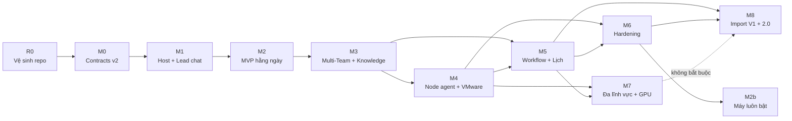
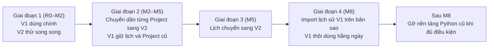

# 06 · Roadmap nâng cấp Windows Worker thành Multi-Team AI Platform

| Mục | Giá trị |
|---|---|
| Trạng thái | **Đề xuất, chờ duyệt** |
| Ngày | 07/11/2026 |
| Baseline | commit `692ad3f`, branch `architecture/multi-team-research` |
| Dựa trên | [00 Sổ quyết định](00-decision-register.md), [01](01-product-and-domain-model.md), [02](02-collaboration-and-knowledge.md), [03](03-distributed-worker.md), [04](04-workflow-and-governance.md), [05 Kiến trúc mục tiêu](05-target-architecture.md), [Rà soát open-source](oss-options.md), khảo sát codebase giai đoạn 1 |
| Không làm | Sửa source, cài package, tạo VM, commit |

**Quy ước:** công sức ghi bằng **ngày công**, là **ước lượng có điều kiện**: một người phát triển có agent AI hỗ trợ, khoảng 5–6 giờ làm việc hiệu quả mỗi ngày, chưa có số đo thực tế. Độ phức tạp: S (một ranh giới nhỏ), M (nhiều module), L (giao cắt runtime, dữ liệu, UI), XL (nhiều L).

---

## 1. Nguyên tắc nâng cấp

Đây là **nâng cấp sản phẩm hiện có**, không phải viết ứng dụng mới từ đầu. Cách làm theo mẫu *strangler* đã chốt ở ADR-T01/T11:

| Nguyên tắc | Nghĩa cụ thể |
|---|---|
| **Cùng repo, cùng hạ tầng** | Code mới nằm cạnh `apps/windows-worker`; dùng lại 9Router, GitLab, CA Caddy, môi trường WSL `/home/lazy/factory-v2`, VMware đã cài |
| **Dùng lại thứ đã chứng minh** | Nền V2 (contracts, schema reference, design, script kiểm tra), module V1 không phụ thuộc Electron, giao thức worker của hệ Python cũ, cấu hình container trên `.60` |
| **Sao chép có chọn lọc, không import xuyên app** | Tránh kéo Electron, schema V1 và 7 role cố định vào hệ mới (F0-01, ADR-T11) |
| **Không sửa V1** | V1 đang dùng hằng ngày; mọi milestone phải giữ V1 nguyên vẹn, có hàng rào kiểm tra tự động |
| **V1 và bản mới chạy song song** | Người dùng chuyển dần từng Project sang bản mới khi bản mới đủ dùng; V1 chỉ thôi dùng sau khi chuyển dữ liệu (M8) |
| **Mỗi milestone dùng được thật** | Có tiêu chí nghiệm thu, thời gian dùng thử, phương án quay lại |

---

## 2. Phân loại module

### 2.1 Tái sử dụng (dùng nguyên hoặc gần nguyên)

| Nguồn | Thành phần | Dùng ở |
|---|---|---|
| V2 | `packages/factory-contracts` (Zod, 14 command, event/cursor, adapter, permissions, preferences, 15 test) | M0 mở rộng; mọi milestone |
| V2 | `schema/factory-v2/001-core.reference.sql` (20 bảng) + `scripts/factory-v2/schema.test.py` | M0 → migration thật ở M1 |
| V2 | `design/factory-v2` (tokens Light/Dark, vi/en, 22 component, 9 màn, window-state) | M1 UI |
| V2 | `scripts/factory-v2/verify-contracts.mjs` (hàng rào "legacy tracked source/config must remain unchanged") | R0 → **V1 Protection Guard** |
| V2 | `scripts/factory-v2/preflight-linux.py`, `setup-linux.py`, `linux-toolchain.lock.json` | M1 môi trường; M4 probe node |
| V1 | `electron/runtime/owned-process.ts` + `owned-job.cs` | M4 node Windows |
| V1 | `electron/gateway/model-proxy.ts`, `request-budget.ts` | M1 model proxy |
| V1 | `electron/workspace/worktrees.ts`, `snapshot.ts`, `checkpoint.ts`, `git-evidence.ts`, `integration.ts` | M2 workspace |
| V1 | `electron/workspace/readiness.ts`, `projects.ts` | M2 probe công cụ |
| V1 | `agent-profiles/*.md` (7 profile), `skills/*/SKILL.md` (4 skill) | M1 Pack "Software Team" |
| Hạ tầng | `infrastructure/worker/Dockerfile` (image OpenCode đã kiểm trên `.60`) | M4 sandbox VM node |
| Hệ Python cũ | Giao thức `claim/heartbeat/complete`, token lưu hash, generation, model proxy theo execution | M4 thiết kế giao thức node |

### 2.2 Cần refactor

| Thành phần | Vì sao | Khi nào |
|---|---|---|
| `packages/factory-contracts` | Thêm Team, Seat, Engagement, Node, Attempt, Approval, Artifact Version, Workflow; bỏ membership agent theo Project; phân tầng trạng thái (ADR-T03, T04) | M0 |
| Schema reference | Thêm bảng cho các thực thể trên | M0 |
| `verify-contracts.mjs` | Tách hàng rào V1 thành script riêng, cập nhật baseline | R0 |
| Module V1 sao chép | So sánh path không phân biệt hoa thường (`workspace/files.ts`, `worktrees.ts`) phải sửa cho Linux; bỏ phụ thuộc role cố định; gắn grant từ control plane | M1, M2, M4 |
| `runtime/opencode.ts` | Đưa về dưới `RuntimeAdapter` làm adapter native dự phòng | M2 |

### 2.3 Xây mới

| Ứng dụng | Module mới | Milestone |
|---|---|---|
| `apps/factory-host` | `api`, `identity`, `storage`, `events`, `org`, `projects`, `work` | M1 |
| | `dispatch`, `knowledge` (tối thiểu), `approvals` (tối thiểu), `notify` (Inbox), `mcp` | M2 |
| | `knowledge` đầy đủ, `approvals` đầy đủ, CTR trong `work` | M3 |
| | `nodes`, `effects` | M4 |
| | `workflow`, `automation`, `policy` | M5 |
| `apps/factory-node` | `runtime/api-agent`, `model-proxy` (chạy trong tiến trình) | M1 |
| | `exec` (Linux), `runtime/acp`, `runtime/native-opencode`, `workspace`, `probes` | M2 |
| | `transport`, `enroll`, `exec` (Windows), `sandbox`, `mcp-relay` | M4 |
| `apps/factory-ui` | Shell, Project, Chat Lead | M1 |
| | Board, Task detail, Kết quả, Inbox | M2 |
| | Team, Knowledge, CTR | M3 |
| | Node | M4 |
| | Workflow, Approval Inbox, Lịch | M5 |
| `packs/` | `software-team` | M1 |
| | `research-team`, `reporting-team` | M3, M5 |
| | `video-team` | M7 |

---

## 3. Implementation Roadmap

### 3.1 Điều chỉnh thứ tự so với lộ trình 05 §13 (điểm phê duyệt AP-1)

Lộ trình 05 đặt Distributed (M2a) trước Team/Knowledge (M3). Roadmap này **đổi theo lớp năng lực**: Project/Team/Agent → Task/Collaboration/Knowledge → Distributed → Workflow/Automation → Monitoring/Security/Optimization.

| Lý do | Chi tiết |
|---|---|
| Không còn nhu cầu 24/7 sớm | Đã chốt VMware trên laptop cho giai đoạn phát triển (05 §21); 24/7 để mốc M2b |
| Không phải viết lại khi tách node | Node chạy trong tiến trình (bậc C0) dùng đúng interface `RuntimeAdapter` và hàng đợi; tách tiến trình ở M4 chỉ thêm transport |
| Giá trị dùng hằng ngày đến sớm hơn | Team và Knowledge là phần người dùng thấy rõ nhất so với V1 |
| Rủi ro chấp nhận được | Code agent chạy trên Windows/WSL lâu hơn, cùng mức rủi ro V1 hiện nay |

### 3.2 Tổng quan

| Mốc | Lớp năng lực | Tên | Phiên bản | Công sức (ngày công, có điều kiện) | Dùng thật được |
|---|---|---|---|---:|---|
| **R0** | Chuẩn bị | Vệ sinh repo và baseline | — | 0,5–1 | — |
| **M0** | Nền | Contracts wire v2 | contracts 0.2.0 | 3–6 | Không (nền) |
| **M1** | L1 Project, Team, Agent | Host lõi + Lead chat | 2.0.0-alpha.1 | 10–16 | Một phần: trò chuyện, lập kế hoạch |
| **M2** | L1–L2 | **MVP dùng hằng ngày** | 2.0.0-alpha.2 | 15–25 | **Có**: làm việc thật trên một máy |
| **M3** | L2 Collaboration, Knowledge | Multi-Team + Knowledge | 2.0.0-alpha.3 | 15–25 | Có |
| **M4** | L3 Distributed | Node agent + VMware | 2.0.0-beta.1 | 15–25 | Có, nhiều máy trên laptop |
| **M5** | L4 Workflow, Automation | Workflow, Approval Inbox, lịch | 2.0.0-beta.2 | 20–30 | Có, thay V1 cả phần lịch |
| **M6** | L5 Monitoring, Security, Optimization | Hardening | 2.0.0-rc.1 | 10–20 | Có, ổn định |
| **M7** | Mở rộng | Đa lĩnh vực + GPU | 2.0.0-rc.2 | 15–25 | Có, thêm Video/Research |
| **M8** | Chuyển đổi | Import V1 + phát hành | **2.0.0** | 8–15 | V1 chuyển chỉ đọc |
| **M2b** | Hạ tầng | Control plane lên máy luôn bật | — | 3–5 | Khi cần 24/7, sau M6 |
| | | **Tổng** | | **≈ 110–190** | |

Tổng công sức có độ tin cậy thấp; sẽ hiệu chỉnh sau M1 bằng số đo thực tế.

### 3.3 Dependency Graph

| Phụ thuộc kỹ thuật | Giải thích |
|---|---|
| M0 trước mọi thứ | Contracts quyết định DB, API, giao thức node (ADR-T03 là quyết định khó đổi nhất) |
| M2 cần M1 | Task chạy cần Host, event log, Project, Lead |
| M3 cần M2 | CTR và Knowledge cần Task, Artifact, dispatch đã chạy |
| M4 cần M3 | Context Pack (thuộc Knowledge) phải có trước khi gửi qua mạng; giao thức node dùng Attempt đã ổn định |
| M5 cần M3, M4 | Workflow dùng CTR, Approval, Knowledge; lịch 24/7 và Effect Executor cần control plane tách khỏi máy làm việc |
| M7 cần M4 | Job GPU chạy trên node Windows/WSL |
| M8 cần M5, M6 | Mô hình dữ liệu ổn định và có sao lưu trước khi nhập dữ liệu V1 |

---

## 4. Milestone Breakdown

### R0 · Vệ sinh repo và baseline

| Mục | Nội dung |
|---|---|
| **Mục tiêu** | Có điểm xuất phát sạch, được bảo vệ, để mọi thay đổi sau đo được |
| **Phạm vi** | Commit `docs/architecture/`; chốt chiến lược nhánh (đưa nhánh hiện tại vào `main` hoặc làm việc từ nhánh này); chạy baseline V1 và V2; tạo V1 Protection Guard |
| **File thay đổi** | `scripts/factory-v2/verify-contracts.mjs` (tách phần hàng rào); `scripts/factory-v2/README.md` |
| **Tạo mới** | `scripts/factory-v2/verify-v1-protection.mjs` (kiểm `apps/windows-worker/**` và nền tảng Python cũ không đổi so với baseline R0); `research/factory-v2/r0-baseline.json` (kết quả test V1, V2) |
| **Phụ thuộc** | Người dùng duyệt thao tác Git (AP-2) |
| **Độ phức tạp, công sức** | S · 0,5–1 ngày |
| **Rủi ro** | Nhầm nhánh khi `main` chậm 63 commit; commit nhầm file `.cache`, ảnh, DB |
| **Test Cases** | (1) `npm test`, `npm run typecheck`, `npm run build` của V1 đạt; (2) `npm test` của `packages/factory-contracts` đạt; (3) Guard báo lỗi khi cố ý sửa một file V1 trên nhánh thử; (4) Guard đạt trên nhánh sạch |
| **Acceptance** | Tài liệu kiến trúc đã commit; baseline lưu; Guard chạy trong 1 lệnh |
| **Rollback** | Không đụng code chạy; revert commit tài liệu/script nếu cần |
| **Điều kiện chuyển** | Baseline xanh, Guard hoạt động, AP-2 đã duyệt |

### M0 · Contracts wire v2

| Mục | Nội dung |
|---|---|
| **Mục tiêu** | Chốt mô hình dữ liệu và giao thức trước khi viết Host (ADR-T03, T04, T05, T06) |
| **Phạm vi** | Thực thể: Organization, Team, Seat, Role, Agent Profile, Pack, Engagement, Task (lifecycle mới + holds + disposition), Dependency, CTR, Workflow Definition/Instance/Patch (khung), Node, Agent Instance, Assignment, Run Attempt (lifecycle thực thi), Artifact Version, Approval, Decision Record, Standing Approval, Budget, Effect; command và event tương ứng; giao thức node (enroll, heartbeat, claim, renew, uplink); bề mặt tool MCP; `RuntimeAdapter` ba loại |
| **File thay đổi** | `packages/factory-contracts/src/models.ts`, `commands.ts`, `events.ts`, `adapter.ts`, `permissions.ts`, `base.ts`, `index.ts`; `package.json` (0.2.0); `test/contracts.test.mjs`; `scripts/factory-v2/schema.test.py`; `scripts/factory-v2/verify-contracts.mjs` |
| **Tạo mới** | `src/org.ts`, `src/work.ts`, `src/nodes.ts`, `src/workflow.ts`, `src/approvals.ts`, `src/knowledge.ts`, `src/policy.ts`, `src/mcp-tools.ts`; `schema/factory-v2/002-multiteam.reference.sql`; test mới cho phân tầng trạng thái (property test) |
| **Phụ thuộc** | R0 |
| **Độ phức tạp, công sức** | M · 3–6 ngày |
| **Rủi ro** | Thiết kế quá rộng, chưa dùng tới; đổi `idSchema` sang UUIDv7 làm vỡ test cũ |
| **Test Cases** | (1) Schema strict từ chối khóa lạ; (2) Task lifecycle chỉ cho chuyển hợp lệ, property test 1.000 chuỗi ngẫu nhiên không vào trạng thái cấm; (3) Attempt với epoch cũ bị `acceptsCallback` từ chối; (4) Approval gắn digest khác thì thành Superseded; (5) Command trùng `commandId` khác nội dung bị từ chối; (6) SQL reference: FK theo Project, unique một live attempt mỗi assignment, CAS epoch; (7) Guard V1 vẫn đạt |
| **Acceptance** | `npm test` của contracts đạt; schema test đạt; người dùng duyệt hình dạng mô hình (AP-3) |
| **Rollback** | Package riêng, chưa có consumer; quay về 0.1.0 bằng revert |
| **Điều kiện chuyển** | AP-3 duyệt; không còn câu hỏi mở về thực thể cho M1–M2 |

### M1 · Host lõi + Lead chat (L1: Project, Team, Agent)

| Mục | Nội dung |
|---|---|
| **Mục tiêu** | Có ứng dụng web chạy trên WSL: tạo Project, chọn Team "Software" từ Pack, trò chuyện với Lead; Lead trả lời hoặc đề xuất kế hoạch thành Task (chưa thực thi) |
| **Phạm vi** | Host: `storage` (better-sqlite3 + Kysely, WAL, migration ledger có checksum, backup trước migration), `events` (event log theo Project, outbox, SSE có cursor), `api` (Fastify, bootstrap token một lần → cookie phiên, CSRF, Origin, bind loopback), `identity`, `org` (Team, Seat, Profile, Pack Registry tối thiểu), `projects` (Project, Engagement tự tạo), `work` (Task Draft/Proposed/Accepted); Node trong tiến trình chỉ có **API agent** + **model proxy**; UI: shell, danh sách Project, Chat Lead, danh sách Task |
| **File thay đổi** | `packages/factory-contracts` (bổ sung nhỏ nếu cần) |
| **Tạo mới** | `apps/factory-host/` (`package.json`, `tsconfig.json`, `src/main.ts`, `src/modules/{api,identity,storage,events,org,projects,work}`, `migrations/0001_core.sql`, `test/`); `apps/factory-node/` (`src/runtime/api-agent`, `src/model-proxy` sao chép từ V1 `gateway/model-proxy.ts`, `request-budget.ts`); `apps/factory-ui/` (Vite + React, dùng `design/factory-v2`); `packs/software-team/` (chuyển từ `apps/windows-worker/agent-profiles/*.md`, `skills/*/SKILL.md`) |
| **Phụ thuộc** | M0; môi trường WSL F1-01 (Node 22.23.4); key 9Router |
| **Độ phức tạp, công sức** | L · 10–16 ngày |
| **Rủi ro** | Lead bằng API agent trả lời kém so với Lead chạy OpenCode của V1; migration ledger sai từ đầu |
| **Test Cases** | (1) Migration chạy từ DB rỗng, chạy lại không đổi gì, checksum lệch thì dừng; (2) Bootstrap token dùng một lần; request thiếu CSRF/Origin sai bị 403; (3) Tạo Project hai lần cùng `commandId` chỉ ra một Project; (4) SSE ngắt và nối lại từ cursor không mất/không lặp event; (5) Lead (Fake Runtime Adapter) nhận câu hỏi tư vấn: trả lời, không tạo Task; nhận yêu cầu làm việc: đề xuất Task đúng một lần; (6) Model proxy: token tạm sai bị từ chối, vượt ngân sách bị chặn; (7) Live smoke có ngân sách nhỏ với 9Router; (8) Guard V1 đạt |
| **Acceptance** | Từ trình duyệt: tạo Project, chat Lead, thấy kế hoạch Task; khởi động lại Host không mất dữ liệu; V1 vẫn chạy bình thường cùng lúc |
| **Rollback** | Ứng dụng mới độc lập; tắt Host, V1 không bị ảnh hưởng; DB V2 có backup trước mỗi migration |
| **Điều kiện chuyển** | Acceptance đạt; dùng thử 2–3 ngày không lỗi dữ liệu |

### M2 · MVP dùng hằng ngày

| Mục | Nội dung |
|---|---|
| **Mục tiêu** | Làm việc thật trên một máy, đủ để thay V1 cho phần lớn công việc phần mềm hằng ngày (danh sách parity ở §5) |
| **Phạm vi** | `dispatch` (hàng đợi, assignment, attempt, lease cục bộ, nhiều Project song song, mỗi Seat N slot); node trong tiến trình thêm `runtime/acp` (OpenCode qua `opencode acp`), `runtime/native-opencode` (dự phòng từ V1), `exec` (process group Linux), `workspace` (worktree, snapshot, checkpoint, patch); `knowledge` tối thiểu (Artifact Version theo hash, xem diff/bằng chứng); `approvals` tối thiểu (câu hỏi nghiệp vụ, nghiệm thu human-final); `notify` (Inbox "Cần xử lý"); `mcp` (tool `output.register`, `task.progress`, `decision.request`); dừng có xác nhận, khôi phục không chạy lặp; UI: Board, Task detail (Yêu cầu/Trao đổi/Tiến độ/Kết quả như V1), Kết quả, Inbox |
| **File thay đổi** | `apps/factory-host/src/modules/*`, `apps/factory-node/src/*`, `apps/factory-ui/src/*`, `migrations/0002_*.sql` |
| **Tạo mới** | `apps/factory-host/src/modules/{dispatch,knowledge,approvals,notify,mcp}`; `apps/factory-node/src/{exec,runtime/acp,runtime/native-opencode,workspace,probes}` (sao chép, sửa từ V1 `owned-process.ts` phần không phải Windows, `opencode.ts`, `worktrees.ts`, `snapshot.ts`, `checkpoint.ts`, `git-evidence.ts`, `integration.ts`, `readiness.ts`) |
| **Phụ thuộc** | M1; OpenCode 1.19.5 Linux (đã cài); quyết định nơi đặt mã nguồn Project (AP-4) |
| **Độ phức tạp, công sức** | XL · 15–25 ngày |
| **Rủi ro** | Không đạt parity → người dùng ở lại V1; ACP của OpenCode thiếu năng lực dừng/khôi phục; làm việc trên thư mục Windows qua `/mnt/e` chậm và sai hoa thường (F1-01 thấy `/mnt/e` là 9p) |
| **Test Cases** | (1) Hai Project chạy đồng thời, mỗi Project một Task, không lẫn workspace; (2) Dừng Task: tiến trình thật sự thoát mới báo Stopped; (3) Tắt Host giữa chừng, bật lại: attempt Interrupted, không chạy lại prompt, có Session mới với handoff; (4) Task sửa file trong worktree, diff và bằng chứng lệnh hiển thị đúng; repo gốc không đổi cho tới khi áp dụng; (5) Gửi lại tin nhắn khi mất mạng không tạo Task trùng; (6) Câu hỏi nghiệp vụ xuất hiện đúng một lần trong Inbox, trả lời xong Task tiếp tục; (7) Adapter native dùng được khi tắt ACP; (8) E2E Playwright luồng chính; (9) Guard V1 đạt, test V1 đạt |
| **Acceptance** | Checklist parity §5 đạt; người dùng làm ít nhất một công việc thật đầu-cuối mỗi ngày trong 5 ngày liên tiếp mà không phải quay lại V1 cho luồng đó; không mất dữ liệu |
| **Rollback** | Dừng dùng V2 cho Project đó, quay lại V1 (repo gốc chỉ đổi khi người dùng áp dụng patch); khôi phục DB V2 từ backup |
| **Điều kiện chuyển** | AP-5 (người dùng xác nhận chuyển công việc hằng ngày của ít nhất một Project sang V2) |

### M3 · Multi-Team, Collaboration và Knowledge

| Mục | Nội dung |
|---|---|
| **Mục tiêu** | Nhiều Team phục vụ nhiều Project; Team hỏi nhau qua yêu cầu có cấu trúc; tri thức có trạng thái và truy xuất được |
| **Phạm vi** | `org` đầy đủ (Team CRUD từ Pack, Seat dedicated/elastic, Engagement có ưu tiên/hạn mức); `work` thêm CTR (6 loại, triage, giới hạn hop/vòng); `knowledge` đầy đủ (FTS5 có tokenizer tiếng Việt, trạng thái Draft→Approved→Superseded, provenance, phân tích tác động, Dossier, Context Assembly L0/L1/L2, phân quyền đọc theo Session); `approvals` (mô hình Approval chung, Decision Record, Execution Gate); tool MCP `knowledge.search/get`, `request.create/reply`; Pack `research-team`; UI Team, Knowledge, yêu cầu giữa Team |
| **File thay đổi** | Các module Host liên quan; `migrations/0003_*.sql`; UI |
| **Tạo mới** | `packs/research-team/`, `packs/architecture-team/`, `packs/design-team/` (nội dung từ BMAD-METHOD/spec-kit có ghi nguồn, OSS-05) |
| **Phụ thuộc** | M2 |
| **Độ phức tạp, công sức** | XL · 15–25 ngày |
| **Rủi ro** | Tóm lược L1 do agent viết kém chính xác; FTS5 tìm tiếng Việt không dấu kém; số Approval làm Operator quá tải |
| **Test Cases** | (1) Kịch bản 02 §18.1 (Research → BA → Architecture ∥ Design → sẵn sàng chờ lệnh) chạy bằng Fake Runtime Adapter; (2) CTR vượt hop 3 bị từ chối; thread quá 3 vòng tự leo thang; (3) Hai CTR trùng được gộp; (4) Session Project A không đọc được Artifact nháp của Project B; (5) Version mới Approved làm bản cũ Superseded và đánh dấu stale đúng Task phụ thuộc; (6) Tìm "thiet ke" ra tài liệu "thiết kế"; (7) Tiếp nhận lại Project sau nhiều ngày dựng đúng Resume Briefing |
| **Acceptance** | Kịch bản 02 §18 chạy với model thật trong ngân sách; người dùng dùng hai Team trên hai Project thật |
| **Rollback** | Migration có backup; tắt tính năng Multi-Team bằng cờ, quay về một Team mặc định mỗi Project |
| **Điều kiện chuyển** | Dùng thật 5 ngày; AP-6 duyệt nội dung Pack |

### M4 · Distributed Worker trên VMware

| Mục | Nội dung |
|---|---|
| **Mục tiêu** | Tách node khỏi Host và chạy trên nhiều máy: VM `factory-cp`, VM `factory-node-1`, node Windows |
| **Phạm vi** | Bậc C1 (node tách tiến trình, cùng máy) rồi C2-dev; `nodes` (Registry, enrollment token một lần + keypair + Operator duyệt, capability, trạng thái node); `dispatch` qua mạng (claim long-poll, lease 60 s, gia hạn 20 s, epoch fencing); node `transport`, `enroll`, `sandbox` (container theo Dockerfile đã kiểm trên `.60`), `mcp-relay`; node Windows: `exec` bằng Job Object (sao chép `owned-process.ts`, `owned-job.cs`), chạy bằng WinSW; `effects` (node trả patch, Effect Executor commit lên branch theo attempt); lớp vị trí và side effect của Task (E-06) |
| **File thay đổi** | Host `dispatch`, `knowledge` (tải Artifact theo hash qua API node); node toàn bộ |
| **Tạo mới** | `apps/factory-host/src/modules/{nodes,effects}`; `apps/factory-node/src/{transport,enroll,sandbox,mcp-relay,exec/windows}`; `infrastructure/factory-v2/vm/README.md` (hướng dẫn tạo VM, mạng VMnet8, CA, Docker; người dùng tự tạo VM) |
| **Phụ thuộc** | M3; người dùng tạo hai VM trên D: (AP-7) |
| **Độ phức tạp, công sức** | XL · 15–25 ngày |
| **Rủi ro** | RAM laptop không đủ khi chạy cùng WSL (R18 ở 05); mạng giữa VM và Windows; ACP dưới tiến trình nền không có terminal |
| **Test Cases** | Kịch bản sự cố 03 §15: (K1) ngắt mạng ảo < 60 s; (K2) ngắt > 60 s → self-fencing, Task di chuyển được thì chạy node khác; (K3) giết tiến trình runtime; (K4) khởi động lại VM node; (K5) tắt node Windows khi đang chạy Task node-bound → chờ, không chuyển; (K6) tạm dừng VM `factory-cp`; (K7) gửi kết quả với epoch cũ bị từ chối; thêm: enrollment token dùng lại bị từ chối, node chưa duyệt không nhận việc, sandbox không đọc được thư mục ngoài workspace, commit qua Effect Executor không trùng khi gửi lại |
| **Acceptance** | K1–K7 đạt bằng thao tác VMware (tạm dừng, ngắt card, khôi phục snapshot); Task thật chạy trên `factory-node-1` và node Windows |
| **Rollback** | Chế độ node trong tiến trình vẫn giữ (cấu hình); quay về một máy nếu mạng/VM lỗi |
| **Điều kiện chuyển** | Dùng thật 5 ngày ở chế độ nhiều node; không có attempt "ma" |

### M5 · Workflow và Automation

| Mục | Nội dung |
|---|---|
| **Mục tiêu** | Quy trình theo template, phê duyệt tập trung, việc tự động theo lịch/sự kiện; thay V1 cả phần lịch |
| **Phạm vi** | `workflow` (Definition trong Pack, Instance, Plan Patch, validator, gate, rework có giới hạn); `automation` (Scheduler bằng croner, misfire skip/coalesce, concurrency, Rule Evaluator, Monitor kích hoạt theo cạnh, Watchdog stall); `policy` (ngân sách nhiều cấp có reservation, mức tự chủ L0–L4, circuit breaker bằng cockatiel); `approvals` (Approval Inbox đầy đủ, Standing Approval, TTL, nhắc); `notify` (digest, giờ yên lặng, ntfy nếu người dùng bật); Project Proposal từ ngôn ngữ tự nhiên; Pack `reporting-team` + Workflow Software, Reporting ngày |
| **Tạo mới** | `apps/factory-host/src/modules/{workflow,automation,policy}`; `packs/reporting-team/`; `packs/software-team/workflows/software-delivery.*` |
| **Phụ thuộc** | M3, M4 |
| **Độ phức tạp, công sức** | XL · 20–30 ngày |
| **Rủi ro** | Lead đề xuất Plan Patch kém; ngưỡng circuit breaker quá nhạy; quá nhiều Approval |
| **Test Cases** | (1) Ví dụ Software 04 §15.1: bỏ Design khi không có UI, rework QA → Dev tối đa 3 vòng; (2) Plan Patch tạo chu trình bị từ chối; (3) Lịch lỡ khi control plane tắt: skip mặc định, coalesce chạy đúng một lần; (4) Lần trước còn chạy thì lần mới bị skip; (5) Reporting ngày 04 §16 với pre-check không có thay đổi thì không gọi LLM; (6) Rule lặp bị quarantine; (7) Approval hết hạn không tự áp; Action Intent không đảo ngược không dùng Standing Approval; (8) Ngân sách chạm 100% dừng việc mới; (9) Đồng hồ giả lập cho test lịch và DST |
| **Acceptance** | Ví dụ Software và Reporting ngày chạy với model thật; người dùng tắt lịch trong V1 và dùng lịch V2 |
| **Rollback** | Tắt Scheduler/Rule toàn cục (công tắc); Workflow Instance có thể chuyển về Task thủ công |
| **Điều kiện chuyển** | Dùng thật 7 ngày có lịch chạy hằng ngày; AP-8 duyệt mức tự chủ, ngân sách mặc định |

### M6 · Monitoring, Security và Optimization

| Mục | Nội dung |
|---|---|
| **Mục tiêu** | Vận hành ổn định, an toàn, đo được |
| **Phạm vi** | pino + OpenTelemetry; sổ usage và màn chi phí; Litestream cho `factory-cp`; diễn tập khôi phục; sandbox-runtime trên node Linux; mức tin cậy node, audit trong event log; kiểm bảo mật (CSRF, Origin, secret không lộ log/export, node bị thu hồi); kiểm tải (1.000 Task, 50 agent, 10.000 event); tối ưu Context Pack và chi phí token theo chỉ số 02 §10.3 |
| **Tạo mới** | Cấu hình Litestream; bộ kiểm tải; tài liệu vận hành |
| **Phụ thuộc** | M4, M5 |
| **Độ phức tạp, công sức** | L · 10–20 ngày |
| **Rủi ro** | sandbox-runtime (beta) không chạy trong VM; NAS chưa rõ giao thức cho Litestream |
| **Test Cases** | (1) Xóa VM `factory-cp`, dựng lại từ Litestream, mất dữ liệu ≤ vài giây; (2) Node bị thu hồi không gọi được API; (3) Secret không xuất hiện trong log, export, Artifact; (4) Dataset tải không làm UI hay SSE chậm quá ngưỡng đã đặt; (5) Sandbox chặn ghi ngoài scope và mạng ngoài allowlist |
| **Acceptance** | Diễn tập khôi phục đạt; báo cáo bảo mật không còn lỗi nghiêm trọng; số đo hiệu năng ghi lại |
| **Rollback** | Từng phần có cờ bật/tắt |
| **Điều kiện chuyển** | Chạy 14 ngày không sự cố mất dữ liệu |

### M7 · Đa lĩnh vực và GPU

| Mục | Nội dung |
|---|---|
| **Mục tiêu** | Team Video và Research hoạt động với công cụ thật |
| **Phạm vi** | Job runner trên node (tách khỏi lượt agent, staging/publish nguyên tử); FFmpeg/ffprobe; probe GPU RTX 4060 qua node Windows hoặc WSL (CUDA); Pack `video-team`, Workflow Video 04 §15.2 |
| **Phụ thuộc** | M4, M5 |
| **Độ phức tạp, công sức** | L · 15–25 ngày |
| **Rủi ro** | CUDA trong WSL chưa kiểm; VRAM thật chưa rõ (Windows báo 4 GB) |
| **Test Cases** | Render dừng giữa chừng không để file dở được công bố; hết đĩa báo lỗi rõ; Review quay lại Script đánh dấu stale đúng |
| **Acceptance** | Một video ngắn đi hết quy trình |
| **Rollback** | Pack bật/tắt độc lập |
| **Điều kiện chuyển** | Không bắt buộc cho M8 |

### M8 · Chuyển dữ liệu V1 và phát hành 2.0

| Mục | Nội dung |
|---|---|
| **Mục tiêu** | Đưa lịch sử V1 sang, V1 thôi dùng, phát hành 2.0.0 |
| **Phạm vi** | Công cụ import đọc **bản sao** `worker.sqlite` của V1 (schema 15): Project, work item (W-xxxx, revision), báo cáo, tài liệu BA, bằng chứng; mapping ID, hash, số lượng; dry-run; import vào DB V2 dưới dạng lịch sử (paused, không tự chạy lại); rollback; tài liệu vận hành; quyết định gỡ nền tảng Python cũ trên `.14` |
| **Tạo mới** | `apps/factory-host/src/tools/import-v1/` |
| **Phụ thuộc** | M5, M6 |
| **Độ phức tạp, công sức** | M · 8–15 ngày |
| **Rủi ro** | Lệch số liệu; dữ liệu V1 mã hóa bằng DPAPI không chuyển được (credential không chuyển, theo V2 ADR-006) |
| **Test Cases** | Import hai lần cho cùng kết quả; số lượng và hash khớp; Task nhập vào không tự chạy; rollback xóa sạch dữ liệu nhập |
| **Acceptance** | Người dùng đối chiếu ngẫu nhiên 10 hồ sơ; V1 không còn dùng hằng ngày |
| **Rollback** | V1 vẫn nguyên (chỉ đọc bản sao), quay lại V1 ngay |
| **Điều kiện chuyển** | AP-10 |

### M2b · Control plane lên máy luôn bật (khi cần 24/7)

Chuyển VM `factory-cp` (export từ VMware) hoặc cài lại trên máy luôn bật (VM trên hypervisor, dự phòng `.14`), khôi phục DB bằng Litestream, đổi địa chỉ node. Làm sau M6, khi người dùng cần Team/lịch chạy lúc laptop tắt (AP-9). Công sức 3–5 ngày.

---

## 5. MVP Scope

### 5.1 MVP = R0 → M2

Một ứng dụng web chạy trên WSL của laptop, làm việc thật cho các Project phần mềm, chạy song song với V1.

### 5.2 Parity với luồng chính của V1

| Chức năng V1 | MVP (M2) | Ghi chú |
|---|---|---|
| Chọn source, tạo Project | Có | Xem AP-4 về nơi đặt mã nguồn |
| Chat với Lead, Lead lập kế hoạch và giao việc | Có | Lead dùng API agent |
| Agent sửa code trong worktree riêng, xem diff, bằng chứng lệnh | Có | Sao chép từ V1 |
| Board, hồ sơ công việc W-xxxx (Yêu cầu/Trao đổi/Tiến độ/Kết quả) | Có | |
| Câu hỏi nghiệp vụ, nghiệm thu, yêu cầu sửa | Có | |
| Dừng, khôi phục sau gián đoạn không chạy lặp | Có | |
| Inbox "Cần xử lý" | Có | |
| Lịch sử, kết quả, tìm kiếm cơ bản | Có | Tìm toàn văn đầy đủ ở M3 |
| Lịch (once/daily tạo backlog) | **Chưa** | Dùng lịch V1 tới M5 |
| Git local chỉ đọc, Mermaid, ảnh chat | Một phần | Ưu tiên theo nhu cầu |
| Văn phòng 3D | Không | Đã hoãn |
| **Mới so với V1** | Nhiều Project chạy cùng lúc; mỗi Seat nhiều slot; Team Pack sửa được không cần code | |

### 5.3 Nơi đặt mã nguồn Project trong MVP (AP-4)

V1 làm việc trực tiếp trên thư mục Windows (`E:\GIT\...`). Host V2 chạy trong WSL; đọc `/mnt/e` qua 9p chậm và khác quy tắc hoa thường (F1-01).

| Phương án | Mô tả | Đánh giá |
|---|---|---|
| **A (khuyến nghị)** | Project được clone vào filesystem Linux của WSL; kết quả đẩy về bằng **branch** vào remote (GitHub/GitLab) hoặc vào repo Windows như một remote cục bộ | Nhanh, đúng V2 ADR-006; người dùng merge branch như quy trình Git thường |
| B | Làm việc trực tiếp trên `/mnt/e/...` | Đơn giản nhưng chậm, rủi ro sai hoa thường và quyền file |
| C | Chờ node Windows (M4) cho Project chỉ có trên Windows | Đúng nhất cho dữ liệu cục bộ nhưng chậm có MVP |

### 5.4 Ngoài MVP

Multi-Team và CTR (M3), nhiều máy (M4), Workflow/lịch/Approval Inbox đầy đủ (M5), hardening (M6), Video/GPU (M7), import V1 (M8).

---

## 6. Thay đổi dữ liệu, API và ảnh hưởng tới chức năng cũ

| Thay đổi | Ảnh hưởng tới V1 | Ảnh hưởng tới nền tảng Python cũ | Biện pháp |
|---|---|---|---|
| Contracts wire v2 | Không (V1 không dùng package này) | Không | — |
| DB V2 mới (`$XDG_STATE_HOME/factory-v2`) | Không (DB V1 ở `%APPDATA%`) | Không | Host fail closed nếu đường dẫn trùng V1 (V2 ADR-006) |
| Ứng dụng mới trong `apps/` | Không | Không | V1 Protection Guard ở mọi milestone |
| Sửa `scripts/factory-v2/*` | Không | Không | — |

**Xung đột khi chạy V1 và V2 cùng lúc:**

| Xung đột | Biện pháp |
|---|---|
| Cùng một repo được cả V1 và V2 tạo worktree/branch | Không mở cùng một Project trên cả hai cùng lúc; V2 dùng tiền tố branch riêng (ví dụ `factory/`), thư mục worktree riêng |
| Tiến trình OpenCode của cả hai | Mỗi bên quản lý tiến trình của mình (V1 Job Object, V2 process group trong WSL); không kill theo tên |
| Quota 9Router | Ngân sách riêng của V2; theo dõi lỗi 429 |
| Cổng mạng | V2 bind loopback cổng riêng |
| Key 9Router | V2 lưu riêng, không đọc DPAPI của V1 |

---

## 7. Migration Strategy

| Nội dung | Quy tắc |
|---|---|
| Chuyển Project | Theo từng Project, do người dùng quyết định; Project đã chuyển không dùng song song trên V1 |
| Migration schema V2 | Mỗi migration có checksum; **backup DB trước khi nâng** (giống V1 `VACUUM INTO worker.schemaN...backup.sqlite`); không có migration đi lùi, quay lại bằng khôi phục backup |
| Import V1 | Đọc bản sao, dry-run, mapping, hash, idempotent, dữ liệu nhập ở trạng thái lịch sử (V2 F8-01) |
| Credential | Không chuyển từ V1 (DPAPI); người dùng nhập lại key 9Router cho V2 |
| Rollback tổng thể | V1 luôn còn dùng được cho tới khi người dùng chủ động thôi dùng; snapshot VM ở M4+; Litestream ở M6+ |

---

## 8. Test Strategy

| Tầng | Công cụ | Phạm vi | Khi chạy |
|---|---|---|---|
| Contract | `node:test` + Zod | Schema, command, event, chuyển trạng thái | Mọi commit |
| Property test | **fast-check** | Task/Attempt/Approval/Workflow state machine, lease/epoch | Mọi commit (số lần chạy nhỏ), đêm (lớn) |
| Unit | `node:test` | Module Host, node | Mọi commit |
| DB và migration | SQLite memory + file tạm | Nâng từ mọi version cũ, chạy lại idempotent, checksum, FK, CAS | Mọi commit |
| Integration | Host + node trong tiến trình + **Fake Runtime Adapter** | Luồng chat → Task → output → review, không gọi model | Mọi commit |
| Chaos node | VMware (tạm dừng VM, ngắt card mạng, khôi phục snapshot) | K1–K8 (03 §15) | Trước khi đóng M4, M6 |
| E2E UI | **Playwright** | Luồng chính, Light/Dark, vi/en, 1366×768 | Trước mỗi release |
| Live smoke | 9Router thật, ngân sách nhỏ, opt-in | Lead, OpenCode, Reporting | Trước mỗi release |
| **V1 regression** | `npm test`, `npm run typecheck`, `npm run build` của V1; acceptance fixture; **V1 Protection Guard** | V1 không đổi và vẫn chạy | Mọi milestone |
| Tải | Bộ dữ liệu 1.000 Task, 50 agent, 10.000 event | Độ trễ API, SSE, UI | M6 |

**Fake Runtime Adapter** là `RuntimeAdapter` giả lập theo kịch bản (trả lời, hỏi, sửa file, lỗi, treo) để kiểm thử xác định, không tốn token. Đây là phần cần xây sớm nhất ở M1.

---

## 9. Release Strategy

| Nội dung | Quy tắc |
|---|---|
| Phiên bản | `2.0.0-alpha.N` (M1–M3), `2.0.0-beta.N` (M4–M5), `2.0.0-rc.N` (M6–M7), `2.0.0` (M8). V1 giữ `1.3.x`, chỉ sửa lỗi nghiêm trọng |
| Nhánh | Một nhánh tính năng mỗi milestone; checkpoint `checkpoint/<milestone>-start-<ngày>` trước thay đổi lớn (giống thói quen repo) |
| Tag | Tag mỗi phiên bản đã nghiệm thu |
| Cờ tính năng | Phần chưa xong ẩn sau cờ; không hiện tab/nút chưa hoạt động (V2 F2) |
| Ghi chú phát hành | Chỉ ghi khả năng đã kiểm chứng; giới hạn đã biết |
| Thời gian dùng thử | Mỗi milestone có số ngày dùng thật tối thiểu (ghi ở "Điều kiện chuyển") |
| Cài đặt | M1–M3: chạy từ checkout trong WSL; M4+: node Windows chạy bằng WinSW; đóng gói cài đặt để sau |

---

## 10. Vận hành ổn định sau mỗi milestone

| Tiêu chí | Áp dụng từ |
|---|---|
| Khởi động lại Host không mất dữ liệu, không chạy lặp | M1 |
| Backup DB trước mỗi migration và thử khôi phục | M1 |
| Dùng thật N ngày theo điều kiện chuyển, không mất dữ liệu | M2 |
| Không có attempt "ma" sau sự cố node | M4 |
| Lịch không chạy trùng, không chạy bù hàng loạt | M5 |
| Diễn tập khôi phục từ Litestream | M6 |
| V1 vẫn chạy bình thường | Mọi milestone |

---

## 11. Điểm người dùng kiểm tra và phê duyệt

| ID | Thời điểm | Nội dung |
|---|---|---|
| **AP-1** | Trước R0 | Đổi thứ tự theo lớp năng lực (§3.1) so với lộ trình 05 §13 |
| **AP-2** | R0 | Thao tác Git: commit tài liệu, chiến lược nhánh, có đưa nhánh hiện tại vào `main` không |
| **AP-3** | Cuối M0 | Hình dạng mô hình dữ liệu và giao thức (khó đổi nhất) |
| **AP-4** | Đầu M2 | Nơi đặt mã nguồn Project trong MVP (§5.3) |
| **AP-5** | Cuối M2 | Chuyển công việc hằng ngày của ít nhất một Project sang V2 |
| **AP-6** | Cuối M3 | Nội dung Team Pack (Research, Architecture, Design). **Giao thức cộng tác đã chốt 12/11/2026** theo ủy quyền ([14](14-agent-collaboration-protocol.md)) |
| **AP-7** | Đầu M4 | Tạo VM `factory-cp`, `factory-node-1`; mức tin cậy node |
| **AP-8** | Cuối M5 | Mức tự chủ, ngân sách mặc định, Standing Approval, bật ntfy hay không |
| **AP-9** | Sau M6 | Chuyển control plane lên máy luôn bật nào (M2b) |
| **AP-10** | M8 | Import dữ liệu V1, thôi dùng V1, gỡ nền tảng Python cũ |
| **AP-11** | Trước khi dùng Claude Code/Codex bằng tài khoản cá nhân | Kiểm điều khoản nhà cung cấp (R15 ở 05) |

---

## 12. Rủi ro lớn nhất khi chuyển đổi

| ID | Rủi ro | Ảnh hưởng | Giảm thiểu |
|---|---|---|---|
| T1 | **MVP không đạt parity**, người dùng ở lại V1, bản mới không được dùng thật | Cao | Checklist §5.2; điều kiện chuyển M2 bằng dùng thật 5 ngày |
| T2 | **Phạm vi quá lớn** cho một người (≈110–190 ngày công) | Cao | Mỗi milestone dùng được; hiệu chỉnh ước lượng sau M1; M7 không bắt buộc |
| T3 | Mã nguồn Project trên Windows, Host trong WSL (hiệu năng, hoa thường) | Trung bình | AP-4 phương án A; node Windows ở M4 |
| T4 | Contracts M0 sai, phải đổi khi đã có dữ liệu | Cao | AP-3; property test; migration có backup |
| T5 | V1 và V2 tranh cùng repo, tiến trình, quota | Trung bình | Quy tắc §6 |
| T6 | ACP của từng runtime thiếu năng lực | Trung bình | Adapter native dự phòng từ V1 |
| T7 | RAM laptop khi chạy WSL + 2 VM | Trung bình | Giới hạn WSL, tắt VM không dùng |
| T8 | Import V1 lệch dữ liệu | Cao | Dry-run, hash, đối chiếu ngẫu nhiên, V1 giữ nguyên |
| T9 | Tài liệu và nhánh chưa gọn (`docs/architecture/` chưa commit, `main` chậm 63 commit) | Trung bình | R0 |
| T10 | Chi phí token tăng khi thêm Lead, CTR, lịch | Trung bình | Ngân sách từ M1, đầy đủ ở M5 |

---

## 13. Rà soát open-source giai đoạn 7

GitHub API ngày 07/11/2026.

| Dự án | License | Hoạt động | Đề xuất |
|---|---|---|---|
| `microsoft/playwright` | Apache-2.0 | push 06/11/2026 | **Áp dụng** cho E2E UI; hệ Python cũ đã dùng (`tests/dashboard-smoke.cjs`) |
| `dubzzz/fast-check` | MIT | push 06/11/2026 | **Áp dụng** cho property test state machine, lease/epoch |

Ghi vào `oss-options.md` §6D và sổ quyết định (OSS-13) ở trạng thái **Đề xuất chọn**.

---

## 14. Milestone đề xuất bắt đầu lập trình

**R0 + M0: vệ sinh repo và Contracts wire v2.**

| Vì sao bắt đầu từ đây | |
|---|---|
| Không đụng V1 | Chỉ thêm script kiểm tra và mở rộng package contracts chưa có consumer |
| Nhỏ, kiểm thử được | 4–7 ngày công; có test boundary, schema test, property test |
| Là quyết định khó đổi nhất | ADR-T03/T04/T05 cần chốt trước khi viết Host |
| Mở đường cho MVP | M1, M2 dựa hoàn toàn vào contracts v2 |

**Việc đầu tiên khi được duyệt:** R0 (sau AP-1, AP-2): commit tài liệu kiến trúc, tạo nhánh `feature/m0-contracts-v2`, chạy baseline, tạo V1 Protection Guard. Sau đó M0: mở rộng `packages/factory-contracts` và `schema/factory-v2`, kết thúc bằng AP-3.
