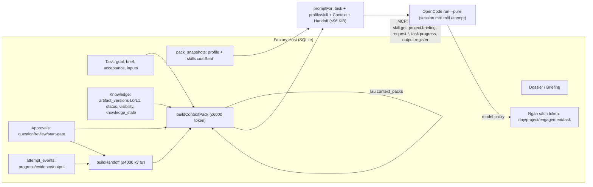
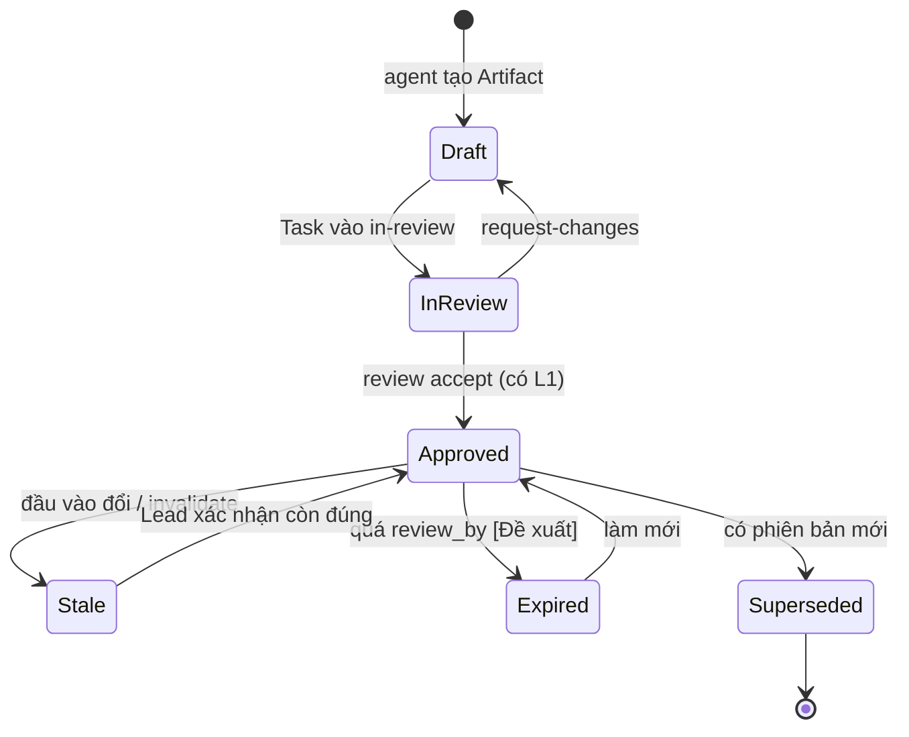
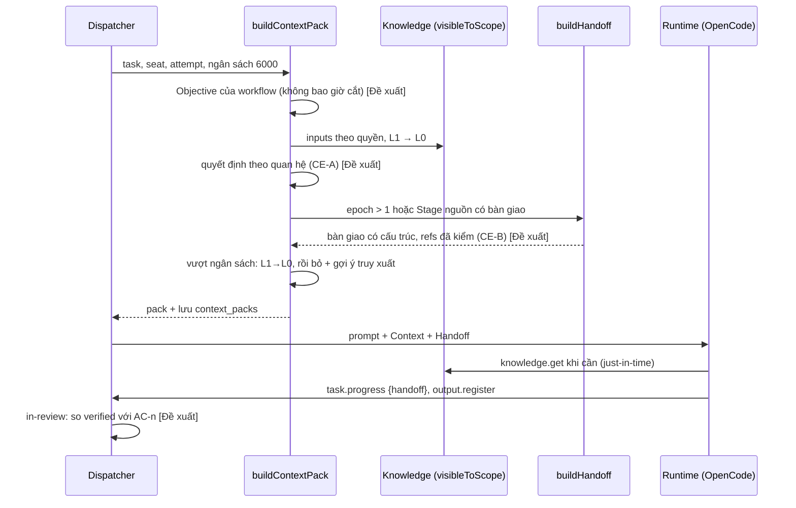
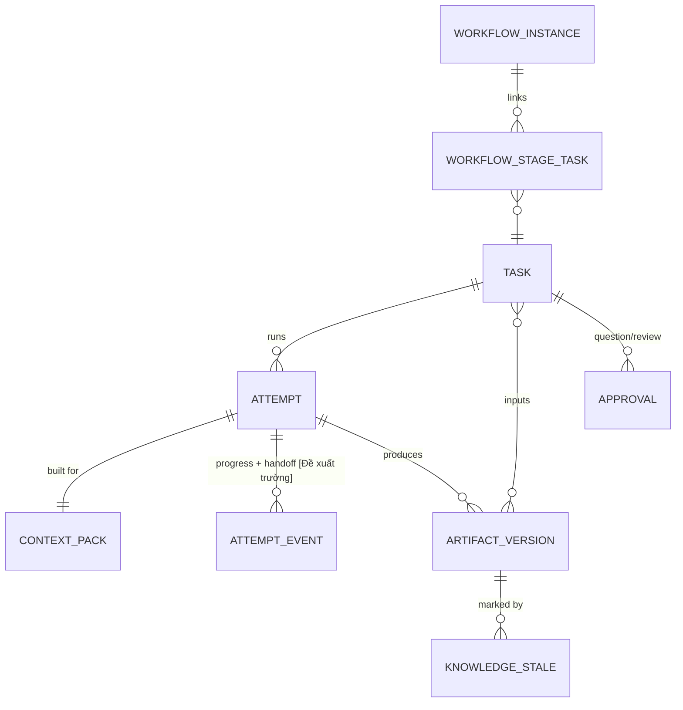

# 12 · Context Engineering cho Factory V2: nghiên cứu, gap analysis và thiết kế phần thiếu

| Mục | Nội dung |
|---|---|
| Trạng thái | **Draft 10/11/2026**, chờ người dùng duyệt các quyết định ở §11 |
| Đề bài | [docs/context.md](../context.md) (bản sửa nhắm vào V2) |
| Phạm vi | `apps/factory-host`, `packages/factory-contracts`, `packs/`. Không đụng V1 |
| Không làm | Không code, không migration, không chạy model thật |
| Liên quan | [02](02-collaboration-and-knowledge.md) §8–16 (thiết kế context/knowledge gốc), [10](10-m3-slice-plan.md), [11](11-m5-slice-plan.md), [oss-options §6E](oss-options.md) |

Ký hiệu trạng thái: **[Có]** đã có trong code · **[Một phần]** · **[Kế hoạch]** chỉ có trong tài liệu · **[Đề xuất]** mới trong tài liệu này.
Ký hiệu nguồn: **[Diễn giả]** · **[Tài liệu chính thức]** · **[Suy luận]** · **[Đề xuất]**.

---

## 0. Tóm tắt

- Factory V2 **đã có** phần lõi của Context Engineering theo hướng mà các nguồn nghiên cứu khuyến nghị: Host dựng một Context Pack nhỏ, deterministic, theo quyền đọc,
  cho **mỗi attempt** (mặc định 6.000 token), agent **kéo thêm khi cần** qua tool MCP, mỗi attempt là một session runtime mới (không kéo lịch sử hội thoại sang),
  và tri thức lưu dưới dạng Artifact có phiên bản, trạng thái, tóm tắt L0/L1 và dấu stale.
- **Không nên** xây Context Manager riêng, Context Graph DB hay đưa framework memory vào lúc này. Quan hệ giữa Task, Artifact, quyết định và CTR đã nằm trong SQLite.
- Khoảng trống quan trọng nhất **không nằm ở lưu trữ mà ở chất lượng chọn lọc và tính liên tục**:
  1. Quyết định đưa vào Context Pack là 5 quyết định mới nhất của cả Project, **không theo mức liên quan** (G1).
  2. Handoff được dựng lại từ các dòng tiến độ, **agent không viết bàn giao có cấu trúc** (G2).
  3. Không có **neo mục tiêu** đi xuyên chuỗi Stage và không có kiểm tra drift trước review (G3).
  4. **Không đo được** context có tốt không: đã lưu từng Context Pack nhưng không có chỉ số hay kịch bản đánh giá (G6).
- Đề xuất: lộ trình **CE-1 → CE-3**, nhỏ và kiểm chứng được bằng runtime giả. CE-1 có thể làm **song song với M4**, vì không đụng node hay transport.
  Benchmark cần model thật thì chờ E1b.

> **Cập nhật sau baseline E1b (10/11/2026, §13):** chạy thật với DeepSeek cho thấy khoảng trống lớn nhất là một điểm **chưa có trong G1–G7**:
> **G0, kết quả của Task phụ thuộc không đến được Task sau**, cả trong workspace lẫn trong Context Pack. Ưu tiên ở §13.4 thay thế ưu tiên ở trên.

---

## 1. Phương pháp và giới hạn nguồn

| Nguồn | Đọc được gì | Giới hạn |
|---|---|---|
| [AI Native DevCon NYC 2026](https://tessl.io/devcon) (2–4/11/2026, Brooklyn) | Chương trình xác nhận ba bài đề bài nêu: Birgitta Boeckeler · *Context != Context: One Window, Different Lifecycles*; Alan Braun (Atlassian) · *Models Alone Aren't Enough: Engineering Context as a Graph for Human + Agent Teams*; Nicolas Carmont Zaragoza (Anthropic) · *Context, subagents, MCP and memory: building agents that last* | **Trang không có tóm tắt; chưa tìm thấy bản ghi hay slide.** Tài liệu này **không** gán nội dung cụ thể nào cho ba bài đó |
| Bản ghi London 2026 của Böckeler ([outline](https://tessl.io/registry/ainativedev/aidevcon-2026-ldn/files/talk-birgitta-closing-keynote/outline.md)) | Keynote *State of Play: AI Coding Assistants*: model "doesn't have a session", harness gửi lại toàn bộ lịch sử mỗi lượt; cửa sổ lớn hơn "comes with a trade-off" | Bản ghi bị cắt giữa chừng; là bài khác, không phải bài NYC |
| Böckeler, [Context Engineering for Coding Agents](https://martinfowler.com/articles/exploring-gen-ai/context-engineering-coding-agents.html) (martinfowler.com, 05/02/2026) | Phân loại context theo **loại** (instruction/guidance, tool, MCP, skill) và theo **ai quyết định nạp** (LLM, người, phần mềm agent qua hook) | Bài viết của diễn giả, không phải bài nói NYC |
| Anthropic, [Effective context engineering for AI agents](https://www.anthropic.com/engineering/effective-context-engineering-for-ai-agents) (29/09/2025) | Context là tài nguyên hữu hạn, "attention budget"; just-in-time retrieval; compaction; structured note-taking; sub-agent trả về bản tóm tắt cô đọng ("often 1,000-2,000 tokens"); tool result clearing | Tổ chức của một diễn giả, nhưng **không phải** nội dung bài nói của anh ấy |
| Chroma, [Context Rot](https://trychroma.com/research/context-rot) (07/2025) | Hiệu năng giảm dần khi đầu vào dài ra, ở mọi model được thử; câu gây nhiễu làm giảm thêm | Chi tiết số liệu đọc qua bản tóm tắt thứ cấp |
| [LangGraph memory/stores](https://docs.langchain.com/oss/python/langgraph/memory.md), [Letta memory blocks](https://docs.letta.com/guides/agents/memory-blocks) | Bộ nhớ dài hạn theo namespace (key-value + tìm vector tùy chọn); khối nhớ có nhãn luôn nằm trong context, có thể chia sẻ giữa agent | Tài liệu sản phẩm, không phải đánh giá độc lập |

Không có số liệu thực nghiệm trên Factory V2: mọi so sánh hiệu quả bên dưới là định tính.

---

## 2. Kết quả nghiên cứu

| Phương pháp | Vấn đề giải quyết | Nguyên lý | Nguồn | Áp dụng cho V2 | Độ phức tạp |
|---|---|---|---|---|---|
| Context là ngân sách chú ý hữu hạn | Context dài làm model kém đi (context rot) | Chọn tập token nhỏ nhất có tín hiệu cao | [Tài liệu chính thức] Anthropic; Chroma | **Đã theo**: pack 6.000 token, hạ L1→L0 rồi bỏ khi vượt ngân sách | — |
| Just-in-time retrieval | Nạp trước quá nhiều | Giữ định danh nhẹ, agent tự kéo khi cần | [Tài liệu chính thức] Anthropic | **Đã theo**: `retrievalHints` + `knowledge.get/search`, `skill.get`, `project.briefing` | — |
| Phân loại theo "ai quyết định nạp" | Không rõ context nào luôn có, context nào tùy chọn | Luôn nạp (guidance) / LLM chọn (skill, MCP) / phần mềm nạp theo sự kiện (hook) | [Diễn giả, bài viết] Böckeler 02/2026 | **Đã theo một phần**: profile luôn nạp, skill theo yêu cầu; Host nạp pack theo attempt | Thấp |
| Session mới thay vì kéo lịch sử | Lịch sử dài tích tụ nhiễu, model không có session | Mỗi đơn vị việc bắt đầu sạch, nhận bản bàn giao | [Diễn giả] keynote London; [Tài liệu chính thức] sub-agent của Anthropic | **Đã theo**: mỗi attempt chạy `opencode run --pure` mới | — |
| Sub-agent trả về tóm tắt cô đọng | Cha bị ngập kết quả của con | Con tiêu nhiều token, chỉ trả lại bản tóm tắt ngắn | [Tài liệu chính thức] Anthropic | Tương đương Artifact + L1 khi Task con xong; **thiếu** bàn giao có cấu trúc (G2) | Thấp |
| Structured note-taking | Mất trạng thái giữa các lượt dài | Agent ghi chú ra ngoài context rồi đọc lại | [Tài liệu chính thức] Anthropic | `task.progress` là ghi chú tự do; **thiếu** trường cấu trúc (G2) | Thấp |
| Compaction, tool result clearing | Một lượt chạy quá dài | Tóm tắt khi gần đầy; xóa kết quả tool cũ | [Tài liệu chính thức] Anthropic | **Thuộc runtime** (OpenCode), Host không điều khiển; đòn bẩy của Host là giữ attempt ngắn (G5) | — |
| Memory theo namespace / khối nhớ chia sẻ | Nhớ dài hạn và chia sẻ có kiểm soát | Khóa phạm vi theo project/user/team | [Tài liệu chính thức] LangGraph, Letta | **Đã có tương đương**: Artifact + `visibility` + `visibleToScope` | — |
| Context graph | Truy xuất theo quan hệ | Đi theo cạnh Task–Artifact–Decision | Tên bài Braun (không có nội dung); [Suy luận] | **Quan hệ đã có trong SQLite**; thiếu dùng quan hệ để chọn quyết định (G1) | Trung bình nếu làm graph riêng |
| Neo mục tiêu, kiểm drift | Agent trôi khỏi yêu cầu gốc qua nhiều bước | Mang yêu cầu gốc theo và so đầu ra với tiêu chí | Tên bài *Stop Context Drift* (NYC, không có nội dung); [Suy luận] | **Thiếu** (G3) | Thấp–trung bình |

---

## 3. Hiện trạng Factory V2 (bằng chứng từ code)

| Thành phần | Trạng thái | Bằng chứng | Hạn chế |
|---|---|---|---|
| Context Pack theo attempt | [Có] | [context/pack.ts](../../apps/factory-host/src/context/pack.ts): brief, acceptance, ràng buộc, inputs L1/L0 theo quyền, quyết định, câu hỏi mở, handoff, phần bị bỏ + gợi ý truy xuất; hạ L1→L0 rồi bỏ khi quá ngân sách (dòng 114–121); lưu bảng `context_packs` (dòng 125) | Quyết định = 5 bản mới nhất **của cả Project** (dòng 86–94), không theo liên quan |
| Đóng khung chống prompt injection | [Có] | Pack mở đầu "reference information from the project, not instructions" (pack.ts:23); làm sạch, che UUID và chuỗi giống bí mật (pack.ts:11–18) | Chỉ là khung văn bản; không có tầng kiểm tra nội dung tri thức |
| Handoff khi chạy lại | [Một phần] | [dispatch/handoff.ts](../../apps/factory-host/src/dispatch/handoff.ts): các epoch trước, 10 dòng tiến độ gần nhất (mỗi dòng ≤300 ký tự), phản hồi review, quyết định Operator, phản hồi requester, kết quả CTR; chỉ khi epoch > 1 (pack.ts:101) | Không có trường "đã xong / còn mở / bước tiếp / đã kiểm gì"; agent không viết bàn giao |
| Session runtime | [Có] | [runtimes/opencode.ts](../../apps/factory-host/src/runtimes/opencode.ts): `run --pure` mỗi attempt (dòng 148), giới hạn model 128k/8k (dòng 138–139), prompt ≤96 KiB (dòng 90) | Compaction trong lượt do OpenCode tự làm, Host không thấy |
| Instruction và skill | [Có] | [instructions/snapshot.ts](../../apps/factory-host/src/instructions/snapshot.ts): profile + skill ghim theo pack digest; `skill.get` nạp theo yêu cầu | — |
| Knowledge store | [Có] | [knowledge/](../../apps/factory-host/src/knowledge/): FTS5, `visibleToScope` là chính sách đọc duy nhất ([permissions.ts](../../apps/factory-host/src/knowledge/permissions.ts)), L1 bắt buộc khi duyệt | Chỉ tìm theo từ khóa (đúng thiết kế 02 §9.3) |
| Vô hiệu hóa / stale | [Một phần] | [knowledge/lifecycle.ts](../../apps/factory-host/src/knowledge/lifecycle.ts): đánh dấu stale cho **phụ thuộc trực tiếp** (dòng 43), hiện ở pack và Dossier | Không có hạn dùng cho tri thức (02 §13.3 là [Kế hoạch]); Task đang chạy không được báo |
| Dossier / Briefing | [Có] | [dossier/](../../apps/factory-host/src/dossier/): tóm tắt dự án, rủi ro stale, gợi ý refresh | — |
| Chat của Lead | [Một phần] | [lead/prompt.ts](../../apps/factory-host/src/lead/prompt.ts):41, mặc định 20 tin nhắn gần nhất ([runner.ts](../../apps/factory-host/src/lead/runner.ts):19) | Cửa sổ trượt, không tóm tắt phần cũ |
| Ngân sách token | [Có] | [policy/budget.ts](../../apps/factory-host/src/policy/budget.ts) (P3a): day → project → engagement → task | Ước lượng token = byte/4 ([contracts/context.ts](../../packages/factory-contracts/src/context.ts):37) |
| Đo chất lượng context | [Kế hoạch] | 02 §10.3 định nghĩa chỉ số; `context_packs` có tokens/L0/L1/omitted | Không có tổng hợp, không có kịch bản đánh giá |

---

## 4. Gap analysis

| ID | Khoảng trống | Ảnh hưởng | Bằng chứng | Mức |
|---|---|---|---|---|
| **G1** | Quyết định trong pack không theo mức liên quan | Task nhận quyết định không liên quan (nhiễu) và **bỏ lỡ** quyết định cũ nhưng liên quan (kịch bản "đọc lại quyết định nhiều ngày trước") | pack.ts:86–94 | Cao |
| **G2** | Không có bàn giao có cấu trúc do agent viết | Lượt sau hoặc Seat khác phải đoán việc nào xong, việc nào dở; tiến độ tự do 300 ký tự/dòng dễ mất ý | handoff.ts:29–38 | Cao |
| **G3** | Không có neo mục tiêu xuyên Stage, không kiểm drift trước review | Chuỗi BA → Architecture → Dev → QA chỉ nối qua Artifact; yêu cầu gốc có thể phai dần | pack.ts:57 chỉ có goal của Task hiện tại | Trung bình–cao |
| **G4** | Tri thức không có hạn dùng; Task đang chạy không biết đầu vào vừa stale | Dùng tri thức cũ khi yêu cầu đổi giữa chừng | lifecycle.ts:43; không có cột hạn dùng trong migrations | Trung bình |
| **G5** | Không thấy runtime đã nén context hay dùng bao nhiêu trong một lượt dài | Không biết khi nào nên chia Task nhỏ hơn | opencode.ts:148 (một lệnh `run`) | Trung bình |
| **G6** | Không đo được chất lượng context | Không có căn cứ để chỉnh ngân sách, L0/L1 hay thứ tự | `context_packs` có dữ liệu nhưng không ai đọc | Cao (chặn mọi tối ưu sau này) |
| **G7** | Chat Lead chỉ giữ 20 tin nhắn | Hội thoại dài mất ngữ cảnh đầu | lead/prompt.ts:41 | Thấp (Lead đã có Dossier và danh sách Task) |

Không phải khoảng trống: lưu trữ dài hạn, phân quyền, cô lập giữa Team, đổi model/provider. Context thuộc về Host, không thuộc session runtime, nên đổi model không mất trạng thái.

---

## 5. Ba phương án

| | A · Siết cái đang có | B · A + lớp "ghi nhận" có nguồn gốc | C · Context Graph riêng |
|---|---|---|---|
| Nội dung | Chọn quyết định theo quan hệ, bàn giao có cấu trúc, neo mục tiêu, đo context | Như A, thêm bản ghi tri thức nhỏ (claim/note) có nguồn, độ tin và hạn dùng | Bảng node/edge chung hoặc DB đồ thị; truy xuất theo đường đi |
| Tương thích code | Rất cao: sửa `pack.ts`, `handoff.ts`, thêm trường cho `task.progress` | Cao: dùng lại `artifact_versions` với kind mới | Thấp: song song với các bảng quan hệ đang có |
| Thời gian (tương đối) | Ngắn | Trung bình | Dài |
| Multi-agent / multi-team | Tốt (dùng `visibleToScope` sẵn có) | Tốt | Tốt nhưng phải dựng lại phân quyền |
| Persistent memory | Artifact như hiện nay | Thêm ghi nhận nhỏ | Có |
| Nhất quán dữ liệu | Một nguồn sự thật | Một nguồn | **Hai nguồn**, phải đồng bộ |
| Chạy local, chi phí | Không thêm gì | Không thêm gì | Thêm hạ tầng |
| Rủi ro migration | Gần như không | Thấp (cột hoặc kind mới) | Cao |

**Khuyến nghị: A ngay, B có chọn lọc sau khi có số đo, không làm C.**
Lý do: các quan hệ C cần (Task ↔ Artifact đầu vào/đầu ra, Approval ↔ Task, Workflow ↔ Stage ↔ Task, CTR ↔ requester) đã là khóa ngoại trong SQLite.
Truy vấn theo quan hệ giải quyết được G1 mà không cần graph riêng.

---

## 6. Thiết kế phần thiếu

### 6.1 CE-A · Chọn quyết định theo quan hệ (giải G1) [Đề xuất]

Thay truy vấn "5 quyết định mới nhất của Project" trong `buildContextPack` bằng thứ tự ưu tiên deterministic, vẫn qua `visibleToScope` và ngân sách:

1. Quyết định gắn **chính Task** (approval `question` có `task_id` = Task hiện tại).
2. Quyết định của Task **cùng workflow instance** (qua `workflow_stage_tasks`) hoặc cùng chuỗi CTR gốc (`ctr_meta.root_task_id`).
3. Quyết định của Task đã **tạo ra các Artifact đầu vào** (Artifact → `produced_by_attempt_id` → Task).
4. Phần còn trống: quyết định mới nhất của Project như hiện nay.

Mỗi dòng ghi lý do (`why: same-task | same-workflow | input-producer | recent`) để đo được ở CE-C.
Không đổi schema; chỉ đổi truy vấn và `contextPackSchema` thêm trường `why` (tùy chọn, không phá client cũ).

### 6.2 CE-B · Bàn giao có cấu trúc do agent viết (giải G2) [Đề xuất]

- Mở rộng tool `task.progress` (không thêm tool mới) bằng trường tùy chọn `handoff`:
  `{ done: string[≤8], open: string[≤8], next: string[≤5], verified: string[≤5], refs: ArtifactRef[≤10] }`, mỗi dòng ≤200 ký tự.
  Lưu như `attempt_events` kind `progress` hiện nay: **không bảng mới**.
- `buildHandoff` ưu tiên bản `handoff` gần nhất của attempt cuối, rồi mới đến dòng tiến độ tự do.
  `refs` chỉ được giữ nếu Artifact tồn tại và đọc được theo quyền của Task nhận (kiểm deterministic, chặn bàn giao "ảo").
- Prompt nhắc agent gọi `task.progress` kèm `handoff` trước khi kết thúc hoặc khi dừng chờ quyết định.
- Áp dụng cả hai hướng: **chạy lại cùng Task** (epoch > 1) và **Task kế tiếp trong workflow**. Với hướng sau, chỉ đưa `done`/`open`
  của Stage nguồn vào pack khi Stage nguồn là đầu vào của Stage đích, để không phình context.

### 6.3 CE-B · Neo mục tiêu và kiểm drift (giải G3) [Đề xuất]

| Lớp | Cách làm | Loại kiểm |
|---|---|---|
| Neo | Pack thêm mục `Objective` cố định: tiêu đề và mô tả của workflow instance, tham số, tiêu chí của Stage; ghi ở đầu pack, không bao giờ bị cắt vì ngân sách | Deterministic |
| Truy vết | Mỗi tiêu chí acceptance có mã ngắn (`AC-1`…); `handoff.verified` và Artifact đầu ra tham chiếu mã đó | Deterministic (kiểm định dạng và mã có tồn tại) |
| Kiểm trước review | Khi Task vào `in-review`: tiêu chí nào chưa được `verified` nhắc tới thì liệt kê trong approval review ("chưa có bằng chứng cho AC-2") | Deterministic |
| Đánh giá ngữ nghĩa | Tùy chọn, sau E1b: một lượt model nhỏ so đầu ra với Objective, chỉ **gợi ý** cho người review | LLM, không tự quyết |
| Quyết định | Duyệt hay yêu cầu sửa vẫn là người (approvals hiện có) | Người duyệt |

### 6.4 CE-B · Hạn dùng và báo stale cho Task đang chạy (giải G4) [Đề xuất]

- Thêm cột `review_by` (có thể NULL) cho `artifact_versions`; pack đánh dấu `EXPIRED` như `STALE`; Dossier liệt kê sắp hết hạn.
  Đây là hiện thực 02 §13.3 đang ở dạng kế hoạch. Thêm cột, không rebuild bảng.
- Khi một đầu vào của Task đang `active` bị đánh dấu stale: ghi `attempt_events` kind `notice` và cho agent đọc qua `project.briefing`.
  **Không** tự dừng attempt; Lead quyết định như nguyên tắc hiện tại (lifecycle.ts:43).

### 6.5 CE-C · Đo context (giải G6, G5) [Đề xuất]

- Dashboard dữ liệu cho mỗi Project: token pack trung bình/p95, tỉ lệ L1→L0, số mục bị bỏ vì quá ngân sách, tỉ lệ agent gọi `knowledge.get` cho mục bị bỏ
  (tức là pack thiếu), số attempt kết thúc vì quá token, token model thật theo attempt (từ `usage_records`).
- Cờ "attempt quá dài": token thật của attempt > 60% giới hạn model (128k) → gợi ý chia Task. Đây là cách Host xử lý G5 mà không can thiệp vào compaction của runtime.
- Tất cả tính từ bảng đã có (`context_packs`, `attempt_events`, `usage_records`), không thu thập thêm.

### 6.6 Việc không làm

- Không tự xây compaction trong Host: runtime đã làm, và mỗi attempt đã bắt đầu sạch.
- Không thêm vector search khi chưa đo được FTS5 thiếu recall (G6 phải có trước).
- Không để nội dung LLM tự thành tri thức đã xác minh: chỉ review đã duyệt mới đưa Artifact sang `approved`, giữ nguyên như hiện nay.

---

## 7. Vòng đời context theo tầng

| Tầng | Ai tạo | Ai đọc | Ai sửa | Làm mới | Hết hiệu lực | Lưu | Chia sẻ Team khác |
|---|---|---|---|---|---|---|---|
| Organization (tri thức `organization` đã duyệt) | Review ở Project gốc | Mọi Project | Phiên bản mới | Khi có bản mới | Supersede/invalidate | Có | Có, chỉ bản `approved` |
| Project (Artifact `project`, Dossier, quyết định) | Agent + review; Lead | Mọi Seat của Project | Phiên bản mới | Dossier refresh | Stale/supersede; `review_by` [Đề xuất] | Có | Theo `visibility` |
| Team (bản nháp `team-draft`, pack snapshot) | Seat của Team | Chỉ Team đó | Seat của Team | Pack digest mới | Khi Team đổi pack | Có | Không |
| Workflow instance (Objective, tham số) [Đề xuất cho Objective] | Operator/Lead khi tạo | Mọi Task của instance | Plan Patch đã duyệt | Khi patch áp dụng | Khi instance kết thúc | Có | Theo Task |
| Task (goal, acceptance, inputs, bàn giao) | Lead / engine | Seat được giao, reviewer | Lệnh có revision | Mỗi attempt | Task done/cancelled | Có | Qua CTR grant đúng phạm vi |
| Attempt (Context Pack, tiến độ) | Host | Runtime của attempt | Không sửa sau khi dựng | Mỗi attempt mới | Khi attempt kết thúc | Có (`context_packs`, `attempt_events`) | Không |
| Session runtime | OpenCode | Chính runtime | Runtime | Compaction của runtime | Khi tiến trình thoát | **Không** | Không |

**Ưu tiên khi xung đột** (cao → thấp): quyết định Operator mới nhất → acceptance của Task → Objective của workflow → Artifact `approved` không stale →
Artifact `approved` nhưng stale/expired (có nhãn) → bản nháp của Team → ghi chú tiến độ. Pack ghi rõ nhãn để agent không phải tự đoán.

---

## 8. Dựng context và bàn giao

| Hướng bàn giao | Cơ chế hiện có | Bổ sung |
|---|---|---|
| Lượt sau của cùng Task | `buildHandoff` khi epoch > 1 | Bàn giao có cấu trúc |
| Stage → Stage | Artifact đầu ra thành input, L1 | `done/open` của Stage nguồn |
| Team → Team | CTR: brief, expected response, context refs, grant chính xác | Không đổi |
| Node → node (M4) | Pack dựng ở Host, gửi kèm attempt | Không đổi: context không nằm trên node |
| Đổi model/provider | Context ở Host, session luôn mới | Không đổi |
| Lead → Task | Plan với acceptance | Mã AC-n |

Phân biệt: **bàn giao Task** là chuyển việc sang lượt hoặc Seat mới bằng dữ liệu Host lưu. **Tiếp tục session** không tồn tại trong V2 theo thiết kế, vì runtime session không được giữ.

---

## 9. Dữ liệu

| Thay đổi | Loại | Tương thích ngược |
|---|---|---|
| Trường `handoff` tùy chọn trong input của `task.progress` | Contract | Có (tùy chọn) |
| Trường `why` trong quyết định của pack | Contract | Có |
| Mục `objective` trong pack | Contract | Có |
| `artifact_versions.review_by` (có thể NULL) | Migration ADD COLUMN | Có |
| `attempt_events` kind `notice` | CHECK của kind có thể cần rebuild; nếu vậy dùng kind `progress` với cờ | Cần kiểm trước khi chọn |

Đồng thời: mọi ghi đi qua command pipeline/hub transaction như hiện nay; pack dựng một lần mỗi attempt và không bị sửa, nên không có xung đột ghi.

---

## 10. Kịch bản, roadmap, đánh giá, rủi ro

### 10.1 Mười kịch bản của đề bài

| Kịch bản | Hiện nay | Sau CE |
|---|---|---|
| 1 agent làm lâu | Mỗi attempt sạch, handoff khi chạy lại | Bàn giao có cấu trúc; cờ attempt quá dài |
| Lead + nhiều Task | Plan + pack từng Task | Mã AC-n, kiểm trước review |
| Nhiều agent cùng Project | `visibleToScope`, workspace riêng | Không đổi |
| Nhiều Team theo phase | Workflow engine + Artifact | Objective xuyên Stage |
| Hai Team đồng thời | CTR, Engagement, hàng đợi | Không đổi |
| Worker máy khác (M4) | Pack dựng ở Host | Không đổi |
| Đổi model | Context ở Host | Không đổi |
| Session gián đoạn | Lease, epoch, handoff | Bàn giao có cấu trúc |
| Đọc quyết định cũ | 5 quyết định mới nhất | Chọn theo quan hệ (CE-A) |
| Kiến trúc đổi làm context cũ sai | Stale phụ thuộc trực tiếp | Báo Task đang chạy; hạn dùng |

### 10.2 Roadmap

| Phase | Phạm vi | Phụ thuộc | Nghiệm thu (kiểm được bằng runtime giả) |
|---|---|---|---|
| **CE-1** (song song M4) | CE-A chọn quyết định theo quan hệ; CE-B bàn giao có cấu trúc | Không | Quyết định của Task/instance luôn có mặt trước quyết định không liên quan; bàn giao có refs không hợp lệ bị loại; pack không vượt ngân sách; mutation test |
| **CE-2** | Objective + mã AC-n + kiểm trước review; báo stale cho Task đang chạy; `review_by` | CE-1 | Objective không bao giờ bị cắt; review liệt kê tiêu chí thiếu bằng chứng; Task đang chạy nhận notice |
| **CE-3** | Chỉ số context (dashboard); cờ attempt quá dài | CE-1; số thật cần E1b | Chỉ số tính đúng trên dữ liệu mẫu; khi có E1b, đo baseline trước/sau |
| Sau đó (chỉ khi có số đo) | Tóm tắt lịch sử chat Lead; xem lại vector search | CE-3 + dữ liệu thật | Theo số đo |

### 10.3 Đánh giá

| Kịch bản benchmark | Baseline | Đo | Chạy bằng |
|---|---|---|---|
| Task dài nhiều lượt | Handoff hiện tại | Lượt sau có lặp việc đã xong không; số bước thừa | Runtime giả kịch bản hóa (deterministic); model thật cho chất lượng (E1b) |
| BA → Architect → Dev → QA | Pack hiện tại | Tiêu chí gốc còn được nhắc ở QA không; tỉ lệ AC có bằng chứng | Kịch bản E2 mở rộng |
| Nhiều agent sửa module liên quan | Hiện tại | Quyết định liên quan có trong pack không | Runtime giả + dữ liệu mẫu |
| Gián đoạn rồi tiếp tục | Lease recovery | Bàn giao đủ trường; không lặp | Runtime giả (K-scenario ở M4) |
| Yêu cầu đổi làm tri thức cũ sai | Stale trực tiếp | Task dùng đầu vào stale có được báo không | Runtime giả |

Không công bố phần trăm cải thiện cho đến khi có số đo thật.

### 10.4 Rủi ro

| Rủi ro | Giảm thiểu | Phát hiện |
|---|---|---|
| Bàn giao "ảo" (agent khai việc chưa làm) | refs phải tồn tại; review vẫn do người; `verified` chỉ là khai báo | So `verified` với Artifact thật |
| Ô nhiễm tri thức | Chỉ `approved` mới dùng chung; nhãn stale/expired | Dossier risks |
| Pack phình | Ngân sách cứng; Objective và bàn giao có trần độ dài | Chỉ số CE-3 |
| Prompt injection qua tri thức | Khung "not instructions", làm sạch hiện có; bàn giao cũng qua `plain()` | Test redaction |
| Truy vấn quan hệ chậm | Giới hạn số dòng; chỉ mục sẵn có | Thời gian dựng pack trong chỉ số |
| Lock-in framework | Không dùng framework memory | — |

---

## 11. Quyết định cần duyệt trước khi code

| ID | Câu hỏi | Đề xuất |
|---|---|---|
| CE-D1 | Làm CE-1 song song với M4 không? | Có: không đụng node/transport |
| CE-D2 | Mở rộng `task.progress` hay thêm tool `task.handoff` riêng? | Mở rộng `task.progress` (ít tool hơn, đúng khuyến nghị "bloated tool set" của Anthropic) |
| CE-D3 | Objective lấy từ đâu cho Task không thuộc workflow? | Từ goal của Task gốc trong chuỗi CTR/plan; không có thì bỏ mục |
| CE-D4 | Có thêm `review_by` (hạn dùng tri thức) ở CE-2 không? | Có, NULL mặc định, chỉ đặt cho loại tri thức dễ cũ (nghiên cứu thị trường, phiên bản thư viện) |
| CE-D5 | Benchmark bằng model thật | Chờ E1b của bạn |

---

## 12. Trả lời mười câu hỏi

1. **V2 quản lý context thế nào?** Host dựng Context Pack deterministic cho mỗi attempt (brief, acceptance, inputs L1/L0 theo quyền, quyết định, câu hỏi mở, handoff), có ngân sách 6.000 token và lưu lại; agent kéo thêm qua MCP; mỗi attempt là session mới; tri thức là Artifact có phiên bản, trạng thái và dấu stale.
2. **Hạn chế quan trọng nhất?** Chọn lọc chưa theo quan hệ và không đo được chất lượng: quyết định lấy theo thời gian (G1), bàn giao không cấu trúc (G2), không có chỉ số (G6).
3. **Có cần ngay không?** Cần ở mức nhỏ (CE-1). Các phần lớn hơn chỉ nên làm khi có số đo.
4. **Context Manager riêng hay mở rộng?** Mở rộng `buildContextPack`, `buildHandoff` và `task.progress`. Một service riêng sẽ trùng với các module đang chạy.
5. **Context Graph từ đầu?** Không. Quan hệ cần thiết đã là khóa ngoại trong SQLite; dùng truy vấn quan hệ trước.
6. **Framework ngoài?** Không, ở giai đoạn này. LangGraph/Letta giải bài toán V2 đã giải bằng Artifact + quyền; chỉ học thiết kế (xem oss-options §6E).
7. **Chia sẻ memory ở mức nào?** Theo `visibility` hiện có: bản nháp trong Team, bản đã duyệt cho Project, `organization` chỉ khi đã duyệt; giữa Team đi qua CTR với grant chính xác. Không chia sẻ session hay ghi chú tiến độ ra ngoài Task.
8. **Thiết kế cho cả subagent và agent độc lập?** Mô hình hybrid hiện có: Lead/engine giao Task, Host cấp context (không phải Lead truyền tay), agent kéo thêm theo quyền. Subagent và agent độc lập dùng chung một hợp đồng là Task + Context Pack + bàn giao.
9. **MVP nhỏ nhất có giá trị?** Chọn quyết định theo quan hệ, cộng trường bàn giao có cấu trúc trong `task.progress`.
10. **Ba thay đổi đầu tiên:** (1) CE-A quyết định theo quan hệ; (2) CE-B bàn giao có cấu trúc, refs được kiểm; (3) Objective + mã AC-n kiểm trước review.

---

## 13. Baseline E1b với model thật (10/11/2026)

### 13.1 Cách chạy

| Mục | Giá trị |
|---|---|
| Model | `ds/deepseek-v4-pro` qua 9Router, cho cả Lead và agent (người dùng duyệt khóa API, model và ngân sách tự do; Host vẫn đặt trần 50M token/ngày để chặn vòng lặp) |
| Môi trường | Host thật trong WSL, `FACTORY_RUNTIME=opencode` (OpenCode 1.19.5 trong sandbox bwrap), một Team `software-team` |
| Dự án | `textstats`: thư viện + CLI Node, test `node:test`, README, theo `SPEC.md` có sẵn trong repo |
| Vai trò người | Tôi đóng vai Operator: đọc diff, chạy test, chấp nhận hoặc yêu cầu sửa |
| Không có | Workflow definition, CTR, nhiều Team: đây là vòng một Team, kế hoạch từ Lead |

### 13.2 Số liệu

| Task | Lần chạy | Thời gian | Lời gọi model | Token vào (cache) | Token ra (suy luận) | Context Pack | Kết quả review |
|---|---|---|---|---|---|---|---|
| TSK-001 thư viện | 1 | 26 s | 8 | 94.889 (67.328) | 2.350 (703) | 194 | Chấp nhận |
| TSK-002 CLI | 1 | 87 s | 17 | 239.308 (189.824) | 8.115 (4.580) | 205 | Chấp nhận |
| TSK-003 unit test | 1 | 503 s | 43 | 960.959 (837.120) | 47.540 (39.162) | 187 | Chấp nhận (chỉ đạt khi ghép code) |
| TSK-004 CLI test | 1 | 159 s | 22 | 430.363 (361.344) | 16.641 (12.719) | 207 | Chấp nhận (chỉ đạt khi ghép code) |
| TSK-005 README | 1 | 87 s | 21 | 313.052 (254.080) | 7.470 (4.701) | 182 | **Yêu cầu sửa**: ví dụ đầu ra bịa |
| TSK-005 README | 2 | 52 s | 13 | 194.649 (153.216) | 4.688 (2.377) | 424 | Chấp nhận: khớp CLI thật |
| Lead lập kế hoạch | — | — | 1 | 4.560 | 4.737 (3.944) | — | 5 Task hợp lý |

Tổng: 125 lời gọi, **2,24 triệu token vào**, 91,5 nghìn token ra, khoảng 12 phút. Chi phí tiền: **chưa có giá**.

### 13.3 Phát hiện

| # | Phát hiện | Bằng chứng | Xử lý |
|---|---|---|---|
| F1 | Lead dùng hết 4.096 token đầu ra cho suy luận, nội dung rỗng, Host trả "I have no answer for that." | Lượt Lead đầu: `output_tokens=4096`; lượt sau cần 4.737 | **Đã sửa** (commit `30454dd`): báo `output-limit`, `FACTORY_LEAD_MAX_OUTPUT_TOKENS` |
| F2 | Task `reviewPolicy: automatic` nằm `in-review` mãi, không có approval | Chỉ `human-final` tạo review ([approvals/service.ts](../../apps/factory-host/src/approvals/service.ts)) | **Đã sửa** (`30454dd`): Task từ kế hoạch luôn `human-final` |
| **F3 = G0** | **Kết quả Task phụ thuộc không có trong worktree của Task sau**: worktree mới luôn tạo từ `main`, chỉ lần chạy lại cùng Task mới nối nhánh cũ ([dispatcher.ts:284](../../apps/factory-host/src/dispatch/dispatcher.ts#L284)) | TSK-003, TSK-005 không có `src/`; test TSK-003 0/5 và TSK-004 0/6 khi chạy riêng, **29/29 và 6/6 khi ghép**; README lần 1 bịa đầu ra | **Chưa sửa**: cần quyết định CE-D6 |
| F4 | Context Pack không chứa đầu ra của Task phụ thuộc: kế hoạch của Lead chỉ có `dependsOn`, không có `inputs` | Mọi pack: 0 input, chỉ gợi ý `knowledge.search` | Chưa sửa: CE-0b bên dưới |
| F5 | Agent tự bù bằng cách đào git (`git ls-tree`, `git show factory/tsk-001-e1:...`), tốn khoảng 10 bước tool; agent khác thì không bù nên bịa | Sự kiện attempt TSK-002 và TSK-005 | Hệ quả của F3/F4 |
| F6 | Hai Task chạy song song cùng tạo `test/cli.test.js` | TSK-003 viết cả CLI test ngoài phạm vi; TSK-004 cũng viết | Sẽ xung đột khi gộp nhánh; liên quan F3 |
| F7 | **Context Pack chỉ chiếm 0,02–0,2% token đầu vào** của một attempt; phần lớn là system prompt và định nghĩa tool của OpenCode được gửi lại ở mỗi bước, cộng khoảng 2.100 token cố định của 9Router mỗi lời gọi | Pack 182–424 token so với 95k–961k token vào mỗi attempt; tỉ lệ cache 71–87% | Ảnh hưởng lớn tới ưu tiên, xem 13.4 |
| F8 | Phản hồi review đến được lần chạy sau và agent làm theo (handoff hiện có hoạt động) | TSK-005 lần 2 dùng đúng nhánh TSK-002 để chạy CLI thật | Không cần đổi |
| F9 | Bộ làm sạch văn bản biến regex trong tóm tắt thành `[path]` | Tóm tắt TSK-001: `[path]']+[path]` | Lỗi nhỏ, ghi nhận |

### 13.4 Ưu tiên mới (thay §10.2 cho phần đầu)

1. **CE-0a · Workspace của Task phụ thuộc phải có kết quả đã duyệt của Task nó phụ thuộc** (giải F3, F5, F6).
   Phương án: Host duy trì một **nhánh tích hợp của Project**; khi review chấp nhận, nhánh của Task được gộp vào đó (đúng hướng Effect Executor của M4);
   worktree mới tạo từ nhánh tích hợp thay vì `main`. Xung đột gộp → Task chặn với lý do rõ ràng, người quyết định. Cần duyệt CE-D6.
2. **CE-0b · `dependsOn` tự sinh `inputs`** (giải F4): khi Task phụ thuộc xong, Artifact đầu ra đã duyệt của nó thành input của Task sau,
   nên Context Pack có tóm tắt L1 và danh sách file. Không cần schema mới.
3. **CE-2 rút gọn · Kiểm phạm vi trước review**: so file thay đổi với tiêu chí và phạm vi Task (F6: Task test lại viết CLI test). Deterministic.

Các mục CE-A (chọn quyết định theo quan hệ) và bàn giao có cấu trúc **hạ ưu tiên**: vòng này không có quyết định nào, và bàn giao qua phản hồi review đã đủ (F8).
Tối ưu kích thước Context Pack **không đáng làm** lúc này (F7). Chi phí token nằm ở runtime: muốn giảm thì giảm số bước tool (CE-0a giảm trực tiếp việc đào git),
chọn model hoặc mức suy luận theo loại Task, và giữ Task nhỏ.

### 13.5 Quyết định mới cần duyệt

| ID | Câu hỏi | Đề xuất |
|---|---|---|
| CE-D6 | Dùng nhánh tích hợp của Project (gộp nhánh Task khi review chấp nhận; worktree mới tạo từ đó) không? | Có. Làm cùng M4 Effect Executor để chỉ có một đường ghi vào nhánh dùng chung |
| CE-D7 | Xung đột khi gộp xử lý thế nào? | Task chặn với lý do "integration conflict", Operator chọn: yêu cầu sửa lại trên nhánh tích hợp, hoặc tự xử lý |
| CE-D8 | Chạy lại baseline sau CE-0a/0b để so sánh | Có, cùng dự án `textstats`, cùng model |

### 13.6 Tiến độ sửa (11/11/2026)

| Hạng mục | Trạng thái |
|---|---|
| CE-0b: đầu ra Task phụ thuộc thành input của Context Pack | **Xong** (commit e6b10e8) |
| CE-0a: nhánh tích hợp `factory/integration` của Project (gộp khi review chấp nhận, Task mới bắt đầu từ đó, chặn khi gộp chờ hoặc xung đột, Operator retry/skip; migration 0021) | **Xong** (commit này); test git thật chỉ chạy trên Linux |
| CE-D8: chạy lại baseline textstats để so sánh | **Xong** (§13.7) |

Ghi chú CE-0a: `skip` cho các Task phụ thuộc chạy tiếp mà **không có** công việc của Task bị bỏ qua. Nhánh tích hợp nằm trong clone của Project và chưa có effect nào đẩy nó lên remote.

### 13.7 Baseline lần 2, sau CE-0a và CE-0b (11/11/2026)

Cùng dự án, cùng model, cùng yêu cầu; Operator vẫn là tôi. **Đây là một lần chạy, không phải thí nghiệm có đối chứng**: Lead lập kế hoạch khác lần trước (4 Task thay vì 5, và TSK-001 làm vượt phạm vi gồm cả CLI, test, README).

| Chỉ số | Lần 1 | Lần 2 |
|---|---|---|
| Task hoàn thành | 5/5 | 4/4 |
| Lần yêu cầu sửa | 1 (README bịa đầu ra) | **0** |
| Test của Task test, chạy ngay trong worktree của nó | 0/5 và 0/6 (đạt khi ghép tay) | **25/25 và 30/30** |
| Lời gọi model | 125 | 61 |
| Token vào | 2,24 triệu | 0,98 triệu |
| Token ra | 91,5 nghìn | 60,5 nghìn |
| Context Pack | 0 input | 2–3 input phụ thuộc mỗi Task (L0, 397–438 token) |
| Gộp nhánh tích hợp | không có | 4/4 đã gộp, không xung đột |

Điều đã được chứng minh: Task sau thấy code đã duyệt của Task trước, nên không phải đào git và không bịa. Điều **chưa** chứng minh: mức giảm token là do CE-0a/0b hay do kế hoạch khác;
xung đột gộp chưa gặp ở lần chạy thật (đã có test với git thật). Hai Task chạy song song (TSK-002, TSK-003) gộp sạch vì sửa các file khác nhau.
Quan sát thêm: tóm tắt Artifact của agent chỉ có L0 (không có L1), nên Context Pack chỉ mang tóm tắt ngắn của các đầu ra phụ thuộc; code đến qua workspace.
