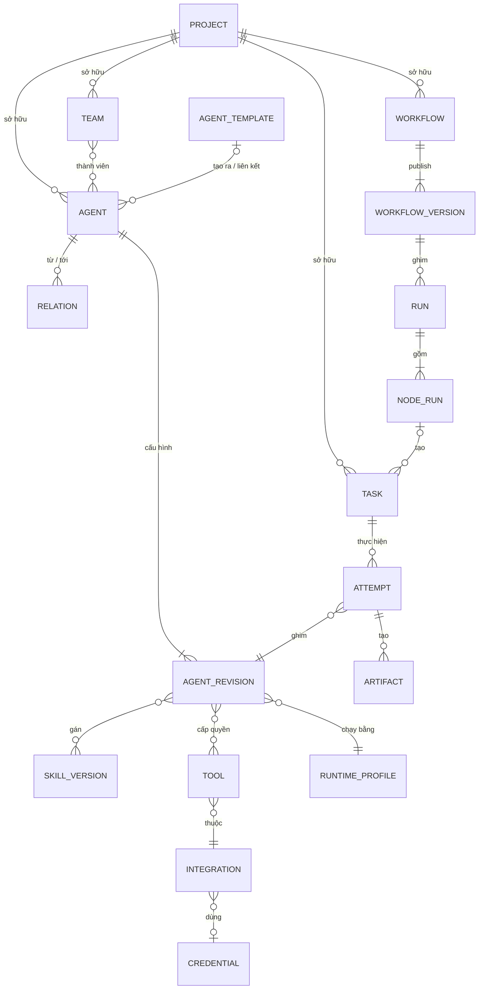
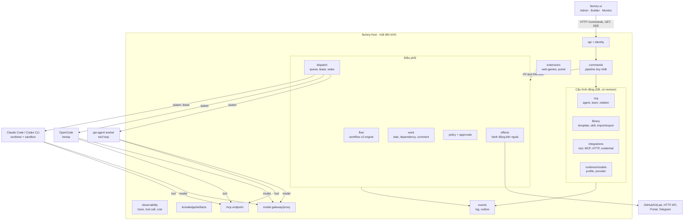
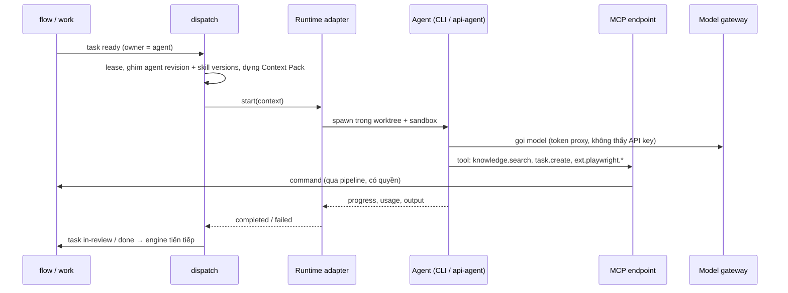

# 17 · Tái kiến trúc: Universal Multi-Agent Platform

| Mục | Giá trị |
|---|---|
| Trạng thái | **Đã duyệt 19/11/2026** (U-01..U-12 ở §15) |
| Ngày | 19/11/2026 |
| Baseline | commit `473dc12`, branch `feat/web-game-factory` |
| Đề bài | "Master prompt" của người dùng ngày 19/11/2026: bỏ định hướng Game Studio / Software Factory, chuyển sang nền tảng đa agent tổng quát, cấu hình động theo project, có trình thiết kế workflow trực quan kiểu n8n và quản trị tổ chức agent kiểu Paperclip |
| Thay thế | Định hướng "web game factory với một workflow cố định" (14/11/2026) không còn là trọng tâm sản phẩm. Nguyên tắc P1, P4–P8 của [05](05-target-architecture.md) §5.2 **giữ nguyên** |
| Không làm trong tài liệu này | Viết code, đổi schema, xóa tính năng |

**Nhãn:** **[Hiện có]** có trong source tại baseline. **[Đề xuất]** chờ duyệt. **[Chưa xác minh]** giả định chưa kiểm.

---

## 0. Tóm tắt

1. **Không viết lại từ đầu.** Lõi Host hiện có (command pipeline, event log/SSE, attempt có lease/epoch, worktree, runtime adapter, sandbox, MCP endpoint, approval, policy, effect executor, kho artifact) đã đúng hướng và là phần khó nhất. Thứ cần thay là **nguồn cấu hình** (pack trên đĩa) và **mô hình workflow** (stage cố định).
2. **Agent, Team, Skill, Tool, Integration, Workflow chuyển vào DB**, có schema, revision và API; quản trị hoàn toàn trên UI. Thư mục `packs/` chỉ còn là **định dạng import/export template**, Host không đọc pack lúc chạy.
3. **Project-centric:** mỗi project có danh sách agent riêng (0..n team, quan hệ tùy ý). Agent tái dùng giữa project bằng **Agent Template** (sao chép hoặc liên kết có ghim revision); trạng thái, phiên, bộ nhớ, quyền luôn tách theo project.
4. **Workflow v2 dạng đồ thị node** (Trigger, Agent, Action, Condition, Parallel, Join, Approval, Loop, Sub-workflow, Orchestrate, Output), chạy bằng **engine xác định có trạng thái thật** trong Host: pause, resume, retry từ node, timeout, cancel, khôi phục sau khi Host khởi động lại.
5. **Hai chế độ trên cùng một engine:** luồng cấu hình sẵn (Structured) và node **Orchestrate**, nơi một agent có quyền giao việc tự phân rã nhiệm vụ trong giới hạn ngân sách, độ sâu và danh sách agent được phép (Dynamic).
6. **Execution Layer tách bạch:** Agent ≠ Runtime ≠ Skill ≠ Tool ≠ MCP. Thêm runtime **`api-agent`** (vòng lặp tool-calling qua model gateway, không cần CLI) để agent nghiên cứu, marketing, viết báo cáo chạy được mà không cần shell.
7. **Agent cộng tác thật qua tool của Host:** giao task, phụ thuộc, bình luận, yêu cầu phản biện, đề xuất thêm agent. Mọi thao tác đi qua command pipeline, có quyền, có giới hạn và để lại vết.
8. **Truy vết đầu-cuối:** yêu cầu → run → node run → task → attempt → tool call → artifact, cùng chi phí ở từng tầng.
9. **Tính năng game** (pack Web Games, Portal publish, Portal ops, preview, Văn phòng, Thế giới 3D) **giữ lại, không xóa**, chuyển thành extension và màn hình phụ.
10. Lộ trình 9 mốc **U0–U8** (§13). Mỗi mốc giữ project game hiện có chạy được (cổng hồi quy).

---

## 1. Đánh giá hiện trạng

### 1.1 Những chỗ đang bị cứng hóa [Hiện có]

| # | Vấn đề | Bằng chứng |
|---|---|---|
| H1 | Team chỉ sinh ra từ pack trên đĩa; không có lệnh tạo team | [org/service.ts:37](../../apps/factory-host/src/org/service.ts#L37) `ensureTeamFromPack`; [contracts/org.ts:25](../../packages/factory-contracts/src/org.ts#L25) "the MVP has no teams.create command" |
| H2 | Profile, skill, tool, capability của seat đọc từ manifest pack đã chụp, không sửa được qua API. Mọi seat trong team nhận **toàn bộ** skill của pack | [instructions/snapshot.ts:23](../../apps/factory-host/src/instructions/snapshot.ts#L23) `pinnedSeat`, `getSeatInstructions` dòng 48 |
| H3 | Chỉ runtime/CLI/model/effort/permission của seat là chỉnh được trên UI | migration `0025_seat_runtime_config.sql` |
| H4 | Chọn người làm có luật theo **tên seat của software-team** (`Test`, `FE`, `DevOps`, `BA`, `PM`, mặc định `BE`) | [dispatch/seats.ts:24](../../apps/factory-host/src/dispatch/seats.ts#L24), dòng 10–16 và 60 |
| H5 | Workflow chỉ đến từ file JSON trong pack, mô hình **stage → task theo capability**; condition/gate/join/rework là thuộc tính phụ của stage, không phải node | `packages/factory-contracts/src/workflow.ts` `workflowDefinitionSchema` |
| H6 | Lead chat mã hóa sẵn quy trình game (`design/rules/art/client`) | [lead/protocol.ts:6](../../apps/factory-host/src/lead/protocol.ts#L6) `leadGameSchema` |
| H7 | Một team dùng chung cho nhiều project (team "Web Games" phục vụ mọi project game); team "đi theo" pack khi khởi động | [host.ts:438](../../apps/factory-host/src/host.ts#L438) `FACTORY_PACK_FOLLOW` |
| H8 | Agent không có tool giao việc cho agent khác trong project. Tool MCP hiện có: `knowledge.*`, `request.*` (xuyên team), `task.progress`, `task.propose`, `output.register`, `criterion.report`, `decision.request`, `skill.get`, `workflow.patch`, `notify.send-internal`, `project.briefing` | `apps/factory-host/src/mcp/tools.ts` |
| H9 | Runtime `api-agent` có trong CHECK của DB nhưng **chưa có adapter**; agent nào cũng phải chạy qua CLI (Claude Code, Codex) hoặc OpenCode | migration `0001_core.sql` dòng 133; `src/runtimes/` |
| H10 | MCP server ngoài khai báo bằng file env `FACTORY_MCP_SERVERS_FILE`; không có kho credential, không kiểm kết nối từ UI | [host.ts:239](../../apps/factory-host/src/host.ts#L239) |
| H11 | Các module chỉ phục vụ game nằm trong lõi: `games`, `publish`, `portalops`, `preview`; UI: `GamePanel`, `NewGameDialog`, `PortalGames`, `world/`, `office/orderGameSeats.ts` | `apps/factory-host/src/`, `apps/factory-ui/src/screens/` |
| H12 | Repo không có test tự động; engine workflow mới sẽ khó giữ đúng nếu thiếu test | CLAUDE.md |

### 1.2 Giữ, refactor hay thay [Đề xuất]

| Thành phần | Đánh giá | Quyết định |
|---|---|---|
| `commands` (pipeline, idempotency, revision), `events` (log, outbox, SSE), `storage`, `identity`, `api` | Đúng nguyên tắc P1, đã kiểm trong thực tế | **Giữ nguyên** |
| `dispatch` (attempt, lease/epoch, handoff, progress) | Phần lõi tốt; riêng `pickSeat` cứng hóa (H4) | **Giữ**, thay bộ chọn người làm bằng `AgentSelector` (§5.5) |
| `workspace` (worktree theo attempt), `sandbox`, `proxy`, `exec` | Cô lập tốt, model key không lọt ra agent | **Giữ** |
| `runtimes` (`RuntimeAdapter`, local CLI, OpenCode) | Interface gọn | **Mở rộng**: descriptor, kiểm môi trường, resume phiên, adapter `api-agent` (§7) |
| `mcp` (endpoint + policy) | Đúng mô hình "identity lấy từ attempt" | **Giữ**; policy đọc grant từ DB; thêm tool cộng tác (§9) |
| `mcp-external` | Cấu hình bằng file | **Refactor** thành registry Integration trong DB (§6.3) |
| `org` | Cấu trúc bảng dùng được, nguồn cấu hình sai (H1–H3, H7) | **Refactor**: cấu hình chuyển vào DB, giữ `teams`/`seats`/`engagements` làm khung thực thi (§5.6) |
| `instructions/snapshot` | Gắn chặt pack | **Thay** bằng agent revision + skill registry; bảng `pack_snapshots` giữ cho lịch sử |
| `workflow` v1 (stage engine, patch) | Không biểu diễn được node, nhánh, vòng lặp tổng quát | **Đóng băng** cho instance đang chạy; **thay** bằng engine v2 (§8); chuyển đổi định nghĩa cũ |
| `lead` | Runner và gateway dùng tốt; protocol game cứng (H6) | **Tổng quát hóa** thành chat với bất kỳ agent nào + node Orchestrate; protocol game chuyển sang extension |
| `work`, `approvals`, `standing`, `policy`, `effects`, `knowledge`, `artifacts`, `documents`, `context`, `dossier`, `schedule`, `automation`, `notify`, `backup` | Tổng quát, không gắn domain | **Giữ**, nối vào engine v2 |
| `requests` (Cross-Team Request) | Thiết kế cho team dùng chung giữa project | **Giữ, thu hẹp**: dùng cho yêu cầu xuyên project; trong project dùng giao việc trực tiếp (§9) |
| `games`, `publish`, `portalops`, `preview` + UI Văn phòng, Thế giới 3D, Game panel | Đang được dùng | **Giữ chức năng, không xóa**; chuyển thành extension "Web Games" (template + action node `portal.publish`) và màn hình phụ (§11.3) |
| `packs/*` | Dữ liệu tốt (profile, skill, workflow) | **Thành template import/export**; không còn được đọc lúc chạy |

---

## 2. Bài học từ Paperclip và n8n

Nguồn: README và docs của `paperclipai/paperclip` (MIT) và `n8n-io/n8n` (Sustainable Use License), đọc ngày 19/11/2026; tham khảo thêm [oss-options](oss-options.md) §2. Các điểm chưa đọc được nguồn gốc ghi rõ là chưa xác minh.

### 2.1 Paperclip

| Học | Không học |
|---|---|
| Agent có trạng thái `active / idle / running / error / paused / terminated / pending_approval`; board có thể pause, resume, terminate, reassign | **Một cây báo cáo duy nhất** (`reports_to`): mỗi agent đúng một cấp trên, quản lý bị pause thì đứt đường leo thang |
| **Wakeup queue có gộp** (coalescing) lưu trong DB; đánh thức theo assignment, review, comment, lịch, "Run now" | Không có workflow engine xác định: routine chỉ tạo một issue mỗi lần kích hoạt; dependency chỉ là blocker link |
| **Checkout nguyên tử**: một assignee, execution lock | Không có trình thiết kế quy trình trực quan |
| **Phiên được giữ giữa các lần chạy** (`sessionCodec`: serialize/deserialize, "Reset Sessions") | Ngân sách chặn sau sự việc: "in-flight work can delay a stop" |
| Adapter có `testEnvironment()`, `models`, `agentConfigurationDoc`; trả usage, cost, session trong kết quả | Postgres + Node 24 (lệch stack SQLite + Node 22) |
| Hire agent qua approval; chặn giao việc vòng (`delegation_cycle`); không giao việc cho agent đang pause | Plugin còn alpha, nhiều tính năng sau cờ "Experimental" |
| Skill theo chuẩn `SKILL.md` + `references/`, `scripts/`, `assets/`; **mức tin cậy** `markdown_only < assets < scripts_executables`; ghim theo commit; `expectedVersionId` | |
| Quyền theo hành động của connector: **Allowed / Ask first / Off** | |
| Chi phí ghi theo từng lần gọi, gắn nhãn "Estimated / Unpriced"; 80% cảnh báo, 100% chặn | |
| Cấu hình agent có revision và rollback | |

### 2.2 n8n

| Học | Không học |
|---|---|
| Canvas node + connection; node có nhiều cổng ra (IF, Switch), Merge để gộp | **Mô hình "items"** (mảng bản ghi chảy qua node) hợp với tự động hóa dữ liệu, không hợp với công việc tri thức kéo dài hàng giờ; ta dùng **một context JSON + tham chiếu artifact** (§8.3) |
| Phân biệt **chạy thử** (bản nháp) và **chạy production** (bản đã publish) | Thứ tự chạy phụ thuộc vị trí node trên canvas (n8n v1: nhánh trên chạy trước). Ta tách hoàn toàn bố cục khỏi ngữ nghĩa |
| **Wait** tạm dừng và chạy tiếp bằng thời gian hoặc webhook | Queue mode cần Redis và Postgres; ta giữ SQLite + lease (OSS-08) |
| **Error workflow** riêng cho mỗi workflow, nhận payload lỗi chuẩn | Biểu thức JavaScript tự do trong tham số: rủi ro bảo mật; ta dùng ngôn ngữ biểu thức có giới hạn, không `eval` |
| Danh sách execution theo workflow và toàn hệ thống; **Debug in editor** (nạp dữ liệu của lần chạy cũ vào editor), **pinned data** | **Không chép mã nguồn**: Sustainable Use License không phải OSS chuẩn; chỉ học khái niệm |
| **Sub-workflow** (Execute Workflow + Execute Workflow Trigger) | |
| Ẩn dữ liệu của execution với người không có quyền credential | |
| AI Agent node ghép model, memory, tool | |

### 2.3 Định vị

Paperclip mạnh về **tổ chức** (ai, ngân sách, quản trị) nhưng không có **quy trình xác định**. n8n mạnh về **quy trình** nhưng agent chỉ là một node gọi model. Nền tảng này đặt cả hai trên **một engine có trạng thái và một nguồn cấu hình**: tổ chức agent là dữ liệu mà workflow tham chiếu, và agent trong workflow là agent thật (có workspace, tool, phiên, chi phí), không phải một lời gọi model.

---

## 3. Khái niệm lõi

| Khái niệm | Định nghĩa | Sở hữu | Ghi chú |
|---|---|---|---|
| **Project** | Không gian làm việc độc lập: agent, team, workflow, task, workspace, tri thức, ngân sách | `projects` | [Hiện có], mở rộng |
| **Agent** | Thực thể **trong một project** có cấu hình (vai trò, mục tiêu, instructions, model, runtime, skill, tool, quyền), trạng thái và lịch sử thực thi | `org` | Thay "Seat"; bảng vật lý vẫn là `seats` (§5.6) |
| **Agent Revision** | Bản cấu hình bất biến của agent; mỗi attempt ghim một revision | `org` | Rollback = tạo revision mới từ bản cũ |
| **Agent Template** | Cấu hình agent tái dùng ở mức toàn hệ thống (thư viện); không có trạng thái thực thi | `library` | Pack cũ được import thành template |
| **Team** | Nhóm agent trong project để tổ chức, hiển thị và chọn người làm (`team:<id>`). Tùy chọn | `org` | Project có thể không có team nào |
| **Relation** | Cạnh có hướng giữa hai agent: `manages`, `reviews`, `collaborates`, `approves` | `org` | Đồ thị, không phải cây |
| **Skill** | Năng lực chuyên môn: hướng dẫn + tài liệu tham chiếu + tài nguyên + script tùy chọn. Có phiên bản, mức tin cậy | `library` | Chuẩn Agent Skills (OSS-05) |
| **Tool** | Một chức năng agent được phép gọi. Năm loại (§6.2) | `integrations` | Gán quyền `allow / ask / deny` |
| **MCP server** | Một **giao thức kết nối** tới tool và tài nguyên; chỉ là một loại nguồn tool | `integrations` | Không phải nền tảng thực thi |
| **Integration** | Kết nối đã đăng ký: MCP server, HTTP API, dịch vụ ngoài; có kiểm kết nối | `integrations` | |
| **Credential** | Bí mật (API key, token) mã hóa khi lưu; UI chỉ ghi, không đọc | `integrations` | §6.3 |
| **Runtime adapter** | Cách chạy agent: Claude Code CLI, Codex CLI, OpenCode, `api-agent`, HTTP, fake | `runtimes` | §7 |
| **Runtime Profile** | Một cấu hình runtime cụ thể: binary, chế độ sandbox, env cho phép, giới hạn | `runtimes` | |
| **Model Provider** | Nguồn model (9Router gateway, OpenAI-compatible, Anthropic) và danh mục model | `models` | Key chỉ ở env của Host |
| **Workflow** | Định nghĩa điều phối dạng đồ thị node; có nháp và các **phiên bản đã publish** | `flow` | §8 |
| **Run** | Một lần chạy workflow (ghim một phiên bản), có trạng thái, context, chi phí | `flow` | Thay "Workflow Instance" |
| **Node Run** | Một lần thực thi một node trong run (kèm lần lặp và lần thử lại) | `flow` | |
| **Task** | Đơn vị công việc có đầu vào, đầu ra, người sở hữu, phụ thuộc, trạng thái | `work` | [Hiện có] |
| **Attempt** | Một lần một agent thực hiện task trên một runtime | `dispatch` | [Hiện có] |
| **Artifact** | Sản phẩm có phiên bản (file, tài liệu, code, báo cáo) | `knowledge` | [Hiện có] |
| **Approval** | Câu hỏi chờ người hoặc agent có thẩm quyền trả lời | `approvals` | [Hiện có] |
| **Policy** | Luật xác định: ngân sách, mức tự chủ, quyền giao việc, hành động nhạy cảm | `policy` | [Hiện có], mở rộng |



---

## 4. Kiến trúc tổng thể

### 4.1 Hình thái

**Modular monolith (Host) + tiến trình thực thi tách riêng**, như [05](05-target-architecture.md) §4.3 bậc C0/C1. Host giữ trạng thái và quyết định; agent chạy trong tiến trình con (CLI trong sandbox, `api-agent` trong worker process) và chỉ nói chuyện với Host qua MCP endpoint và model proxy. Không thêm Postgres, Redis hay broker.



### 4.2 Module

| Module | Bảng sở hữu chính | Trạng thái |
|---|---|---|
| `projects` | `projects`, `project_settings` (mới) | Giữ, mở rộng |
| `org` | `teams`, `seats` (= agent), `engagements`, `agent_revisions`, `team_members`, `agent_relations` | Refactor |
| `library` (mới) | `agent_templates`, `agent_template_revisions`, `skills`, `skill_versions`, `skill_files`, `workflow_templates` | Mới |
| `integrations` (mới, thay `mcp-external`) | `integrations`, `tools`, `tool_grants`, `credentials` | Mới |
| `runtimes` / `models` | `runtime_profiles`, `model_settings`, `agent_sessions` | Mở rộng |
| `flow` (mới, thay `workflow`) | `workflows`, `workflow_versions`, `runs`, `node_runs`, `run_timers` | Mới; `workflow` v1 đóng băng |
| `work` | `tasks`, `task_dependencies`, `task_holds`, `task_comments` (mới) | Giữ, mở rộng |
| `dispatch` | `attempts`, `attempt_*`, `agent_wakeups` (mới) | Giữ, đổi bộ chọn |
| `policy`, `approvals`, `standing`, `effects` | như hiện có + `delegation_limits` | Giữ |
| `observability` (mới) | `trace_spans`, `tool_calls` | Mới |
| `setup` (mới) | `setup_proposals` | Mới (U7) |
| `knowledge`, `artifacts`, `documents`, `context`, `dossier`, `schedule`, `automation`, `notify`, `backup`, `requests` | như hiện có | Giữ |
| `extensions/web-games` | `game_releases`, `portal_*` | Di chuyển, không đổi hành vi |

Nguyên tắc P7 giữ nguyên: module không đọc bảng của nhau; `flow` gọi `work` qua interface, không ghi thẳng `tasks`.

### 4.3 Một nguồn cấu hình

Đề bài yêu cầu UI, backend và runtime không được lệch nhau. Luật [Đề xuất]:

1. **DB là nguồn duy nhất** cho agent, team, relation, skill, tool, integration, workflow. Không module nào đọc `packs/` lúc chạy; `FACTORY_PACK_FOLLOW` và `FACTORY_MCP_SERVERS_FILE` bị gỡ sau khi đã import.
2. **Mọi thay đổi qua `POST /commands`**, có `expectedRevision`. UI và agent (qua MCP) dùng cùng lệnh.
3. **Attempt ghim revision** của agent, của từng skill và của workflow version ngay khi tạo. UI hiển thị đúng revision đó trong Monitor, nên "UI nói một đằng, engine chạy một nẻo" không xảy ra được.
4. **Thay đổi cấu hình không cần khởi động lại.** Attempt đang chạy giữ revision cũ; attempt sau dùng revision mới.
5. Các hằng số domain (tên seat, stage game, luật từ khóa) bị xóa khỏi lõi; nếu extension cần thì khai báo dưới dạng dữ liệu template.

---

## 5. Agent, Team và cấu hình động

### 5.1 Cấu hình agent [Đề xuất]

Lưu trong `agent_revisions.config_json`, kiểm bằng zod trong `@factory/contracts`:

```ts
agentConfig = {
  name, role, description,                 // nhãn hiển thị; quyền KHÔNG suy ra từ tên vai trò
  goals: string[],                         // mục tiêu, đưa vào context của mọi attempt
  instructions: string,                    // markdown, tối đa 64 KiB
  workRules: string[],                     // quy tắc làm việc ngắn
  runtime: {
    adapter: "claude-code" | "codex" | "opencode" | "api-agent" | "http" | "fake",
    profileId?: id,                        // Runtime Profile; bỏ trống = mặc định của adapter
    provider?: id, model?: string, effort?: "low"|"medium"|"high"|"xhigh",
    params?: { temperature?, maxOutputTokens? },
    permission: "read-only" | "workspace-write" | "autonomous",
    timeoutMinutes, maxConcurrent,         // 1..8
    fallback?: { adapter, model }[],       // dùng khi lỗi cấu hình/hết hạn mức (§7.6)
  },
  workspace: "project-repo" | "scratch" | "none",
  skills: { skillId, version: number | "latest" }[],
  tools: { toolId, mode: "allow" | "ask" | "deny" }[],
  delegation: {
    canAssign: "none" | "relations" | "team" | "project",
    canProposeAgents: boolean, maxDepth: 0..3, maxOpenSubtasks: 0..20,
  },
  autonomy: "L0" | "L1" | "L2" | "L3" | "L4",   // dùng lại policy/autonomy hiện có
  memory: { scope: "task" | "project", knowledgeWrite: "draft" | "none" },
  budget?: { perTaskTokens?, monthlyTokens? },
}
```

Trạng thái agent (cột riêng, không nằm trong revision): `active`, `paused`, `archived`, `pending-approval` (agent do agent khác đề xuất).

### 5.2 Revision và ghim

- Mỗi `agents.update` tạo một revision mới; revision cũ bất biến. Rollback = tạo revision mới có nội dung của revision cũ, ghi người thực hiện.
- `attempt_instructions` (đã có) ghi `agent_revision` thay cho `pack_digest`.
- UI hiển thị diff giữa hai revision.

### 5.3 Template: sao chép hoặc liên kết

| Cách | Hành vi | Dùng khi |
|---|---|---|
| **Sao chép (fork)** | Agent mới mang bản sao cấu hình; không còn liên hệ với template | Mặc định |
| **Liên kết** | Agent ghi `template_id` + `template_revision`. Khi template có revision mới, UI báo "có bản mới" và cho xem diff; **chỉ áp dụng khi người dùng bấm** (hoặc bật cờ "tự cập nhật" cho agent đó). Agent có thể ghi đè từng trường | Dùng cùng một vai trò ở nhiều project |

Dù cách nào, phiên, bộ nhớ, workspace, grant tri thức, ngân sách và lịch sử luôn thuộc **từng project**. Hai project dùng chung template là hai agent khác nhau.

### 5.4 Team và quan hệ

- `team_members(team_id, agent_id)`: nhiều-nhiều. Team có thể có một agent dẫn dắt (`lead_agent_id`, tùy chọn).
- `agent_relations(from, to, kind)`: `manages`, `reviews`, `collaborates`, `approves`. Một agent có thể có nhiều quản lý hoặc không có ai. Engine kiểm chu trình chỉ với `manages` (chặn A quản lý B quản lý A).
- Quan hệ có ý nghĩa thực thi: `delegation.canAssign = "relations"` chỉ cho giao việc tới agent mà mình `manages`; node Approval với approver `relation:approves` chọn agent theo cạnh `approves`; leo thang khi bị chặn đi theo `manages` ngược, nếu không có thì tới người dùng.
- Org chart trên UI là **hình chiếu** của đồ thị này (dagre), không phải cấu trúc bắt buộc.

### 5.5 Chọn người làm (`AgentSelector`)

Thay `pickSeat` (H4):

```ts
AgentSelector =
  | { agent: id }                                  // chỉ định
  | { team: id, pick: "least-busy" | "round-robin" }
  | { role: string }                               // so khớp nhãn role, không phân biệt hoa thường
  | { skills: string[] }                           // agent có đủ skill
  | { ask: id }                                    // để một agent điều phối chọn (Orchestrate)
```

Kết quả chọn và lý do được ghi vào trace. Không còn luật theo từ khóa trong tiêu đề task.

### 5.6 Lưu trữ và di chuyển dữ liệu [Đề xuất]

Có 4 khóa ngoại trỏ tới `seats(id)` và 4 tới `teams(id)`; SQLite không đổi được khóa ngoại nếu không dựng lại bảng, và migration runner không cho tắt `foreign_keys`. Vì vậy:

- **Bảng `seats` được giữ làm bảng định danh agent** (tên bảng là di sản; contracts, API và UI gọi là "agent"). Thêm cột `project_id`, `status`, `current_revision`, `template_id`, `template_revision`.
- Mỗi project có **một team "roster" ẩn** (`teams.kind = 'roster'`) và một engagement tới nó. Roster chứa mọi agent của project, nên dispatcher hiện tại (engagement → team → seat) vẫn chạy. Team người dùng thấy là `teams.kind = 'group'` với `team_members`.
- **Migration dữ liệu** (một migration SQL + một bước khởi động có kiểm):
  1. Mỗi pack trong `packs/` được import thành Agent Template + Skill + Workflow Template.
  2. Mỗi cặp (project, engagement đang active/paused) sinh agent riêng của project từ seat cũ: chép profile, skill **thật sự được gán** (hiện tại là mọi skill của pack), tool, capability (thành `skills` hoặc nhãn), cấu hình runtime ở `seat_runtime_config`.
  3. Task chưa kết thúc được chuyển `owner_seat_id` sang agent mới; task đã kết thúc giữ seat cũ (team cũ chuyển `archived`, vẫn đọc được).
  4. Kiểm sau migration: mỗi project có roster, mỗi task chưa kết thúc có owner thuộc roster của project đó.

### 5.7 Lệnh mới (contracts trước)

`agents.create`, `agents.update`, `agents.clone`, `agents.set-status`, `agents.delete` (chỉ khi chưa từng có attempt; nếu có thì archive), `agents.rollback`, `teams.create`, `teams.update`, `teams.set-members`, `relations.set`, `agent-templates.create/update/publish/import/export`, `agents.upgrade-from-template`.

---

## 6. Skill, Tool và Integration

### 6.1 Skill Registry

- Định dạng: thư mục chuẩn Agent Skills (`SKILL.md` có frontmatter `name`, `description`; tùy chọn `references/`, `scripts/`, `assets/`). Lưu trong kho file theo hash (dùng lại `artifacts/content-store`), metadata trong DB.
- **Phiên bản:** mỗi lần sửa tạo `skill_versions` mới (hash nội dung); agent gán phiên bản cụ thể hoặc `latest`. Attempt ghim phiên bản đã phân giải.
- **Mức tin cậy:** `instructions` (chỉ markdown) < `assets` < `scripts`. Skill có script chỉ được gán cho agent chạy runtime có sandbox, và cần người dùng xác nhận khi import.
- **Tạo/sửa trên UI:** editor markdown, tải file đính kèm, xem trước. **Import:** thư mục pack, file zip, URL git (ghim commit). **Export:** zip theo chuẩn.
- **Giao cho agent:** skill được gán xuất hiện trong instructions dưới dạng danh sách tên + mô tả; nội dung đầy đủ lấy qua tool `skill.get` (đã có) hoặc được chép vào `.factory/skills/` của worktree với runtime CLI hỗ trợ skill gốc.

### 6.2 Năm loại Tool

| Loại | Ví dụ | Ai thực thi | Cách kiểm soát |
|---|---|---|---|
| **Factory built-in** | `task.create`, `task.comment`, `knowledge.search`, `output.register` | Host qua MCP endpoint | Grant theo agent; identity lấy từ attempt (đã có) |
| **Runtime-native** | đọc/sửa file, shell, web fetch của CLI | Chính runtime | `permission` của agent → cờ CLI + sandbox bwrap. Chỉ runtime có sandbox mới cho `autonomous` mặc định |
| **MCP server** | Playwright, GitHub, Figma | Tiến trình MCP (stdio) hoặc HTTP | Đăng ký ở Integrations; grant theo từng tool `ext.<server>.<tool>` |
| **HTTP API** | webhook, REST nội bộ | Host qua **effect executor** | Khai báo endpoint, method, schema, credential; agent gọi tool `http.<name>`; Host thực hiện, agent không thấy credential |
| **Workflow-as-tool** | "chạy workflow Review tài liệu" | Engine `flow` | Grant theo agent; tạo run con có giới hạn |

Mỗi grant có chế độ **`allow`** (gọi ngay), **`ask`** (tạo Approval, chờ trả lời rồi mới thực thi), **`deny`**. Chế độ `ask` làm được cho tool built-in, MCP (Host làm proxy) và HTTP; với tool runtime-native của CLI, Host **không chặn được từng lệnh shell**, nên chỉ kiểm soát bằng mức `permission` và sandbox. Tài liệu và UI phải nói rõ giới hạn này (§6.5).

### 6.3 Integration và Credential

- `integrations`: loại (`mcp-stdio`, `mcp-http`, `http-api`), cấu hình, trạng thái kiểm tra gần nhất, danh sách tool phát hiện được (MCP `tools/list`) hoặc khai báo (HTTP).
- **Kiểm kết nối** từ UI: chạy trong sandbox, timeout, trả kết quả ok/lỗi (lỗi đã lọc bí mật).
- **Credential:** mã hóa AES-256-GCM khi lưu; khóa chính lấy từ `FACTORY_SECRET_KEY` hoặc file `state/secret.key` (mode 600). API chỉ cho **tạo/thay/xóa**, không bao giờ trả giá trị; UI hiện 4 ký tự cuối. Credential chỉ được giải mã khi Host spawn MCP server (đưa vào env của tiến trình đó, **không** vào env của agent) hoặc khi effect executor gọi HTTP.
- `NINE_ROUTER_API_KEY` vẫn chỉ lấy từ env của Host như hiện tại (bất biến), không chuyển vào kho credential.
- File `FACTORY_MCP_SERVERS_FILE` cũ được import một lần thành Integration.

### 6.4 Thành phần tùy chỉnh

- Script của skill, MCP stdio server và adapter tùy chỉnh chạy dưới bwrap với thư mục và mạng được khai báo; không có quyền đọc state dir của Host.
- Mọi cấu hình được kiểm bằng zod trước khi lưu; command bị từ chối với lỗi cụ thể.
- Thêm loại adapter mới (không phải cấu hình) vẫn cần code; đó là điểm mở rộng có chủ đích, không phải thứ người dùng thường làm.

### 6.5 Giới hạn cần nói rõ

Gắn MCP **không** làm agent có khả năng thực thi. Khả năng thực thi đến từ runtime (CLI hoặc `api-agent`) + workspace + tool grant. Ví dụ đã biết từ POC 0: Claude `-p` ở chế độ `acceptEdits` từ chối tool MCP nếu không có `--allowedTools mcp__<server>`; Codex `workspace-write` cần `default_tools_approval_mode="approve"`. Adapter phải dịch grant của agent thành cờ đúng cho từng CLI, và nút "Kiểm tra agent" (§7.2) phải phát hiện khi một tool được cấp nhưng runtime không gọi được.

---

## 7. Execution Layer

### 7.1 Một agent chạy như thế nào



### 7.2 Adapter contract v2 [Đề xuất]

Mở rộng `RuntimeAdapter` hiện có (không phá):

```ts
interface RuntimeAdapterV2 extends RuntimeAdapter {
  readonly descriptor: {
    id: string; label: string;
    capabilities: { shell: boolean; fileEdit: boolean; mcp: boolean; sessions: boolean;
                    sandbox: "bwrap" | "cli-native" | "none"; structuredOutput: boolean };
    configSchema: ZodType;            // UI sinh form từ đây
    models(): Promise<string[]>;
  };
  test(config): Promise<{ ok: boolean; checks: { name: string; ok: boolean; detail: string }[] }>;
  start(context: AttemptContext & { session?: SessionHandle }): Promise<RuntimeSession>;
}
// RuntimeEvent thêm: { type: "session"; handle }, { type: "tool-call"; name; status; ms }
```

`test()` là nút **"Kiểm tra agent"** trên UI: chạy một lượt rất ngắn bằng agent đó, xác nhận model trả lời, tool Factory gọi được, MCP được cấp gọi được, workspace ghi được. Chi phí ghi như mọi attempt.

### 7.3 Runtime

| Adapter | Trạng thái | Khi nào dùng |
|---|---|---|
| `claude-code` (local CLI) | [Hiện có] `local-cli.ts` | Code, sửa file, tác vụ dài |
| `codex` (local CLI) | [Hiện có] | Như trên |
| `opencode` (bwrap + model proxy) | [Hiện có] `opencode.ts` | Cần sandbox mạnh, model qua 9Router |
| **`api-agent`** | **Mới** | Agent không cần shell: nghiên cứu, viết, phân tích, marketing, review. Vòng lặp tool-calling chạy trong **worker process** riêng (không chặn event loop của Host), gọi model qua gateway, dùng tool qua MCP endpoint, ghi file vào workspace `scratch` qua tool `file.*` có giới hạn |
| `http` | Mới, sau | Agent bên ngoài có endpoint riêng (kiểu Paperclip `http`) |
| `fake` | [Hiện có] | Chạy thử workflow không tốn token (§8.6) |

### 7.4 Agent nhận gì và trả gì

- **Nhận:** instructions (revision + skill), Context Pack (đã có: briefing, artifact liên quan, handoff), task (mục tiêu, tiêu chí chấp nhận, đầu vào), workspace, danh sách agent có thể giao việc (nếu có quyền), token model proxy, MCP endpoint với grant.
- **Trả:** progress, usage (null nếu không báo, chi phí **unknown**, không bao giờ 0), artifact qua `output.register`, kết quả có cấu trúc qua `task.result` (khi node khai báo `outputSchema`), tool call, lỗi đã phân loại.

### 7.5 Phiên và bộ nhớ

- `agent_sessions(project_id, agent_id, task_id, adapter, handle_json, updated_at)`: lưu handle phiên (Claude `--resume`, Codex `resume`) để attempt sau của **cùng task** tiếp tục phiên cũ; có nút "Reset phiên". Phiên không bao giờ dùng chung giữa project (D-05).
- Bộ nhớ dài hạn = tri thức project (knowledge, FTS5) với quyền ghi `draft`; không có bộ nhớ ẩn trong runtime.

### 7.6 Hành động nhạy cảm và runtime dự phòng

- Phân loại theo `sideEffect` (đã có): `none`, `artifact`, `code`, `external`. Xóa dữ liệu, push, deploy, publish, gửi tin ra ngoài chỉ đi qua **effect executor** + policy; mặc định cần Approval. `git.push-branch` không bao giờ nhắm main/master (bất biến).
- **Fallback:** khi attempt lỗi loại `config` hoặc `model` (hết hạn mức, 429), dispatcher thử runtime kế tiếp trong `runtime.fallback` của agent. Lỗi `unknown` **không** tự thử lại (bất biến), đi qua reconciliation.

---

## 8. Workflow v2: trình thiết kế và engine

### 8.1 Định nghĩa [Đề xuất]

```ts
workflowDefinitionV2 = {
  schema: 2, key, title, description?,
  inputs: { name, type: "string"|"number"|"bool"|"enum"|"artifact", required, default? }[],
  nodes: FlowNode[],                                // tối đa 200
  edges: { id, from: { node, port }, to: { node }, loopBack?: true }[],
  settings: {
    maxDurationMinutes?, stallAfterMinutes?, budgetTokens?,
    errorWorkflow?: key,                            // như n8n error workflow
    concurrency: "allow" | "queue" | "skip",        // run mới khi run cũ còn chạy
  },
  layout: Record<nodeId, { x: number; y: number }>, // chỉ cho UI, KHÔNG ảnh hưởng ngữ nghĩa
}
FlowNode = { id, type, title, retry?: { max: 0..5, backoffSeconds }, timeoutMinutes?, onError: "fail"|"continue"|"port" , ...cấu hình theo type }
```

### 8.2 Các loại node

| Node | Cổng ra | Cấu hình chính | Thực thi |
|---|---|---|---|
| **Trigger** | `out` | `manual` · `chat` · `schedule` (cron, dùng `schedule`) · `webhook` (token riêng) · `event` (task tạo, artifact approved, run kết thúc…) · `api` | Tạo run với `trigger.input` |
| **Agent** | `out`, `error` | `agent: AgentSelector`, `title`, `instructions` (template), `acceptance[]`, `inputs` (artifact/context), `review: none \| agent:<selector> \| human`, `outputSchema?` | Tạo task qua `work`, dispatch như hiện nay; xong khi task `done` (và review đạt) |
| **Action** | `out`, `error` | `action`: `http.request`, `git.push-branch`, `notify.send`, `artifact.save`, `knowledge.publish`, `portal.publish` (extension)… | Qua effect executor; có idempotency key = node run id |
| **Condition** | một cổng mỗi luật + `else` | `rules: { when: Expr, port }[]` | Đánh giá xác định; kết quả `unknown` → node `failed` (không đoán) |
| **Parallel** | `item` (mỗi phần tử), `done` | `forEach: Expr` (danh sách), `maxConcurrency` 1..16 | Fan-out; nhiều cạnh ra từ một node bình thường cũng chạy song song |
| **Join** | `out` | `policy: all \| any \| quorum(n)`, `merge: list \| object` | Chờ các nhánh vào; nhánh bị bỏ qua tính là xong |
| **Approval** | `approved`, `rejected`, `timeout` | `approver: operator \| AgentSelector \| relation:approves`, `prompt` (template), `timeoutMinutes?` | Tạo Approval (đã có); chờ |
| **Loop** | `body`, `done` | `maxIterations` 1..20, `until: Expr` | Cạnh `loopBack` về Loop; vượt giới hạn → `done` kèm cờ |
| **Wait** | `out` | `for: minutes` · `until: time` · `event` | Hẹn giờ trong `run_timers` |
| **Sub-workflow** | `out`, `error` | `workflow: key`, `version: "published" \| number`, `inputs` | Run con, độ sâu tối đa 3 |
| **Orchestrate** | `out`, `error` | `lead: AgentSelector`, `goal`, `allowed: AgentSelector[]`, `maxTasks`, `maxDepth`, `budgetTokens` | §8.8 |
| **Output** | — | `artifact` · `knowledge` · `deliver` (effect) | Kết thúc nhánh, ghi kết quả của run |

### 8.3 Dữ liệu và biểu thức

- Mỗi run có **một context JSON**: `trigger`, `inputs`, `nodes.<id>.output`, `nodes.<id>.artifacts`, `loop.iteration`, `item` (trong Parallel). Output của node tối đa 64 KiB; lớn hơn phải là artifact (tham chiếu theo id + version).
- **Template chữ:** `{{ nodes.research.output.summary }}`, chỉ thay giá trị, không logic.
- **Biểu thức điều kiện:** mở rộng ngữ pháp `Condition` hiện có (độ sâu giới hạn, không `eval`) bằng lá `{ path: "nodes.qa.output.verdict", op: "eq", value: "pass" }`. Kiểu của path được kiểm lúc publish dựa trên `outputSchema` của node nguồn.
- Agent trả output có cấu trúc bằng tool `task.result`; Host kiểm theo `outputSchema` (tập con JSON Schema). Sai schema → agent nhận lỗi và được sửa trong cùng attempt; hết số lần → node `failed`.

### 8.4 Ngữ nghĩa thực thi

**Trạng thái Run:** `queued → running ⇄ waiting → succeeded | failed | cancelled`; thêm `paused` (người dùng dừng) và `stalled` (watchdog, không tiến triển quá `stallAfterMinutes`).

**Trạng thái Node Run:** `pending → ready → running → waiting → succeeded | failed | skipped | cancelled`. Mỗi lần lặp và mỗi lần thử lại là một node run mới (`iteration`, `attempt_no`); bản cũ giữ nguyên để truy vết.

**Bước tiến (`advanceRun`)**, gọi khi có sự kiện (task đổi trạng thái, approval trả lời, timer đến, run con kết thúc, lệnh của người dùng), chạy **trong một transaction**:

1. Với mỗi node `pending` có tất cả cạnh vào đã được quyết định: nếu ít nhất một cạnh vào "được kích hoạt" → `ready`, nếu không → `skipped` (lan truyền bỏ qua, kiểu dead-path elimination).
2. Node `ready` → thực thi bước đồng bộ (Condition, Join, Loop) ngay, hoặc phát lệnh bất đồng bộ (tạo task, approval, timer, run con, effect) rồi chuyển `waiting`.
3. Lặp lại tới khi không còn thay đổi (giới hạn 1000 bước một lần gọi, chặn vòng vô hạn do lỗi).
4. Ghi event cho từng thay đổi; SSE đẩy lên canvas.

Engine chỉ quyết định bằng dữ liệu trong DB, không gọi LLM. LLM chỉ chạy bên trong Agent/Orchestrate node qua dispatch (nguyên tắc P4).

### 8.5 Điều khiển và phục hồi

| Thao tác | Hành vi |
|---|---|
| **Pause** | Không bắt đầu node mới. Attempt đang chạy: mặc định chạy nốt; tùy chọn "dừng ngay" gửi stop |
| **Resume** | Chạy lại `advanceRun` |
| **Retry tự động** | Theo `retry` của node, chỉ với lỗi `runtime`/`timeout`/`model`; không bao giờ với kết quả `unknown` |
| **Retry từ node** | Người dùng chọn một node đã `failed` (hoặc `succeeded`): tạo node run mới, các node phía sau quay lại `pending` |
| **Timeout** | Timer theo node và theo run; hết giờ → node `failed` (lỗi `timeout`) hoặc cổng `timeout` của Approval |
| **Cancel** | Hủy task, approval, run con, timer còn mở; attempt đang chạy nhận stop |
| **Host khởi động lại** | Đọc run `running/waiting`, đối chiếu task/approval/timer/attempt, gọi `advanceRun`. Attempt có kết quả `unknown` đi reconciliation như hiện nay |
| **Error workflow** | Run `failed` kích hoạt workflow lỗi (nếu có) với payload: run, node cuối, lỗi đã lọc bí mật |

### 8.6 Phiên bản, nháp, chạy thử

- `workflows` giữ bản **nháp** (sửa tự do, có revision). **Publish** kiểm toàn bộ (§8.7), tạo `workflow_versions` bất biến (hash). Run production luôn ghim một version.
- **Chạy thử** trên bản nháp, đánh dấu `test`. Tùy chọn **"agent giả"**: Agent node dùng runtime `fake` và trả **dữ liệu ghim** (pinned output) do người dùng nhập hoặc lấy từ một run cũ, nên thử nhánh, vòng lặp, approval mà **không tốn token**.
- **Debug từ run cũ:** mở một run trong editor, ghim output của các node đã chạy, sửa phần sau rồi chạy thử tiếp.
- Lịch sử version có diff (node thêm/xóa/sửa).

### 8.7 Kiểm tra khi publish (xác định)

Có ít nhất một Trigger; mọi node đến được từ Trigger; mọi chu trình đi qua đúng một cạnh `loopBack` tới một Loop có `maxIterations`; cổng tồn tại; Join có ≥ 2 cạnh vào; agent được tham chiếu tồn tại và `active` trong project; approver hợp lệ; path trong biểu thức đúng kiểu; sub-workflow không tạo đệ quy; tổng ngân sách gợi ý không vượt ngân sách project. Lỗi hiện ngay trên node tương ứng.

### 8.8 Structured + Dynamic: node Orchestrate

- Engine tạo một task "điều phối" cho agent `lead` với mục tiêu và danh sách agent được phép.
- Agent điều phối dùng tool `task.create` để tạo task con (gắn vào node run này), đặt phụ thuộc, yêu cầu review, và `task.result` khi xong. Mỗi lời gọi qua command pipeline và bị kiểm: agent đích nằm trong `allowed` và trong `delegation.canAssign`; tổng task ≤ `maxTasks`; độ sâu ≤ `maxDepth`; ngân sách còn đủ để **giữ chỗ** ước tính.
- Node xong khi lead gọi `task.result` **và** mọi task con đã kết thúc. Lead được đánh thức lại mỗi khi một task con xong (§9.3).
- Hai chế độ lồng nhau tự do: một workflow cố định có bước Orchestrate ở giữa; agent điều phối có thể gọi một workflow (tool workflow-as-tool).

### 8.9 Chuyển từ workflow v1

- Bộ chuyển đổi xác định: stage → Agent node (`AgentSelector` theo skill/capability cũ); cạnh `finish-to-start` → cạnh; `artifact-approved` → cạnh + Condition trên `artifact.status`; `rework` → Loop + `loopBack` với `maxLoops`; `gates` → Approval node đứng trước; `joins` → Join node; `parallelGroup` → nhiều cạnh từ một node; `includeIf/skipIf` → Condition.
- Instance v1 đang chạy chạy nốt trên engine v1 (chỉ đọc trên UI mới). Mọi run mới dùng v2. Engine v1 bị gỡ khi không còn instance nào chưa kết thúc.
- `game-build` được chuyển và chạy thử bằng agent giả để so sánh với v1 trước khi bật.

---

## 9. Cộng tác giữa agent

### 9.1 Tool cộng tác mới (MCP)

| Tool | Tác dụng | Kiểm soát |
|---|---|---|
| `agent.directory` | Xem agent trong project: vai trò, skill, đang bận hay rảnh | Chỉ thấy agent trong phạm vi `canAssign` |
| `task.create` | Giao task cho agent khác (task con hoặc ngang hàng) | `canAssign`, độ sâu, số task mở, ngân sách giữ chỗ, chặn vòng (giao lại cho người tạo tổ tiên đang mở) |
| `task.depend` | Đặt phụ thuộc giữa các task mình tạo | Kiểm chu trình (`task_dependencies` đã có) |
| `task.comment` | Trao đổi trên task; có thể nhắc một agent | Nhắc agent sẽ đánh thức agent đó nếu agent đó là owner hoặc reviewer |
| `task.request-review` | Yêu cầu agent khác phản biện kết quả | Tạo task review có tham chiếu artifact; người review chỉ đọc |
| `task.handoff` | Chuyển kết quả + ngữ cảnh sang task kế tiếp | Dùng cơ chế handoff đã có |
| `task.result` | Trả kết quả có cấu trúc | Kiểm schema |
| `task.block` | Báo bị chặn, cần người dùng hoặc agent quản lý | Tạo Approval/Decision; leo thang theo `manages` |
| `agent.propose` | Đề xuất thêm agent (Adaptive Team) | Tạo agent `pending-approval`; cần Approval theo policy |

### 9.2 Hàng đợi và quyền sở hữu

- Mỗi agent có hàng đợi task theo ưu tiên; `maxConcurrent` của agent giới hạn số attempt đồng thời. Một task đúng một owner; checkout bằng lease như hiện nay.
- Trạng thái task giữ như hiện tại; thêm cột `created_by_agent_id`, `node_run_id`.

### 9.3 Đánh thức

`agent_wakeups(project_id, agent_id, task_id, reason, due_at)` với khóa duy nhất (agent, task) để **gộp** nhiều lý do thành một lần đánh thức. Lý do: được giao task, phụ thuộc xong, task con xong (cho agent điều phối), được nhắc trong comment, được yêu cầu review, approval trả lời, lịch. Mỗi lần đánh thức là một attempt mới của task đó, nối tiếp phiên (§7.5).

### 9.4 Trùng lặp và xung đột

- **Task trùng:** khi `task.create`, Host so tiêu đề + mục tiêu với các task đang mở trong project (FTS5, ngưỡng điểm). Nếu trùng, trả về task có sẵn và để agent quyết định (không tự gộp).
- **Xung đột file:** khi hai attempt cùng project sửa cùng đường dẫn, module `integration` (nhánh `factory/integration`) đã phát hiện xung đột lúc gộp; thêm cảnh báo sớm khi `task.create` khai báo cùng phạm vi file với task đang chạy.

---

## 10. Quan sát, truy vết, chi phí

- **Trace:** mỗi yêu cầu (chat, trigger, lệnh) có `trace_id`; `trace_spans(trace_id, span_id, parent, kind, ref, started_at, ended_at, status, cost)` với `kind` ∈ `request, run, node-run, task, attempt, tool-call, effect, approval`. Một màn hình đi từ yêu cầu tới artifact cuối cùng và ngược lại ("vì sao file này tồn tại").
- **Tool call:** Host ghi mọi lời gọi qua MCP endpoint (tên, trạng thái, thời gian, kích thước; không ghi bí mật). Tool runtime-native lấy từ luồng JSON của CLI khi CLI có báo.
- **Chi phí:** giữ bất biến "unknown, không bao giờ 0"; cộng theo agent, team, node, workflow, project; hiển thị phần **ước tính** riêng.
- **Phân tích run** (nền cho Self-Improving, §12): thời gian chờ và chạy của từng node, số lần retry, số vòng rework, tỉ lệ review không đạt, chi phí mỗi node, agent quá tải.

---

## 11. Giao diện

### 11.1 Cấu trúc điều hướng [Đề xuất]

| Cấp | Mục | Nội dung |
|---|---|---|
| Toàn hệ thống | **Dự án** | Danh sách, tạo bằng form hoặc bằng ngôn ngữ tự nhiên (U7) |
| | **Thư viện** | Agent Template, Skill, Workflow Template, import/export |
| | **Tích hợp** | MCP server, HTTP API, Credential, kiểm kết nối |
| | **Runtime & Model** | Runtime Profile, provider, model, kiểm môi trường |
| | **Hệ thống** | Backup, ngân sách toàn cục, phiên đăng nhập |
| Trong project | **Tổng quan** | Mục tiêu, tiến độ, chi phí, việc đang chặn, approval chờ |
| | **Agent & Đội** | Danh sách agent, sơ đồ quan hệ, editor agent (§11.2), team |
| | **Quy trình** | Danh sách workflow, canvas builder, version, run |
| | **Bảng việc** | Giữ bảng việc hiện có, thêm cột owner agent, phụ thuộc |
| | **Giám sát** | Run đang chạy, node run, attempt, tool call, log, lỗi, trace, chi phí |
| | **Tài liệu & Mã nguồn** | Giữ màn hình hiện có |
| | **Cài đặt dự án** | Model mặc định, runtime, integration được cấp, ngân sách, policy |

### 11.2 Màn hình chính cần xây

- **Editor agent:** tab Hồ sơ (tên, vai trò, mục tiêu, instructions), Thực thi (runtime, model, quyền, fallback; form sinh từ `configSchema`), Năng lực (skill, tool với allow/ask/deny), Cộng tác (quyền giao việc, quan hệ), Lịch sử (revision, diff, rollback), nút **Kiểm tra agent**.
- **Canvas builder:** dùng `@xyflow/react` 12 và `@dagrejs/dagre` **đã có trong UI**. Bảng node bên trái (tìm kiếm), inspector bên phải (form sinh từ schema node), bảng lỗi kiểm tra, nút Chạy thử / Publish, lớp phủ trạng thái run trực tiếp qua SSE, mở một run cũ để debug.
- **Monitor:** dòng thời gian run, cây trace, log attempt trực tiếp, nút Pause/Resume/Retry từ node/Cancel ngay trên node.
- **Skill manager, Integrations:** CRUD, import, kiểm kết nối, ai đang dùng.

### 11.3 Màn hình hiện có

Theo phản hồi trước đây của người dùng (không xóa màn hình đang dùng mà không hỏi): **Văn phòng**, **Thế giới 3D**, Game panel, Portal **giữ nguyên chức năng**. Đề xuất chuyển chúng vào mục "Chế độ xem" của project và extension Web Games thay vì nằm trên điều hướng chính; việc dời chỗ này cần người dùng duyệt (U-10). Bảng màu giữ tông sữa/kem/be với điểm nhấn pastel.

---

## 12. Vượt Paperclip: năng lực kiểm chứng được

| Năng lực | Paperclip (theo docs 19/11/2026) | Ta làm | Tiêu chí kiểm chứng |
|---|---|---|---|
| Quy trình xác định có trạng thái | Không có; routine tạo một issue mỗi lần | Engine v2 + canvas | Workflow có Parallel + Join + Approval + Loop chạy hết bằng agent giả; `kill -9` Host giữa run, khởi động lại, run tiếp tục mà **không tạo task trùng** |
| Kết hợp Structured + Dynamic | Chỉ dynamic (CEO phân rã) | Node Orchestrate trong workflow | Orchestrate tạo ≥ 3 task con, bị chặn khi vượt `maxTasks`/`maxDepth`/ngân sách; node chỉ xong khi mọi task con xong |
| Tổ chức dạng đồ thị | Một `reports_to` | `manages/reviews/collaborates/approves` | Agent có 2 quản lý; approver chọn theo cạnh `approves`; leo thang khi quản lý bị pause đi tới quản lý còn lại hoặc người dùng |
| Chạy thử không tốn token | Không thấy trong docs | Agent giả + dữ liệu ghim + debug từ run cũ | Chạy thử toàn bộ `game-build` đã chuyển đổi với 0 token, hiển thị nhánh đi qua |
| Truy vết đầu-cuối | Run record theo heartbeat | Trace request → artifact | Từ một artifact mở được chuỗi: yêu cầu, run, node, task, attempt, tool call; tổng chi phí khớp `usage_records` |
| Thiết lập project bằng ngôn ngữ tự nhiên | Team Catalog cài sẵn | LLM đề xuất **Setup Proposal** (agent, team, quan hệ, skill, workflow); Host kiểm schema; người dùng sửa rồi mới áp dụng | Đề xuất sai schema bị từ chối kèm lỗi; áp dụng = một loạt command có receipt; hoàn tác được |
| Workflow từ ngôn ngữ tự nhiên | Không | LLM sinh **bản nháp** workflow, không bao giờ publish thẳng | Bản nháp qua được §8.7 hoặc hiện lỗi trên node; cần người publish |
| Self-Improving có kiểm soát | Roadmap ("organizational learning") | Phân tích run → đề xuất sửa (bản nháp version mới, đổi agent, đổi model) | Đề xuất kèm số liệu nguồn; workflow production **không đổi** cho tới khi người dùng publish |
| Runtime-agnostic có dự phòng | Nhiều adapter, không thấy fallback | `runtime.fallback` | Agent Claude hết hạn mức tự chuyển Codex; trace ghi lý do |
| Quyền tool theo hành động | Allowed / Ask first / Off cho connector | allow/ask/deny cho mọi tool qua Host, kể cả HTTP và MCP | Tool `ask` tạo Approval; agent nhận kết quả chỉ sau khi duyệt |
| Chạy cục bộ nhẹ | Postgres nhúng, Node 24 | SQLite, Node 22, một tiến trình | Chạy trên máy 3,4 GB RAM (`.12`) cùng 2 agent |

Ghi chú công bằng: Paperclip có nhiều adapter, connector (khoảng 83) và tính năng doanh nghiệp hơn. Lợi thế ở trên là về **kiến trúc thực thi**, không phải số tính năng.

---

## 13. Lộ trình [Đề xuất]

Mỗi mốc kết thúc khi: `npm run check` và `npm run build` của contracts, host, ui đều qua; **cổng hồi quy**: một project game hiện có chạy được một vòng bằng runtime giả; tài liệu cập nhật. Từ U0 có bộ test engine bằng `node:test` (không thêm dependency).

| Mốc | Nội dung | Kết quả kiểm được |
|---|---|---|
| **U0 · Nền** | Contracts v3 cho agent/team/relation/skill/tool/workflow v2; khung `node:test` cho Host; gỡ hằng số domain khỏi lõi (`pickSeat` theo từ khóa → `AgentSelector`, giữ hành vi cũ qua dữ liệu) | Test selector; build qua |
| **U1 · Agent động** | Migration: `agent_revisions`, cột mới của `seats`, roster/group team, `team_members`, `agent_relations`; import pack → template; tách agent theo project (§5.6); lệnh `agents.*`, `teams.*`, `relations.set`; dispatch đọc revision; UI Agent & Đội + editor | Tạo agent mới trên UI, giao task, attempt ghim revision mới **không khởi động lại Host**; project cũ vẫn chạy |
| **U2 · Skill & Tool & Integration** | Skill registry (version, import/export, trust); `integrations`, `tools`, `tool_grants`, credential mã hóa; MCP policy đọc DB; chế độ `ask`; import `FACTORY_MCP_SERVERS_FILE`; UI Thư viện + Tích hợp | Gán skill/tool cho agent trên UI, attempt kế tiếp dùng đúng; credential không xuất hiện ở API/log/DB dạng rõ |
| **U3 · Execution Layer** | Adapter v2 (descriptor, `test()`, session resume, tool-call event); **`api-agent`** trong worker process; fallback runtime; nút Kiểm tra agent | Agent `api-agent` viết một báo cáo thành artifact không cần CLI; kiểm tra agent phát hiện tool MCP không gọi được |
| **U4 · Engine v2** | `workflows`, `workflow_versions`, `runs`, `node_runs`, `run_timers`; Trigger/Agent/Action/Condition/Parallel/Join/Approval/Loop/Wait/Sub-workflow/Output; pause/resume/retry/timeout/cancel/recovery; publish + kiểm tra; bộ chuyển đổi v1 | Bộ test engine (gồm kill -9 giữa run); `game-build` chuyển đổi chạy bằng agent giả cho cùng nhánh như v1 |
| **U5 · Builder UI** | Canvas, inspector, validation, chạy thử với dữ liệu ghim, lớp phủ run trực tiếp, lịch sử version | Người dùng dựng luồng "Lead → [Research + Design + Analysis] → Review → Delivery" chỉ bằng UI và chạy thử thành công |
| **U6 · Cộng tác & Orchestrate** | Tool §9.1, wakeup có gộp, node Orchestrate, phát hiện trùng, leo thang | Một agent tự phân rã yêu cầu thành task cho 3 agent, bị chặn đúng giới hạn, node kết thúc đúng |
| **U7 · Quan sát & Ngôn ngữ tự nhiên** | Trace + tool call + màn hình Giám sát; Setup Proposal; workflow từ ngôn ngữ tự nhiên; Adaptive Team (`agent.propose`) | Tiêu chí §12 tương ứng |
| **U8 · Tự cải tiến & dọn dẹp** | Phân tích run, đề xuất cải tiến; chuyển game sang `extensions/`; gỡ engine v1 khi hết instance; cập nhật CLAUDE.md, README Host | Đề xuất có số liệu, không tự publish; lõi không còn import module game |

Thứ tự có chủ đích: **U1 trước U4** vì workflow v2 tham chiếu agent trong DB; **U3 trước U6** vì cộng tác cần agent không-CLI chạy rẻ; UI builder (U5) sau engine (U4) để canvas không bao giờ "vẽ mà không chạy được".

---

## 14. Rủi ro

| Rủi ro | Ảnh hưởng | Giảm thiểu |
|---|---|---|
| Migration seat → agent theo project làm hỏng project đang chạy | Mất việc đang dở | Backup tự động trước migration (module `backup`); kiểm sau migration (§5.6 bước 4); chạy thử trên bản sao state trước khi deploy lên `.12` |
| Engine v2 sai ngữ nghĩa (join, skip, loop) | Run treo hoặc chạy thừa | Test `node:test` cho từng loại node + test thuộc tính (fast-check, OSS-13) cho đồ thị ngẫu nhiên; giới hạn bước mỗi lần advance |
| Agent tự giao việc vô hạn, đốt token | Chi phí | Giới hạn độ sâu, số task, ngân sách giữ chỗ trước khi tạo; circuit breaker hiện có |
| Người dùng tưởng "ask" chặn được shell của CLI | Hiểu sai an toàn | UI ghi rõ (§6.5); mặc định `workspace-write`, `autonomous` chỉ với sandbox |
| Credential lộ qua log/lỗi | Bảo mật | Lọc bí mật ở một chỗ (đã có cho model key), test tìm chuỗi bí mật trong log/DB/API |
| Phạm vi quá lớn cho một người + agent | Dừng giữa chừng | Mỗi mốc tự đứng được và deploy được; cổng hồi quy giữ game chạy |
| `api-agent` chạy trong Host làm chậm event loop | Host chậm | Worker process riêng, giao tiếp qua IPC; giới hạn đồng thời |
| SQLite một luồng ghi khi nhiều agent | Nghẽn | Transaction ngắn, LLM luôn ngoài transaction (đã vậy); đo trước khi nghĩ tới Postgres (điều kiện kích hoạt §10 của 05) |

---

## 15. Quyết định cần duyệt

| ID | Quyết định | Đề xuất |
|---|---|---|
| U-01 | Hướng sản phẩm | Universal Multi-Agent Platform; game factory thành một extension |
| U-02 | Cách làm | Refactor lõi hiện có theo §1.2, **không viết lại** |
| U-03 | Nguồn cấu hình | DB + revision; `packs/` chỉ là template import/export; gỡ `FACTORY_PACK_FOLLOW` |
| U-04 | Mô hình agent | Agent thuộc project; tái dùng qua template (sao chép mặc định, liên kết tùy chọn); bảng `seats` giữ làm định danh |
| U-05 | Tổ chức | Đồ thị quan hệ 4 loại, team tùy chọn; không cây báo cáo bắt buộc |
| U-06 | Workflow | Đồ thị node v2 + engine xác định trong Host; v1 đóng băng rồi gỡ; không dùng n8n/Temporal |
| U-07 | Dữ liệu workflow | Một context JSON + tham chiếu artifact (không mô hình "items"); biểu thức có giới hạn, không `eval` |
| U-08 | Runtime mới | Thêm `api-agent` (worker process) và fallback runtime |
| U-09 | Credential | Mã hóa bằng khóa trong `state/secret.key` hoặc env; chỉ ghi, không đọc qua API |
| U-10 | Màn hình game/3D | Giữ chức năng; dời vào "Chế độ xem" và extension (cần duyệt vì đổi chỗ màn hình đang dùng) |
| U-11 | Test | Thêm `node:test` (không dependency) cho engine và selector từ U0 |
| U-12 | Thứ tự | U0 → U8 như §13; bắt đầu từ U0 + U1 |

---

## Phụ lục A · Đổi tên khái niệm

| Cũ | Mới | Ghi chú |
|---|---|---|
| Seat | Agent | Bảng `seats` giữ tên |
| Team (từ pack, dùng chung) | Roster ẩn của project + Team (group) | |
| Pack | Template bundle | Định dạng thư mục giữ nguyên để import/export |
| Profile (file trong pack) | `instructions` trong agent revision | |
| Capability | Skill hoặc nhãn trong `AgentSelector` | |
| Workflow Definition (stage) | Workflow v2 (node) | Bộ chuyển đổi §8.9 |
| Workflow Instance | Run | |
| Stage | Node | |
| Lead (cố định mỗi team) | Bất kỳ agent có quyền giao việc; node Orchestrate | |
| Cross-Team Request | Giao việc trực tiếp trong project; CTR cho xuyên project | |
