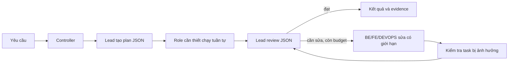

# Hiện trạng từ source

Baseline: `3e3cd60` trên nhánh `feature/windows-worker-ww4c`. Nhánh nghiên cứu được tách từ baseline này. Đánh giá tĩnh có phạm vi; không phải audit bảo mật toàn hệ thống.

Cập nhật AU-1 ngày 04/11/2026: G1 đã xử lý; bảy profile dùng `1.1.0`, profile/skill version được đọc từ nội dung nên phần metadata G7 đã xử lý. G2–G6/G8 và catalog theo task của G7 còn trong backlog. Các mô tả/bằng chứng dưới đây giữ theo baseline khảo sát; [báo cáo trạng thái mới](../../../windows-worker/au1-completion.md).

Cập nhật AU-2A cùng ngày: G4 đã có handoff bounded với trạng thái cắt và reference gốc; map latest giữ đúng attempt. Năm profile Lead/BE/FE/TEST/DEVOPS lên `1.2.0`, PM/BA giữ `1.1.0`. G3/G6 vẫn cần evidence gate; reference hiện chưa chứng nhận artifact tồn tại hoặc đúng identity khi call ID trùng. Xem [báo cáo AU-2A](../../../windows-worker/au2a-completion.md).

Cập nhật AU-2B cùng ngày: completion của team dùng review v2 và evidence refs có kiểu; thiếu/sai evidence chuyển AC thành unverified và chặn completed. Command artifact gắn run/attempt/session/call, source có quan sát trước/sau; file snapshot lưu theo task/scope và mở được từ AC. Giữ schema6, evidence legacy không được gán verified. Phần integrity/reference của G3/G6 đã xử lý; đánh giá ngữ nghĩa bằng chứng vẫn thuộc Lead, lifecycle/retention và nghiệm thu model thật còn trong các mốc sau. Xem [báo cáo AU-2B](../../../windows-worker/au2b-completion.md).

Cập nhật AU-3 cùng ngày: phần catalog/chọn skill của G7 đã xử lý. Profile mới chỉ chứa rule nền; bốn skill được catalog hóa và chọn theo workType/role/capability, tối đa ba skill/task. Run chụp catalog, task/direct chụp lựa chọn cùng nội dung/version/hash; không đọc lại file skill khi thực thi các task sau. Đề xuất ID sai bị từ chối trước work; runtime quyền/model/scope giữ nguyên. Legacy giữ nguyên nội dung đã lưu; schema6 không đổi. 62/62 test và native storage đạt; chi tiết trong [báo cáo AU-3](../../../windows-worker/au3-completion.md).

## Hai lớp sản phẩm đang cùng repository

**Factory Lite legacy:** Python FastAPI, LangGraph, PostgreSQL/Redis và Linux worker. [graph.py](../../../../orchestrator/graph.py) chạy PM → BA → approval → execution boundary; [state.py](../../../../orchestrator/state.py) giữ reference và trạng thái. [coding.py](../../../../workers/coding.py) có Docker task cho Linux, trusted test mount và model proxy; TEST/DEVOPS không đồng nghĩa có đầy đủ agent model như desktop. Không chuyển mô hình Docker/Linux này vào Windows, không sửa luồng tích hợp legacy trong chương trình nâng cấp này.

**Windows Worker:** Electron 42, React 19, TypeScript 5.9, SQLite schema 6, OpenCode runtime/SDK **1.19.5**. [Kế hoạch Windows](../windows-worker/README.md) ghi WW-1–3 và WW-4A/B/C đã xong; WW-4D và WW-5 còn lại. Đây là đích triển khai chính.

Luồng team hiện tại:

## Những thành phần nên giữ

- [runs.ts](../../../../apps/windows-worker/electron/controller/runs.ts): một run toàn ứng dụng; runtime/session riêng theo task; model riêng theo role; request budget chung cho run.
- [coordinator.ts](../../../../apps/windows-worker/electron/team/coordinator.ts): plan tối đa 10 task, kiểm tra dependency, scope, readonly, snapshot trước/sau; không tự hoàn tác khi vi phạm; review và fix có giới hạn.
- [opencode.ts](../../../../apps/windows-worker/electron/runtime/opencode.ts): pin runtime, tắt external skills/plugins/project config, `task: deny`, MCP rỗng, chặn directory ngoài. Không có scheduler lồng bên trong OpenCode.
- [model-proxy.ts](../../../../apps/windows-worker/electron/gateway/model-proxy.ts): provider key nằm ở parent, model bị khóa theo session; giới hạn request/payload/output; không tự đổi provider/model.
- WW-4C đã lưu source/HEAD/index trước và sau, command evidence, diff và restore từng file có phát hiện xung đột. Tái sử dụng những dữ liệu này cho handoff/review.
- Mặc định 40 request, 30 phút, tối đa 2 fix round theo [defaults.ts](../../../../apps/windows-worker/shared/defaults.ts) và [contracts.ts](../../../../apps/windows-worker/shared/contracts.ts). Giới hạn 2 đã đáp ứng yêu cầu người dùng “không quá 3”; không cần tăng lên 3.

## Khoảng trống ưu tiên

| ID | Bằng chứng source | Hệ quả | Đợt xử lý |
|---|---|---|---|
| G1 | `runs.ts:147` chỉ load profile cho team; nhánh direct tại `runs.ts:419` dùng instructions rỗng/quyền chung hoặc context undefined | Role chọn trong direct quyết định model nhưng chưa áp dụng cùng profile/policy với team | AU-1 |
| G2 | `profiles.ts:7` gán skill cố định theo role và `loadProfiles()` ghép toàn bộ skill vào instructions | Tốn context, skill fix/implement/testing có thể cùng xuất hiện khi không cần | AU-3 |
| G3 | `shared/team.ts` review evidence là string; `coordinator.ts:76` kiểm tra state/AC, không xác thực reference evidence | Câu “đã test” hoặc ID không tồn tại có thể được Lead đánh dấu passed | AU-2 |
| G4 | `coordinator.ts:208` handoff dùng summary cắt 6000 ký tự và command tail 2500; review command tail 2000 | Thông tin quan trọng có thể bị cắt, thiếu chỉ dẫn lấy bằng chứng đầy đủ | AU-2 |
| G5 | `coordinator.ts:141` ghi lỗi rồi ném lại; một số lỗi runtime dừng trước review/fix | Cần phân loại lỗi phục hồi được và lỗi phải dừng; chưa đủ căn cứ tự chạy lại task có side effect | AU-4 |
| G6 | `verificationError()` yêu cầu TEST có lệnh exit 0, từ chối lệnh lỗi | Chưa chứng minh lệnh đó kiểm tra đúng AC; một lệnh không liên quan vẫn có thể đạt | AU-2 |
| G7 | Profile/skill version hardcode `1.0.0`; có content hash nhưng chưa có catalog chọn theo task | Khó truy vết chính xác lý do chọn skill và nâng version | AU-3 |
| G8 | Role/model được cấu hình rõ nhưng chưa có bộ so sánh nhiệm vụ cố định | Chưa có số liệu để kết luận thêm agent/model lớn làm nhanh hoặc tốt hơn | AU-4/5 |

G1 là hành vi đã thấy trong source, không khẳng định đã khai thác được vượt quyền hệ điều hành. Readonly tool policy không cô lập shell native: TEST chạy lệnh có thể gây side effect; hậu kiểm snapshot vẫn phải giữ.

Chế độ direct vẫn là trả lời trực tiếp, kể cả role Lead. Thống nhất policy không biến direct thành vòng team, không ép Lead luôn trả JSON plan. Nếu người dùng muốn sửa source thì chọn BE/FE/DEVOPS hoặc team.

## Evidence và giới hạn khảo sát

[Báo cáo WW-4C](../../../windows-worker/ww4c-completion.md) là baseline lịch sử: 38/38 test, typecheck/native/build/format và acceptance DeepSeek Flash đã được ghi ở đợt trước. **Không chạy lại và không tuyên bố đây là kết quả mới của đợt lập kế hoạch.** Chưa benchmark tốc độ/cost, chưa kiểm chứng model nào tốt hơn.

README gốc còn mô tả desktop theo WW-2; cập nhật tài liệu sản phẩm theo hành vi cuối khi AU-1 hoàn thành. Preview/lifecycle/recovery/retention còn thuộc WW-4D, installer thuộc WW-5; không đánh dấu hoàn tất trong chương trình nghiên cứu này.

## Cập nhật sau AU-4A — 04/11/2026

Phần khảo sát và các số dòng bên trên là baseline lịch sử. AU-1/2A/2B/3 đã xử lý profile/policy, handoff, evidence gate và skill selection; xem các báo cáo tương ứng. [AU-4A](../../../windows-worker/au4a-completion.md) bổ sung failure có kiểu, model snapshot check và metrics run/task/attempt; G5 được phân loại và dừng rõ, chưa có tự replay task. G8 có nền metrics, chưa có benchmark so sánh model/hiệu suất.

Proxy giữ lỗi đầu tiên và chặn request upstream tiếp theo trong execution lỗi; auth/rate-limit/transient/budget/model mismatch dừng Controller. Từ chối quyền cũng kết thúc lượt chạy. Token chỉ tổng hợp các bước runtime quan sát được, cost luôn chưa có số liệu; history cũ giữ unknown. Không đổi schema6 hoặc thêm dependency. 71/71 test và checks phát triển/native đạt; không gọi model thật trong AU-4A.

**AU-4B vẫn chờ lifecycle WW-4D liên quan.** Reopen vẫn ghi interrupted, giữ hàng chờ và yêu cầu thử lại có chủ đích; chưa có resume hoặc nhận lại process. Preview, lifecycle/crash recovery, retention/export, AU-5 và installer chưa hoàn thành.

## Cập nhật trải nghiệm Lead và quyền — 04/11/2026

Đã sửa nguyên nhân lời chào bị biến thành blocker: quyết định Lead chấp nhận nhánh reply có schema riêng bên cạnh plan cũ, trả lời tự nhiên hoặc hỏi làm rõ mà không giao task/review giả. Cùng một lần gọi model, giữ ngữ cảnh hội thoại và các gate khi có work. Nội dung lời đáp trong test dùng mock, chưa nghiệm thu cách model thật chọn nhánh.

Hoạt động mặc định thu gọn task plan/review và log kỹ thuật; task work/fix đóng metadata, hiển thị tối đa năm lệnh gần nhất, log đầy đủ mở khi cần. Full access tự duyệt shell/doom-loop theo snapshot; role/scope/secret/delegation deny và giới hạn giữ nguyên. Config/queue cũ thiếu field trở về ask; thay mode không làm đổi run đang chạy. [Báo cáo](../../../windows-worker/lead-chat-access-completion.md) ghi 79/79 test, native và UI Electron thật với dữ liệu thử. AU-4B/WW-4D/AU-5 vẫn chưa hoàn thành.
