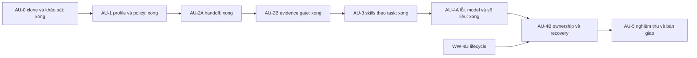

# Kế hoạch triển khai theo đợt

Trạng thái ngày 04/11/2026: **AU-0, AU-1, AU-2A, AU-2B, AU-3, AU-4A và AU-4B hoàn thành**; [kết quả AU-1](../../../windows-worker/au1-completion.md), [AU-2A](../../../windows-worker/au2a-completion.md), [AU-2B](../../../windows-worker/au2b-completion.md), [AU-3](../../../windows-worker/au3-completion.md), [AU-4A](../../../windows-worker/au4a-completion.md). AU-4B bàn giao trong [V1.1](../../../windows-worker/v1.1-completion.md); AU-5 benchmark còn lại. Vai trò ghi trong bảng là trách nhiệm lúc triển khai, không có nghĩa đã khởi chạy agent song song.

## Ranh giới và thứ tự

1. Giữ một Controller, một run, các task tuần tự; OpenCode chỉ thực thi tools/model. Không thêm framework/dependency trong AU-1–4.
2. Tái sử dụng SQLite, snapshots, command evidence và queue hiện có. Không sửa ngoài workspace; không thay credential/cấu hình hệ thống, deploy/VM hoặc tích hợp legacy.
3. Checkpoint Git trước mỗi đợt lớn. Không commit thay đổi người dùng ngoài phạm vi. Không cho agent của sản phẩm tự commit/push/deploy trong task.
4. Mỗi vấn đề tối đa 3 vòng sửa theo yêu cầu; runtime giữ cấu hình tối đa **2** fix round đang có. JSON repair một lần hiện tại vẫn nằm trong request budget, không mở thêm vòng sửa vô hạn.
5. WW-4D không chặn AU-1/2/3. Recovery và công việc tự nâng cấp kéo dài phải hoàn thành phần lifecycle WW-4D liên quan trước; AU-5 không thay cho installer WW-5.

## AU-0 — Nguồn và kế hoạch: hoàn thành

- Source sản phẩm đã có, giữ checkout và tạo tag `checkpoint/agent-research-20261104` tại `3e3cd60`.
- Clone 5 repository vào `.cache/asf-research/sources/`; pin SHA trong manifest, bổ sung tag OpenCode 1.19.5.
- Đọc source/tài liệu liên quan và giấy phép MIT gốc; không chạy external script, không chép code.
- Lưu hiện trạng, lựa chọn và kế hoạch trong `plan/agent-upgrade/`, nguồn trong `research/agent-upgrade/`.
- Kiểm tra đợt này: manifest/paths/license hash, checkout sạch, cache bị ignore, local links và `git diff --check`. Không build/test app vì chưa sửa sản phẩm.

## AU-1 — Profile và quyền nhất quán

**Đã hoàn thành AU1-01–04.** Direct/team dùng chung context/policy; direct snapshot profile và hậu kiểm source readonly; 7 profile và 2 skill cập nhật; version đọc từ nội dung; README cập nhật. Không cần thêm UI hint vì composer đã có lựa chọn role. Kiểm tra: 43/43 test, typecheck/build/format đạt; không gọi model thật. Chi tiết và giới hạn trong báo cáo AU-1.

Mục tiêu: chọn role nào trong direct cũng thực sự áp dụng hướng dẫn và policy role đó, có hoặc không có lịch sử chat. Không thêm request model hoặc lượt review.

| Task | Owner | File dự kiến, tính từ `apps/windows-worker/` | Kết quả |
|---|---|---|---|
| AU1-01 | BE | `electron/team/profiles.ts`, mới `electron/team/policy.ts`, `electron/controller/runs.ts` | Một builder context dùng chung; snapshot profile cho direct và team |
| AU1-02 | BE | `agent-profiles/*.md`, `skills/fix-bug/SKILL.md`, `skills/testing/SKILL.md` | Role contract ngắn: scope, kết quả, bằng chứng, blockers; phân biệt direct với plan/review JSON |
| AU1-03 | TEST | `tests/runtime.test.ts`, `tests/team.test.ts`, mới `tests/profiles.test.ts` | Regression policy cho mọi role và direct có/không history |
| AU1-04 | FE/Lead | README sản phẩm/gốc; UI role hint chỉ nếu cần | Mô tả đúng quyền khi chọn role, không thêm mô tả dài trong chat |

Policy đích: Lead/PM/BA chỉ đọc, không shell; TEST chỉ đọc source, shell vẫn qua permission; BE/FE/DEVOPS sửa trong scope. Direct dùng workspace scope hiện tại, team dùng task scope. Native shell vẫn không phải OS sandbox; giữ hậu kiểm snapshot và deny secret/external directory.

Nghiệm thu: direct Lead không edit/shell; direct BE nhận profile và vẫn sửa được file trong scope; history không làm mất policy; team không đổi thứ tự chạy; quyền deny secret giữ nguyên; direct Lead trả lời thường, không buộc plan JSON. Test context/config thực tế, không chỉ kiểm tra chuỗi prompt. Tái sử dụng runtime adapter 1.19.5.

Kiểm tra: test trọng tâm policy/runtime/team; sau đó `npm run typecheck`, `npm test`, `npm run build`, `npm run format:check` tại `apps/windows-worker`. Không cài ESLint chỉ để có lệnh lint; repo hiện không có script `lint`. Native storage test chỉ chạy nếu thay storage. Rollback bằng revert commit AU-1, không có migration DB dự kiến.

## AU-2A — Bàn giao gọn, truy vết được

**Đã hoàn thành AU2A-01–03.** Packet dùng chung dependency/review, giữ task/attempt ID, report bốn mục dễ đọc và fallback legacy; giới hạn 32.000 ký tự sau JSON serialize, có truncation/count/source refs. 48/48 test, typecheck/build/format đạt; không gọi model thật hoặc thay completion gate. Chi tiết trong báo cáo AU-2A.

Phụ thuộc AU-1. Scope 2A chưa đổi kết luận completion, chưa migration schema evidence.

| Task | Owner | File dự kiến | Kết quả |
|---|---|---|---|
| AU2A-01 | BE | `electron/team/coordinator.ts`, mới `electron/team/handoff.ts` | Builder handoff gồm task/attempt, scope, dependency, summary, blockers, changed files, command refs |
| AU2A-02 | BE | `agent-profiles/lead.md`, `be.md`, `fe.md`, `test.md`, `devops.md` | Báo cáo có status, việc làm, điều chưa xác minh, lệnh cần xem; Lead review spec + quality trong lần review hiện có |
| AU2A-03 | TEST | `tests/team.test.ts`, mới `tests/handoff.test.ts` | Kiểm tra truncation, dependency mới nhất, failure output và reference đầy đủ |

Ưu tiên giữ blocker, failure và command ID trước summary dài. Đặt giới hạn số task/file và ký tự cho prompt; nếu cắt phải ghi rõ `truncated` và pointer tới evidence đã lưu. Không gửi toàn transcript/diff cho mọi role. Giữ nguyên báo cáo đầy đủ ở storage hiện tại; model không được tự ghi đè evidence.

Không thêm lượt LLM chỉ để format handoff. Báo cáo có cấu trúc lấy từ response cuối cùng của task; nếu chưa parse được thì giữ summary cũ và đánh dấu metadata chưa xác minh, không bịa evidence. Pointer không mặc nhiên cho runtime quyền đọc SQLite/blobs hoặc thư mục app; Controller cung cấp excerpt cần thiết qua context. Cách cung cấp thêm evidence theo nhu cầu chỉ bổ sung nếu acceptance cho thấy excerpt hiện tại thiếu.

Nghiệm thu: task sau chỉ nhận dependency liên quan và attempt mới nhất; nội dung bị cắt không che trạng thái fail/blocked; command refs trỏ đúng task; không đổi tổng request mặc định. Test trọng tâm + typecheck/full unit/build/format một lần cuối đợt; revert commit 2A nếu cần.

## AU-2B — Completion gắn bằng chứng thật

**Đã hoàn thành AU2B-01–04.** Review v2 dùng ID task + thứ tự AC, refs có kiểu, xác minh identity/attempt/session/hash/source; lệnh thất bại hoặc evidence thiếu không được completed. Command artifact mới có key riêng theo run/attempt/session/call, không ghi đè lệnh cùng call ID. File evidence lưu blob theo scope; UI mở snapshot/output đã lưu. Tái sử dụng schema6 và JSON task, không migration hoặc chuyển đổi evidence cũ. Kết quả và giới hạn trong báo cáo AU-2B; mốc tiếp theo AU-3.

Phụ thuộc 2A; checkpoint riêng trước đổi data contract. Đây là thay đổi rủi ro vừa, không ghép vào AU-1.

| Task | Owner | File dự kiến | Kết quả |
|---|---|---|---|
| AU2B-01 | BE | `shared/team.ts`, `shared/evidence.ts`, `shared/runs.ts` | AC có ID ổn định theo task + index; evidence refs có kiểu command/file/artifact, run/task/attempt rõ |
| AU2B-02 | BE | `electron/team/coordinator.ts`, `electron/storage/evidence.ts`, `electron/storage/database.ts` nếu cần | Xác thực ref tồn tại, đúng lần chạy/attempt/source version; gate completion theo evidence |
| AU2B-03 | FE | `src/` panel task/result/evidence hiện có | Bấm AC mở evidence tương ứng; trạng thái Đạt/Chưa đạt/Chưa xác minh; không thêm màn hình quản trị |
| AU2B-04 | TEST | `tests/team.test.ts`, `tests/evidence.test.ts`, `tests/native-storage.cjs` nếu migration | Ref giả, stale attempt, AC trùng chữ, command thất bại/không liên quan và dữ liệu cũ |

Quy tắc: command pass phải là lệnh completed/exit 0 của đúng attempt; claim kiểm thử phải có command evidence, không chỉ file diff. Claim tài liệu/source có thể dùng file/artifact evidence phù hợp thay vì ép chạy test. Lead vẫn chịu trách nhiệm đối chiếu sự liên quan giữa AC và bằng chứng; validator xác thực tính toàn vẹn/reference, không tuyên bố tự chứng minh được ngữ nghĩa của mọi lệnh.

Phát hiện khi làm AU-2A: controller và artifact schema6 hiện dùng call ID trong phạm vi run. AU-2B cần xử lý identity task/attempt/session ở cả command capture và storage để không ghi đè artifact nếu call ID trùng, rồi mới coi ref là bằng chứng hợp lệ. Không tự gán task cho artifact legacy khi không xác minh được.

Chưa đủ evidence thì `unverified`, không được completed. Review không chỉ tin câu trả lời implementer. Không tự xóa failed command hoặc nới quy tắc verification hiện tại để làm xanh kết quả; xử lý expected-failure/TDD nếu cần bằng contract riêng có test, ngoài scope 2B ban đầu.

Tương thích: lịch sử cũ đọc được, evidence cũ không bị gán lại thành “verified”; run mới dùng contract version mới. Chỉ migration khi dữ liệu persisted thực sự cần đổi. Nếu có migration: backup DB trước, test schema cũ → mới; rollback app phải có quy trình dùng backup tương thích, không tự downgrade/xóa DB.

Nghiệm thu: không thể completed bằng ID giả, evidence attempt cũ, failed command hoặc AC thiếu; UI mở đúng bằng chứng và dữ liệu WW-4C vẫn đọc được. Chạy test evidence/team, native storage nếu đổi DB, typecheck/build/format; ghi kết quả thực tế.

## AU-3 — Skills nhỏ và chọn theo tác vụ

**Đã hoàn thành.** Catalog nội bộ bốn skill, metadata role/task-kind/capability/path/provenance, chọn tối đa ba skill và snapshot nội dung/version/hash vào run/task. Lead đề xuất ID trong allowlist; Controller kiểm tra trước chạy work và lúc tạo runtime context. Profile nền tách khỏi skill, docs/analysis không tải skill tác vụ, fix dùng bộ bugfix. Legacy dùng nguyên profile cũ; snapshot mới thiếu/sai thì dừng. 62/62 test, typecheck/build/format/native đạt. So sánh ký tự instruction cùng fixture và giới hạn trong [báo cáo AU-3](../../../windows-worker/au3-completion.md). Không đổi schema6, dependency hoặc quyền runtime.

Phụ thuộc AU-2B. Owner BE + Lead cho catalog/prompt, TEST cho lựa chọn và quyền.

- Thêm catalog nội bộ trong `electron/team/` hoặc file data đóng gói: `id`, `version`, `description`, `roles`, `taskKinds`, `requiredCapabilities`, `path`, content hash và nguồn gốc.
- Giữ rule nền ngắn cho mọi role; chọn trong các skill implement-feature/fix-bug/testing/local-dev theo mục tiêu task. Lead có thể đề xuất ID từ allowlist; Controller quyết định hợp lệ và áp giới hạn. Không lấy path/URL do model chỉ định, không cho skill mở quyền tool.
- Bổ sung nội dung review/handoff vào profile sẵn có trước khi tách thành skill mới. Tách skill chỉ khi được tái sử dụng và giúp giảm prompt.
- Snapshot skill/version/hash đã chọn vào task/run; phần đọc version từ nội dung đã có ở AU-1, AU-3 mở rộng cho lựa chọn theo task. Run đang chạy giữ snapshot kể cả file skill đã đổi sau đó. Dữ liệu cũ có fallback rõ ràng.
- Không bật `skill` tool/external discovery, không cài hooks hoặc dependency của ECC/Superpowers. Dùng tối đa 3 skill tác vụ cho một task làm giới hạn ban đầu; rule nền không tính vào số này.

File dự kiến: `electron/team/profiles.ts`, mới catalog/selector, `shared/team.ts`, các skill nội bộ, test profile/catalog, cấu hình đóng gói tài nguyên nếu cần.

Nghiệm thu: task docs không tải toàn bộ implement/fix/local-dev; bugfix nhận skill cần thiết; role sai/skill không tồn tại bị từ chối; selection không thay model/quyền; replay dùng snapshot/hash đúng. So sánh số ký tự prompt trên cùng bộ task, chưa gọi đó là số token đo được. Typecheck/unit/build/format; native test nếu đổi persistence. Rollback catalog/selector về mapping hiện tại, bảo toàn history.

## AU-4 — Lỗi rõ ràng, model minh bạch, số liệu có nguồn

### AU-4A — Hoàn thành

Đã triển khai các mục 1–4 dưới đây và regression cho Stop/reopen hiện có. Lỗi có mã và nguyên nhân đầu tiên được giữ lại; từ chối quyền dừng lượt chạy. Proxy ngừng gửi upstream sau lỗi auth/rate-limit/transient/budget/model mismatch, Controller dừng runtime; không thêm retry request/task. Đã đọc source retry của OpenCode 1.19.5: runtime có tối đa 5 retry transient nội bộ; latch tại proxy chặn các request tiếp theo gửi upstream trong execution lỗi.

Model phải khớp role bật trong settings snapshot. Metrics lưu theo run/task/attempt: request đã thử gửi, thời gian, lệnh đạt/lỗi/chưa hoàn tất, usage runtime quan sát được. Không coi usage này là tổng billing; thiếu token/cost ghi chưa có số liệu. Lịch sử cũ không bị gán metrics giả, schema vẫn v6. 71/71 test, typecheck/build/format/native đạt; sau sửa nhỏ cuối ở error adapter, 20/20 test execution/runtime/team cùng typecheck/build/format đạt. [Báo cáo và giới hạn AU-4A](../../../windows-worker/au4a-completion.md).

### AU-4B — Hoàn thành trong V1.1

Mục 5 đã triển khai cùng lifecycle WW-4D: Windows Job Object, random owned-job identity, startup cancellation, parent/host crash, recovery có kiểm tra source/Git trước attempt mới. Kiểm tra process Windows và Electron UI thật, cùng acceptance 9Router đạt; [bàn giao và giới hạn V1.1](../../../windows-worker/v1.1-completion.md). AU-5 benchmark so sánh vẫn chưa thực hiện.

Phụ thuộc AU-3. Phần ownership/recovery phải phối hợp sau nghiệm thu lifecycle WW-4D, tránh hai cơ chế quản lý process. BE phụ trách controller/proxy; FE phần hiển thị; TEST kiểm tra stop/failure; DEVOPS chỉ toolchain local.

1. Error taxonomy: cancelled, permission-denied, scope-violation, incomplete-snapshot, budget-exhausted, provider-auth, rate-limit/transient, invalid-output và tool/test-failure. Lỗi an toàn/cancel/budget/auth không tự retry. Hết budget dừng rõ, không tạo run kế tiếp để vượt giới hạn.
2. Đọc retry hiện có ở runtime 1.19.5 trước khi bổ sung; tránh retry chồng. Ban đầu không tự replay nguyên task. Chỉ retry request transient nếu chứng minh chưa có tool side effect, có deadline/budget và tối đa một retry bổ sung; nếu không chứng minh được thì báo lỗi để retry có chủ đích. Mọi request vẫn tính vào budget chung.
3. Giữ lựa chọn model theo role/preset do người dùng cấu hình. Lead chỉ chọn role đã bật và capability phù hợp, số task tối thiểu. Không model fallback âm thầm; cấu hình không hợp lệ thì blocked kèm cách sửa.
4. Metrics gắn run/task/attempt/model: thời gian, request count, usage nếu gateway/runtime trả, fix rounds, command pass/fail, trạng thái kết thúc. Token/cost thiếu ghi unknown; không suy diễn giá từ tên model.
5. Ownership task/attempt và interrupted recovery dùng queue/store/process manager hiện có. Không resume session đã đóng hoặc nhận process chỉ dựa vào PID. Hành vi crash/close cụ thể thuộc WW-4D, không xây thêm daemon.

File dự kiến: `electron/controller/runs.ts`, `runtime/stopped.ts`, `runtime/opencode.ts`, `gateway/model-proxy.ts`, queue/storage contracts, `shared/` metrics và panel hiện có. Chỉ đổi schema nếu cần và có backup/migration test.

Nghiệm thu: 401 không lặp, cancel/Stop không khởi task mới, request limit không vượt, lỗi transient không lặp side effect, role/model đúng snapshot, recovery không nhận nhầm attempt/process. Test bằng server giả lập và fault injection có kiểm soát; không cần gọi provider thật cho mọi ca lỗi. Chạy unit/typecheck/native theo thay đổi/build/format; rollback từng commit, không tắt policy để chữa lỗi.

## AU-5 — Nghiệm thu hiệu quả và bàn giao

Phụ thuộc AU-4 + lifecycle WW-4D liên quan. TEST thiết kế ca; BE/FE sửa phần thuộc mình; Lead đối chiếu yêu cầu, không tự xác nhận bằng lời.

| Ca cố định | Điều cần chứng minh |
|---|---|
| Sửa lỗi logic nhỏ trong repo fixture | Scope đúng, test xác minh lỗi, file/command refs hợp lệ |
| Thay đổi UI nhỏ | Dùng role cần thiết, build liên quan, không ép cả đội |
| Nhiệm vụ docs/read-only | Không edit/shell trái policy, không test thừa |
| Task BE → TEST và một lần fix | Handoff đúng dependency/attempt, không dùng evidence cũ |
| Lỗi gateway, hết budget, Stop và gián đoạn | Kết thúc rõ, không process mồ côi, không tự lặp side effect |

So sánh baseline và bản mới trên cùng fixture commit, prompt, model, settings và cache conditions ghi rõ. Baseline lịch sử WW-3/WW-4B/WW-4C là các nhiệm vụ khác nhau, không dùng để khẳng định phần trăm tăng tốc. Ban đầu chạy cục bộ deterministic checks; sau đó một lượt acceptance chức năng dùng `ds/deepseek-v4-flash` qua 9Router đã cấu hình. Chỉ benchmark thêm khi cần quyết định model/reviewer; không biến runtime proof repo mẫu thành phase chặn sản phẩm.

Ngưỡng: tất cả ca correctness/policy bắt buộc đạt; không tăng số request bắt buộc của luồng mặc định do formatting/handoff; không thêm role/review mặc định cho task nhỏ. Ghi latency/token thực tế thay vì cam kết mức tăng tốc chưa đo. Không đánh đổi correctness lấy ít request.

Đầu ra: báo cáo issue đã xử lý, source/technique/license, file đổi, check/build/test thực tế, số liệu, hạn chế còn lại; cập nhật docs sản phẩm và hướng dẫn ngắn. WW-5 tiếp tục riêng cho bộ cài; không deploy production hoặc mở Connected Mode ở đây.

## Quy trình cho từng đợt code

1. Kiểm tra git status và checkpoint từ trạng thái thực tế; nếu có thay đổi khác thì giữ nguyên, tách phạm vi.
2. Analyze/research phần cần thiết → cập nhật plan task nhỏ → implement bằng module hiện có.
3. Chạy kiểm tra trọng tâm; lỗi có bằng chứng → xác định nguyên nhân → sửa → chạy lại kiểm tra liên quan. Tối đa 3 vòng tự sửa cho cùng vấn đề; còn lỗi thì giữ trạng thái chưa hoàn thành và báo cụ thể.
4. Khi check trọng tâm đạt, chạy checks tổng phù hợp một lần; không build Docker ASF mỗi lần sửa desktop, không chạy lại checks nặng khi không có thay đổi mới.
5. Review diff/scope/secret, cập nhật báo cáo, commit từng đợt và push GitHub theo quyền đã có. Không merge/main hoặc deploy ngoài phạm vi.
6. Đo thực tế rồi mới quyết định cần agent/reviewer/tool/dependency mới. Nếu thiếu quyền/công cụ thì báo giới hạn cụ thể, không giả lập kết quả thành đạt.

Mốc tiếp theo: **lifecycle WW-4D liên quan → AU-4B ownership/recovery → AU-5 nghiệm thu**. AU-4A đã hoàn thành; không thêm process manager hoặc cơ chế retry task chồng lên runtime.

Ưu tiên bổ sung theo yêu cầu người dùng sau AU-4A: [Lead trò chuyện, Hoạt động gọn và Full access](../../../windows-worker/lead-chat-access-completion.md) đã hoàn thành trên branch riêng. Chỉ mở nhánh reply trong bước Lead hiện có, thêm chế độ auto-approve shell theo snapshot và thu log UI; không thêm classifier request, scheduler hoặc thay vòng review/evidence. Lịch sử/cấu hình cũ mặc định ask; schema6 không đổi. Các milestone lifecycle/recovery phía trên vẫn giữ trạng thái chưa hoàn thành.
