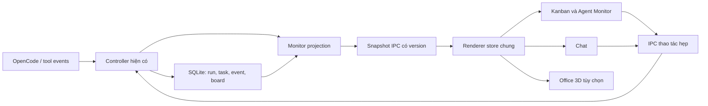

# V1.3 — Kiến trúc và hợp đồng dữ liệu đề xuất

Chỉ là thiết kế, chưa phải API/schema đã triển khai. Baseline và phạm vi: [README](README.md).

## 1. Luồng dữ liệu



Projection là hàm/module trong Controller, không phải service hoặc orchestrator thứ hai. Renderer không đọc database, quét process, gọi OpenCode hoặc giữ scheduler. Scene chỉ chọn agent/task và phát ý định UI tới cùng action handler.

## 2. Identity và snapshot

Phân biệt role profile, logical task và execution attempt:

- `role` nhận diện cấu hình Lead/PM/BA/BE/FE/TEST/DEVOPS.
- `logicalTaskKey`: run gốc + task gốc; attempt fix/recovery liên kết rõ bằng ID, không lấy title làm khóa.
- `attemptKey`: runId + taskId (hoặc `direct`) + attempt ID đã được lưu. Có thể thêm execution UUID tại lúc Controller tạo lane nếu chưa có ID bền vững phù hợp.
- `executionId`, `sessionId`, `callId` thuộc lần thực thi; không mặc định một role chỉ có một session.
- Nếu recovery không chứng minh được cùng logical task, hiện run mới với `recoveryOf`; không đoán nối task dựa nội dung.

Ví dụ shape, cần chốt Zod schema ở A-01:

```ts
type MonitorSnapshot = {
  epoch: string; // Controller instance; đổi khi app khởi động lại
  revision: number; // tăng cả khi board/settings/state đổi mà không có log
  projectId: string;
  observedAt: string;
  activeRun: { id: string; projectId: string; state: string } | null;
  agents: AgentStatus[];
  cards: TaskCardSummary[]; // phân trang, không mang output/diff lớn
  progress: {
    currentTasks: number;
    verifiedTasks: number;
    passedCriteria: number;
    applicableCriteria: number;
    unverifiedCriteria: number;
    planRevision: string | null;
  };
  history: { retainedFrom: string | null; truncated: boolean };
};

type AgentStatus = {
  role: string;
  availability: string;
  configuredModel: string | null;
  executions: {
    executionId: string;
    runId: string;
    taskId: string | null;
    logicalTaskKey: string;
    attemptKey: string;
    model: string; // snapshot thực tế, không lấy settings hiện hành
    activity: string;
    label: string; // ngắn, đã redaction
    observedFrom: "controller" | "runtime" | "derived";
    startedAt: string | null;
    activityAt: string;
  }[];
  lastFinished: { taskKey: string; at: string; outcome: string } | null;
};
```

Board không trả toàn bộ `Run.settings`, provider headers, prompt thô, lệnh/output không giới hạn hoặc file contents. Inspector tải chi tiết qua các API hiện có và projection chi tiết hẹp. Redaction xảy ra trước khi persist/publish; canonical path/ownership do main kiểm tra.

## 3. Thu nhận hoạt động đúng lane

`electron/controller/runs.ts` đã có `ExecutionContext` theo lane và route session. Tại các điểm start/finish request, tool, permission, checkpoint, integration và stop:

1. Gắn metadata vào đúng run/task/attempt/execution; không dựa riêng `currentTaskId` khi song song.
2. Cập nhật activity hiện hành cùng lifecycle; tool end chỉ đóng đúng call đang mở, không ghi đè call khác cùng execution.
3. Persist run/task/state và event chuyển trạng thái trong transaction khi thích hợp; tăng revision sau commit thành công.
4. Phát snapshot của một revision nhất quán; không lấy run trước transaction và events sau transaction.
5. Tool chưa nhận diện dùng nhãn “Đang dùng công cụ”; command chưa biết loại dùng “Đang chạy lệnh”, không phỏng đoán testing từ văn bản model.
6. Không persist reasoning/raw stream. `onEvent` hiện chủ động bỏ reasoning/text; giữ nguyên nguyên tắc đó.

Metadata đề xuất thêm vào event: `version`, `taskId`, `logicalTaskKey`, `attemptKey`, `executionId`, `activity`, `callId`, `outcome`, đường dẫn tương đối đã lọc nếu cần. Có thể lưu bằng cột JSON nullable trên bảng `events`, không tạo log pipeline riêng.

Event cũ không có metadata vẫn đọc được như lịch sử legacy; snapshot trạng thái hiện tại dựa trên run/task đã lưu. Không parse prefix tiếng Việt trong text để khẳng định execution lịch sử chính xác.

**Lưu ý retention baseline:** `Store.event()` hiện dừng ghi sau 2.000 event/run và `events()` chỉ trả 300 event cuối. Vì vậy `lastSequence` không thể là version duy nhất của trạng thái. V1.3 phải tiếp tục cập nhật projection/revision dù log đã chạm cap; timeline thông báo phần lịch sử bị giới hạn. Khi bổ sung metadata, ưu tiên transition quan trọng, coalesce tool lặp; không bỏ terminal/stop/error khỏi trạng thái hiện tại. Việc thay cap/retention cụ thể phải kiểm tra regression export/recovery.

## 4. Đồng bộ UI: snapshot trước, delta sau nếu cần

Chọn giải pháp ban đầu đơn giản: **một poller snapshot dùng chung**, một request đang bay; 500 ms khi có run hoạt động, 2 giây khi idle và đang mở màn hình theo dõi. Đây là giá trị mục tiêu cần đo ở E, không hứa realtime cứng. Query `sinceRevision` cho phép trả `unchanged` nhẹ. UI thể hiện thời điểm cập nhật cuối.

- `useSyncExternalStore` hoặc store React nhỏ; không thêm thư viện state chỉ vì ba view.
- Chat không chạy lại poll run detail độc lập nếu cùng run đã có dữ liệu; text hội thoại vẫn dùng API hội thoại nhưng dedupe request và chỉ tải detail khi cần.
- Dữ liệu board cũ và run active được query riêng, tổng hợp thành snapshot; không dựa duy nhất `Store.runs()` giới hạn 50 để dựng toàn bộ lịch sử project.
- Snapshot muộn hơn bị bỏ nếu revision thấp hơn; epoch mới buộc tải snapshot đầy đủ. Project đổi hủy/discard kết quả đang bay của project cũ.
- Sau 3 giây không có snapshot thành công khi view foreground: giữ trạng thái lần cuối với badge “Chưa đồng bộ”. Cập nhật `observedAt` ngay cả response `unchanged`; không coi 3 giây không có tool event là mất kết nối.
- Khi minimize/ẩn 3D: tắt vòng render 3D. Poll chung có thể giảm tần suất; khi focus lại tải đầy đủ. Không chạm process lifecycle.
- Không poll diff/output mỗi 500 ms. Inspector gọi lazy và cache theo source/evidence version.
- IPC push/invalidation chỉ bổ sung khi số đo chứng minh poller chung chưa đủ; phải có unsubscribe và snapshot recovery, không tạo socket/server mới.

## 5. Kanban persistence và giao việc

Đề xuất migration **schema 7**, chỉ chốt số thực tế lúc bắt đầu code nếu HEAD đã đổi. Một migration tập trung, transaction + backup nhất quán SQLite/WAL trước nâng version; không copy riêng file DB khi còn WAL.

| Dữ liệu | Lưu như thế nào |
|---|---|
| Card kế hoạch | `board_items`: UUID, project FK, title/body, suggestedRole, priority, planningState, position, archivedAt, version, createdAt/updatedAt |
| Liên kết thực thi | `board_links`: itemId, runId hoặc followUpId, logicalTaskKey nếu có, thời điểm; unique chống gửi trùng |
| Card runtime | Projection từ run/task/review hiện có; không lưu bản state thứ hai trong board_items |
| Event metadata | Thêm JSON nullable vào events; dữ liệu cũ giữ nguyên |
| View preferences | Local renderer/app preferences nhỏ: tab, camera preset, chất lượng, reduced motion; không cần ghi DB mỗi frame |

Card có `version` cho optimistic concurrency: sửa từ view cũ bị trả conflict để tải lại, không ghi đè âm thầm. Gửi card khóa theo item version và idempotency key; nếu `startRun/enqueue` lỗi thì không lưu liên kết giả thành công. Liên kết card → follow-up → run được hoàn thiện từ queue hiện có; không thêm hàng đợi thực thi thứ hai.

Retention run phải có chính sách với board: card còn tham chiếu ngăn prune run bằng preview, hoặc chuyển thành tombstone theo lựa chọn rõ ràng. Không xóa cascade backlog hoặc để card báo Done nhưng mất toàn bộ bằng chứng mà không có thông báo. Project removal xử lý tham chiếu bằng luồng hiện có; migration không thay source workspace.

SQLite version guard chặn app cũ mở schema mới. Hướng rollback: tắt app, phục hồi backup bằng thao tác có chủ đích; không tự downgrade database hoặc xóa board mới.

## 6. IPC đề xuất

Thêm tên vào `shared/channels.ts`, Zod input/output trong `shared/monitor.ts` / `shared/board.ts`, WorkerAPI trong `shared/contracts.ts`, bridge whitelist trong preload:

| API đề xuất | Mục đích |
|---|---|
| `monitorSnapshot({projectId, sinceRevision?, epoch?, filters?, cursor?})` | Read-only trạng thái tổng hợp, bounded payload |
| `agentHistory({projectId, role, runId?, beforeSequence?, limit})` | Timeline có metadata, phân trang |
| `createBoardItem(input)` | Tạo backlog, validate độ dài/role/project |
| `updateBoardItem({id, version, patch})` | Sửa nội dung/ưu tiên/planningState của card chưa thực thi |
| `moveBoardItem({id, version, beforeId?, planningState})` | Sắp thứ tự và Chưa làm ↔ Sẵn sàng |
| `archiveBoardItem({id, version})` | Ẩn card kế hoạch, không xóa run/evidence |
| `submitBoardItem({id, version, conversationId})` | Dùng startRun/enqueue hiện có, trả link thực tế |

Chặn mutation state của runtime card tại main, kể cả renderer gửi IPC trực tiếp. Không expose SQL, shell, đường dẫn file tùy ý hoặc generic event write. Nút Stop/Retry/permission/open diff dùng API sẵn có.

## 7. Module và file dự kiến

| Khu vực | File thêm/sửa dự kiến | Trách nhiệm |
|---|---|---|
| Contract | `shared/monitor.ts`, `shared/board.ts`, `shared/runs.ts`, `shared/contracts.ts`, `shared/channels.ts` | Identity, schema, projection DTO, IPC |
| Controller | `electron/controller/monitor.ts`, `electron/controller/runs.ts` | Trạng thái execution và snapshot, không scheduling mới |
| Team | `electron/team/coordinator.ts`, `dispatch.ts` khi cần | Emit metadata queued/dependency/handoff bằng lifecycle đang có |
| Storage | `electron/storage/board.ts`, `database.ts` | Migration, board links, query/pagination, event metadata |
| Bridge | `electron/main.ts`, `electron/preload.ts` | Handler hẹp và kiểm tra input |
| Store UI | `src/lib/monitor-store.ts`, `src/lib/use-monitor.ts` | Poll, dedupe, stale/version, selection |
| Monitor UI | `src/features/AgentMonitor.tsx`, `AgentInspector.tsx`, `AgentTimeline.tsx` | Roster và chi tiết dùng chung |
| Board UI | `src/features/KanbanBoard.tsx`, `TaskCard.tsx`, `BoardItemEditor.tsx` | Card, filter, drag/menu di chuyển |
| 3D | `src/features/office/OfficeView.tsx`, `OfficeScene.tsx`, `AgentDesk.tsx`, `office-state.ts` | Lazy scene, trạng thái/selection, fallback |
| UI cũ | `src/App.tsx`, `ChatWorkspace.tsx`, `ActivityLog.tsx`, CSS hiện có | Navigation, giảm poll/log trùng, tokens dùng chung |
| Dependency | `package.json`, lockfile của Windows Worker | Chỉ đợt D; pin Three.js/R3F tương thích React 19 |
| Evidence | `tests/monitor*.test.ts`, `tests/board*.test.ts`, `docs/windows-worker/v1.3/` | Mapping/migration/IPC/perf và kết quả nghiệm thu |

Tên file có thể điều chỉnh lúc code theo cấu trúc thực tế; ranh giới trách nhiệm giữ nguyên. Không sửa `orchestrator/`, VM hoặc backend ASF cho phạm vi này.
