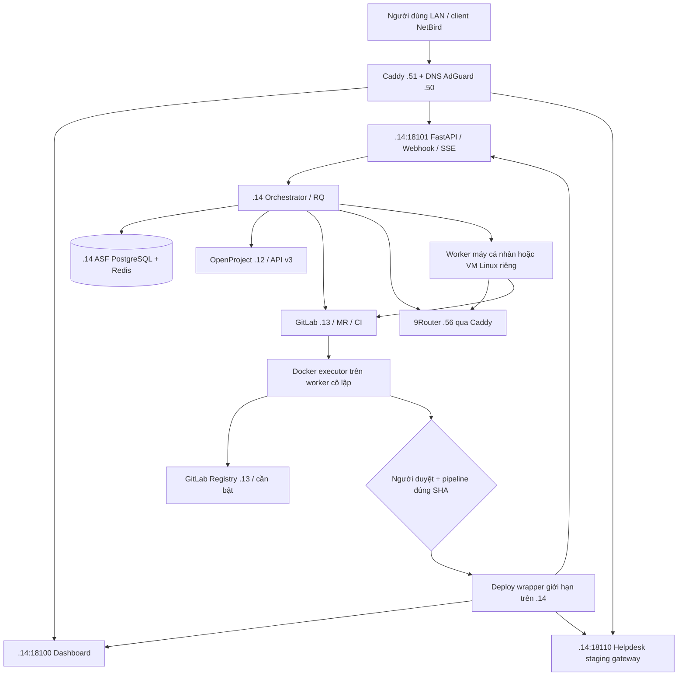

# Kế hoạch triển khai đã chốt — AI Software Factory

> **Ưu tiên mới 04/11/2026:** người dùng yêu cầu code và deploy bản đầu trước phần thực nghiệm/template. Xem [lộ trình hiện hành](../plan/lo-trinh-code-v0.md) và [ADR-004](adr/ADR-004-release-first.md). Phân bố host/resource/DNS bên dưới vẫn áp dụng; thứ tự thi công và gate phải đọc theo lộ trình mới. Không cần hoàn tất toàn bộ M0 để viết scaffold.

Ngày chốt: **03/11/2026**, Asia/Saigon. Căn cứ [kiểm kê thực tế](infra-inventory.md) và [snapshot MCP](evidence/openproject-itcare-2026-2026-11-03.json). Đây là kế hoạch thi công, chưa phải thông báo đã triển khai.

> **Cập nhật 04/11/2026:** worker `.60` đã mở đủ root LV 58 GiB, cài Docker/CLI image và pass sửa code + 3 test trong container Linux. Có thể bắt đầu code nền tảng Phase 1; GitLab Runner chưa register và pipeline tự động chưa nghiệm thu. Xem [mức sẵn sàng](worker-bootstrap-2026-11-04.md).

## 1. Quyết định chính

1. Tận dụng GitLab `.13`, OpenProject `.12`, Caddy `.51`; NetBird dùng để vào subnet từ xa, không cần cài agent VPN trên từng container.
2. Nền tảng và staging chạy trên `.14`, Compose riêng, DB/Redis/volume riêng; không chạm Safe School hoặc ITCare đang chạy.
3. Coding/build/test chạy trên **worker Linux cô lập, đặt trên máy cá nhân hoặc VM server**, không chạy bằng hai shell runner hiện có trên `.14`. Worker có thể bật theo nhu cầu. Chỉ mở coding gate sau S4/S7.
4. Control plane: FastAPI + LangGraph + PostgreSQL 17 + Redis/RQ + Next.js. Sáu role logic trong một hệ thống, chưa chia thành sáu microservice.
5. Coding adapter MVP: **OpenCode**, sau khi file-edit probe đã pass; Codex là adapter bổ sung chờ kiểm chứng. Gateway dùng 9Router `https://ai.lazy.local/v1`.
6. Module thực nghiệm: **Mini Helpdesk độc lập**, FastAPI + Next.js; tham khảo cách quản lý work package của ITCare-2026, giữ dữ liệu/tiến độ của dự án đó nguyên vẹn.
7. Hai repo GitLab mới: `ai-software-factory` và `mini-helpdesk`. Giữ GitHub origin hiện tại; thêm remote `gitlab` khi bootstrap. Group đề xuất `ai-factory`, kiểm tra tên/quyền trước tạo.

Các ADR: [module/stack](adr/ADR-001-module-mau.md), [phân bố](adr/ADR-002-phan-bo-ha-tang.md), [CLI](adr/ADR-003-coding-cli.md).

## 2. Sơ đồ triển khai



Worker khuyến nghị 4 vCPU/8 GiB RAM/80 GiB SSD, có thể đặt trong VM trên máy cá nhân hoặc VM server; không cần IP cố định nếu dùng mô hình worker tự lấy job. Máy cá nhân dùng LAN/NetBird, tin CA và phân giải DNS nội bộ. Tài nguyên hypervisor/máy cá nhân chưa khảo sát. Trước khi có worker đã nghiệm thu vẫn làm nền tảng với mock workflow; không cho coding/test tự động rơi xuống host dịch vụ. Xem [phương án worker linh hoạt](worker-options.md).

## 3. Tài nguyên và mạng

| Stack/dịch vụ mới trên `.14` | RAM limit khởi điểm | Cổng host dự kiến |
|---|---:|---|
| ASF dashboard | 384 MiB | `.14:18100` |
| ASF API | 384 MiB | `.14:18101` |
| Orchestrator/RQ worker | 768 MiB | Không publish |
| ASF PostgreSQL | 768 MiB | Không publish 5432 |
| ASF Redis | 128 MiB | Không publish 6379 |
| Helpdesk API | 384 MiB | Chỉ network staging |
| Helpdesk frontend | 384 MiB | Chỉ network staging |
| Helpdesk PostgreSQL | 512 MiB | Không publish |
| Helpdesk gateway | 64 MiB | `.14:18110` |

Tổng ~3.70 GiB; đặt trần mới ban đầu 4 GiB. CPU budget tổng các workload ASF tối đa 3 vCPU, điều tiết theo đo tải; không build image trên `.14`. Limits chỉ là budget dự kiến, cần thử load và so với ứng dụng hiện hữu trước mở concurrency. Worker điều tiết coding + CI tổng tối đa 2 tác vụ trên cấu hình khuyến nghị, không phải 2 tác vụ mỗi loại.

Các cổng trên chưa thấy listen trong snapshot; kiểm tra lại ngay trước bind. Cổng đang dùng gồm 5432, 8000, 8091, 8092, 9443, 18080, 18081. `.51:18081` còn có route khác; không tái sử dụng.

| DNS mới | Đích DNS | Caddy upstream |
|---|---|---|
| `asf.lazy.local` | `.51` | `/api/*`, `/healthz`, `/readyz` → `.14:18101`; phần còn lại → `.14:18100` |
| `helpdesk-staging.lazy.local` | `.51` | `.14:18110` |
| `registry.lazy.local` | `.51` | `.13:5050` sau khi bật Registry |

Dashboard/API dùng cùng origin để giảm cấu hình CORS; SSE dưới `/api/`. Caddy giữ prefix `/api`, chuyển tiếp đúng HTTPS, hỗ trợ kết nối SSE dài. Chỉ cần thêm `asf-api` nếu sau này có nhu cầu tách origin.

Các route ASF mới `tls internal`, áp ACL `internal_only` tương thích nguồn NetBird/subnet router. Host/container phải tin Caddy root; public endpoint OpenProject tiếp tục dùng CA công cộng. `.14` chỉ nhận upstream port từ Caddy/nguồn quản trị được chỉ định; kiểm tra firewall có hiệu lực với Docker published ports, không chỉ dựa vào UFW. DB/Redis không xuất LAN.

OpenProject canonical đang là domain public. Trước runtime, ưu tiên làm đường nội bộ ổn định bằng cấu hình hostname được hỗ trợ và Caddy Host phù hợp, hoặc route split DNS canonical có TLS đúng tên. Không tắt kiểm tra TLS, không dùng SSH quản trị làm dependency runtime.

## 4. Bộ work package theo ITCare-2026

Tạo **project ASF riêng**, dự kiến identifier `ai-software-factory`. Chỉ sao chép cấu trúc type/workflow hợp lệ; không clone 214 nhiệm vụ ITCare hoặc lịch synthetic. Quy hoạch:

- Epic theo năng lực: hạ tầng, orchestration, PM/BA, coding, QA/deploy, dashboard/thực nghiệm.
- User story theo đầu ra người dùng; Task theo role PM/BA/BE/FE/TEST/DEVOPS. Task hạ tầng có thể nằm trực tiếp dưới Epic như mẫu.
- Sub-task cho checklist cần tracking riêng; Bug cho lỗi TEST phát hiện; Milestone M0…M5 cho các gate.
- Giữ mã công việc `P0-01`…`P5-xx` đang có, title dạng `[ASF-P2-PM-01] ...`; ghi `Plan key: P2-01` để map sang plan. Nhiệm vụ chạy thật thêm `run_id`, `task_id`, contract version và commit SHA.
- Sprint/phiên bản tạo riêng theo phase, gắn `targetVersions`; không chỉ lưu sprint trong mô tả như mẫu. Không giả định MCP có tool tạo project/version: dùng API v3 hoặc UI phù hợp khi bootstrap.
- `Work role`, acceptance, evidence, dependency, run/contract refs dùng mô tả có cấu trúc trước; chưa tạo custom fields toàn instance.

Mô tả Task chuẩn:

```text
Plan key: P2-01
External key: ASF-P2-PM-01
Work role: PM
Objective: ...
Scope: ...
Acceptance: ...
Dependencies: OP-...
Artifacts: ...
Run ID / Contract version / Candidate SHA: ...
Evidence: MR / pipeline / test report / deployment URL
```

Mapping theo workflow **Task/User story** đã xác minh; không lấy tên gần giống ở instance thay thế:

| State nội bộ | OpenProject ID / tên | Cách thực hiện |
|---|---|---|
| BACKLOG | 15 / Backlog | Task mới 1 / New → 15 |
| READY | 20 / Selected | 15 → 20 |
| IN_PROGRESS | 7 / In progress | 20 → 7 |
| IN_REVIEW | 21 / Code Review | 7 → 21 |
| READY_FOR_TEST | 22 / Ready for Test | 21 → 22 |
| TESTING | 23 / Testing | 22 → 23 |
| DONE | 19 / Done | 23 → 19, chỉ sau evidence đạt AC |
| CHANGES_REQUESTED | 7 / In progress | 21 hoặc 23 → 7; lý do nằm ở comment/state nội bộ |
| BLOCKED | 24 / Blocked | Workflow mẫu chỉ có 7 → 24 → 7 |

Bug bắt đầu New → Open (18) → In progress; test fail → Reopened (25) → In progress. Sub-task dùng To Do (17), In Review (26); không dùng Code Review (21) thay In Review. Epic theo Backlog → In progress → Done. Đọc allowed transition/schema bằng tài khoản bot và áp đúng workflow/type; không PATCH thẳng qua nhiều chặng.

Khi cần block ở giai đoạn khác, ghi state nội bộ + comment trước, không tự đổi workflow global hoặc ép một transition chưa được phép. Nếu nghiệp vụ cần transition mới, tạo bản workflow riêng cho ASF. Không chỉnh các workflow chung đang được ITCare sử dụng. Mọi cập nhật giữ `lockVersion`, conflict thì đọc lại; create theo external key phải kiểm tra idempotency ở DB nền tảng.

Dùng relation `blocks` cho dependency thực thi, như mẫu 1682 → 1683; `precedes/follows` chỉ khi muốn tự động đổi lịch. `depends_on` trong Orchestrator vẫn là nguồn quyết định scheduling tác vụ Agent.

## 5. Tài khoản, build và deploy

- OpenProject `asf-bot` chỉ là thành viên project ASF với quyền đọc/tạo/sửa/comment/relation. Tài khoản admin đang khảo sát không được đưa vào runtime.
- GitLab bot Developer trên repo cần coding, token monitor chỉ đọc; tài khoản deploy riêng cho job release. `main` protected, cấm direct push; MR do người review/merge. Kiểm tra tính năng duyệt bắt buộc của GitLab CE đang có; nếu không đủ enforcement thì chỉ maintainer người thật có quyền merge và lưu approval audit ở ASF.
- Repo ASF không nhận untagged/shared instance runner. Runner CI riêng, tag ví dụ `asf-ci`, scope project/group; Docker executor không privileged và không mount host socket vào job. Chọn rootless builder sau khi spike chứng minh chạy được trong cấu hình này; không tự bật privileged để vượt lỗi build.
- Registry mới có TLS hợp lệ, image tag full commit SHA và lưu digest. Chính sách giữ ít nhất 3 release đã deploy cùng rollback reference; artifact/JUnit tối thiểu 14 ngày ở giai đoạn demo, điều chỉnh theo dung lượng.
- Deploy job chỉ từ protected `main`/release, manual gate, đối chiếu đúng candidate SHA đã test; `resource_group` tách `asf-control` và `asf-helpdesk-staging` để tránh hai deploy chồng nhau.
- Forced-command SSH wrapper trên `.14` chỉ thao tác stack của ASF, không có shell tùy ý. Secret key/deploy token là protected file variables, chỉ vào job deploy; không vào container coding hoặc prompt. Không cấp nhóm docker cho user deploy mới.
- Spec approval gắn contract version; deploy approval gắn image digest/commit SHA. Thay candidate/contract làm approval cũ mất hiệu lực. Pipeline webhook có secret riêng, kiểm SHA/project/run và chống delivery trùng.
- PostgreSQL backup hàng ngày sang nơi khác host, retention 7 bản ngày + 4 bản tuần; NAS `.20` chỉ là đích ứng viên đã thấy trong Caddy, chưa kiểm tra quyền/dung lượng. Mục tiêu RPO 24 giờ/RTO 2 giờ cho MVP phải được xác nhận bằng thử restore. Không coi backup trên cùng volume là đủ.
- Rollback application về digest trước; migration theo expand/contract và backup trước migration. Không tự downgrade DB có mất dữ liệu; chạy restore rehearsal trước demo.

## 6. Thứ tự thi công và điều kiện mở gate

Ước lượng ngày công cho một người thực hiện tập trung; không coi là deadline đã được người dùng xác nhận. Lịch 12–13 tuần trong plan gốc vẫn là baseline cho dự án đầy đủ.

| Đợt | Công việc cụ thể | Chứng cứ để hoàn tất | Ước lượng |
|---|---|---|---|
| A — chuẩn bị truy cập | DNS/CA GitLab đã sửa; `.14` đạt 42.50 GiB trống; còn ổn định route OpenProject, chuẩn bị worker máy cá nhân hoặc VM | Host + worker/container resolve đúng hostname; TLS không `-k`; `.14` trống ≥35 GiB; worker resource được xác nhận | 1–2 ngày theo baseline |
| B — quản trị và repo | Tạo ASF OpenProject/project workflows/versions; bot hạn chế quyền; group/2 repo GitLab; protected main/MR; thêm remote `gitlab`; bật Registry/DNS/Caddy | S2/S3 có create/read/update/comment/relation/MR thật bằng bot; Registry push/pull thành công; secret scan sạch | 1–2 ngày |
| C — CI và sandbox | Docker executor trên worker, CA/DNS trong image; OpenCode adapter; resource limits; builder phù hợp | S4 pipeline + JUnit xanh; S7 sửa file và test thật trong Linux, không thấy socket/secret deploy; job không chạy trên shell runner cũ | 1–2 ngày |
| D — đường triển khai | Deploy wrapper, hai stack hello-world, Caddy routes/ACL, webhook endpoint, backup/restore thử | S5 URL staging OK qua CI; S6 delivery thật + bad secret bị từ chối + duplicate không chạy lại; smoke/rollback/restore có log | 1–2 ngày |
| E — Phase 1 | Khung API/DB/queue/LangGraph, sáu role stub, client gateway, approval API, timeline tối thiểu | M1: checkpoint/resume, spec gate, trace ID, usage và ma trận quyền | 2 tuần theo baseline |
| F — Phase 2–5 | PM/BA thật → BE/FE song song → TEST/fix → DEVOPS → dashboard/metrics | M2…M5 theo checklist các file phase; không mở deploy gate trước đúng SHA/test | Theo baseline còn lại |

Đợt B/C có thể triển khai các phần độc lập sau khi dependency của A tương ứng đạt; đợt D chờ repo/runner/secret sẵn sàng. Tổng chuẩn bị theo baseline khoảng **4–8 ngày công**, phụ thuộc chuẩn bị worker và các cấu hình cần quản trị; không tuyên bố Phase 0 đã hoàn tất. Các việc bảo trì đã thực hiện được ghi riêng để không nhầm với checklist còn lại.

Chuyển **khung dashboard/timeline tối thiểu** về cuối Phase 1 để người duyệt sử dụng các gate; Phase 5 dành cho hoàn thiện dashboard và thực nghiệm. Gate có API audit ngay từ Phase 1.

M0 đóng khi S1…S7 đủ chứng cứ, tài khoản bot không admin, CI runner đúng máy, trust/DNS đúng từ host và container, backup thử được và hai repo đã có secret scanning. Hạn nộp, số thành viên và người duyệt chính thức còn cần gán khi xếp lịch; MVP mặc định mỗi gate chờ người khởi tạo run hoặc admin dự án được phân quyền duyệt.

## 7. Hạng mục cần xử lý trước

**P0 còn lại:** chuẩn bị worker máy cá nhân hoặc VM; đường truy cập OpenProject ổn định; tài khoản bot; Registry và runner dự án cô lập. DNS/CA `.13` đã sửa ngày 03/11/2026; kết quả dung lượng xem nhật ký bảo trì. Các bước còn lại vẫn chặn pipeline end-to-end.

**P1:** tăng RAM OpenProject; kiểm chứng NetBird client từ xa/ACL/split DNS; rà ACL cho các route hiện hữu chưa áp `internal_only`; backup off-host và restore; quota gateway. Không thay policy dịch vụ khác trong lúc triển khai ASF mà chưa kiểm tra tác động.

Mọi thay đổi hạ tầng được ghi thành diff/config riêng, kiểm tra cấu hình trước apply và có rollback phù hợp. Lần khảo sát đầu chỉ đọc; sau đó người dùng đã cho phép xóa hoàn toàn `btl-httt`, dọn dung lượng `.14` và sửa CA `.13`. Các thao tác thực tế được ghi trong [nhật ký bảo trì](maintenance-2026-11-03.md).
