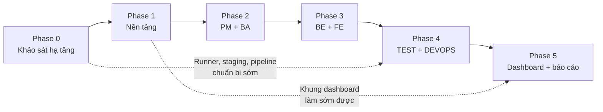

# Kế hoạch triển khai — AI Software Factory (6 AI Agent)

> **Lộ trình hiện hành từ 04/11/2026:** [Bắt đầu code và deploy v0.1](lo-trinh-code-v0.md), theo [ADR-004](../docs/adr/ADR-004-release-first.md). Thứ tự mới: **khung ứng dụng → workflow → dashboard → deploy ASF lần đầu → tích hợp/Agent thật → template và nghiệm thu toàn luồng**. Không chờ toàn bộ Phase 0 cũ để bắt đầu code. Các bảng Phase 0–5 bên dưới là baseline tham khảo, không phải thứ tự hiện hành.

Thư mục này chia kế hoạch triển khai thành từng phase, dựa trên tài liệu [AI_Software_Factory_6_Agents_Architecture.md](../AI_Software_Factory_6_Agents_Architecture.md) (sau đây gọi là **tài liệu kiến trúc**).

**Cập nhật 03/11/2026:** xem [kế hoạch triển khai đã chốt](../docs/deployment-plan.md), [kiểm kê hạ tầng](../docs/infra-inventory.md) và các ADR trong `docs/adr/`. Nền tảng/staging trên `.14`; coding/build trên môi trường Linux cô lập **ở máy cá nhân hoặc VM server** theo [phương án worker](../docs/worker-options.md); adapter OpenCode cho MVP; bộ work package theo **ITCare-2026 / `itcare-2026` / ID 6**. Phase 0 **chưa nghiệm thu M0**; vẫn còn Registry, bot, sandbox/CI và các spike ghi dữ liệu/deploy/webhook.

**Cập nhật 04/11/2026:** [worker `.60` đã bootstrap](../docs/worker-bootstrap-2026-11-04.md), mở đủ disk, pass sửa code và ba test trong Linux container; có thể bắt đầu code nền tảng Phase 1 với mock/role stub. Runner chưa register; CI/deploy tự động vẫn chờ các gate Phase 0 còn lại.

Mỗi file phase gồm: mục tiêu, phạm vi, điều kiện bắt đầu, công việc chi tiết, sản phẩm bàn giao, tiêu chí nghiệm thu (checklist), cách kiểm chứng và rủi ro.

---

## 1. Danh sách phase

| Phase | File | Mục tiêu chính | Thời lượng gợi ý |
|---|---|---|---|
| 0 | [Khảo sát & chuẩn bị hạ tầng](phase-0-khao-sat-ha-tang.md) | Xác minh 9Router, OpenProject, GitLab, runner, server; chốt module mẫu | 1 tuần |
| 1 | [Nền tảng Orchestrator](phase-1-nen-tang.md) | API, LangGraph, PostgreSQL, Redis, 9Router client, khung 6 Agent | 2 tuần |
| 2 | [PM Agent + BA Agent](phase-2-pm-ba.md) | Yêu cầu → Work Packages + SRS/AC/API contract được duyệt | 2 tuần |
| 3 | [BE Agent + FE Agent](phase-3-be-fe.md) | Coding worker cô lập, phát triển song song, MR trên GitLab | 3 tuần |
| 4 | [TEST Agent + DEVOPS Agent](phase-4-test-devops.md) | CI, vòng lặp test → sửa, deploy staging, smoke test, rollback | 2–3 tuần |
| 5 | [Dashboard, thực nghiệm, báo cáo](phase-5-dashboard-bao-cao.md) | Giao diện giám sát/duyệt, số liệu thực nghiệm, demo, báo cáo | 2 tuần |

**Tổng:** khoảng 12–13 tuần. Đây là thời lượng gợi ý cho nhóm nhỏ, cần điều chỉnh theo hạn nộp và số thành viên.

> **Ghi chú:** Mục 12 của tài liệu kiến trúc không có Phase 0. Phase này được thêm vào từ mục 15 ("Những thông tin cần xác minh trước khi triển khai"), vì mọi phase sau đều phụ thuộc vào kết quả xác minh hạ tầng.

---

## 2. Phụ thuộc giữa các phase

Các phần có thể làm song song để rút ngắn thời gian:

- **DEVOPS chuẩn bị sớm** (mục 4.1 tài liệu kiến trúc): runner cô lập, staging, Dockerfile và pipeline khung có thể làm cùng lúc với Phase 2–3. Riêng bước **deploy** vẫn phải chờ gate.
- **Khung dashboard:** từ cuối Phase 1 đã có API và SSE, nên có thể dựng trang xem timeline đơn giản để tiện debug các phase sau.
- **TEST soạn test case:** làm ngay khi BA có AC (Phase 2), không cần chờ code.

---

## 3. Các mốc nghiệm thu

| Mốc | Kết thúc | Chứng cứ cần có |
|---|---|---|
| **M0** Hạ tầng sẵn sàng | Phase 0 | Bảng kiểm kê hạ tầng; 7 spike chạy thành công; ADR chọn module mẫu |
| **M1** Workflow chạy được | Phase 1 | Run mẫu đi qua đủ 6 role; lịch sử lưu DB; dừng/resume từ checkpoint |
| **M2** Đặc tả được duyệt | Phase 2 | Work Packages trong OpenProject; contract v1 đã freeze và nằm trong repo |
| **M3** Code thật trên GitLab | Phase 3 | 2 MR (BE, FE) tạo song song; có `integration_commit_sha` |
| **M4** Staging chạy | Phase 4 | Pipeline pass trên SHA ứng viên; vòng sửa lỗi; deploy + smoke test pass |
| **M5** Sẵn sàng bảo vệ | Phase 5 | Dashboard; số liệu 3 kịch bản; run mẫu lưu sẵn; video dự phòng; báo cáo |

---

## 4. Định nghĩa MVP (từ mục 12 tài liệu kiến trúc)

Bắt buộc có:

- Một project demo (module mẫu, gợi ý **Mini Helpdesk**).
- Sáu Agent: PM, BA, BE, FE, TEST, DEVOPS.
- Một quy trình có approval (ít nhất Specification Gate và Deployment Gate).
- Một vòng lặp sửa lỗi thật (test fail → sửa → test pass).
- Một môi trường staging.
- Một dashboard theo dõi trạng thái.

**Không cần** ở bản đầu: đa tenant, tự deploy production, nhiều project chạy song song.

### Thứ tự cắt giảm khi thiếu thời gian

Nếu bị trễ, cắt theo thứ tự dưới đây. Phần trên cùng cắt trước.

1. Màn hình dashboard phụ (Task Board, GitLab/CI view): thay bằng link sang OpenProject/GitLab.
2. Thay đổi contract v1 → v2 giữa chừng: chỉ demo luồng QUESTION/ANSWER.
3. Test e2e Playwright: giữ API test và unit test.
4. Tự động rollback: chuyển thành rollback thủ công có ghi lại.

**Không được cắt:** human approval, chạy song song BE/FE, vòng lặp sửa lỗi thật, gắn kết quả với commit SHA, sandbox cô lập.

---

## 5. Quy ước chung

### Mã công việc

- Mỗi công việc có mã `P<phase>-<số>`, ví dụ `P1-03`.
- Có thể tạo các công việc này thành Work Package trong OpenProject để quản lý chính dự án làm bài.

### Definition of Done chung cho mọi công việc

- Code được merge qua MR, có người review.
- Có test tự động phù hợp; CI xanh.
- Không có secret trong code, log hoặc prompt (kiểm bằng `gitleaks`).
- Hành động của Agent có gắn `run_id` / `task_id` để truy vết.
- Tài liệu liên quan đã được cập nhật.

### Ghi lại quyết định

Mỗi quyết định kỹ thuật quan trọng được ghi thành ADR (Architecture Decision Record) trong `docs/adr/`, ví dụ: chọn module mẫu, chọn coding tool, chính sách merge.

### Nguyên tắc xuyên suốt (mục 1.2 tài liệu kiến trúc)

- Mọi giao tiếp Agent đi qua Orchestrator; không có kênh riêng.
- Truy vết được: `run_id`, `task_id`, phiên bản tài liệu, commit SHA.
- Người duyệt ở các bước quan trọng.
- Agent chỉ có quyền tối thiểu.
- Kết quả build/test luôn gắn commit SHA.
- Tận dụng hạ tầng có sẵn; làm MVP trước.

---

## 6. Cách dùng thư mục này

- Mỗi file phase có mục **Tiêu chí nghiệm thu** dạng checklist `- [ ]`. Tick khi hoàn thành.
- Khi thông tin thực tế khác với giả định trong plan (ví dụ phiên bản GitLab, khả năng của 9Router), cập nhật file phase tương ứng và ghi ADR.
