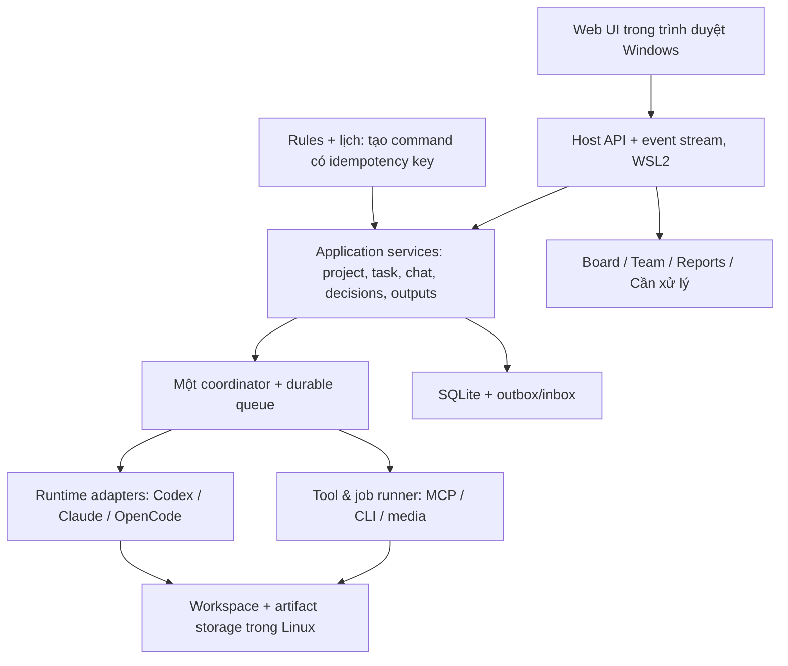

# Factory V2 — Kế hoạch hợp nhất theo CrewHub Loops

**Cập nhật UI/UX 06/11/2026:** [Đánh giá và kế hoạch nâng cấp](uiux-upgrade.md) là quyết định hiện hành: Light mặc định, Dark/System, Inter, vi/en và nhiều cửa sổ chat kéo/resize. Thay mục tiêu sao chép palette/font trên 90% và giới hạn một dock; giữ phạm vi nghiệp vụ và tiêu chí tin cậy. [F0-02 đã hoàn tất bộ chuẩn/fixture](f0-02-design-baseline.md), chưa có Host/UI V2 thật.

Ngày: **05/11/2026**. Trạng thái: **kế hoạch để triển khai; chưa xây Host/UI V2**. Baseline `793f081`, nhánh `feature/worker-office-v1.3d`; checkpoint `checkpoint/factory-v2-consolidated-20261105`. Mã phiên bản V2 dùng cho hướng sản phẩm mới, không đổi version ứng dụng hiện tại trong đợt tài liệu này.

**Tiến độ 06/11/2026:** F0 hoàn tất: [baseline/reuse map](f0-01-baseline.md), [design baseline](f0-02-design-baseline.md) và [contracts/ADR](f0-03-contracts.md) Done. Nhánh `feature/factory-v2-foundation`, checkpoint mới `checkpoint/factory-v2-f0-03-20261106`. Có package TypeScript dùng chung và fixture offline; chưa scaffold Host/UI app, đổi DB hoặc cài WSL. Tiếp theo **F1-01 preflight WSL**, rồi Host/API/storage thật.

**Đây là đầu mối kế hoạch hiện hành.** Gộp multi-runtime, Paperclip, đa lĩnh vực, Loops, quyền tự động và WSL2. CrewHub là tham chiếu trải nghiệm và vòng nghiệp vụ local; hình thức theo kế hoạch UI/UX 06/11, không bắt sao chép palette/font trên 90%. Giữ project tabs, Graph và hướng web/WSL đã chốt. Không yêu cầu xóa sản phẩm/dữ liệu cũ.

## 1. Đọc và triển khai theo bộ tài liệu nào?

| Tài liệu | Dùng để quyết định |
|---|---|
| [Kế hoạch hợp nhất](README.md) | Phạm vi, kiến trúc, quyết định cuối, đối chiếu hiện trạng |
| [Thiết kế và bộ ảnh](design-reference.md) | Chín ảnh chuẩn, màu/font/kích thước, bố cục từng trang, responsive |
| [Quy trình và hợp đồng dữ liệu](workflows.md) | Lead/agent/task, quyền, bàn giao, automation, trạng thái và API |
| [Backlog và thứ tự triển khai](delivery-plan.md) | Các đợt F0–F8, ticket cụ thể, phụ thuộc, đầu ra và nghiệm thu |
| [Tiêu chí nghiệm thu](acceptance.md) | Quality gates hiện hành, business parity, luồng bắt buộc và bằng chứng phát hành; visual rubric cũ chỉ tham khảo |
| [Đánh giá UI/UX 06/11](uiux-upgrade.md) | Hiện trạng thật/demo, Light/Dark, Inter, vi/en, chat windows, thư viện và các bước UX-0–5 |
| [Manifest tham chiếu](../../research/factory-v2/reference-manifest.json) | Hash ảnh, snapshot nguồn, quyết định, giới hạn khảo sát |
| [Kết quả kiểm tra tài liệu](../../research/factory-v2/validation.json) | Links, JSON, hashes, số ticket/cases; không phải app build/test |

Chín ảnh được dẫn ngay trong tài liệu thiết kế từ `crewhub/`; vẫn giữ local theo yêu cầu không push ảnh. Checkout khác cần tự cung cấp đúng bộ ảnh/hash để đối chiếu. Các tài liệu cũ là lịch sử và nguồn chi tiết; nếu có xung đột, bộ `factory-v2` này được ưu tiên. F0–F8 là thứ tự duy nhất dùng để mở công việc mới; không tạo song song ticket P/V2/LP cho cùng một việc.

## 2. Sản phẩm cuối cùng người dùng nhận được

Một ứng dụng web local, mở bằng trình duyệt Windows, quản lý đội AI chạy trong WSL2. Người dùng tạo dự án, chọn Lead và nói yêu cầu bằng ngôn ngữ tự nhiên. Lead trả lời trực tiếp hoặc tổ chức các task có người nhận, đầu ra và điều kiện hoàn thành. Board, Team, Chat, Reports và Automations xem cùng hồ sơ; người dùng biết ai đang làm gì, chờ gì và cần tự xử lý việc nào.

Ví dụ phần mềm: trao đổi yêu cầu → BA lưu yêu cầu/data model/API contract có phiên bản → FE và BE chạy song song trên input đã chốt → tích hợp → kiểm tra → Lead báo kết quả → hoàn thành hoặc review theo policy. Ví dụ nội dung/video: brief → nghiên cứu/kịch bản → asset → render job → preview → sửa/xuất. Những chuỗi này là template sửa được; việc nhỏ không phải đi qua mọi role.

Giao diện dùng Light mặc định, có Dark/System, Inter và vi/en theo kế hoạch UI/UX; giữ sidebar/project tabs và nhịp bố cục CrewHub. Board giữ cột cao theo viewport, Team có cây session/agent, chat có cửa sổ kéo/resize và tray. Không biến sản phẩm thành bảng log hoặc biểu mẫu xác nhận lệnh.

## 3. Quyết định đã hợp nhất

| Mã | Quyết định hiện hành | Hệ quả khi triển khai |
|---|---|---|
| D01 | CrewHub Loops là tham chiếu trải nghiệm/nghiệp vụ | Shell, nhịp bố cục, tab và vòng giao việc; Light/Dark, Inter, vi/en, chat windows theo UI/UX 06/11 |
| D02 | Web UI + một Host WSL2; local-first | Trình duyệt không chạy CLI trực tiếp; Electron chỉ là tùy chọn đóng gói về sau |
| D03 | Một nguồn quản lý ownership/dispatch | Lead và automation gửi command qua cùng coordinator/queue |
| D04 | Không bắt LangGraph | Bắt đầu state machine + durable queue; chỉ xét lại khi có bằng chứng recovery/workflow cần engine chuyên dụng |
| D05 | Agent, role và đội tự do | Không enum bảy role; Lead theo project, agent chọn runtime/model/skills/tools riêng |
| D06 | Codex, Claude Code, OpenCode qua adapter | Probe capability/auth; không giả mọi runtime có cùng session, model, child visibility |
| D07 | Quyền thực thi được cấp trước | Đọc/sửa/build/test/shell trong scope không có Bash Accept thường ngày |
| D08 | Câu hỏi nghiệp vụ và duyệt đầu ra độc lập quyền tool | Chat là nơi trả lời Lead; review theo Human-final/Automatic/Hybrid |
| D09 | Project không bắt Git hoặc code | Hỗ trợ directory/artifact workspace, tài liệu/ảnh/media/jobs |
| D10 | Automation List/Graph là hai view cùng rule model | Event → điều kiện → hành động, lịch dùng cùng dispatch, version/simulation/history |
| D11 | Một hồ sơ công việc thống nhất | Mọi đường mở task/decision/report dẫn về cùng ID/revision |
| D12 | Chuyển dữ liệu có kiểm chứng, không reset | Giữ V1 dùng được tới khi đủ luồng V2; migration trên bản sao, không replay task cũ |

Tên “Full access” phải mô tả đúng quyền hiệu lực: agent được tự chạy công cụ trong environment đã cấp, có phạm vi filesystem/network/tool/job rõ. Không phải lời hứa có root, điều khiển mọi app Windows hoặc tự publish/mua dịch vụ. Dự án đã được cấp quyền thì không hỏi lại để bắt đầu từng việc.

## 4. Hiện trạng và khoảng cách

Khảo sát source trước đó tại `bf9b497` và baseline tài liệu hiện tại; Worker vẫn `1.3.0-alpha.8`. Các commit nghiên cứu gần nhất chỉ thay tài liệu, không biến tính năng đề xuất thành khả năng đã chạy.

| Nhóm | Đã có hoặc có thể học lại từ V1 | Cần làm cho V2 |
|---|---|---|
| Workspace UX | R0–R6 đã có chat, công việc, feed, kết quả, setup, lịch | Shell/9 màn theo ảnh, bỏ điều hướng và metadata gây nhiễu, web transport |
| Agent/runtime | OpenCode/9Router, role policy và role defaults | Agent ID tự do, ba adapter, capability/model discovery |
| Điều phối | Task/dependency/worktree, stop/recovery/evidence | Gỡ một active run toàn app, claim/lease/fencing và concurrency theo tài nguyên/scope |
| Skills/tools | Catalog skills nội bộ | Import versioned package, MCP/CLI registry, binding theo agent/project |
| Tài liệu | Lưu/xuất thiết kế BA, command/file evidence | Document/output revision, input refs, preview/review đa lĩnh vực |
| Automation | Lịch hiện tại tạo backlog, có timer/history | Event rules và dispatch thật, Graph/List, simulation/chống lặp |
| Môi trường | Windows CLI đã được nhận diện; Ubuntu WSL2 tồn tại | Chưa probe Linux toolchain/auth/disk/network/CA; chưa chạy runtime trong WSL |
| Dữ liệu | SQLite/history của V1 | Storage V2 riêng và import/export; không dùng chung DB writable qua hai OS |

Không nhập tất cả controller/schema cũ chỉ để gọi là tái sử dụng. Giữ những ý tưởng đã chứng minh hữu ích: stop/reconcile, worktrees, history, evidence, BA docs và một hồ sơ công việc. Lựa chọn giữ/chuyển/viết lại từng module được ghi ở F0.

## 5. Phạm vi nghiệp vụ

### Bản 2.0 local hoàn chỉnh

1. Setup máy/runtime/model/quyền; tạo dự án theo wizard ba bước; readiness chỉ chặn điều kiện thật sự bắt buộc.
2. Dashboard, Cần bạn xử lý, Team; sidebar dự án và tab Overview/Board/Reports/List/Archive/Automations/Scheduled/Git.
3. Lead chat tự nhiên; chat tư vấn không sinh task rác; yêu cầu làm việc tạo/link task đúng một lần; attachments và ngữ cảnh rõ.
4. Agent CRUD/template, đội theo project, chọn runtime/model, skill/tool bindings; session thuộc task và runtime cụ thể.
5. Ticket/subtask, assignee, dependency, custom fields, labels/priority, workflow/status cấu hình được; review và archive/park.
6. Phối hợp song song khi độc lập; task thread/handoff; stop thật, recovery không thực thi lặp; tự sửa tối đa ba vòng mỗi vấn đề.
7. Reports, thiết kế BA và outputs có version/source/evidence; người dùng xem được data model/API contract và phiên bản FE/BE đang dùng.
8. Rule engine List + Graph, Draft/Proposed/On/Off, simulation, history; schedule/timezone/skip/coalesce; không cần mở UI để chạy khi Host còn hoạt động.
9. Domain packs Software, Research & Planning, Content, Design, Video Basic; job runner/preview; Git chỉ khi dự án có Git.
10. Search/views, export/backup/restore, import V1 trên bản sao; hướng dẫn vận hành local và checklist phát hành.

Git 2.0 gồm workspace/status/diff/commit history và liên kết task. GitHub PR/issues được triển khai khi có provider connection hợp lệ; hiển thị unsupported/setup khi chưa có, không tạo dữ liệu giả. Điều này không kéo GitLab Server, Jira hoặc OpenProject vào sản phẩm.

### Sau 2.0 hoặc tính năng có điều kiện

Remote LAN/NetBird/VM là profile 2.1 cùng protocol, có auth/TLS/reconnect và ownership rõ; không bắt dựng một VM cố định để dùng local. Nhiều execution hosts, Windows native-tool bridge, NLE/video chuyên sâu, GPU/AI media trả phí, marketplace, multiuser governance và 3D nằm ngoài bản local đầu. Chưa triển khai bridge thì không quảng cáo điều khiển Premiere/DaVinci từ WSL.

3D tiếp tục tạm dừng. Không bắt Docker/Redis/PostgreSQL/Kubernetes hoặc LangGraph để chạy 2.0. Budget/token/resource guard dùng mức runtime cung cấp; chi phí chưa biết hiển thị “Chưa có giá”, không tính thành 0.

## 6. Kiến trúc triển khai đề xuất



**Stack khởi đầu:** TypeScript/Node Host, React/TypeScript/Vite UI, SQLite và file storage. Tái dùng React/component/tooling nếu phù hợp; transport/API không phụ thuộc Electron IPC. Schema validation và contracts dùng chung. Chỉ thêm dependency có nhiệm vụ cụ thể; graph editor có thể dùng React Flow sau khi xác minh giấy phép/version, không cần engine workflow thứ hai. Pin versions trong lockfile sau preflight.

Ranh giới source đề xuất, chưa tạo code:

```text
apps/factory-host/           API, application services, queue, recovery, persistence
apps/factory-ui/             shell, screens, design tokens, API client
packages/factory-contracts/  commands/events, DTO, validation, adapter capabilities
packages/factory-adapters/   runtime integrations; mỗi runtime có module riêng
packages/factory-presets/    versioned domain/project/workflow presets
```

Có thể gộp folder nếu hệ build của repo khiến cấu trúc này không đáng chi phí; giữ boundary logic và một queue, không bắt tạo năm package xuất bản. Chốt cấu trúc ở F0 trước thêm app mới. Không đưa nguyên source upstream vào repo.

**Đường dẫn đích đề xuất:** app/source Linux `~/factory/app`, projects `~/factory/projects`, state theo XDG, artifacts riêng. Không di chuyển/xóa `E:\GIT\...` hoặc AppData của V1. Không dùng chung `node_modules` và SQLite WAL giữa Windows/WSL. Backup phải nhất quán; artifacts có hash/retention tham chiếu, không xóa file còn được report/task dùng.

Host local bind loopback, kiểm session/token/origin cho API có tác động. Secrets lưu dưới quyền user của Host và tham chiếu bằng ID, không nằm trong prompt/export/log. Đóng tab không dừng công việc; tắt Host/WSL làm task interrupted và cần reconcile sau mở lại. Không hứa lịch chạy khi Windows ngủ/WSL tắt. Thiết lập auto-start và giới hạn CPU/RAM có recipe ở F1.

VM Linux có thể chạy cùng Host về sau. Chưa có benchmark để khẳng định cấu hình tối thiểu cho toàn bộ domain: 2 CPU/6 GB/60 GB có thể là máy điều phối/CLI nhẹ; build lớn, nhiều agent và render phải admission theo tài nguyên thực tế, không coi mọi tác vụ AI chạy local model.

## 7. Học gì từ các nguồn trước?

| Nguồn | Bằng chứng đã khảo sát | Lựa chọn hợp nhất |
|---|---|---|
| Chín ảnh `crewhub/` | Bố cục/màu/nội dung hiển thị | Chuẩn trực quan chính, mapping cập nhật trong atlas |
| [CrewHub Loops](https://crewhub.dev/loops) | Mô tả sản phẩm/onboarding/ticket/review/automation | Chuẩn vòng nghiệp vụ local; không suy đoán mọi tính năng ẩn đã hoạt động |
| [CrewHub classic](https://github.com/EKINSOL-DEV/crewhub) | Connection/session abstraction; Codex adapter vẫn stub ở snapshot | Học UX và lifecycle; không lấy stub làm integration thật |
| [CrewHub World](https://github.com/EKINSOL-DEV/crewhub2) | Design system và prototype mô phỏng | Semantic tokens/components; không coi simulation là runtime evidence |
| [Paperclip](https://github.com/paperclipai/paperclip) | Adapter/session/claim, routine revisions, work products/docs/budgets | Học ownership/handoff/output/recovery; không nhập company hierarchy/control plane |
| [Nghiên cứu runtime/WSL](../worker-v2/process-first-wsl.md) | Tài liệu runtime và phân biệt permission/approval | Adapter pin version/capability, quyền có hiệu lực từ Host đến OS |
| LangGraph | Có persistence/interrupt/replay; không quản lý CLI thay Host | Không bắt buộc; chỉ đánh giá lại bằng ADR khi có nhu cầu cụ thể |

Các revision/hash ở [manifest](../../research/factory-v2/reference-manifest.json) và [nghiên cứu gốc](../worker-v2/research.md). CrewHub classic/World root license AGPL-3.0, Paperclip MIT tại snapshot; triển khai độc lập, giữ thương hiệu ASF. Nếu lấy code/font/icon/package thật phải kiểm license và giữ notices thích hợp. Ảnh là reference local, không đóng gói thành asset sản phẩm.

## 8. Thứ tự và điểm có thể dùng sớm

| Đợt | Đầu ra | Mốc |
|---|---|---|
| F0 | Baseline, sơ đồ nguồn → màn, data/API contracts, inventory giữ/thay | Kế hoạch đủ để mở code |
| F1 | WSL preflight, Host chạy/dừng, một runtime sẵn sàng, permissions/storage | Nền thực thi |
| F2 | Design system + shell theo ảnh + Lead làm việc thật + Board/Team tối thiểu | **Alpha dùng được hằng ngày cho một Lead** |
| F3 | Agent tự do, ba runtime, song song, skills/MCP/CLI, handoff | Đội đa công cụ |
| F4 | Ticket/workflow/project types, review/inbox, BA docs/reports | Vòng nghiệp vụ trọn vẹn |
| F5 | Automations List/Graph và Scheduled | Local Loops automation |
| F6 | Đa lĩnh vực, jobs/media/outputs | Đội không chỉ code |
| F7 | Search/views/archive, Git/provider, hoàn thiện chín màn/hiệu năng | 2.0 candidate |
| F8 | Migration/backup/recovery, nghiệm thu hình ảnh/nghiệp vụ, phát hành | 2.0 local |

UI theo ảnh được làm từ F2 và kiểm tại từng đợt, không đợi backend xong mới làm đẹp. Shell F2 chỉ expose các view đang hoạt động; các tab còn lại thêm dần đúng vị trí trong đích cuối. Không dùng trang/nút không hoạt động để đạt hình thức “giống”.

## 9. Truy vết các phương án cũ

| Kế hoạch trước | Điều giữ lại | Được thay/thực hiện ở đâu |
|---|---|---|
| WW-1–4, V1.1–1.3, UX/R0–R6 | Baseline code, bằng chứng và kinh nghiệm UX | Không mở lại toàn bộ như task chưa làm; F0 xác định phần reuse |
| [Worker V2](../worker-v2/README.md), V2-01–07 | Adapter, đội tự do, skills, task/evidence | D01–D12 và F1–F8 thay thứ tự/kiến trúc bắt buộc |
| [Paperclip/đa lĩnh vực](../worker-v2/multidomain.md) | Goals, outputs/jobs/resources, domain packs | F3/F4/F6; không mang ràng buộc Windows-native |
| [Loops parity](../worker-v2/loops-parity.md), [rules](../worker-v2/automations.md) | Tính năng và safety semantics của rule engine | F4/F5/F7; canonical contracts ở workflows |
| [Process-first WSL](../worker-v2/process-first-wsl.md), P0–P5 | Quy trình tự nhiên, quyền tự động, Host Linux | Giữ và phân nhỏ thành F0–F8 |
| [CrewHub workspace R](../experience-loops/crewhub-workspace-redesign.md) | Một hồ sơ, gọn feed, card/menu căn đều | Palette, font, mapping ảnh, tab cuối cùng theo thiết kế mới |

## 10. Những gì phải kiểm chứng trong triển khai

WSL hiện chỉ xác minh có Ubuntu WSL2, chưa biết Linux auth/toolchain/network/disk thực tế. Không có source Loops đầy đủ để chứng minh mọi nghiệp vụ ẩn. Không có bằng chứng đã đạt 90% giao diện hoặc chạy được ba runtime V2. Những điểm này trở thành ticket và acceptance, không phải lý do tạo thêm phase nghiên cứu vô hạn.

Nếu một runtime chưa có auth/quota, dùng runtime đã sẵn sàng để hoàn thiện lát cắt sản phẩm; đánh dấu adapter còn lại chưa nghiệm thu. Chỉ cần quyết định người dùng khi thiếu thông tin/quyền thực sự không thể suy ra; phần độc lập tiếp tục. Công việc kế tiếp cụ thể là **F0-01 → F0-03, sau đó F1/F2**, theo [delivery plan](delivery-plan.md).
