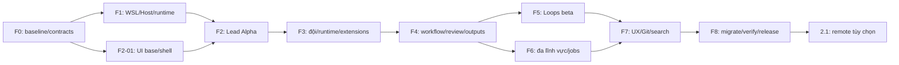

# Backlog triển khai Factory V2

Đọc [phạm vi hiện hành](README.md), [UI reference](design-reference.md), [behavior contracts](workflows.md) và [acceptance](acceptance.md). **Cập nhật 06/11/2026: F0-01 Done** — [baseline và reuse map](f0-01-baseline.md). 39 ticket còn lại Planned. Chưa triển khai Host/UI V2; không dùng trạng thái hoàn thành của inventory/tài liệu để đánh dấu chức năng đã có.

## 1. Cách thực hiện và bàn giao

Một ticket có owner theo chuyên môn, input/dependency, đầu ra và evidence. BE/FE/BA/QA/OPS dưới đây là nhóm công việc để phân công, không là bảy agent bắt buộc hoặc yêu cầu mở nhiều agent trong phiên hiện tại. Có thể một người/Lead thực hiện nhiều nhóm. Chia task thêm khi có output độc lập, không chia để tăng số card.

Mỗi đợt: checkpoint trước thay đổi lớn → thực hiện lát cắt dùng được → checks đúng thay đổi → sửa tối đa ba vòng mỗi vấn đề → ghi evidence/chưa đạt → commit. Không thêm một phase “chứng minh runtime” tách rời làm chậm sản phẩm; runtime thật được tích hợp và kiểm ngay trong F1/F2. Không bỏ kiểm quyền/ownership/recovery vì đây là điều kiện để user không bị Accept hàng loạt hay chạy lặp.

Mức S/M/L chỉ độ lớn tương đối (S một boundary nhỏ, M nhiều module, L giao cắt runtime/data/UI); không phải cam kết ngày. Sau F0/F1 mới ước lượng lịch theo toolchain/auth và thời gian thực tế. Phạm vi local hoàn chỉnh là F0–F8; F2 chỉ Alpha một Lead, F5 là Loops core beta, không đổi tên chúng thành bản hoàn thiện toàn bộ.

## 2. F0 — Baseline và hợp đồng trước khi mở source mới

| Ticket / nhóm / cỡ | Việc phải làm và đầu ra | Phụ thuộc | Nghiệm thu |
|---|---|---|---|
| F0-01 BA/BE · S · **Done** | [Baseline 06/11 và reuse map](f0-01-baseline.md): 19 nhóm, 96 source/test refs; DB metadata-only | Bộ kế hoạch | Checkpoint `checkpoint/factory-v2-f0-01-20261106`, source V1 giữ nguyên, chưa mở DB/cài WSL |
| F0-02 BA/FE · M | Chuyển chín ảnh thành screen/component checklist; style guide states + seed data; ưu tiên UI-04/UI-08/UI-03 | F0-01 | Mapping đúng tên ảnh; tokens, layout, Vietnamese labels và rubric được lưu cùng source |
| F0-03 BE/FE · M | ADR source boundaries, command/event contracts, schema/index invariants, adapter interface và permissions model | F0-01; dùng F0-02 | Một nguồn task/dispatch; UI/Host thống nhất errors/revisions; plan schema V2 tách DB V1 |

**Bàn giao:** danh sách module tái dùng, ADR/contracts và ticket sẵn triển khai. Không cài WSL packages hoặc đổi DB ở bước inventory. Chỉ trở lại hỏi người dùng nếu gặp thiếu input/quyền không thể suy ra, không hỏi “cho phép bắt đầu” lần nữa.

## 3. F1 — WSL Host và nền thực thi

| Ticket / nhóm / cỡ | Việc phải làm và đầu ra | Phụ thuộc | Nghiệm thu |
|---|---|---|---|
| F1-01 OPS · M | Preflight Ubuntu/user/disk/filesystem/toolchain/network/CA/9Router; ghi installed/auth/compatible riêng; recipe setup đã xem xét | F0-01 | Linux CLI thật, không lấy version Windows; không lộ credentials; có đủ runtime đầu tiên dùng được |
| F1-02 BE/OPS · M | Bootstrap Host/API, UI entrypoint, Linux state/workspace dirs, SQLite/outbox, start/stop recipe, local auth/origin checks | F0-03, F1-01 | Reboot Host không mất state, API mutation kiểm session/origin; không tạo DB V2 trên DB V1 |
| F1-03 BE · L | Adapter đầu tiên theo auth thực tế Codex/OpenCode; streaming, session mapping, interrupt/process lifecycle, errors | F1-02 | Gửi việc thật qua protocol, lưu output, stop đúng owned process; protocol/auth failures có reason |
| F1-04 BE/OPS · M | Execution profiles, effective-grants preflight, caches/network/tool permissions; startup resource defaults | F1-03 | Read/edit/shell/build/test trong scope chạy không Accept; ngoài quyền thành một blocker cấu hình, không flood |

**Bàn giao:** Host local trong WSL và runtime đầu tiên có quyền đúng, đã nối API/storage. Không dựng Redis/orchestrator/framework mới. Chưa chuyển dữ liệu người dùng. F2-01 có thể làm trên contracts trong lúc F1 hoàn thiện; giao việc thật chờ F1-03/04.

## 4. F2 — Giao diện CrewHub và Lead dùng được ngay

| Ticket / nhóm / cỡ | Việc phải làm và đầu ra | Phụ thuộc | Nghiệm thu |
|---|---|---|---|
| F2-01 FE · L | Tokens/font/primitives, custom dropdown/menu/stepper, AppShell/sidebar/search/project tabs, style guide page | F0-02/03 | UI-01/04/08 shell đúng tỷ lệ/màu; keyboard, tiếng Việt, 1366×768, dropdown không lệch |
| F2-02 BE/FE · M | Setup readiness và project wizard 3 bước, chọn Lead/profile, directory/artifact modes | F1-02/04, F2-01 | Tạo project thật đúng một lần, validate path/slug/runtime, optional steps không chặn local |
| F2-03 BE/FE · L | Lead conversation + dock, attachments/context, intent→ticket linking, meaningful progress stream | F1-03/04, F2-02 | Chat tư vấn trả lời; giao việc nhỏ đọc/sửa/check ra output; send/reconnect không tạo hai task |
| F2-04 BE/FE · M | Minimal Board/Team/task detail/output summary dùng projections thật; click mở cùng hồ sơ | F2-03 | Ai/việc gì/trạng thái rõ; board viewport height/internal scroll; không mock online/progress |
| F2-05 QA/BE · M | Stop/interrupted/reconnect tests, decision qua chat, feed filtering và regression visual shell/dock | F2-03/04 | Stop thật, restart không replay; một decision đúng context; raw tool logs không làm đầy feed |

**Alpha một Lead:** tạo project → nói chuyện/giao việc → runtime làm → xem output/checks → tiếp tục/stop. Shell có đúng cấu trúc đích; chỉ expose view đã hoạt động, không tạo tab giả. Chụp và đối chiếu Board/Dashboard/Setup ngay tại đây; không chờ F7 mới xử lý font/căn lề.

## 5. F3 — Đội tự do, nhiều runtime và extensions

| Ticket / nhóm / cỡ | Việc phải làm và đầu ra | Phụ thuộc | Nghiệm thu |
|---|---|---|---|
| F3-01 BE/FE · M | Agent CRUD/clone/archive, project membership/Lead, runtime/model/schema UI, readiness states | F2, F0-03 | Tạo role tên tùy ý; configured không bị coi ready; đổi config không phá run cũ |
| F3-02 BE · L | Hoàn thiện hai adapter còn lại trong Codex/Claude/OpenCode, capability/model/auth/version matrix | F1-03, F3-01 | Ba adapter có lifecycle thật, profile no-routine-approval; adapter thiếu auth ghi chưa đạt |
| F3-03 BE · L | Durable assignments/thread/handoff, claim/fencing, resources/concurrency, isolated workspaces/integration | F3-01; F3-02 cho đội hỗn hợp | Hai task độc lập khác runtime chạy đồng thời; tranh scope chờ có lý do; late callback bị chặn |
| F3-04 BE/FE · L | Skill import pinned version/hash/license, MCP/CLI registry/health/binding, per-run snapshots | F3-01, F1-04 | Một skill và tool thật dùng được; import không chạy installer tự động; secrets không export |
| F3-05 FE/QA · M | Team theo UI-03, session tree/counters/freshness, controls theo adapter capabilities | F3-02/03 | Từng agent/task/context/state đúng dữ liệu, card đều, reconnect không giữ “working” sai mãi |

**Bàn giao:** đội hỗn hợp nhiều runtime, agent không khóa role, tool/skills có thể mở rộng. Nếu native subagents chưa đủ theo dõi/dừng thì giữ capability off có lý do, không thêm badge giả. Không tự fallback model đắt hơn.

## 6. F4 — Quy trình ticket và kết quả rõ ràng

| Ticket / nhóm / cỡ | Việc phải làm và đầu ra | Phụ thuộc | Nghiệm thu |
|---|---|---|---|
| F4-01 BA/BE/FE · L | Project types/templates, custom fields/status editor/mapping/transition guards; preset Software/Generic | F3-03 | Sửa workflow có preview ảnh hưởng và revision; không hardcode tiếng Anh/role; không mất task hiện hữu |
| F4-02 BE/FE · L | Task detail Yêu cầu/Trao đổi/Tiến độ/Kết quả, dependencies/subtasks/owner rõ; List/Board shared filters | F4-01, F2-04 | BA/FE/BE task có brief/input/output/criteria đọc được, Board và List cùng status/count |
| F4-03 BE/FE · M | Business decision records + Cần bạn xử lý, dedup/stale context; Human-final/Automatic/Hybrid review | F4-02 | Trả lời/review trong app cập nhật mọi nơi; không tool approvals rác; không Done bypass |
| F4-04 BE/FE · L | Documents/output versions/evidence/assessment, BA ERD/data dictionary/API contract; Reports UI-05 | F4-02 | Xem/tải docs, FE/BE input refs đúng version; output mới làm review cũ stale; pass/fail/not-run rõ |
| F4-05 QA/BE · M | Software end-to-end: BA→FE/BE song song→integrate→QA→review; bounded fix issues | F3-02/03, F4-03/04 | Đầu ra thực, lỗi giao đúng owner, tối đa ba vòng/issue; không dùng câu model thay evidence |

**Bàn giao:** trọn vòng giao việc–đội–kết quả–review. Người dùng có thể vào task để biết yêu cầu là gì, từng agent chịu trách nhiệm gì và tại sao đang chờ; thiết kế BA không bị chôn trong log.

## 7. F5 — Automations và lịch tương tự Loops

| Ticket / nhóm / cỡ | Việc phải làm và đầu ra | Phụ thuộc | Nghiệm thu |
|---|---|---|---|
| F5-01 BA/BE · L | Rule schema/revision, triggers/conditions/typed actions, lifecycle và project switch; evaluator→same queue | F4-01/03/04 | Không dispatch thứ hai; Off ngăn action mới, giữ rule settings; actions kiểm grants/review |
| F5-02 BE/FE · M | Automations List/editor, simulation/explanation, targets/validation/history | F5-01 | Tạo/simulate/enable/routing rule thực; simulation không side effect; proposed không chạy |
| F5-03 FE/BE · L | Graph canvas UI-02, Moment/Who/Label nodes/edges, list round-trip/layout persistence | F5-02, F2-01 | Sửa rule giống List, kéo node không chạy task; zoom/minimap/keyboard và labels đọc được |
| F5-04 BE/FE · L | Schedule revisions/timezone/occurrence dedup/skip-coalesce, UI-06 + tạo từ Lead/form | F5-01/02, F2-03 | Weekly report tự dispatch khi Host chạy; Off/missed/restart không tạo trùng hoặc catch-up hàng loạt |
| F5-05 QA/BE · M | Causation/hop limits, conflict ordering, no-op detection, crash/duplicate triggers, trace retention | F5-01–04 | Vòng lặp bị quarantine và giải thích; lịch/rule không tự tăng quyền hoặc đóng human-final ticket |

**Loops core beta:** label routing, review checks, scheduled report và List/Graph đều chạy thật. Làm List trước Graph để chốt semantics; Graph vẫn là phạm vi 2.0, không bị hoãn vô thời hạn. Rule templates có thể edit/export không kèm secrets.

## 8. F6 — Đội đa lĩnh vực và jobs chuyên môn

| Ticket / nhóm / cỡ | Việc phải làm và đầu ra | Phụ thuộc | Nghiệm thu |
|---|---|---|---|
| F6-01 BA/BE/FE · M | Artifact/directory workspace, domain pack revisions, asset/output registry và preview types | F4-01/04, F3-04 | Project không Git hoạt động; shared core, không thêm workflow engine cho từng domain |
| F6-02 BE/OPS · L | Job runner/resource reservation, progress/cancel/recovery, staging/final validation, usage known/pending/unknown | F6-01, F3-03 | Agent có thể rảnh khi render; cancel/disk full/crash không publish file dở; không hardcode progress |
| F6-03 BA/FE/BE · M | Research/Planning và Content packs, source/document revisions, preview/review/export | F6-01, F5-01 | Báo cáo có nguồn/đầu ra thật; thiếu search/tool không giả đã nghiên cứu |
| F6-04 BE/FE/OPS · L | Video Basic FFmpeg/ffprobe, brief/storyboard/assets/subtitles, preview/export; Design pack/tool contracts | F6-02/03 | Video từ input cho phép xem preview/final; tool Design được kết nối mới chạy, không giả có image gen |
| F6-05 QA · M | Domain end-to-end và asset version/review tests; resource/budget exhaustion | F6-03/04 | Software, no-repo research và video basic có evidence; design/content giới hạn được công bố đúng |

**Bàn giao:** đa lĩnh vực có tool thực, không chỉ thêm tên role Designer/Video Editor. Chưa bao gồm điều khiển GUI NLE/Adobe hoặc publish ra nền tảng bên ngoài khi chưa được cấp quyền.

## 9. F7 — Hoàn thiện trải nghiệm và tích hợp đọc

| Ticket / nhóm / cỡ | Việc phải làm và đầu ra | Phụ thuộc | Nghiệm thu |
|---|---|---|---|
| F7-01 BE/FE · M | Search/deep links/saved views, archive/park/restore, pagination/projections/freshness | F4, F5 | Tìm theo code/text, view thống nhất Board/List/Reports, archive không mất dữ liệu/không tự replay |
| F7-02 BE/FE · M | Git local overview/diff/history/task links UI-07; GitHub provider PR/issues theo auth capability | F3-03, F4-04 | Không Git không bị lỗi; thiếu provider giải thích rõ; mở view không tự push/merge |
| F7-03 FE/QA · L | Chín màn visual/reference audit, unshown screens consistency, content density, custom menus, responsive/keyboard | F2–F7-02 | Đạt [rubric](acceptance.md); không overlap/clipping/board dài/card lệch/arrow sai |
| F7-04 BE/FE · M | Feed batching, SQLite indexes/query bounds, event cursor reconnect/backpressure, UI render budgets | F7-01/03 | Dataset 1.000 task/50 agent/10.000 events thử tải, không fan-out probe/append trùng; đo số liệu thay vì hứa tốc độ |

**2.0 candidate:** mọi destination có mục đích và dữ liệu thật, UI gọn giống reference. GitHub feature nếu thiếu tài khoản/quyền thì đánh partial, không tuyên bố parity đầy đủ; phần local độc lập tiếp tục.

## 10. F8 — Chuyển dùng và phát hành

| Ticket / nhóm / cỡ | Việc phải làm và đầu ra | Phụ thuộc | Nghiệm thu |
|---|---|---|---|
| F8-01 BE/OPS · L | Backup/export/restore, dry-run V1 importer vào state mới, mapping/hashes/counts/rollback | F4-04, F7-01 | Bảo toàn history/BA docs/artifacts; imported tasks paused/historical, V1 DB không ghi đè |
| F8-02 OPS/FE · M | Launch/update/startup recipe local, data/secret locations, troubleshooting/capability matrix | F1, F7 | Người dùng mở app/start Host rõ, đóng browser không dừng việc; WSL tắt/lịch missed được giải thích |
| F8-03 QA/BE/FE · L | Release regression: ownership/recovery/permissions/three runtimes, visual scores, domain/rules/lịch | F5–F8-02 | Critical flows pass; không routine Bash accepts; evidence và known gaps đúng trạng thái |
| F8-04 BA/OPS · S | Release notes, screenshots local QA, final parity matrix, migration choice và support runbook | F8-03 | Chỉ công bố khả năng verified; không push ảnh tham chiếu/chụp màn/debug DB/credentials |

Chuyển DB thật chỉ sau dry-run đạt và phạm vi chuyển dữ liệu được người dùng yêu cầu. Kế hoạch hiện tại không tự cấp quyền xóa/ghi đè DB. Tự động hóa triển khai source không đồng nghĩa tự publish nội dung, mua dịch vụ hoặc đổi hệ thống ngoài scope.

## 11. F9 đề xuất sau 2.0 — Remote profile 2.1

Host Linux VM hoặc WSL có API/auth/TLS/reconnect qua LAN/NetBird, tiếp theo mới nhiều execution hosts và Windows native-tool bridge. Cần host identity/ownership/clock/resource/secret scopes và bằng chứng remote cancel/recovery. Không làm lại sản phẩm thứ hai, không dùng share SQLite qua mạng. Tạm thời không đưa F9 vào điều kiện phát hành local.

## 12. Dependency và mốc bàn giao

F6-01/02 có thể làm sau F4 khi F5 đang hoàn thiện nếu không tranh core contracts; nghiệm thu F6 đầy đủ cần rule integration liên quan. F7 visual QA diễn ra tăng dần từ F2, không chỉ một đợt cuối. Số ticket dự kiến: **40 ticket F0–F8**, không tính F9. Mỗi commit cập nhật trạng thái/evidence của ticket thực sự đã hoàn thành; không đánh cả phase xong khi chỉ có UI placeholder.

## 13. Ma trận truy vết nhanh

| Yêu cầu người dùng | Ticket chịu trách nhiệm |
|---|---|
| CrewHub >90% màu/bố cục | F0-02, F2-01, F3-05, F4-04, F5-03/04, F7-03 |
| Chat tự nhiên với Lead | F2-03/05, F4-03 |
| Hết Accept Bash linh tinh | F1-04, F3-02, F8-03 |
| Agent/runtime/model tùy ý | F3-01/02 |
| Skills/tool từ repo/MCP/CLI | F3-04 |
| Biết từng agent làm/chờ gì, chạy song song | F3-03/05, F4-02/05 |
| Yêu cầu FE/BE/BA rõ, BA docs xem được | F4-02/04/05 |
| Tự động hóa như Loops | F4-01/03, F5-01–05 |
| Video/design/research/content | F6-01–05 |
| Không chạy lặp/mất kết nối | F2-05, F3-03, F5-05, F7-04, F8-03 |
| Gọn UI, board/card/menu không lệch | F2-01/04, F3-05, F7-03 |
| WSL2, không bắt LangGraph | F0-03, F1-01–04 |
| Bảo toàn DB/source | F0-01, F1-02, F8-01 |
