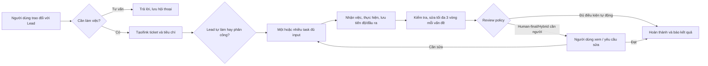

# Quy trình nghiệp vụ và hợp đồng thực thi

Thuộc [Factory V2](README.md). Đây là behavior contract để FE/BE/runtime không tự hiểu khác nhau. Project/workflow presets được sửa, còn ownership, quyền và bằng chứng do Host bảo đảm.

## 1. Vòng sử dụng chính



Không ép mọi hội thoại thành ticket và không tạo task chỉ để thông báo đang suy nghĩ. Khi người dùng thực sự giao việc, Host lưu intent/message trước, tạo/link ticket bằng command có idempotency key. Lead chỉ cần phát task đủ thực hiện; không bắt người dùng điền form kỹ thuật.

Lead được tự làm việc nhỏ, phân công phần cần chuyên môn/tool/context khác hoặc có lợi khi song song. Không gọi đội cố định BA→BE→FE→TEST cho mọi yêu cầu. Dự án có Lead và membership; vai trò là tên/capabilities, không phải quyền hardcode. Lead đổi kế hoạch trong scope thì giữ lịch sử và chỉ đánh dấu task/input bị ảnh hưởng stale; không restart toàn bộ.

## 2. Phân biệt ba loại yêu cầu với người dùng

| Loại | Ví dụ | UI và runtime xử lý |
|---|---|---|
| Execution grant | Đọc/sửa source, shell/build/test, công cụ đã enable trong workspace | Cấp trước ở project/environment; không phát Accept cho từng lệnh |
| Business decision | Chọn đối tượng video, thay yêu cầu mâu thuẫn, ngân sách chưa được cấp | Lead hỏi một câu rõ context/options/recommendation; trả lời trong chat hoặc card |
| Result review | Xem bản nháp, nghiệm thu phiên bản output | Card có preview/criteria/evidence; Accept/send-back theo policy |

Execution profile có `paths`, tools/jobs, network, caches/package directories, action scopes, concurrency/budget và effective adapter settings. Ghi rõ quyền thực tế; hỗ trợ profile tự động trong project và Full access trong environment được khai báo. Thiếu quyền hoặc managed policy không cho phép trả structured blocker `permission-configuration`, gom theo connection/project, **không** xếp hàng từng Bash request trong inbox. UI không tự click thay người dùng để che runtime misconfiguration.

Thao tác đã được giao/cấp quyền không xin lại. Publish/spend/ghi ngoài scope chỉ cần grant khi chưa có authorization; once granted, commands phục vụ cùng hành động theo scope được chạy tiếp. Full access không tự đổi credentials, cài root hoặc tắt policy quản trị. WSL chỉ giúp môi trường Linux nhất quán, không tự giải quyết permissions.

Business decision: `id`, câu hỏi, lựa chọn/khuyến nghị, context digest/version, task phụ thuộc, status pending/answered/superseded, answer/actor/time. Một decision hiện qua nhiều view nhưng chỉ có một writer/API và một unresolved count. Context thay đổi thì câu trả lời cũ không tự áp dụng; request mới trỏ lý do supersede. Chỉ giữ nhánh phụ thuộc ở trạng thái chờ, các nhánh khác tiếp tục.

Review policy:

- **Human-final:** task nội bộ có thể tự hoàn thành, ticket cuối chờ người dùng review; tương thích vòng Loops.
- **Automatic:** validators/evidence đủ và đúng version thì hoàn thành; model nói “xong” không phải validator.
- **Hybrid:** tự review việc nội bộ/đầu ra được cấu hình, chỉ các output/action đã chọn cần người dùng.

Review verdict gắn contract/output version và reviewer authority. Output mới hoặc criteria đổi thì verdict cũ không chứng minh bản mới. Không kéo cột Done để bypass gate; Host trả lý do và điều hướng đúng review.

## 3. Ticket, task và mô tả dễ hiểu

Ticket là hồ sơ yêu cầu người dùng; task/subtask là phần thực hiện có thể phân công. Dùng chung WorkItem model với parent/link; không giữ hai bản ticket và task độc lập phải đồng bộ tay. Board cho phép hiện tất cả task hoặc nhóm theo cha; owner/assignee luôn xem được, không giấu FE/BE/BA trong một dòng tổng.

Task tối thiểu:

| Trường | Nội dung có ích | Hiển thị |
|---|---|---|
| Mục tiêu | Kết quả cần đạt bằng một câu | Card và detail |
| Owner | Agent ID được chỉ định; trạng thái sẵn sàng | Avatar/tên và link Team |
| Input refs | Brief, thiết kế BA/API/schema/asset version, file scopes | Detail/Input, không raw UUID |
| Output contract | File/document/media/service nào, format và vị trí | Yêu cầu/Kết quả |
| Acceptance | Tiêu chí có thể kiểm, required validators/review | Checklist ngắn |
| Dependencies | Chờ task/output nào và lý do | Indicator trên card, đầy đủ ở Tiến độ |
| Scope/resources | Workspace/path, tool grants, concurrency/job resources | Chi tiết kỹ thuật |
| Status/reason | Business status + execution state + blocker | Nhãn chính và lý do rõ |

Ví dụ phân công cụ thể:

| Task | Input | Output / tiêu chí | Điều kiện chạy |
|---|---|---|---|
| BA-01 Làm rõ yêu cầu và dữ liệu | Brief + quyết định người dùng | Requirements v1, ERD/data dictionary v1, API contract v1; đủ fields/validation/error cases | Chạy trước khi FE/BE cần contract |
| FE-01 Trang danh sách và form | Contract v1 + UI reference | UI states, form validation, error/loading; check phù hợp | Song song BE sau BA-01 |
| BE-01 API và lưu dữ liệu | Contract/data model v1 | API/schema/migration, error cases; tests liên quan | Song song FE nếu không tranh file |
| INT-01 Tích hợp FE/BE | Hai output + commit refs | Tích hợp rõ source revision; conflict giải quyết | Chờ FE/BE cần tích hợp |
| QA-01 Kiểm luồng | Integrated revision + criteria | Pass/fail/not-run và evidence; bug task đúng owner | Chạy trên bản tích hợp |

Đây là template Software, tên/đội có thể khác. Nếu BA đổi contract v2 trong khi FE đang làm v1, Host đánh dấu dependency stale, Lead so tác động và giao phần sửa cần thiết. Người dùng luôn xem được BA docs tại Reports/Documents và task Input; không chỉ nằm trong model context hoặc SQLite log.

## 4. Giao tiếp và bàn giao giữa agent

Không dùng all-to-all chat như cơ chế điều phối. Lead gửi assignment/handoff có recipient/task/refs; thread bền vững gắn task là nơi hỏi đáp. Message types: assignment, progress, question, answer, handoff, result, blocker. Tin nhắn thường không tự nhận việc, restart task hoặc wake cả đội.

Handoff gồm: đã làm gì, output versions/paths/hashes, quyết định đã áp dụng, kiểm tra pass/fail/not-run, phần chưa làm, dependency/next owner. Không chuyển nguyên transcript dài mặc định. Context pack có brief/current criteria, required input revisions, relevant decisions, selected skill/tool snapshot và phần trao đổi cần thiết. Runtime đổi thì tạo run mới nhận context pack; không giả session Codex chuyển nguyên sang Claude.

Host cung cấp API/tool có schema cho agent: xem task/context, đề xuất/tạo task trong quyền, gửi câu hỏi/handoff, đăng ký output, báo blocker/tiến độ. Model không ghi SQL trực tiếp. Các tool mutation mang actor/run/attempt/scope và idempotency key; Host kiểm authority trước commit.

Native subagents chỉ bật khi adapter có khả năng quan sát/quy attribution/dừng phù hợp. Nếu chỉ nhìn được parent tổng thì UI nói rõ, không tự tạo child state giả. Không để native child phát sinh một scheduler/ownership thứ hai hoặc thoát grant cha.

## 5. Trạng thái độc lập và quyền chuyển trạng thái

| Đối tượng | Trạng thái chuẩn hóa | Ai quyết định |
|---|---|---|
| WorkItem | Theo project workflow; preset Backlog/Planned/In progress/Review/Done | Host transition service kiểm guards/criteria/review |
| Agent readiness | unconfigured/needs-auth/ready/offline/unknown | Capability/auth/health probe có freshness |
| Agent activity | idle/working/waiting/blocked | Projection từ owned runs/jobs/dependencies, không tự đoán từ câu chữ |
| Run attempt | queued/starting/running/waiting-input/stopping/succeeded/failed/interrupted | Host + adapter protocol/process evidence |
| Job | queued/running/cancelling/succeeded/failed/cancelled/interrupted | Job runner, artifact validation |
| Decision | pending/answered/superseded | Decision service, user/authorized actor |
| Review | pending/accepted/changes-requested/superseded | Review authority theo policy và đúng version |

Task bị blocked là một reason/condition, không nhất thiết thêm cột workflow. Custom workflow mapping xác định start/review/terminal categories để automation và UI hiểu nghĩa mà không hardcode tên tiếng Anh. Archive/park là disposition; archive không xóa source/history, park tạm không auto-dispatch. Sửa workflow đang có task cần preview mapping; không tự đổi task terminal thành running.

## 6. Chạy song song, retry và recovery

Một coordinator claim task bằng transaction/lease và attempt epoch. Adapter và job callbacks phải mang attempt identity; callback cũ bị fencing, không thể kết luận task sau run mới. Reserve concurrency/tài nguyên trước spawn, release/reconcile khi terminal. Unique keys ở DB bảo vệ command/message/event/schedule occurrence; không dựa mỗi UI disable button.

Hai task đủ input chạy đồng thời khi không tranh scope/file/resource/quota. Code dùng worktree/branch hoặc isolated workspace; integrate có owner riêng, không cùng hai agent ghi lên working tree chung. Directory/media jobs dùng output staging và publish atomic sau validate. Waiting-input không tự bị tính là failed; deadline lease và timeout execution là hai chuyện riêng.

Retry phân loại: network/protocol retry có thể có bounded backoff khi chưa phát sinh side effect; mutation không rõ kết quả phải reconcile. Tự sửa nội dung tối đa **ba vòng mỗi issue** với evidence và budget; hết vòng báo lý do và việc cần làm tiếp, không tự reset counter bằng cách tạo issue giống hệt. Quota/auth/permission errors không retry liên tục.

Stop gửi interrupt/cancel theo capability, chờ grace period, kill đúng process tree do Host sở hữu nếu cần; tránh kill theo tên chung. Không đánh “Stopped” trước khi có kết quả quá trình thực tế. Crash/WSL shutdown: đánh interrupted, kiểm process/session/output, không replay hành động chỉ vì thiếu phản hồi. Không tuyên bố exactly-once cho mọi external effect; dùng idempotency/reconciliation nơi được hỗ trợ, unknown outcome yêu cầu xử lý đúng ngữ cảnh.

## 7. Automation và schedule kiểu Loops

Rule model duy nhất: `id/projectId/revision/name/lifecycle/enabled`, typed `trigger`, `conditions[]`, `actions[]`, targets, policy scope, limits và `graphLayout`. States Draft chưa đủ cấu hình; Proposed là đề xuất chưa active; On/Off là cấu hình hợp lệ enabled/disabled. UI không dùng một trường state để thay version/validation. Project master switch Off ngăn evaluate/dispatch mới nhưng không đổi từng rule; đang chạy tiếp/dừng theo lựa chọn rõ.

Triggers local đợt đầu: work.created, work.transitioned, label.changed, assignment.changed, output.registered, review.requested/completed, schedule.due, job.finished. Conditions thuần: workflow category/label/type/assignee/field/output/review facts. AI classification là task/output riêng rồi phát event, không gọi model ẩn trong predicate. Actions qua typed commands: assign, add/remove label, transition, create task/subtask, request review/decision, invoke enabled job/template, create/update report. Không cho nhập arbitrary JavaScript predicate chạy trong Host.

```text
Event + causation/root ID
  → snapshot revision + evaluate project/rule switches
  → match conditions + explain/simulate
  → validate grant/targets/guards/resources
  → enqueue commands cùng coordinator
  → commit result/outbox + rule trace
```

Graph thể hiện Moment/Who/Label và edges như reference, nhưng serialize về cùng rules với List. Node tọa độ/zoom không là business change; sửa trigger/action là revision mới. Unsupported construct bị báo rõ, không âm thầm mất dữ liệu khi đổi view. Simulation không phát side effect; history giải thích đã match/skip/fail, input snapshot và actions.

Chống lặp: event/root causation, idempotency action key, hop/action budget, debounce phù hợp, no-op transition không phát vòng mới, cycle detection và quarantine rule lặp. Conflict cùng field/assignee có deterministic order/priority; không giải bằng hai agent chạy tranh rồi UI lấy kết quả cuối. Rule không tự tăng grant/budget hoặc vượt human-final review. Proposed không tự thành On trừ policy đã cấp cho người tạo rule.

Lịch: timezone IANA, definition revision, next occurrence, misfire skip mặc định hoặc coalesce một lần; `scheduleId+revision+occurrenceUTC` làm key. Tắt/bật không chạy bù mọi slot. History lưu started/skipped/coalesced/failed và reason; restart/reconnect không tạo duplicate ticket/report. Người dùng mô tả lịch bằng Chat hoặc form đều tạo cùng record. Scheduler không gọi model để thăm dò mỗi phút; chỉ wake khi có occurrence/event.

## 8. Skills, tools, model và đa lĩnh vực

Skill registry tương thích SKILL.md, source URL/path, pinned commit/version/hash/license, description, files, requested capabilities. Import preview trước, không thực thi script repo chỉ vì đã đọc README. Gắn agent/project và materialize snapshot theo run; nâng version không thay instruction đang chạy. Skill gợi ý cách làm, không tự cấp filesystem/network/tool authority.

Tool registry tách MCP server và CLI recipe: executable/argv/env references/working directory/capabilities/health/schema/version, install recipe được xem xét. Runtime cần có discovery test và tool thật dùng được; `mcp: {}` hoặc một badge “Connected” chưa đủ. Secrets qua refs riêng, export bỏ secrets. MCP/skill chỉ được truy cập theo grant và source trust; external instructions không nâng quyền Host.

Agent config chọn connection/runtime/model hỗ trợ, prompt, skill/tool versions và defaults. Model discovery/probe có cache/freshness; provider model ID không đổi bằng label đẹp. 9Router là connection tùy chọn, DeepSeek Flash được dùng nếu route/model đã probe tương thích, không ép ba runtimes cùng đi qua endpoint chưa xác minh. Fallback chỉ theo policy đã cấp; quota cạn không tự đổi model đắt hơn.

Domain pack là preset có revision, gồm ticket/workflow/custom fields/output contracts/tools/validators/rules. Không tạo engine khác cho từng domain:

| Pack | Đầu ra cần xem được | Công cụ thực tế |
|---|---|---|
| Software | Requirements, data/API docs, source/commit, checks | Git/build/test runtimes |
| Research & Planning | Báo cáo có nguồn, plan, decision records | Search/fetch đã kết nối, document tools |
| Content | Brief, outline, draft, phiên bản cuối | Text/document/media tools phù hợp |
| Design | Brief, asset specs, ảnh/SVG/tài liệu thiết kế | Tool đã cài/kết nối; không hứa tự có image generator |
| Video Basic | Storyboard, assets, subtitle, preview/export | FFmpeg/ffprobe theo recipe, input hợp lệ |

Job render/encode chạy độc lập agent turn; agent có thể rảnh trong khi job còn chạy. Job có progress thực (unknown nếu không đo được), resource requirements, staging/final paths, logs thu gọn. Validate file/codec/duration/content theo contract trước publish output. Disk full/cancel/crash không đánh output hoàn chỉnh; GPU/encoder chưa probe thì không quảng cáo tăng tốc.

## 9. Mô hình dữ liệu và API đề xuất

Tên logic, chốt schema/indexes bằng ADR F0; không phải lệnh migrate DB V1:

| Nhóm | Entities / invariant |
|---|---|
| Setup | HostEnvironment, RuntimeConnection, CapabilityProbe, CredentialRef, ExecutionProfile |
| Đội/dự án | AgentDefinition, Project, ProjectMembership, ProjectType/TemplateRevision, Goal tùy chọn |
| Công việc | WorkItem(parentId), Dependency, WorkflowRevision, FieldDefinition, InputRef, CompletionContractRevision |
| Hội thoại | Conversation, Message, TaskThread, DecisionRecord, HandoffEnvelope |
| Thực thi | Assignment, RunAttempt, Lease/Reservation, RuntimeSessionRef, Job, ResourceUsage |
| Kết quả | Document, DocumentRevision, OutputVersion, AssetRef, Evidence, Assessment, Review |
| Tự động | RuleRevision, RuleEvaluation/ActionTrace, GraphLayout, ScheduleRevision, Occurrence |
| Tin cậy | CommandReceipt, Inbox/Outbox, EventLog, ProjectionCursor, MigrationLedger |

API command families: `projects.create/update`, `agents.configure`, `chat.send/stop`, `work.create/assign/transition`, `decisions.answer`, `reviews.submit`, `runs.cancel/reconcile`, `outputs.register`, `rules.simulate/publish/toggle`, `schedules.save/toggle`, `extensions.import/bind`. Mutations có `commandId`, expected revision khi cập nhật, actor/session, project scope; trả receipt/result/errors. Errors phân biệt validation/conflict/needs-auth/permission-configuration/resource-exhausted/runtime-unavailable/outcome-unknown.

Queries lấy projection paginated/filter/sort có stable cursor và freshness, không fan-out probe mỗi agent khi mở Dashboard. Event stream có `eventId`, project/entity/version, cursor; reconnect replay từ cursor hoặc refresh snapshot nếu retention đã hết. UI dedup, gap detection, không append lặp sau reconnect. API version và DTO schema chung giữa UI/Host/adapters; không gửi raw SQL hoặc secrets.

## 10. Chất lượng, hoạt động và bảo toàn dữ liệu

User activity chỉ phát mốc meaningful: assigned/started/decision/blocker/output/review/completed. Raw tool events lưu có giới hạn và mở theo run khi cần; không đẩy vào feed/counter unread như tin người dùng. Retention tách evidence cần giữ với debug logs, archive không xóa artifacts còn được tham chiếu.

Cost/usage có known/pending/unknown, session cumulative tính delta tránh đếm hai lần. Admission theo concurrency/token/time/disk và budget cung cấp; không hứa dollar hard cap khi provider chưa báo giá/usage kịp. Log che secrets, lỗi kết nối có correlation IDs để chẩn đoán, người dùng đọc reason và next action thay vì stack trace.

Migration V1: backup nhất quán, import vào state directory V2 riêng, mapping IDs/roles→agent definitions và history/output provenance, dry-run summary, hashes/counts và rollback. Imported tasks mặc định historical/paused, không tự dispatch lại. Không overwrite DB AppData, không chia sẻ WAL writable hoặc tự copy toàn bộ credentials home. V1 giữ dùng được cho đến khi nghiệm thu bản chuyển.
