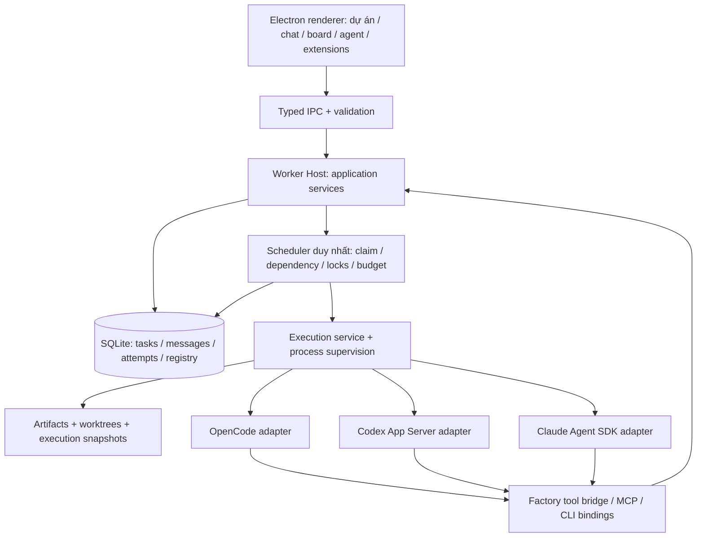

# Worker V2 — Kiến trúc và giao thức công việc

Trạng thái: thiết kế đề xuất, chưa phải API/schema đã triển khai. Đọc [phạm vi](README.md), [nghiên cứu](research.md) và [kế hoạch triển khai](implementation.md).

Mở rộng đa lĩnh vực: [multidomain.md](multidomain.md) quy định goals, domain packs, workspace không Git, media assets, jobs, resource/budget admission và review. Các phần source/Git/FE/BE bên dưới chỉ áp dụng cho workflow phần mềm; không phải precondition cho mọi task.

## 1. Ranh giới hệ thống



Scheduler sở hữu task state và quyết định chạy. Adapter sở hữu protocol runtime; model không được ghi trực tiếp DB. Tool bridge kiểm tra token/attempt rồi gọi application service. Renderer dùng projection đã chuẩn hóa, không suy diễn “đang chạy” từ chuỗi log.

Đề xuất module trong `apps/windows-worker/electron/`: `agents/`, `runtimes/`, `execution/`, `scheduler/`, `messaging/`, `extensions/`, `artifacts/`. Có thể giữ đường dẫn cũ khi refactor từng phần; không tạo các service tương đương song song với controller hiện có. Chưa tách thành server hoặc workspace package mới khi chưa cần.

## 2. Những thực thể cần tách riêng

| Thực thể | Nội dung chính | Quy tắc |
|---|---|---|
| RuntimeConnection | adapterId, executable/version, provider/model catalog, authRef, config/capabilities | Một adapter có nhiều connection; authRef trỏ kho credentials, không chứa secret |
| AgentDefinition | UUID, name, roleLabel/tags, instructions, connectionId, model selection, policy, skill/tool bindings, enabled | Role là nhãn tự do; sửa cấu hình không đổi snapshot của lượt đang chạy |
| ProjectMembership | projectId, agentId, lead/member, overrides | Dự án bật tự động có đúng một Lead được chọn; không bắt buộc bảy thành viên |
| Task / TaskRevision | yêu cầu, assigneeId, acceptance, scope, dependencies, expected outputs, priority | Revision bất biến; thay yêu cầu đang chạy phải tạo revision và đối chiếu kết quả cũ |
| ExecutionAttempt | task revision, agent snapshot, sessionRef, epoch, process owner, source/contract hashes | Một attempt chỉ ghi kết quả cho revision và claim của chính nó |
| RuntimeSession | connection + agent + project/task + provider + context fingerprint, native sessionId | Không resume xuyên runtime/provider; không dùng chung session cho hai attempt đồng thời |
| AgentMessage / Outbox / Delivery | sender/recipient, task, type, correlation, content/artifact refs, trạng thái | Ghi bền vững, idempotency; delivery không đồng nghĩa task hoàn thành |
| ArtifactVersion | loại, tên, body/file hash, author task, version, supersedes, source base | Thiết kế BA không bị giới hạn vào summary; consumer dùng version cụ thể |
| ExtensionPackage / ToolBinding | nguồn/commit/hash/license, trạng thái, manifest, config refs, quyền | Cài package khác với cho phép agent sử dụng; credentials không nằm trong package |

Có thể tiếp tục dùng bảng work/revision/task/attempt hiện có; tên ở trên mô tả mô hình logic, không yêu cầu tạo mọi bảng từ đầu. Mỗi bước migration phải ghi mapping rõ.

## 3. Runtime adapter

Contract phác thảo, không dùng nguyên mẫu này như API đã ổn định:

```ts
interface RuntimeAdapter {
  id: string;
  probe(config: ConnectionConfig): Promise<RuntimeProbe>;
  listModels(config: ConnectionConfig): Promise<ModelCatalog>;
  start(input: ExecutionInput, sink: EventSink): Promise<ExecutionHandle>;
  resume(input: ResumeInput, sink: EventSink): Promise<ExecutionHandle>;
}

interface ExecutionHandle {
  send(message: AgentInput): Promise<SendResult>; // chỉ khi capability hỗ trợ
  interrupt(): Promise<StopResult>;
  stop(): Promise<StopResult>;
  completion: Promise<ExecutionResult>;
}
```

`RuntimeProbe` trả version, auth readiness không lộ secret, capabilities và compatibility errors. Capability phải phân biệt `supported`, `unsupported`, `unverified`: models discovery, resume, live input, interrupt, skills, MCP, structured output, usage, policy enforcement. Model catalog có thể là danh sách do runtime cung cấp hoặc cấu hình tường minh có nhãn nguồn; không giả danh sách đó đã được provider xác nhận.

`ExecutionInput` chứa task/revision/attempt, immutable agent snapshot, workspace binding (worktree khi là code), input artifact fingerprints, source fingerprint khi có, tool grants và budget/deadline. `ResumeInput` kiểm tra lại runtime/provider/config fingerprint; thay policy/skill/tool config không tương thích thì tạo session mới với context bàn giao. Không tự đổi model hoặc runtime khi lỗi.

Event chung gồm: session started, text delta, tool started/completed, artifact reported, usage checkpoint, progress, question, error, terminal. Giữ native metadata cần chẩn đoán trong log có redaction; không cố chuyển mọi event thành nội dung Chat. Chi phí không biết hiển thị `unknown`; usage cumulative phải tính delta theo session/checkpoint.

### Adapter cụ thể

| Runtime | Cách tích hợp | Điều phải làm rõ |
|---|---|---|
| OpenCode | Bọc runtime hiện tại, giữ model proxy khi connection dùng 9Router | Tách config ra khỏi global settings; kiểm tra MCP/skills ở đúng bản hỗ trợ; không bật native delegation |
| Codex | App Server chính thức qua stdio JSONL, handshake rồi thread/turn/interrupt | Pin protocol theo bản CLI đã probe; không dùng WebSocket experimental hoặc dynamic tools làm nền bắt buộc |
| Claude Code | Ưu tiên TS Agent SDK trong process riêng; CLI stream-json là lựa chọn thay thế được kiểm chứng | SDK auth mặc định qua API key; không hứa dùng claude.ai subscription cho sản phẩm bên thứ ba; hook/tool policy phải kiểm tra cả autoallow |

Version allowlist/range được bổ sung bằng test adapter, không dựa vào so sánh chuỗi version đơn giản. Không tự tải CLI ngoài ý muốn người dùng. UI phát hiện thiếu CLI/auth và hướng dẫn đúng connection; agent khác vẫn dùng được.

Process supervision giữ ownership riêng cho từng attempt, hỗ trợ Windows process tree/job mechanism sau khi kiểm chứng. Dừng gồm interrupt → thời gian chờ hữu hạn → kết thúc cây process do Worker sở hữu. Không kill theo tên executable toàn máy. Session ngoài app chỉ `observed`, không có quyền điều khiển trừ khi có cơ chế attach đã xác minh.

## 4. Agent tự do và lựa chọn model

Agent mẫu “Analyst” có thể dùng Claude, nhãn `analysis`, quyền đọc source và xuất artifact; “API” dùng OpenCode và quyền ghi backend; “UI” dùng Codex và quyền ghi frontend. Có thể đổi tên/nhân bản hoặc dùng cùng agent cho nhiều dự án. Không còn kiểm tra `role === 'ba'` để quyết định quyền.

Lead lập kế hoạch dựa trên agent đang được gắn dự án, năng lực khai báo, trạng thái connection, model tương thích, phạm vi file và ngân sách. Capability khai báo là khả năng dự kiến, không bằng chứng agent sẽ hoàn thành tốt. Task nêu tiêu chí nghiệm thu và evidence cần có; agent không phù hợp trả lý do, không tự nhận mọi việc.

Đổi connection/model mặc định chỉ áp dụng lượt mới. Session cũ giữ snapshot, provider và native session ID. Resume cùng task không có nghĩa tiếp tục được trên runtime khác; chuyển runtime phải tạo attempt mới và đính kèm context/outputs đã có.

## 5. Skills và tools

### Skill lifecycle

```text
Thư mục hoặc Git URL + subdirectory + revision
  → đọc metadata/nội dung/giấy phép
  → snapshot commit + hash
  → kiểm tra đường dẫn, symlink, kích thước và cấu trúc
  → Installed (chưa được agent dùng)
  → binding agent/project
  → snapshot theo attempt → materialize theo adapter
```

Format ưu tiên Agent Skills `SKILL.md`, hỗ trợ references/assets/scripts. Chỉ index mô tả trước; nạp nội dung liên quan khi dùng để tránh phình context. `allowed-tools` trong skill không cấp quyền thực thi. Một script đi kèm là code/tool chịu policy và môi trường như các script khác.

Cập nhật là một version mới có diff; không tự theo `main`. Disable gỡ binding cho lượt mới; rollback chọn snapshot cũ. Đổi role label không làm mất skill. Runtime không hỗ trợ skill native có thể nhận nội dung qua context adapter, nhưng UI ghi rõ chế độ tương thích và không hứa auto-discovery tương đương native.

### Ba loại tool trong 2.0

1. **Factory tools**: lấy task/context, gửi câu hỏi/tin nhắn, đăng artifact, báo tiến độ/kết quả. Bridge kiểm tra scope phía host; không tin ID task do model tự khai.
2. **MCP server**: stdio hoặc endpoint HTTP, namespace riêng, schema/capability discovery, config/auth refs, timeout và trạng thái connection.
3. **CLI/command tool**: executable + argv/env schema + cwd + platform requirements + exit/output contract. Không nối dữ liệu người dùng thành shell string tùy ý.

URL repository chỉ là nguồn. Gói chưa có manifest phải khai báo loại tool, lệnh cài/chạy, dependencies, giấy phép và Windows support trước khi Enabled. Installer/script lấy từ ngoài phải được xem xét và được người dùng chủ động cho phép ở cấp package; không kéo theo nút Accept cho từng Bash khi agent làm task. Version update không tự chạy hook/install script mới.

Không nạp JavaScript plugin tùy ý vào Electron main. Tool process được quản lý riêng; MCP server lỗi không được làm chết host. Credentials giới hạn theo connection/tool binding, không đưa toàn bộ biến môi trường hay file auth vào mọi process.

### Bộ quyền

Profile gợi ý: `Read & analyze`, `Build in workspace`, `Full access`. Người dùng có thể chỉnh các capability: đọc/ghi phạm vi source, shell, network, tool bindings, artifact publish. Trong Full access, các quyền được cấp trước nên không hỏi từng lệnh; quyền ngoài phạm vi chưa được cấp trả lỗi có lý do. Lệnh cấm không được đổi thành allow chỉ vì runtime không hiểu policy.

UI phải ghi rõ mức thực thi: kiểm soát tại bridge, hook/runtime hay OS sandbox. Worktree/phạm vi application không phải OS sandbox; CLI có thể đọc ngoài workspace nếu không có lớp cô lập tương ứng. Full access không phải lời hứa cách ly filesystem. Những policy adapter không enforce được phải bị chặn chọn hoặc hiện giới hạn trước khi bật, không lặng lẽ hạ mức bảo vệ.

## 6. Giao thức giữa agent

Một task thread có các loại message: `assignment`, `question`, `answer`, `contract-published`, `change-request`, `review-request`, `finding`, `handoff`, `completion`. Progress là event để tránh nhét mọi heartbeat vào hội thoại. Completion message chỉ là yêu cầu kiểm tra kết quả, chưa đủ đổi task thành Done.

Ví dụ envelope:

```json
{
  "version": 1,
  "messageId": "msg-uuid",
  "idempotencyKey": "attempt-uuid:handoff:1",
  "correlationId": "thread-uuid",
  "causationId": "assignment-message-uuid",
  "replyTo": null,
  "projectId": "project-uuid",
  "taskId": "task-uuid",
  "taskRevision": 2,
  "attemptId": "attempt-uuid",
  "claimEpoch": 4,
  "fromAgentId": "api-agent-uuid",
  "toAgentId": "ui-agent-uuid",
  "type": "handoff",
  "body": "API đã tích hợp; dùng contract đính kèm.",
  "artifactRefs": [{ "id": "api-contract", "version": 3, "sha256": "hash" }],
  "createdAt": "2026-11-05T08:00:00Z"
}
```

Các ID/giá trị trên chỉ minh họa. Host xác thực sender từ token attempt, kiểm tra project/member/task và tính hợp lệ của loại payload; không chấp nhận envelope giả danh agent khác. Token chỉ cho phép cập nhật tiến độ, trao đổi và xuất artifact trong scope đã giao, không cho phép tự cấp tool hoặc đổi quyền.

Message + outbox ghi trong cùng SQLite transaction với thay đổi task liên quan. Delivery có thể lặp sau crash; consumer dedup theo key và ghi ack bền vững. Phân biệt `accepted`, `delivered`, `acknowledged`; không tuyên bố exactly-once cho tác dụng ngoài DB. Claim được scheduler cấp trước khi start, process start không nằm trong transaction DB nên có bước reconcile theo ownership marker. Nếu không xác định được lần chạy cũ đã tạo tác dụng gì, dừng ở trạng thái cần đối chiếu, không tự chạy lại.

Agent trả lời trực tiếp agent khác theo task thread, nhưng không tự dispatch một cây agent mới. Lead/scheduler kiểm soát giao việc và chuyển trạng thái. Giới hạn số vòng trao đổi/sửa, budget, deadline và số message để tránh vòng lặp; mặc định tối đa ba vòng sửa tự động cho một issue, sau đó đưa câu hỏi cụ thể vào Cần xử lý.

## 7. Scheduler, concurrency và source

Task state: `backlog → ready → running → review → done`; nhánh `waiting`, `blocked`, `failed`, `cancelled`. Các reason code chi tiết gồm dependency, contract, file lock, runtime offline, quota, question, integration conflict. Board có thể gom các state thành cột dễ đọc nhưng không thay đổi state machine ở client.

Một task chỉ ready khi assignee khả dụng, dependency/input contract thỏa, source đã sẵn sàng nếu cần Git, quyền hợp lệ và đủ resource/budget slot. Scheduler thực hiện claim nguyên tử với owner/lease/epoch; completion cần đúng epoch/revision/attempt. Lease hết hạn chưa đủ để chạy lại: phải đối chiếu process/job trước. Cancel/reassign tăng epoch và ngăn kết quả cũ ghi đè; terminal state chỉ được xác nhận sau khi xử lý ownership/process. Job render/compute có lifecycle riêng và đánh thức task bằng sự kiện khi xong.

Giới hạn đồng thời theo global/project/agent/connection/account và file scopes. Default gợi ý hai writer độc lập; mọi process Lead/reader/tool vẫn có budget, không mặc định vô hạn. Giới hạn dựa trên phép đo CPU/RAM/quota thực tế, không cam kết theo cấu hình VM cũ.

- Code writer có worktree riêng từ source base đã định; dependencies chỉ code-ready khi source cần thiết đã tích hợp.
- Một integration writer cho mỗi project branch. Scope khác nhau không bảo đảm hết conflict; integration conflict giữ patch và trả task sửa phù hợp.
- BA có thể xuất artifact không cần commit source. FE/BE cùng nhận contract version xác định rồi chạy song song nếu phạm vi tương thích.
- TEST chạy trên source tích hợp cụ thể; không dispatch chỉ vì các role FE/BE đã trả lời “xong”. Rule dựa task inputs/outputs, không theo tên role.
- Native subagents của runtime tắt trong 2.0 để tránh nguồn điều phối thứ hai; khả năng quan sát/import native subagents là nghiên cứu sau.

Recovery phân loại: lỗi bootstrap có bằng chứng chưa bắt đầu thì retry có giới hạn; quota/auth/config thì chờ khắc phục; mất kết nối sau khi tool đã chạy thì đối chiếu hoặc resume hợp lệ, không replay tự động. Stop/cancel không được tự kích hoạt restart.

## 8. Artifact và handoff

Artifact chuẩn gồm tài liệu (requirement, data model, ERD/Mermaid, contract, decision), code (patch/commit, test report), ảnh/âm thanh/video/dữ liệu và review. Nội dung bất biến theo version, lưu file trong data directory có hash và index SQLite; DB có thể lưu body nhỏ. Media binary/proxy không đưa nguyên khối qua IPC. Không tự đưa mọi artifact vào source repo; người dùng có thể xem/xuất, và chỉ ghi vào workspace khi task yêu cầu. Deliverable và review decision gắn đúng version, tiêu chí theo loại đầu ra như thiết kế mở rộng.

Handoff tối thiểu có: kết quả, artifact refs, source/commit fingerprint, acceptance evidence, việc chưa xong, blocker và bước đề nghị tiếp theo. Consumer tải nội dung cần dùng, không chỉ nhận một summary có giới hạn ký tự.

Contract thay đổi tạo version mới, đánh dấu các consumer bị ảnh hưởng là stale và yêu cầu Lead xác nhận kế hoạch sửa tương ứng. Không âm thầm đổi input của attempt đang chạy. UI cho thấy “đang dùng v2; hiện có v3”, diff và task liên quan.

## 9. Chuyển đổi từ V1

1. Backup nhất quán SQLite và artifact/config cần thiết bằng cơ chế backup/checkpoint hoặc khi app đã dừng ghi; không copy riêng file DB trong lúc WAL còn thay đổi. Backup không xuất plaintext secrets.
2. Schema additive: tạo connection từ settings hiện tại; bảy role thành bảy AgentDefinition mặc định; map ID giữ lịch sử/snapshot. Lead cũ thành membership mặc định, không mất lịch.
3. Feature flag V2 theo project; chỉ một execution backend được quyền chạy task. Shadow chỉ đọc/projection, không double dispatch.
4. Cấu hình runtime/proxy được chuyển thành connection phù hợp. Giữ lịch sử V1 read-only qua reader tương thích; không tự replay task cũ hoặc migrate native session sang runtime khác.
5. Kiểm tra counts, IDs, artifact hashes và hiển thị trước cutover. Task đang chạy phải drain/stop có xác nhận outcome trước chuyển backend.
6. Rollback bằng executable phù hợp với **snapshot trước migration**; không mở DB V2 đã ghi bằng app V1. Dữ liệu mới sau cutover cần export/reconcile riêng trước rollback. UI phải nêu rõ giới hạn này.

Cleanup code legacy chỉ sau nghiệm thu parity và migration; không xóa lịch sử, report người dùng hoặc package cũ trước khi biết còn tham chiếu.
